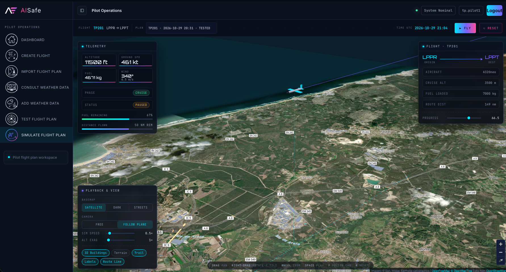
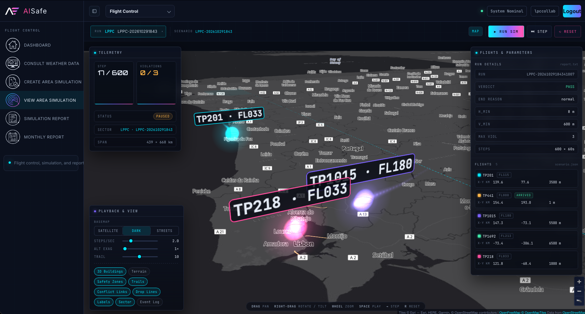
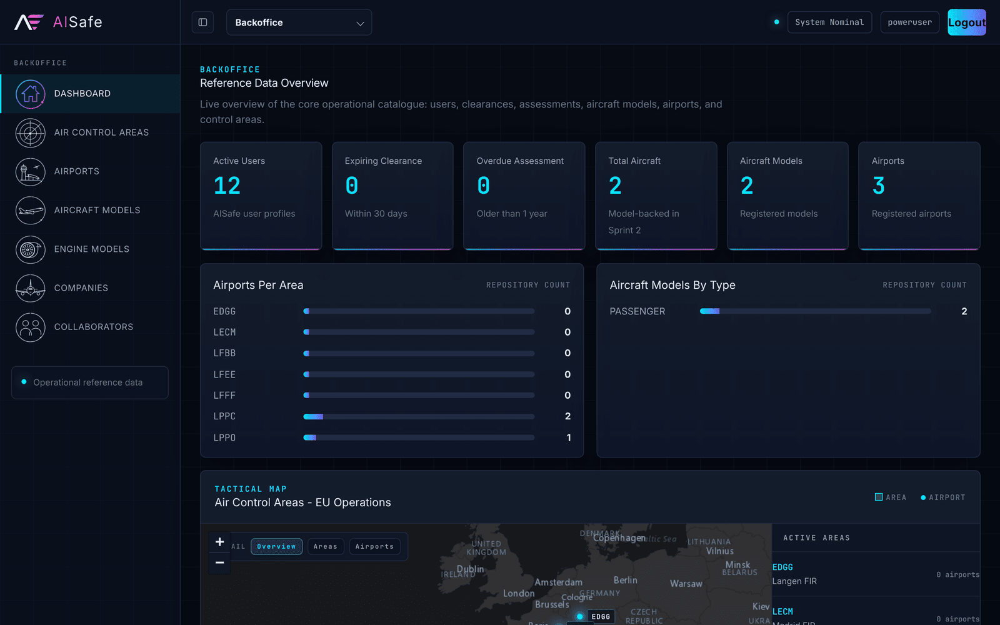
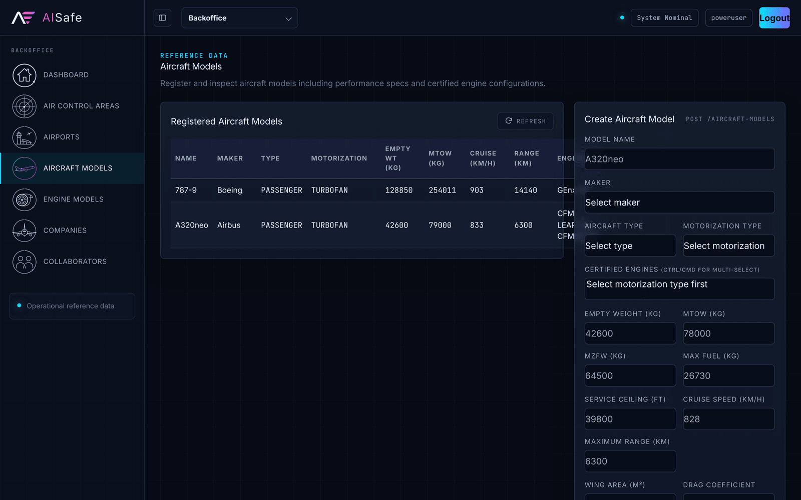
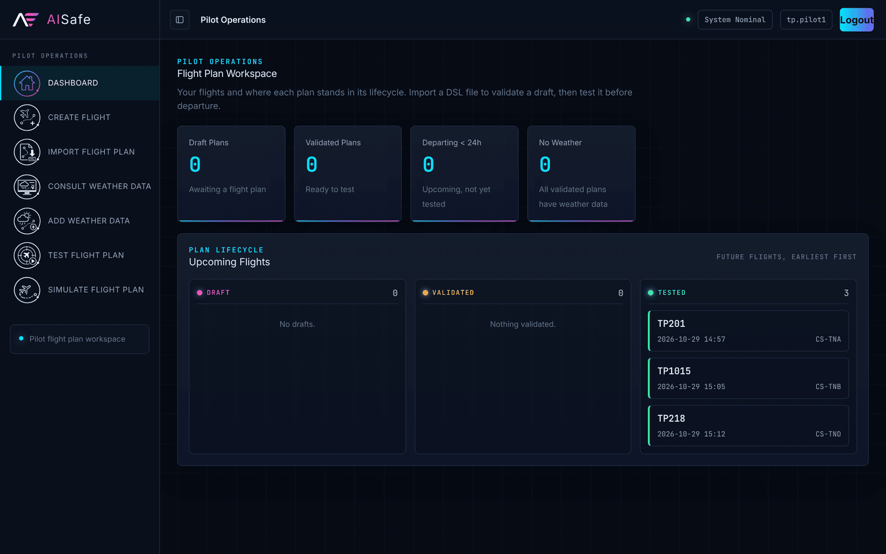
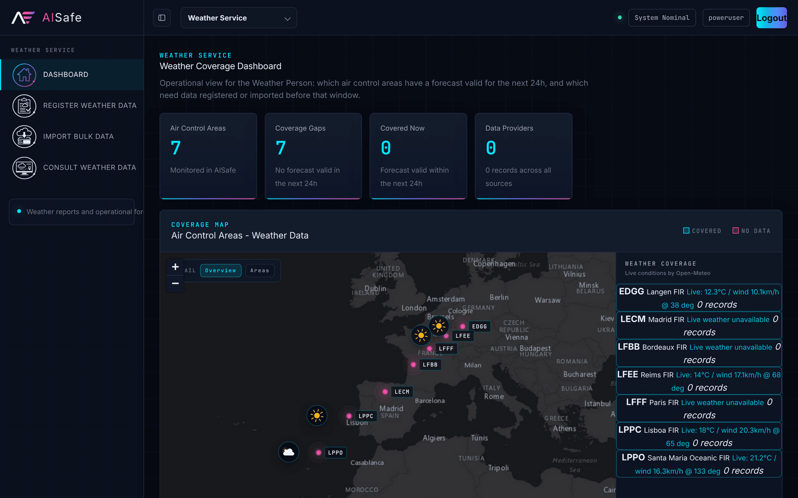
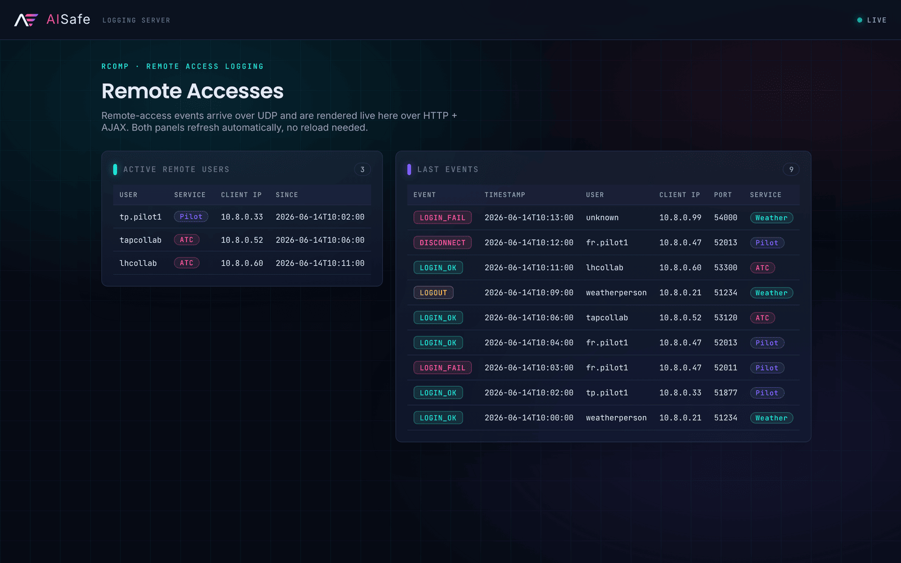

<div align="center">

# AISafe

**Air traffic control and flight simulation: from flight-plan language to airspace simulation.**

Java 21 · Domain-Driven Design · JPA · ANTLR4 · Spring Boot + HTMX · TCP/UDP sockets · C (POSIX processes, threads, shared memory)



</div>

## About

AISafe is the integrative project from the 4th semester of the Informatics Engineering degree (LEI) at [ISEP](https://www.isep.ipp.pt/), academic year 2025/2026. A team of five built it over three sprints, following a Product Owner's requirements.

The client was a fictional air-safety authority that needed a prototype for managing European airspace. Five courses fed into one system:

- **A domain-driven core** (Java, eapli.framework) covering 16 bounded contexts: users and clearances, airports, air control areas, aircraft and engine models, airlines and fleets, routes, pilots, flights, flight plans, weather and reporting. Each actor gets its own console app.
- **A flight-plan language.** Pilots write plans in a custom DSL, compiled by an ANTLR4 lexer and parser, a listener, a visitor and a semantic validator.
- **Networked remote access** over TCP for pilots, airline staff and weather staff, plus a UDP logging server with a live web viewer.
- **An airspace simulator in C**: one process per flight, with threads, shared memory, semaphores and condition variables to detect separation violations step by step. The Java side then ingests its reports.
- **A web interface** (Spring Boot + HTMX) built as a second adapter over the same core, with maps and a 3D flight-plan simulator in the browser.



## Engineering highlights

- **Ports and adapters.** One Java 21 core drives seven front ends: six console apps and a Spring Boot web app. All of them call the same use-case controllers, and dependencies point inward, so the core has no knowledge of Spring, HTTP or the console.
- **Persistence.** JPA with Hibernate, switchable to in-memory repositories through configuration. Optimistic locking (`@Version`) on 16 aggregates detects conflicting concurrent updates.
- **Testing.** About 1,270 JUnit tests. Dependencies are replaced with hand-written in-memory fakes rather than mocks, and each user story maps its tests to its acceptance criteria. Domain and controller code targets ≥90% coverage (JaCoCo), and CI runs the suite on every push.
- **Concurrency.** The C simulator runs one process per flight and coordinates them through POSIX shared memory, named semaphores, mutexes and condition variables, advancing in strict lockstep. On the Java side, the TCP servers handle each client on its own thread.
- **Networking.** Custom TCP protocols with authentication for three kinds of remote client, and a UDP event stream to a logging server with a live HTTP viewer.
- **Language tooling.** A flight-plan DSL built with ANTLR4: lexer, parser, listener, visitor and a semantic validator that reports rule-coded errors with line and column.
- **Cross-language integration.** Java builds a JSON scenario, runs the C simulator as a separate process and reads its report back into the domain.

## Run it

**Requirements**

- **JDK 21.** Maven is not required; `aisafe/` includes the Maven wrapper.
- **C toolchain**, only for the airspace simulator.
- **About 1.1 GB of free disk space.** The repository is about 25 MB, but the build output takes about 780 MB, and the first build downloads about 300 MB of dependencies into `~/.m2` (this needs an internet connection).

| | Windows | macOS | Linux |
|---|---|---|---|
| **JDK 21** | [Temurin 21](https://adoptium.net/temurin/releases/?version=21) installer | `brew install --cask temurin@21` | `sudo apt install openjdk-21-jdk` |
| **C toolchain** | use [WSL](https://learn.microsoft.com/windows/wsl/install) | `xcode-select --install` | `sudo apt install build-essential` |

> **Note:** During the course, the system used a remote database hosted on university servers. That server is no longer available, so this version uses an embedded H2 database stored in your home folder (`~/aisafe-demo.mv.db`). No database setup is needed.

### 1. Build and load the demo data

| Windows (cmd / PowerShell) | macOS / Linux |
|---|---|
| `cd aisafe`<br>`mvnw.cmd install -DskipTests "-Dmaven.javadoc.skip=true"`<br>`run-bootstrap.bat` | `cd aisafe`<br>`./mvnw install -DskipTests -Dmaven.javadoc.skip=true`<br>`./run-bootstrap.sh` |

The bootstrapper creates users, airports, air control areas, aircraft, airlines, routes, pilots, flights with tested flight plans, and simulation runs. To start again from scratch, delete `~/aisafe-demo.mv.db` and run it again.

### 2. Open the web app

| Windows | macOS / Linux |
|---|---|
| `cd aisafeweb`<br>`..\aisafe\mvnw.cmd -f pom.xml spring-boot:run` | `cd aisafeweb`<br>`../aisafe/mvnw -f pom.xml spring-boot:run` |

Go to **http://localhost:8081**. Demo accounts:

| User | Password | Sees |
|---|---|---|
| `poweruser` | `poweruserA1` | every module |
| `admin` | `Password1` | back office (reference data) |
| `tp.pilot1` | `Password1` | pilot workspace with three tested flight plans, ready to simulate |
| `tapcollab` | `Password1` | TAP Air Portugal: fleet and routes |
| `weatherperson` | `Password1` | weather service |
| `lpccollab` | `Password1` | flight control (Lisbon area) |

The maps load tiles from Esri, OpenFreeMap and OpenStreetMap, so they need an internet connection.

To run area simulations as Flight Control, compile the simulator before starting the web app: `cd scomp/sprint-3/flight_sim && make` (macOS, Linux or WSL). The demo flights depart about two hours after you run the bootstrapper and only appear as candidates until then; run it again to reschedule them.

### 3. Run the tests

```bash
cd aisafe
./mvnw test          # Windows: mvnw.cmd test
```

There are about 1,270 JUnit tests (JUnit 4 and 5). JaCoCo coverage reports go to each module's `target/site/jacoco/`.

<details>
<summary><b>Console apps, the DSL compiler, the log server and the C simulator</b></summary>

**Console apps.** There's one per actor. Run them from `aisafe/` after step 1 (use the `.bat` version on Windows):

```bash
./run-admin.sh  ./run-backoffice.sh  ./run-atcc.sh  ./run-pilot.sh  ./run-fco.sh  ./run-weather.sh
```

**Flight-plan DSL compiler.** Validate any `.flight` file:

```bash
java -jar aisafe/aisafe.flightplandsl/target/aisafe.flightplandsl-1.0.0-SNAPSHOT-cli.jar docs/sprint-3/samples/FR401-OPO-LIS.flight
```

**Remote-access log server.** It receives UDP on 9090 and serves a live viewer on http://localhost:8090:

```bash
cd aisafe && ./run-logserver.sh
```

**Airspace simulator** (C, Linux/macOS/WSL):

```bash
cd scomp/sprint-3/flight_sim
make && make test          # unit and scenario tests (US105–US110)
make run-violation         # three flights, one pair breaks separation
```

</details>

## A quick tour

**Back office.** Reference data, with live counts and the European air control areas on a map. Every form validates against the domain rules (for example, ICAO/IATA codes and coordinates that must fall inside the area).

| Dashboard | Aircraft models |
|---|---|
|  |  |

**Pilot: from DSL to flight.** A pilot creates a flight, imports a flight plan written in the DSL, attaches weather per segment, and tests the plan for fuel sufficiency, altitude limits and separation. Then they can fly it in the browser simulator. Here is a plan (`docs/sprint-3/samples/FR401-OPO-LIS.flight`):

```text
flight FR401 {
  type: regular
  route { origin: LPPR  destination: LPPT }
  leg 1 {
    departure { airport: LPPR  datetime: 2026-06-18T09:00 }
    arrival   { airport: LPPT  datetime: 2026-06-18T09:50 }
    fuel: 3300 kg
    segments {
      segment {
        start: (41.2356, -8.6781)  end: (40.0100, -8.9000)
        slots { slot { altitude: 9000 m  width: 500 m } }
        wind { direction: 350  speed: 8.0 m/s }
      }
      ...
```

Errors come back with their position and the rule that was broken:

```text
Flight DSL validation: FAILED
[SEMANTIC][S5] line 8:4 leg 1 fuel quantity must be strictly positive
[SEMANTIC][S6] line 19:4 leg 2 departs from LEMD but previous leg arrives at LFPG
[SEMANTIC][S15] line 14:8 wind direction must be in [0, 360)
```

| Pilot workspace | Weather coverage |
|---|---|
|  |  |

**Flight control.** Tested flights crossing an operator's area become candidates for an area simulation. The C simulator runs them, and its report is ingested back into the system (US111). Monthly statistics are then aggregated from those runs (US112).

**Remote access.** Pilots, airline staff and weather staff connect over TCP. Every login, failure and disconnect is sent over UDP to the log server, whose page refreshes over AJAX:



## What each course contributed

| Course | Focus | What was built |
|---|---|---|
| **EAPLI** (Applications Engineering) | DDD, layered architecture, testing | The `aisafe/` core on eapli.framework: 16 bounded contexts with aggregates, entities and value objects; use-case controllers; JPA and in-memory repositories you can switch in config; one console app per actor; bootstrappers that reuse the controllers. About 1,000 unit tests in the core, with a ≥90% coverage target on domain and controllers (JaCoCo). |
| **LAPR4** (Integrative Project Lab) | Engineering process, integration | Technical constraints, repository and module structure, GitHub Actions CI (on every push, plus a nightly build during the course; the nightly schedule is disabled in this copy), deployment, and per-story documentation (requirements → analysis → design → tests). The **web adapter** (`aisafeweb/`) plugs into the same core as a second presentation layer: Spring Boot, HTMX, Tailwind, Leaflet/MapLibre maps and a 3D flight-plan simulator. |
| **LPROG** (Languages and Programming) | Formal languages, compilers | The flight-plan DSL in ANTLR4: grammar, lexer and parser; a listener for statistics; a visitor that builds domain objects; a semantic validator with rules S1–S17 and line:column error reporting; a CLI; and import into flight plans (US121). |
| **RCOMP** (Computer Networks) | Sockets, protocols | TCP client/server remote access with authentication for weather staff, airline collaborators and pilots (US044, US078, US086). A UDP remote-access logging server (US090) with an HTTP + AJAX live viewer (US091). |
| **SCOMP** (Computer Systems) | Processes, concurrency, IPC | The airspace simulator in C. **Sprint 2:** one process per flight, pipes and signals, violation detection, time-step synchronisation. **Sprint 3:** a hybrid model with shared memory and named semaphores, dedicated detection, report and environment threads, condition variables, strict step synchronisation, final reports and weather effects (US105–US110). |

## Project structure

```
aisafe/        the core: Maven multi-module app (domain, persistence, consoles, DSL, log server)
aisafeweb/     Spring Boot + HTMX web adapter over the aisafe core
scomp/         C airspace simulator (sprint-2: processes; sprint-3: threads + shared memory)
docs/          design documentation (see below)
.github/       CI workflow
```

## Documentation

The documentation is organised **by sprint, then by user story**. Start with [`docs/readme.md`](docs/readme.md), which indexes every story.

| Where | What you'll find |
|---|---|
| [`docs/architecture`](docs/architecture) | Base project decisions: modules, layers, naming, bootstrap order |
| [`docs/sprint-1`](docs/sprint-1) | The **domain model**, glossary and aggregate justification, with one diagram per aggregate |
| [`docs/sprint-2`](docs/sprint-2), [`docs/sprint-3`](docs/sprint-3) | One folder per user story: requirements, analysis and design decisions, diagrams, tests mapped to acceptance criteria, coverage screenshots. Also the updated domain model and glossary, and the PO clarifications |
| [`docs/sprint-3/samples`](docs/sprint-3/samples) | Example DSL flight plans, simulator reports and a weather CSV for trying the import features |
| [`docs/sprint-3/RCOMP`](docs/sprint-3/RCOMP) | Network design for the remote-access and logging protocols |
| [`scomp/sprint-2`](scomp/sprint-2/readme.md), [`scomp/sprint-3`](scomp/sprint-3/readme.md) | The simulator's design, approach and implementation notes per user story |

Diagrams are PlantUML. Run `./generate-plantuml-diagrams.sh` to regenerate the SVGs.

## Team

Built by **Team 2DK-2**, ISEP LEI, 2025/2026:

- Carlos Fernandes
- Carolina Oliveira
- Inês Barbosa
- João Ferreira
- Rafael Monteiro

---

<sub>This repository is shared as a portfolio piece. All rights reserved by the authors. The code isn't licensed for reuse, but you're welcome to read, clone and run it. It's built on the course-provided eapli.framework (fetched via JitPack).</sub>
