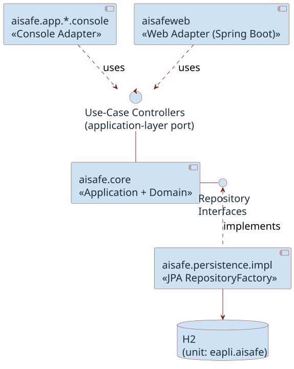
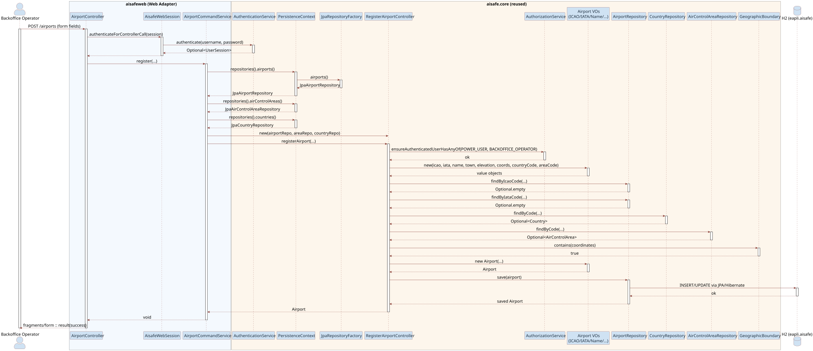

# AISafeWeb Overview

AISafeWeb is an optional web GUI built on top of AISafe. It adds browser-based dashboards, maps, and visualizers while fulfilling the same user stories already covered by the original console applications. AISafe stays exactly as it is, and the web GUI plugs into it as an additional front end.

The key idea is that the same application core can serve more than one user interface.

## A Second Front End on One Core

AISafe follows a layered architecture: presentation, application, domain, and persistence. The original system uses console applications as its presentation layer.

AISafeWeb adds a new presentation layer, a web interface, without changing anything underneath it. The console apps and the web GUI are interchangeable outer rings around one shared core. Both reach the system the same way: by calling the existing use-case controllers in `aisafe.core`. This is the **Ports and Adapters** principle in practice, where the core exposes a stable entry point and different adapters connect to it.

This structure rests on the **Dependency Inversion Principle**. Dependencies point inward: `aisafeweb` depends on `aisafe.core`, but the core depends on nothing in the web layer, with no knowledge of Spring, HTTP, or browsers. A new interface can therefore be added on the outside without the core ever changing. Building AISafe with real application-layer controllers, rather than putting logic directly in the console UI, is exactly what makes adding a second GUI cheap, because the controllers were already there to be reused.

Both front ends also run on the same database, through the same persistence unit and repository factory. There is one source of data. Whatever is created in the console is visible in the web GUI and the reverse, because both go through the same repositories into the same H2 database.

## What Spring Boot Contributes

The web GUI is built with Spring Boot, a Java framework that speeds up building web applications by auto-configuring common setup such as the embedded web server, dependencies, and application configuration. In AISafeWeb, Spring Boot is deliberately limited to web concerns. Its automatic database and security setup are switched off, so persistence and authorization remain owned by AISafe. Spring handles HTTP routing and page rendering; AISafe handles the actual use cases.

The web layer's job is to translate. Each web service takes the fields submitted by an HTML form and turns them into a call to the matching AISafe use-case controller, the **Adapter** pattern applied to a concrete class. The controller then enforces authorization, validates the data, applies the domain rules, and saves through the repository, just as it does for the console.

## One Use Case End to End

The diagram below traces a single operation, a Backoffice Operator creating an airport through the web form. The request enters the web adapter, is bridged into the reused AISafe controller, and the controller does the real work: checking permissions, building the value objects, verifying the airport's codes are unique and its position falls inside the chosen control area, and finally saving to the database. The web layer only carries the request in and the result out.

