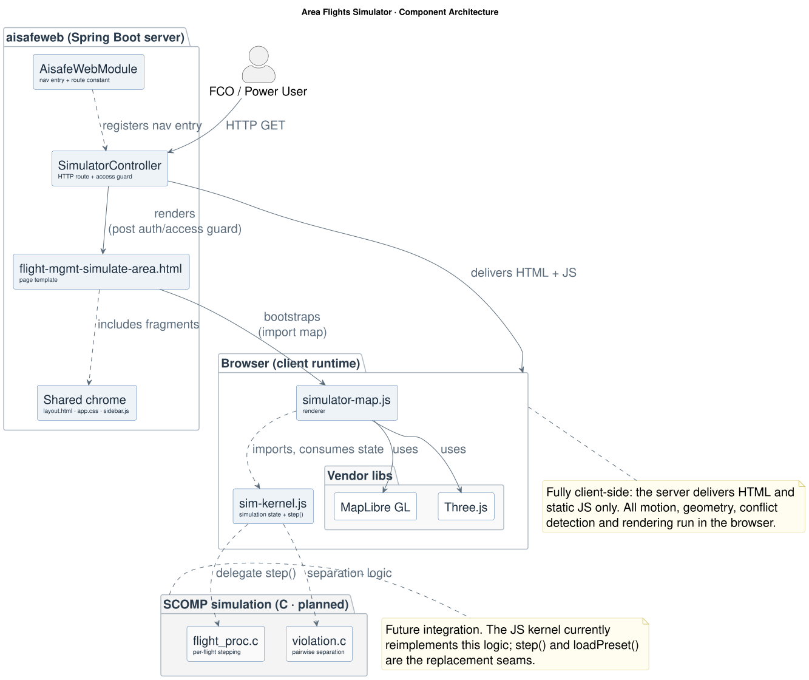

# Area Flights Simulator: Design & Implementation

**Module:** `aisafeweb/` (Flight Management)
**Access:** Flight Control Operator, Power User
**Status:** Standalone client-side simulation; not yet wired to domain persistence
**Last updated:** 2026-05-31

The Area Flights Simulator runs multiple flights inside an Air Control Area and detects pairwise separation violations in real time. It is fully client-side: Spring Boot serves the page and static assets, while all motion, geometry, conflict detection, and rendering execute in the browser using MapLibre GL and Three.js.

## 1. File layout

| Concern | File |
| --- | --- |
| Nav entry + route constant | `aisafeweb/.../security/AisafeWebModule.java` |
| HTTP route + access guard | `aisafeweb/.../web/SimulatorController.java` (`simulateAreaFlights`) |
| Page shell | `aisafeweb/.../resources/templates/flight-mgmt-simulate-area.html` |
| Renderer | `aisafeweb/.../resources/static/js/simulator-map.js` |
| Simulation kernel | `aisafeweb/.../resources/static/js/sim-kernel.js` |
| Shared chrome | `aisafeweb/.../resources/templates/layout.html`, `static/css/app.css` |

## 2. Request flow

1. A user with role `FLIGHT_CONTROL_OPERATOR` or `POWER_USER` opens **Flight Management** and selects **Simulate Area Flights**.
2. The sidebar renders the item enabled with `href = SIMULATE_AREA_FLIGHTS_PATH` (`/modules/flight-management/simulate-area-flights`); the other Flight Management items point at the module dashboard.
3. `SimulatorController.simulateAreaFlights` handles the GET request: it redirects to `/login` if the user is unauthenticated, redirects to the user's landing page if they cannot access Flight Management, and otherwise applies the shell attributes and returns the `flight-mgmt-simulate-area` template.
4. The template renders the application chrome, loads MapLibre GL and Three.js via an import map, then loads `simulator-map.js`, which imports `sim-kernel.js` and boots the simulation.

## 3. Page composition

The page combines the shared application chrome (topbar and sidebar fragments from `layout.html`, styled by `app.css`, with collapse handled by `sidebar.js`) with the simulator UI: a control strip, floating glass panels, and a help bar.

Four panels:
- **Telemetry** (top-left): step counter, violation count (turns red past the limit), status pill, active sector and span.
- **Playback & View** (bottom-left): basemap selector (Satellite / Dark / Streets), steps-per-second, altitude exaggeration, and layer toggles (3D buildings, terrain, safety zones, trails, conflict links, drop lines, labels, sector, event log).
- **Flights & Parameters** (right): scenario preset cards, separation-threshold sliders (`h_min`, `v_min`, max violations, total steps), and the editable flight roster with Add Flight.
- **Violation Log** (bottom-right, toggled by the Event Log chip): per-violation entries.

Control strip: sector picker, active scenario name, map view toggle, and Run / Step / Reset.

## 4. Simulation kernel (`sim-kernel.js`)

The kernel is pure and renderer-agnostic. It reimplements the SCOMP simulation logic in JavaScript so the simulation runs entirely in the browser, specifically the per-flight stepping of `flight_proc.c` and the pairwise separation checks of `violation.c`. The intended evolution is to delegate to the C implementation via an `aisafe/` service or a native bridge; the replacement seams are `step()`, `loadPreset()`, and threshold handling, and because the renderer consumes only `sim` state, it would be unaffected by that change.

### Data
- **`AREAS`**: 12 European Air Control Areas (code, name, bounding box, airport count), aligned with the back-office area registry. Default sector `LPPC` (Lisbon ACC).
- **`PRESETS`**: 6 scenarios, each with `totalSteps`, `maxViolations`, and flights positioned as fractions of the sector half-extent so they adapt to any sector: `patrol` (clean parallel cruise), `crossing`, `descent`, `hold` (clean stack), `heavy` (6 flights, likely conflicts), `threshold` (`maxViolations: 0`, ends on first violation).
- **`PALETTE`**, **`TRAIL_LEN`**: flight colours and trail history length.

### Coordinate helpers
- `areaBBox(area)` returns centre lat/lon plus width/depth in nm.
- `fracToXY(area, fx, fy)` converts a fraction-of-half-extent to sim x/y (nm, relative to sector centre).
- `xyToLatLon(area, x, y)` converts sim coords back to geographic.

### `createSim()`
Returns `{ sim, setArea, loadPreset, addFlight, removeFlight, resetState, step }`. `sim` holds the active area and bbox, the thresholds (`hMin` nm, `vMin` ft, `maxViolations`, `totalSteps`), the current `step`, the `flights` array, `violationCount`, the active conflict pairs, `endReason`, and a `log`.

`step()` is the simulation tick:
1. If the simulation has ended or has no flights, stop. If `step >= totalSteps`, set `endReason = NORMAL` and mark surviving flights `COMPLETED`.
2. Advance each alive flight (`x += vx`, `y += vy`, `alt += vz`; vx/vy in nm/step, vz in ft/step) and append to its trail history, capped at `TRAIL_LEN`.
3. For each flight pair, compute horizontal distance `h = hypot(dx, dy)` and vertical distance `v = |dAlt|`; a violation is `h < hMin && v < vMin`. Count each new violation once (de-duped via `notified`) and append it to the log.
4. If `violationCount > maxViolations`, set `endReason = THRESHOLD_EXCEEDED` and mark all alive flights `TERMINATED`.

## 5. Renderer (`simulator-map.js`)

The renderer bridges kernel state to a 3D map:
- **MapLibre GL** draws the basemap, the sector outline and fill (GeoJSON), and 3D buildings, and owns the camera. `frameSector()` eases the camera to fit the active Air Control Area.
- **Three.js custom layer** (`aisafe-fleet`) renders, per flight: a dart-shaped mesh oriented to its velocity, a safety ring (radius `hMin`), a ground drop line, a trail, and a callsign/FL label. Conflicting flights recolour to pink and draw conflict links between the pair.
- A **local ENU frame** is recentred on the active sector centre (`setOrigin`); `toModel(xNm, yNm, altFt)` maps sim coordinates to model-space metres, with altitude scaled by the exaggeration factor on the Y axis.

### Render loop
`tick(dt)` accumulates real time; when it crosses `1/rate` seconds it calls the kernel's `step()` and refreshes the HUD, roster, and log. Between steps it interpolates each flight from `prev` to `current` (`updateFleetTransforms(t)`) so motion is smooth despite the discrete-step simulation.

> The render loop must never throw. An uncaught error stops `requestAnimationFrame`, freezing the simulation with no recovery via Reset. Keep additions bounded and defensive.

### UI wiring
Sector picker (`buildAreaMenu`), preset cards (`buildPresetCards`), threshold sliders, layer-toggle chips, the editable roster (each field writes back to the flight, re-seeding `initial` while at step 0), Add/Remove flight, and keyboard shortcuts (**Space** run/pause, **→** step, **R** reset). Boot loads sector `LPPC` and preset `patrol`.

## 6. Controls

| Control | Effect |
| --- | --- |
| Sector picker | choose the Air Control Area; reframes the camera and resets the sim |
| Scenario preset cards | load one of the 6 scenarios (flights, thresholds, step budget) |
| Run / Pause / Restart | play, pause, restart (also **Space**) |
| Step | advance exactly one simulation step (also **→**) |
| Reset | return to step 0 with the preset's initial flights (also **R**) |
| Steps/sec | playback rate |
| Alt exag | vertical exaggeration of rendered altitude (1–30×); purely visual, does not affect the conflict maths |
| h_min / v_min | separation thresholds (nm / ft) used by the violation check |
| max viol / total steps | termination threshold and simulation length |
| Layer chips | toggle buildings, terrain, safety zones, trails, conflict links, drop lines, labels, sector, event log |
| Add Flight / roster fields / remove | add, edit (position, altitude, velocity), or remove a flight |

## 7. Not yet implemented

- No domain wiring: areas, presets, and conflict logic are defined in JavaScript. A production version would draw Air Control Areas from the registry and run the SCOMP C separation logic (see §4).
- No persistence, scenario saving, or replay.