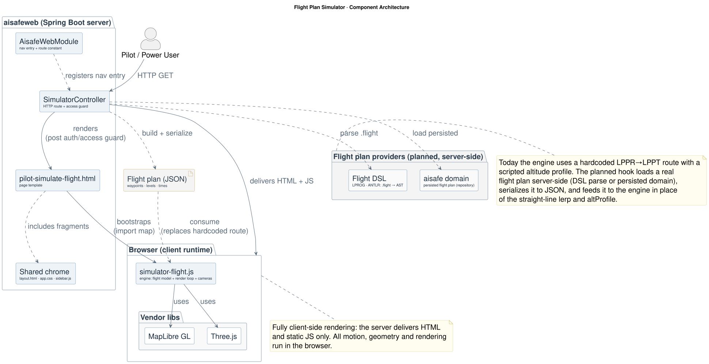

# Flight Plan Simulator: Design & Implementation

**Module:** `aisafeweb/` (Pilot Operations)
**Access:** Pilot, Power User
**Route:** Porto LPPR (Sá Carneiro) → Lisbon LPPT (Humberto Delgado)
**Status:** Standalone client-side simulation; not yet wired to domain persistence
**Last updated:** 2026-05-31

The Flight Plan Simulator animates a single flight along its route in a 3D map, showing the climb, cruise, and descent profile with live telemetry. It is fully client-side: Spring Boot serves the page and static assets, while all motion, geometry, and rendering execute in the browser using MapLibre GL and Three.js.



## 1. File layout

| Concern | File |
| --- | --- |
| Nav entry + route constant | `aisafeweb/.../security/AisafeWebModule.java` |
| HTTP route + access guard | `aisafeweb/.../web/SimulatorController.java` |
| Page shell | `aisafeweb/.../resources/templates/pilot-simulate-flight.html` |
| Simulation engine | `aisafeweb/.../resources/static/js/simulator-flight.js` |
| Shared chrome | `aisafeweb/.../resources/templates/layout.html`, `static/css/app.css` |

## 2. Request flow

1. A user with role `PILOT` or `POWER_USER` opens the **Pilot Operations** module and selects **Simulate Flight Plan**.
2. The sidebar renders the item enabled with `href = SIMULATE_FLIGHT_PLAN_PATH` (`/modules/pilot-operations/simulate-flight-plan`); the other Pilot Operations items point at the module dashboard.
3. `SimulatorController` handles the GET request: it redirects to `/login` if the user is unauthenticated, redirects to the user's landing page if they cannot access Pilot Operations, and otherwise applies the shell attributes and returns the `pilot-simulate-flight` template.
4. The template renders the application chrome, loads MapLibre GL and Three.js via an import map, then loads `simulator-flight.js`, which boots the simulation.

## 3. Page composition

The page combines the shared application chrome (topbar and sidebar fragments from `layout.html`, styled by `app.css`, with collapse handled by `sidebar.js`) with the simulator UI: a control strip, three floating glass panels (Telemetry, Playback & View, Flight), and a help bar.

Two CSS rules reconcile the simulator with the shared shell: `#map { height: 100% }` overrides the global `#map { height: 520px }` (used by the Backoffice Leaflet map) so the map fills the main area, and `.sim-main button { min-height: 0 }` neutralises the global `button { min-height: 38px }` so the segmented controls keep their native size.

The engine binds to these DOM IDs: `#map`, `#btn-play`, `#btn-reset`, `#basemap-seg`, `#camera-seg`, `#rate`, `#exag`, `#p-prog`, `#p-cruise`, and the telemetry read-outs (`#kpi-alt`, `#kpi-spd`, `#kpi-phase`, `#kpi-status`, `#kpi-dist`, `#kpi-prog`, `#active-phase`, `#fp-dist`).

## 4. Simulation engine (`simulator-flight.js`)

The engine uses two third-party rendering layers joined by a custom bridge:
- **MapLibre GL** draws the basemap (satellite / dark / streets), the dashed route line, the airport dots and labels, and 3D buildings; it owns the camera (centre, zoom, pitch, bearing).
- **Three.js** draws the airplane model, its altitude drop-line, the flight trail, and the callsign label sprite.
- **Custom layer** (`type: 'custom'`, `renderingMode: '3d'`) bridges the two: on each MapLibre repaint it receives MapLibre's projection matrix, composes it with a local metres-to-Mercator transform, and renders the Three.js scene into the same WebGL context so the aircraft sits correctly in the 3D map.

### Coordinate model
`PORTO` and `LISBON` hold the airport lat/lon; `DIST_NM` (great-circle distance) and `TRACK` (initial bearing) are derived once via `haversineNm` and `bearingDeg`. A local ENU frame is centred on the route mid-point (`origin`). `toModel(lon, lat, altFt)` maps a geographic point to Three.js metres: East/North from degree scaling, and up = `altFt * FT_TO_M * ui.exag` (the altitude exaggeration is baked into the rendered Y; see §6).

### Flight model (scripted)
- `flight.p` is progress 0→1 along the route, advanced each frame by `dt * ui.rate / DURATION` (`DURATION = 78 s` at 1× speed).
- Horizontal position is a straight `lerp` from Porto to Lisbon by `p`.
- `altProfile(p)` is a scripted vertical profile: ease-in climb to `ui.cruiseFt` by p = 0.18, flat cruise until p = 0.80, ease-out descent to 0 by p = 0.975.
- `phaseFor(p)` returns On stand / Take-off / Climb / Cruise / Descent / Landing / Arrived.
- `displaySpeed(p)` is a cosmetic airspeed (kt) per phase, independent of time-compression, so the HUD shows believable numbers regardless of the speed slider.

### Render loop
`loop(now)`, driven by `requestAnimationFrame`:
1. If playing and not done, advance `p`, recompute lon/lat/alt, ease ground speed toward `displaySpeed`, append to the trail, update phase, and refresh the HUD.
2. `updateScene()` repositions and orients the aircraft (yaw to `TRACK`, pitch from the climb gradient), and updates the drop-line, label, and trail.
3. In follow camera mode, reframe the MapLibre camera (see §5).
4. Re-schedule itself.

> The render loop must never throw. An uncaught exception permanently kills the `requestAnimationFrame` chain: the aircraft freezes and Reset cannot recover it, because Reset only resets state and does not restart the loop. Keep camera math defensive and bounded.

### Scrub & reset
`scrubTo(p)` (Progress slider) jumps to an arbitrary point, pausing playback and rebuilding the trail up to `p`. `resetFlight()` returns everything to On stand at LPPR.

## 5. Cameras

Two modes, toggled in the Playback & View panel (`#camera-seg`) or with the **F** key:
- **Free**: normal MapLibre interaction (drag to pan, right-drag to rotate/tilt, wheel to zoom).
- **Follow**: MapLibre's built-in interactions are disabled and replaced by custom handlers. Wheel adjusts `followZoom` (clamped 5.5–15); drag sets bearing/pitch directly; each frame the loop calls `map.jumpTo({ center: [flight.lon, flight.lat], zoom: followZoom, ... })` so the camera tracks the aircraft's ground track.

### Altitude framing in Follow mode
Because the aircraft is rendered at an exaggerated altitude (§6), centring the camera on its ground point makes it float above screen centre during climb and cruise. The follow branch compensates by computing the aircraft's approximate vertical screen offset and applying it as top padding to `jumpTo`:

```
planeAltM = flight.alt * FT_TO_M * ui.exag         // rendered height in metres
mpp       = metres-per-pixel at this latitude/zoom  // web-mercator, 512-px tiles
offsetPx  = (planeAltM / mpp) * sin(pitch)
padTop    = clamp(2 * offsetPx, 0, 0.8 * viewportHeight)
```

`padding.top` shifts where MapLibre places the centre point, pulling the elevated aircraft back toward the middle. It is clamped to the viewport, so it can never throw or fling the camera. Leaving Follow clears the padding.

**Known limitation:** at very high altitude and high exaggeration (e.g. FL280 × 8 ≈ 68 km rendered height) the required offset exceeds the screen, so `padTop` maxes out and the aircraft still sits high, though the simulation stays usable. Lowering Alt-exag fully re-centres it. A complete fix would require a true 3D chase camera positioned at the aircraft's real 3D point.

## 6. Controls

**Alt-exag (altitude exaggeration)** multiplies the aircraft's rendered height only. Real altitude (e.g. 28 000 ft) would be nearly invisible at the horizontal scale of a 270 nm route, so the slider scales the vertical to make the climb/cruise/descent shape visible in 3D; `exag = 8` draws the aircraft 8× higher than scale. It is purely visual: it changes `toModel`'s Y and the camera framing, but not the flight path, timing, telemetry, or phase logic.

| Control | Effect |
| --- | --- |
| Fly / Pause / Replay | start, pause, restart playback (also **Space**) |
| Reset | return to On stand at LPPR (also **R**) |
| Basemap (Satellite / Dark / Streets) | swap the MapLibre style layer |
| Camera (Free / Follow) | see §5 (Follow also **F**) |
| Sim speed | time-compression multiplier `ui.rate` (0.2×–6×) |
| Alt exag | vertical exaggeration of the rendered aircraft height (1–30×) |
| Progress | scrub to any point along the route |
| Cruise FL | sets `ui.cruiseFt`, which reshapes `altProfile` |
| 3D Buildings / Terrain / Trail / Labels / Route Line | toggle map and scene layers |

## 7. Not yet implemented

- No domain wiring: the flight is defined in JavaScript as a straight Porto-to-Lisbon route. A production version would load a flight plan (waypoints, levels, times) and feed it to the engine instead of the straight-line `lerp` and scripted `altProfile`.
- No persistence, validation, or controllers into `aisafe/`.