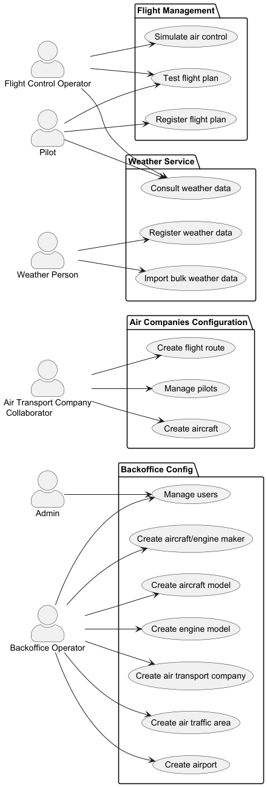

# Documentation

- [Base project decisions](architecture/base-project-decisions.md): modules, layers, naming, bootstrap order
- [Domain model](sprint-1/readme.md) (Sprint 1), with its [latest version](sprint-3/domain-model/) and [glossary](sprint-3/glossary/glossary.md)
- [Remote access and logging protocols](sprint-3/RCOMP/planning.md) (RCOMP)
- Airspace simulator in C: [Sprint 2](../scomp/sprint-2/readme.md) (processes, pipes, signals) and [Sprint 3](../scomp/sprint-3/readme.md) (threads, shared memory)
- [Web adapter](../aisafeweb/docs/aisafeweb_readme.md) and its [flight-plan](../aisafeweb/docs/flight_plan_sim.md) and [area](../aisafeweb/docs/area_flights_sim.md) simulators
- PO clarifications: [Sprint 2](sprint-2/po-clarifications-sprint2.md), [Sprint 3](sprint-3/po-clarifications-sprint3.md)

## User stories

### Sprint 2

| US | Description |
|---|---|
| [US030](sprint-2/us030/readme.md) | Authentication and authorization |
| [US031](sprint-2/us031/readme.md) | Register users |
| [US032](sprint-2/us032/readme.md) | Disable/enable users |
| [US033](sprint-2/us033/readme.md) | List users |
| [US041](sprint-2/us041/readme.md) | Register weather data |
| [US050](sprint-2/us050/readme.md) | Register air control area |
| [US052](sprint-2/us052/readme.md) | Create airport |
| [US055](sprint-2/us055/readme.md) | Create aircraft model |
| [US056](sprint-2/us056/readme.md) | Register aircraft engine model |
| [US057](sprint-2/us057/readme.md) | Add engine model to aircraft model |
| [US058](sprint-2/us058/readme.md) | Remove engine model from aircraft model |
| [US060](sprint-2/us060/readme.md) | Register air transport company |
| [US061](sprint-2/us061/readme.md) | Add customer collaborator |
| [US062](sprint-2/us062/readme.md) | List customer collaborators |
| [US063](sprint-2/us063/readme.md) | Edit customer collaborator |
| [US064](sprint-2/us064/readme.md) | Disable customer collaborator |
| [US070](sprint-2/us070/readme.md) | Add aircraft to air transport company |
| [US071](sprint-2/us071/readme.md) | Decommission aircraft |
| [US072](sprint-2/us072/readme.md) | List air transport company fleet |
| [US081](sprint-2/us081/readme.md) | Create flight plan from file |
| [US083](sprint-2/us083/readme.md) | Specify and validate the flight DSL |
| [US100–US103, US109](../scomp/sprint-2/readme.md) | Airspace simulator: processes, movement capture, violation detection, time-step sync, report |

### Sprint 3

| US | Description |
|---|---|
| [US042](sprint-3/us042/readme.md) | Import bulk weather data |
| [US043](sprint-3/us043/readme.md) | Consult weather data |
| [US044](sprint-3/RCOMP/planning.md#3-us044--weather-person-remote-access) | Weather Person remote access |
| [US073](sprint-3/us073/readme.md) | Create a flight route |
| [US074](sprint-3/us074/readme.md) | Delete a flight route |
| [US075](sprint-3/us075/readme.md) | Add a pilot |
| [US076](sprint-3/us076/readme.md) | List pilot roster |
| [US077](sprint-3/us077/readme.md) | Remove a pilot |
| [US078](sprint-3/us078/readme.md) | Airline collaborator remote access |
| [US080](sprint-3/us080/readme.md) | Create a flight plan |
| [US082](sprint-3/us082/readme.md) | Insert weather data in a flight |
| [US085](sprint-3/us085/readme.md) | Test/validate a flight plan |
| [US086](sprint-3/us086/readme.md) | Pilot remote access |
| [US090](sprint-3/us090/readme.md) | External logging of remote accesses |
| [US091](sprint-3/us091/readme.md) | Remote access log visualization |
| [US105–US110](../scomp/sprint-3/readme.md) | Airspace simulator: shared memory, threads, condition variables, step sync, final report, weather |
| [US111](sprint-3/us111/readme.md) | Generate a simulation report |
| [US112](sprint-3/us112/readme.md) | Monthly statistics report |
| [US120](sprint-3/us120/readme.md) | Flight DSL specification and validation ([spec](sprint-3/us120/dsl-spec.md), [LPROG notes](sprint-3/lprog/readme.md)) |
| [US121](sprint-3/us121/readme.md) | Create a flight plan from a file |
