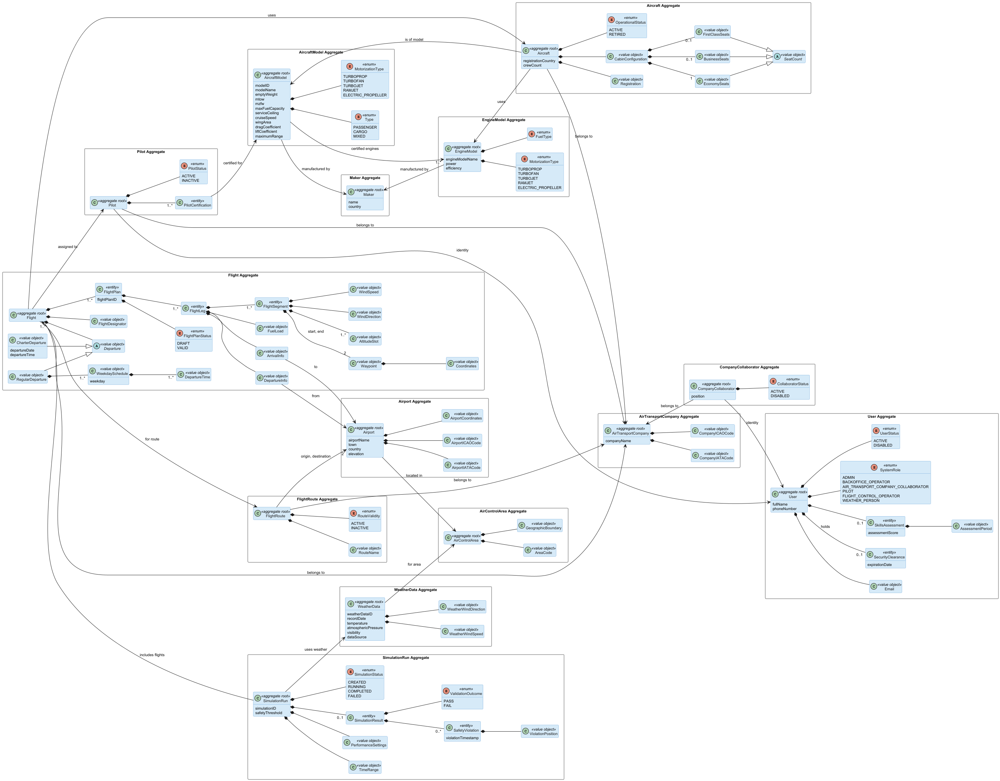

# Sprint 1: Domain Model

Sprint 1 produced the DDD domain model (US010) and a justification of each aggregate boundary (US011). The model was refined in later sprints; the latest version is in [`sprint-3/domain-model`](../sprint-3/domain-model/).

- [Aggregate roots only](us010/03.design/domain-model-aggregate-roots.png): the boundaries and cross-aggregate references, without internals
- [Glossary](us010/02.analysis/glossary.md)
- [Analysis notes](us010/02.analysis/notes.md): the modelling doubts, the PO's answers and the resulting decisions
- [Invariants](us011/02.analysis/invariants.md), per aggregate
- [Aggregate justification](us011/03.design/aggregate-justification.md): one scenario and sequence diagram per aggregate, linked to the invariants it protects

## Aggregates

| Aggregate root | Responsibility | Scenario |
|---|---|---|
| `Maker` | Manufacturer, shared by aircraft and engine makers | Register a manufacturer |
| `EngineModel` | Engine technical definition and certification | Register an engine model |
| `AircraftModel` | Aircraft technical definition and certified engines | Register an aircraft model with certified engines |
| `User` | System identity, role and security clearance | Register a user |
| `CompanyCollaborator` | Links a user to an air transport company | Add a collaborator to a company |
| `Pilot` | Pilot identity, certifications, operational status | Register a pilot with aircraft model certifications |
| `Aircraft` | Physical aircraft: registration, model, engine, cabin | Add an aircraft to a company fleet |
| `AirControlArea` | Geographic boundary of a control area | Register an air control area |
| `Airport` | Airport identity, coordinates, control area | Register an airport in an area |
| `AirTransportCompany` | Company identity via unique IATA and ICAO codes | Register a company |
| `FlightRoute` | Named route between two airports, owned by a company | Create a route |
| `Flight` | Scheduled operation with its flight plans | Register a flight and its first flight plan |
| `WeatherData` | Weather record for an area, date and source | Register weather for an area |
| `SimulationRun` | A simulation from configuration to result and violations | Configure and run a simulation |

## Key decisions

- **`FlightPlan` is an entity inside `Flight`, not its own aggregate.** "At most one VALID flight plan per flight" has to hold within one transaction; as a separate aggregate it would need eventual consistency and could briefly allow two valid plans. The [three options considered](us011/03.design/flight-aggregate-design-alternatives.png) are diagrammed.
- **`CabinConfiguration` is a value object inside `Aircraft`.** Its validity depends on the aircraft and its model, and it has no lifecycle of its own.
- **`Maker` is concrete, not abstract.** One manufacturer can build both aircraft and engines (PO, 22/03/2026), so `AircraftMaker` and `EngineMaker` specialise a shared root.
- **Cross-aggregate references are by identity only,** and only aggregate roots have repositories.
