# Aggregate Justification

This document justifies each aggregate in the AISafe domain model by identifying a representative scenario, the invariants it enforces, and why those invariants require an aggregate boundary.

1. [AirControlArea](#1-aircontrolarea-aggregate)
2. [Aircraft](#2-aircraft-aggregate)
3. [AircraftModel](#3-aircraftmodel-aggregate)
4. [AirTransportCompany](#4-airtransportcompany-aggregate)
5. [Airport](#5-airport-aggregate)
6. [CompanyCollaborator](#6-companycollaborator-aggregate)
7. [EngineModel](#7-enginemodel-aggregate)
8. [Flight](#8-flight-aggregate)
9. [FlightRoute](#9-flightroute-aggregate)
10. [Maker](#10-maker-aggregate)
11. [Pilot](#11-pilot-aggregate)
12. [SimulationRun](#12-simulationrun-aggregate)
13. [User](#13-user-aggregate)
14. [WeatherData](#14-weatherdata-aggregate)

---
## 1. AirControlArea Aggregate

### Representative Scenario
Register a new air control area with a unique area code and valid geographic boundaries.

### Why this is an aggregate
The AirControlArea aggregate must ensure that an air control area is always created and maintained in a valid and consistent state, particularly regarding its identity and geographic definition.

### Invariants enforced
- area code must be unique within the system
- geographic boundary must define a valid closed polygon
- all boundary coordinates must be geographically valid

### Justification
The AirControlArea cannot be treated as a simple data structure because its validity depends on the combination of its identity and geographic boundaries.

An air control area becomes invalid if:
- its area code is duplicated
- its geographic boundary is not a valid polygon
- its coordinates are outside valid geographic ranges

The aggregate root centralizes these validations and guarantees that every AirControlArea instance represents a valid and uniquely identifiable controlled airspace.

---

## 2. Aircraft Aggregate

### Representative Scenario
Register a new aircraft in the fleet of an air transport company, selecting its aircraft model, engine model, registration, cabin configuration, and operational status.

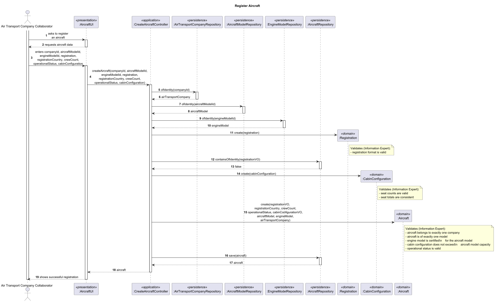

### Why this is an aggregate
The `Aircraft` aggregate represents a specific physical aircraft operated by an air transport company. Its responsibility is to ensure that the aircraft is always created and maintained in a valid operational state before it can be referenced by other aggregates such as `Flight`.

The aggregate boundary is justified because the validity of an aircraft depends on a coordinated set of rules that must be enforced together:
- its business identity (`Registration`) must be unique;
- it must belong to exactly one `AirTransportCompany`;
- it must be associated with exactly one `AircraftModel`;
- the selected `EngineModel` must be certified for that `AircraftModel`;
- its `CabinConfiguration` must respect the capacity constraints of the selected model;
- its `OperationalStatus` must allow it to be used in operations.

These rules define one transactional consistency boundary. A partially valid aircraft must never enter the system.

### Invariants enforced
- aircraft registration must be unique within the system;
- an aircraft must be associated with exactly one `AirTransportCompany`;
- an aircraft must be associated with exactly one `AircraftModel`;
- the `EngineModel` used by the aircraft must be certified for the selected `AircraftModel`;
- the total seats defined in the `CabinConfiguration` must not exceed the capacity allowed by the `AircraftModel`;
- an aircraft in `RETIRED` operational status must not be used in the creation of new `Flight`s.

### Justification
`Aircraft` is not modelled inside `AirTransportCompany`, even though a company owns aircraft, because fleet ownership is not the relevant consistency boundary. The important transactional rule is the internal validity of each individual aircraft. Registering, reconfiguring, or retiring one aircraft must not require loading or locking the whole company aggregate.

`Aircraft` is also not merged with `AircraftModel` or `EngineModel`, because those are separate aggregates with independent lifecycles and responsibilities:
- `AircraftModel` defines the technical characteristics of a type of aircraft;
- `EngineModel` defines the characteristics of an engine model;
- `Aircraft` represents one concrete aircraft instance in a company fleet.

The aggregate root centralizes the validation of:
- identity (`Registration`);
- ownership (`AirTransportCompany`);
- technical consistency (`AircraftModel` + `EngineModel`);
- configuration consistency (`CabinConfiguration`);
- operational eligibility (`OperationalStatus`).

This ensures that every persisted aircraft is structurally and operationally valid before it can be assigned to a `Flight` or used in later simulation-related processes.

### Aggregate boundary rationale
The aggregate contains:
- `Aircraft` as aggregate root;
- `Registration` as value object;
- `CabinConfiguration` as value object;
- `EconomySeats`, `BusinessSeats`, and `FirstClassSeats` as value objects inside `CabinConfiguration`;
- `OperationalStatus` as an enumeration/value classification owned by the aggregate.

The aggregate references the following external aggregates **by identity only**:
- `AirTransportCompany`;
- `AircraftModel`;
- `EngineModel`.

This keeps the aggregate small and cohesive, while still allowing it to enforce all rules that must hold transactionally for a single aircraft.

### Justification summary
`Aircraft` is a standalone aggregate because the system must guarantee that each physical aircraft is uniquely identified, technically valid, correctly configured, and operationally usable as a single consistent unit. These invariants belong to the aircraft itself, not to the company, model, or engine aggregates. Therefore, `Aircraft` is the correct aggregate root for protecting these business rules.

---

## 3. AircraftModel Aggregate

### Representative Scenario
Register a new aircraft model and associate its certified engine models.

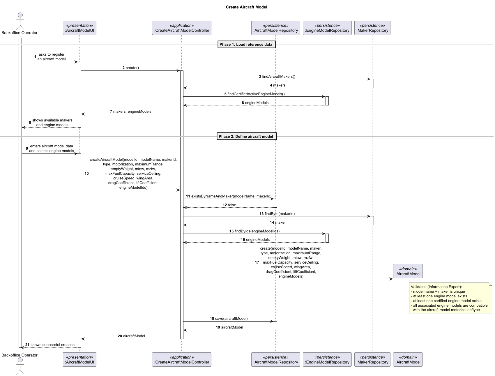

### Why this is an aggregate
The AircraftModel aggregate must protect a coherent set of business rules that are evaluated together when the model is created or updated.

### Invariants enforced
- model name + manufacturer must be unique
- at least one engine model must be associated
- at least one certified engine model must exist
- associated engine models must be compatible with the aircraft model motorization (engines from different manufacturers are allowed — PO, 22/03/2026)

### Justification
The association between AircraftModel and EngineModel cannot be treated as a loose relation because the aircraft model becomes invalid if:
- no engine models are associated
- no certified engine model exists
- the selected engines are not compatible with the aircraft model
- the business identity is duplicated

The aggregate root centralizes these validations and guarantees that an AircraftModel is always created and maintained in a valid configuration before being referenced by other aggregates.

---

## 4. AirTransportCompany Aggregate

### Representative Scenario
Register a new air transport company with its identifying business codes (IATA and ICAO).

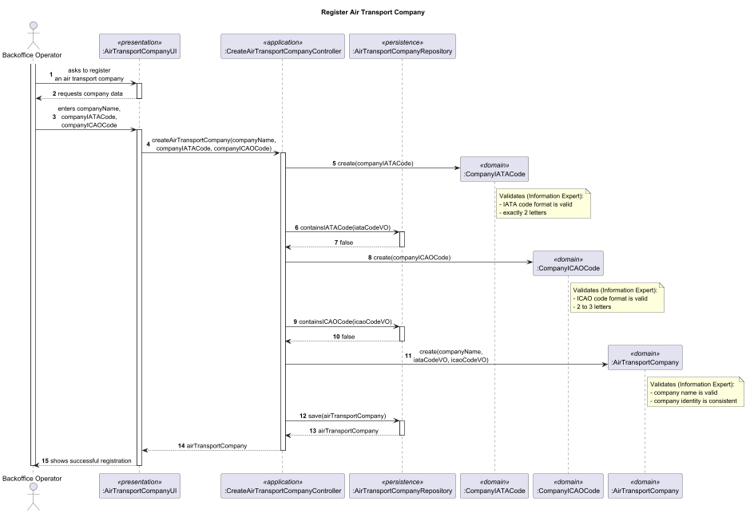

### Why this is an aggregate
The `AirTransportCompany` aggregate represents a real-world airline or operator and is responsible for guaranteeing the integrity of its business identity within the system.

The aggregate boundary exists because the company’s identity is defined by a set of attributes that must be validated together:
- `IATACode` must be unique;
- `ICAOCode` must be unique;
- both codes must follow valid domain formats.

These rules must be enforced atomically when the company is created. A company with duplicated or invalid identifiers must never be persisted.

### Invariants enforced
- company IATA code must be unique within the system;
- company ICAO code must be unique within the system;
- IATA code must follow the standard 2-character format;
- ICAO code must follow the standard 3-character format.

### Justification
`AirTransportCompany` is referenced by multiple aggregates (`Aircraft`, `Pilot`, `CompanyCollaborator`, `FlightRoute`, `Flight`). Because of this, its identity must be stable, unique, and validated before any other aggregate can safely reference it.

If invalid or duplicate company identifiers were allowed:
- aircraft could be assigned to the wrong company;
- pilots and collaborators could be associated inconsistently;
- routes and flights could reference ambiguous or incorrect ownership.

The aggregate root ensures that the company is created in a valid and uniquely identifiable state before it becomes part of the broader system.

### Aggregate boundary rationale
The aggregate contains:
- `AirTransportCompany` as aggregate root;
- `IATACode` as a value object;
- `ICAOCode` as a value object;
- (optionally) `CompanyName` as a value object if modeled explicitly.

The aggregate does **not** contain:
- `Aircraft`;
- `Pilot`;
- `CompanyCollaborator`;
- `FlightRoute`.

These are separate aggregates that reference the company **by identity only**.

This design avoids large aggregate sizes and prevents unnecessary locking or loading of the entire company when managing related entities such as aircraft or pilots.

### Justification summary
`AirTransportCompany` is a standalone aggregate because it owns and protects the business identity of a company. Its invariants are simple but critical: uniqueness and validity of its identifying codes.

By isolating this responsibility, the system guarantees that all other aggregates can safely depend on a consistent and unambiguous company identity without coupling their lifecycle to the company itself.

---

## 5. Airport Aggregate

### Representative Scenario
Register a new airport associated with a specific air control area.

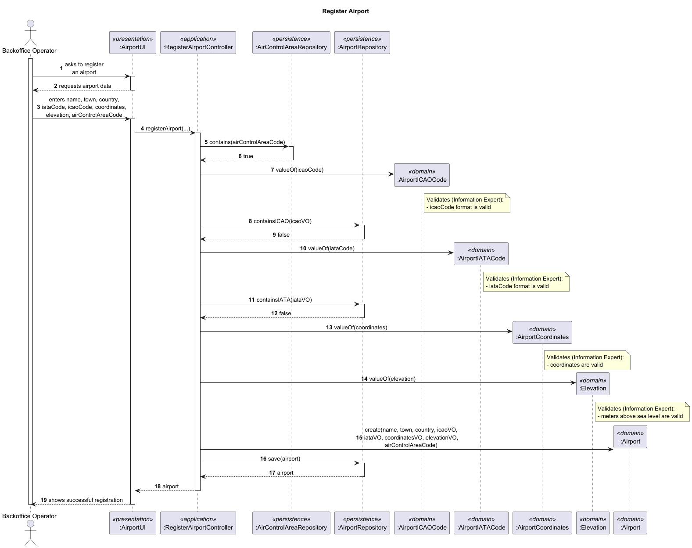

### Why this is an aggregate
The Airport aggregate must ensure that an airport is created as a valid and complete business concept, combining identity, location, and association to an air control area.

### Invariants enforced
- ICAO code must be unique worldwide
- IATA code must be unique worldwide
- coordinates must be geographically valid
- elevation must be expressed in meters above sea level
- the airport must be associated with exactly one existing AirControlArea

### Justification
The Airport cannot be treated as a loose combination of attributes because its validity depends on multiple coordinated rules.

An airport becomes invalid if:
- its ICAO or IATA code is duplicated
- its coordinates are invalid
- its elevation is not properly defined
- it is not associated with a valid AirControlArea

The aggregate root ensures that all these constraints are validated together, producing a consistent and usable airport entity within the system.

The association to AirControlArea is maintained by identity, ensuring low coupling between aggregates.

---

## 6. CompanyCollaborator Aggregate

### Representative Scenario
Add a collaborator to an air transport company using an existing system user, assigning the collaborator’s position and initial status.

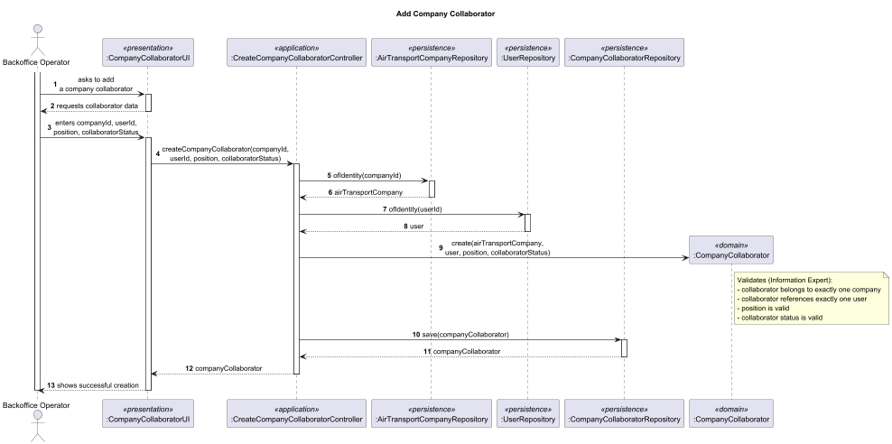

### Why this is an aggregate
The `CompanyCollaborator` aggregate represents the domain-specific association between a `User` and an `AirTransportCompany`. Its responsibility is to guarantee that this association is always valid, unambiguous, and manageable as a single business concept.

The aggregate boundary exists because the collaborator relationship is not just a loose link between two existing aggregates. It carries its own business meaning and rules:
- a collaborator must belong to exactly one company;
- a collaborator must reference exactly one user;
- the collaborator has a company-specific `position`;
- the collaborator has its own lifecycle through `CollaboratorStatus`.

These rules must be enforced together when the collaborator is created or updated. A partially defined collaborator association must never enter the system.

### Invariants enforced
- a collaborator must be associated with exactly one `AirTransportCompany`;
- a collaborator must reference exactly one `User`;
- a collaborator with status `DISABLED` must not appear in active collaborator listings;
- only collaborator-related data may be managed through this aggregate boundary.

### Justification
`CompanyCollaborator` is not modeled inside `AirTransportCompany`, even though the company “has” collaborators, because the important transactional rule is not the company’s total list of collaborators but the validity of each individual association between one company and one user.

It is also not modeled inside `User`, because the collaborator role is not part of generic system identity. `User` is responsible for authentication, authorization, and system-wide identity; `CompanyCollaborator` is responsible for the business fact that a given user acts on behalf of a given air transport company.

If this association were not protected by its own aggregate:
- the same collaborator relationship could become ambiguous or inconsistent;
- disabled collaborators might still be treated as active;
- company-role data would be mixed with generic user data.

The aggregate root centralizes these validations and ensures that every collaborator association is valid before it can be used in company operations.

### Aggregate boundary rationale
The aggregate contains:
- `CompanyCollaborator` as aggregate root;
- `CollaboratorStatus` as an enumeration/value classification owned by the aggregate;
- `position` as collaborator-specific business data.

The aggregate references the following external aggregates **by identity only**:
- `AirTransportCompany`;
- `User`.

The aggregate does **not** contain:
- the `User` object itself;
- the `AirTransportCompany` object itself;
- `Pilot`, which is a separate aggregate with stronger operational invariants.

This keeps the aggregate small and cohesive while ensuring that collaborator-specific rules are enforced in one transactional boundary.

### Justification summary
`CompanyCollaborator` is a standalone aggregate because the association between a system user and an air transport company is itself a business concept with its own lifecycle and invariants. It must guarantee that the collaborator relationship is valid, uniquely defined, and correctly visible in company operations, without coupling the lifecycle of users, companies, or pilots into one large aggregate.

---

## 7. EngineModel Aggregate

### Representative Scenario
Register a new engine model for use by aircraft models.

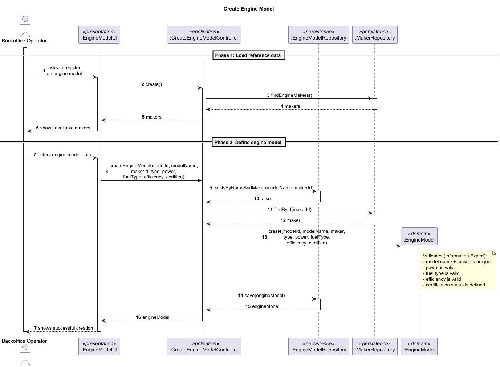

### Why this is an aggregate
The EngineModel aggregate owns the business identity and technical definition of an engine model, ensuring that it is created in a valid and consistent state before being referenced by AircraftModel.

### Invariants enforced
- engine model name + manufacturer must be unique
- engine type must be defined
- power must be valid
- fuel type must be defined
- efficiency must be valid
- certification status must be defined

### Justification
EngineModel must remain internally valid before being referenced by AircraftModel. Its validity does not depend only on its identity, but also on the consistency of the technical attributes that define the model as a usable engine in the domain.

The aggregate root guarantees that the engine's business identity and core technical properties are validated together before the model becomes available for certification and association with aircraft models.

---

## 8. Flight Aggregate

### Representative Scenario
Register a flight plan for a route (US080). The pilot provides route, aircraft, departure info, and plan data. If no Flight exists for that route and departure, a new Flight is created with its first FlightPlan (status: DRAFT). If a Flight already exists, a new FlightPlan is added to it.
US080 creates a Flight including its flight plan (PO, 02/04/2026)

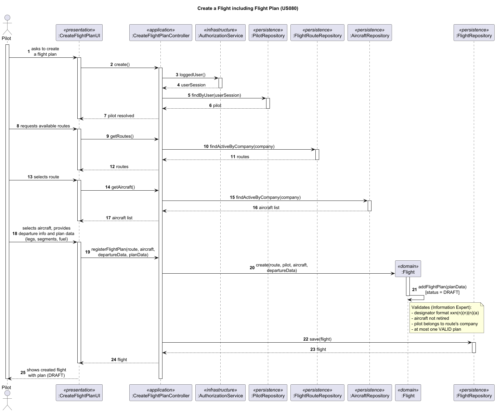

### Why this is an aggregate

Flight is defined in §3.2 as an instantiation of a route — a concrete scheduled operation with a unique designator, aircraft, pilot, and departure. The PO clarified (02/04/2026) that a Flight *has* one or more FlightPlans: if a plan is rejected during validation, the pilot submits a new one. Only one may be validated at a time.

FlightPlan is an entity inside the Flight aggregate, not a separate aggregate, for two reasons:

1. **The "only one VALID FlightPlan at a time" invariant must be enforced transactionally.** A FlightPlan cannot know about its siblings — only Flight can enforce this constraint across all its plans. If FlightPlan were a separate aggregate, this rule would require eventual consistency, risking two simultaneously valid plans.

2. **Flight's arrival time is derived from FlightPlan internals.** The scheduled arrival is determined by the valid plan's last leg ArrivalInfo. If FlightPlan were external, Flight could not describe its own state without querying another aggregate.

Nothing in the system references FlightPlan directly — SimulationRun references Flight (US100), validation operates through Flight (US085), weather is added through Flight (US082). FlightPlan is always accessed through Flight.

The three design alternatives considered are illustrated below:

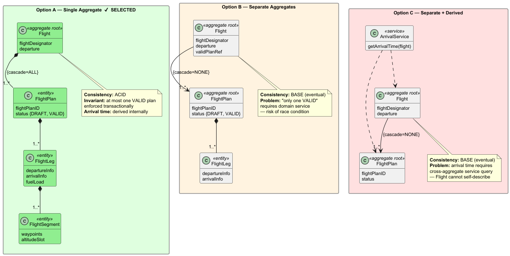

Option A (single aggregate) was selected because the invariants require transactional consistency. The trade-off — larger aggregate, higher memory — is acceptable given that concurrent access to the same flight is not a realistic concern in this domain.

### Invariants enforced

**Flight-level:**
- Flight designator must be unique (format: xxn(n)(n)(n)(a))
- Flight type is determined by Departure subclass (RegularDeparture vs CharterDeparture)
- CharterDeparture: single departureDate + departureTime
- RegularDeparture: 1..* WeekdaySchedule, each with 1..* DepartureTime
- Aircraft must not be retired (US071)
- Pilot must belong to the same company as the route (US080)
- Flight must reference exactly one route, one aircraft, one pilot
- At most one FlightPlan may have status VALID at any time (PO, 25/03/2026)

**FlightPlan-level (enforced within the aggregate):**
- Leg n arrival airport must match leg n+1 departure airport
- Leg n arrival time must precede leg n+1 departure time
- FuelLoad must be strictly positive per leg
- Each leg must have at least one segment
- Segment start and end waypoints must differ
- Altitude values must be positive
- WindDirection must be 0–360, WindSpeed must be >= 0

### Justification summary

Flight owns the scheduled operation and its plans. When a new flight plan is needed, the Flight aggregate root is responsible for creating and managing it internally, enforcing the "only one VALID" constraint. The first flight plan creation also creates the Flight itself (US080: "create a flight, including its flight plan" — PO, 02/04/2026). Subsequent rejected plans result in new FlightPlan entities within the same Flight. All internal entities are persisted as a single consistent unit through the aggregate root.
 
---

## 9. FlightRoute Aggregate

### Representative Scenario
Create a new flight route for an air transport company (US073). Only FlightRoute is created. Airport and AirTransportCompany are read-only references.

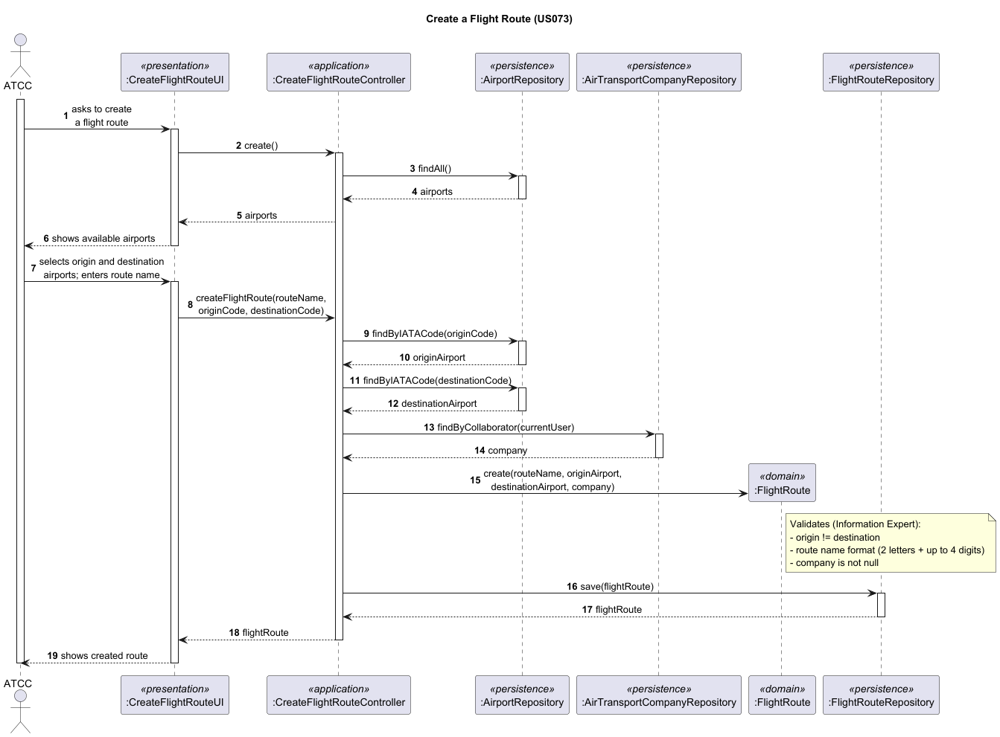

### Why this is an aggregate
The FlightRoute aggregate owns the identity and validity of a route — a named connection between two airports under a specific air transport company. Its invariants must be enforced as a unit at creation time; a partially valid route (e.g., missing company, or origin == destination) must never enter the system.

RouteName is the business identity value object of the aggregate — it uniquely identifies a route within the system and encodes the owning company's designator.

### Invariants enforced
- route name must be unique (format: 2 letters + up to 4 numbers, e.g. TP123)
- route must connect exactly two airports (origin != destination)
- route belongs to exactly one AirTransportCompany

### Justification
A flight route is the foundation of the Route → Flight → FlightPlan chain. Since routes are company-owned and not shared as a global network (PO, 22/03/2026), uniqueness is scoped to the system but identity is tied to the owning company. If route creation allowed duplicate names or same-airport endpoints, downstream aggregates (Flight, SimulationRun) would inherit invalid references. The aggregate root centralizes these validations (Information Expert) so that any route referenced by a Flight is guaranteed to be structurally valid.

Route validity also has a temporal dimension — US074 allows deactivation from a given date but prevents deletion if flights exist after that date. This lifecycle is managed independently of any Flight or FlightPlan, confirming FlightRoute as a standalone aggregate (Protected Variation).

---

## 10. Maker Aggregate

### Representative Scenario
Register a new manufacturer.

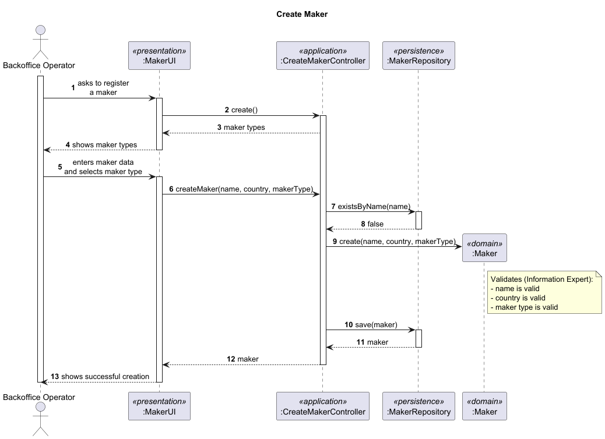

### Why this is an aggregate
Maker centralizes the common business identity of manufacturers and acts as the root of the manufacturer hierarchy.

### Invariants enforced
- a Maker must always have a valid name
- a Maker must always have a valid country

### Justification
Maker represents the common business concept shared by manufacturer of both engines and aircraft. A single real-world entity can be both an aircraft manufacturer and an engine manufacturer (PO, 22/03/2026), which confirms that the hierarchy must share a common root rather than being modeled as two independent aggregates.

The aggregate root centralizes the manufacturer identity rules and guarantees consistency across the hierarchy, avoiding duplication of validation logic and ensuring that all makers are created according to the same domain rules before being referenced by AircraftModel or EngineModel.

---

## 11. Pilot Aggregate

### Representative Scenario
Register a new pilot for an air transport company and assign certifications for one or more aircraft models.

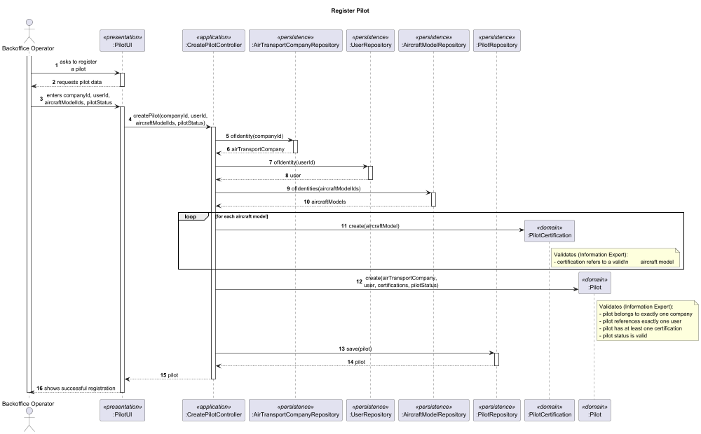

### Why this is an aggregate
The `Pilot` aggregate represents a pilot as an operational aviation role within an `AirTransportCompany`. Its responsibility is to guarantee that a pilot is always created and maintained in a valid state for flight operations.

The aggregate boundary exists because pilot validity depends on a coordinated set of rules that must be enforced together:
- a pilot must belong to exactly one company;
- a pilot must reference exactly one system user;
- a pilot must hold at least one valid certification;
- a pilot’s operational status must remain consistent with existing flight assignments.

These rules define one transactional consistency boundary. A partially valid pilot must never enter the system.

### Invariants enforced
- a pilot must be associated with exactly one `AirTransportCompany`;
- a pilot must reference exactly one `User`;
- a pilot must be certified for at least one `AircraftModel`;
- a pilot assigned to flights must not be set to `INACTIVE`.

### Justification
`Pilot` is not modeled inside `AirTransportCompany`, even though a company has pilots, because the relevant consistency boundary is not the company’s full staff list but the operational validity of each individual pilot.

`Pilot` is also not modeled inside `User`, because pilot-specific rules do not belong to generic system identity. `User` is responsible for authentication, authorization, and system-wide identity. `Pilot` is responsible for aviation-specific constraints such as certifications, company assignment, and operational status.

The certification relationship is especially important. A pilot is not valid in the domain merely because a user exists; the pilot must also be authorized to operate one or more aircraft models. This means the aggregate must protect both identity-related rules and operational qualification rules together.

If these rules were not protected by their own aggregate:
- a pilot could exist without any certification;
- a pilot could become inactive while still assigned to flights;
- pilot qualification could be mixed incorrectly with generic user data or company management data.

The aggregate root centralizes these validations and guarantees that every pilot persisted in the system is operationally meaningful and safe to reference from `Flight`.

### Aggregate boundary rationale
The aggregate contains:
- `Pilot` as aggregate root;
- `PilotCertification` as an internal entity;
- `PilotStatus` as an enumeration/value classification owned by the aggregate.

The aggregate references the following external aggregates **by identity only**:
- `AirTransportCompany`;
- `User`;
- `AircraftModel` (through `PilotCertification`).

The aggregate does **not** contain:
- the `User` object itself;
- the `AirTransportCompany` object itself;
- `Flight`, even though flights reference pilots;
- `CompanyCollaborator`, because collaborator management and pilot qualification protect different invariants.

This keeps the aggregate focused on pilot-specific operational consistency while avoiding a larger and less cohesive aggregate.

### Justification summary
`Pilot` is a standalone aggregate because pilot validity in the system depends on more than identity: it depends on company assignment, aircraft model certifications, and operational status. These invariants must be enforced together as one consistent unit before a pilot can safely participate in flight operations.

---

## 12. SimulationRun Aggregate

### Representative Scenario
Configure a simulation of flights in a given air control area (US100). Only SimulationRun is created. AirControlArea, Flight, and WeatherData are read-only references.

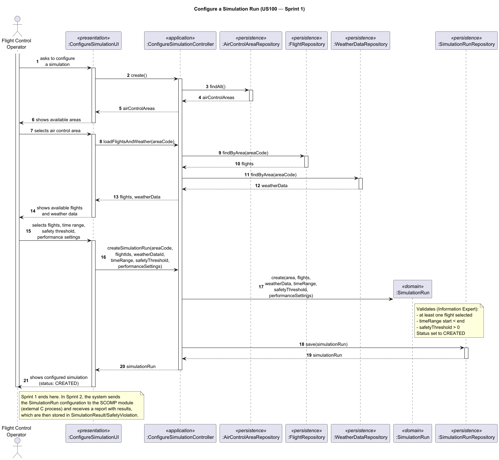

### Why this is an aggregate
The SimulationRun aggregate manages the full lifecycle of a simulation (from creation to completion/failure) and ensures consistency between configuration, referenced flights, and results. It is the integration point between the Java domain and the external SCOMP module — configuration is validated on the Java side before being sent for execution.

### Invariants enforced
- must reference at least one Flight
- must reference exactly one AirControlArea
- TimeRange start must precede TimeRange end
- SafetyThreshold must be positive
- SimulationResult is only present when status is COMPLETED
- SafetyViolation timestamps must fall within the TimeRange
- ValidationOutcome is PASS only if zero SafetyViolations

### Justification
SimulationRun coordinates multiple concerns — configuration parameters, flight selection, weather input, and result capture — under a single lifecycle. Allowing results to exist without a completed simulation, or violations outside the time range, would produce meaningless data.

The aggregate root enforces that configuration is valid before execution begins (Information Expert) and that results are only recorded when the simulation completes, guaranteeing the integrity of simulation outputs used for safety assessment.

The core Java system is not responsible for flight simulation internals — it only sends configuration to the C module (SCOMP) and receives a report (PO, 27/03/2026). PerformanceSettings is intentionally underspecified for Sprint 1 and will be refined in Sprints 2–3 as the simulation requirements become clearer (PO, 26/03/2026).

---

## 13. User Aggregate

### Representative Scenario
Register a new backoffice user (US031), assigning identity, role, security clearance expiration, and skills assessment information.
Later, an Administrator may disable/enable that user (US032), and users must be listed with their status (US033).
Authentication and authorization must be enforced for all functionalities (US030).

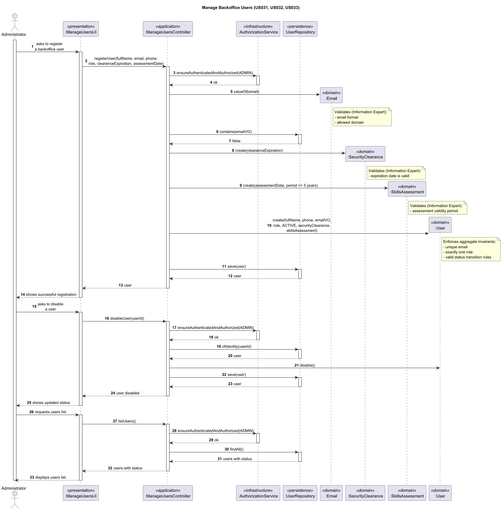

### Why this is an aggregate
The User aggregate is responsible for system identity and access control state.
It guarantees that a user can only exist and operate with coherent identity, role, status, and compliance attributes (security clearance and skills assessment).

### Invariants enforced
-  user email must be unique in the system
-  user email domain must belong to the allowed domain list
-  a user must have exactly one system role
-  user status must be explicitly defined (ACTIVE or DISABLED)
-  security clearance must have a valid expiration date
-  skills assessment must be valid according to the periodic requirement (maximum 5 years)
-  enable/disable transitions are controlled administrative operations (US032)

### Justification
User is a core identity concept reused across multiple domain areas (e.g., collaborator and pilot identities).
If identity and access constraints were spread across other aggregates, the system could allow inconsistent states (for example, a disabled or non-compliant user still being treated as operational).

By concentrating these rules in a single aggregate root, the model enforces consistency at the point where authentication/authorization semantics are decided.
This ensures that all downstream role-specific aggregates reference a valid and access-controlled system identity instead of re-implementing security rules in multiple places.

## 14. WeatherData Aggregate

### Representative Scenario
Register weather data for a specific air control area (US041).

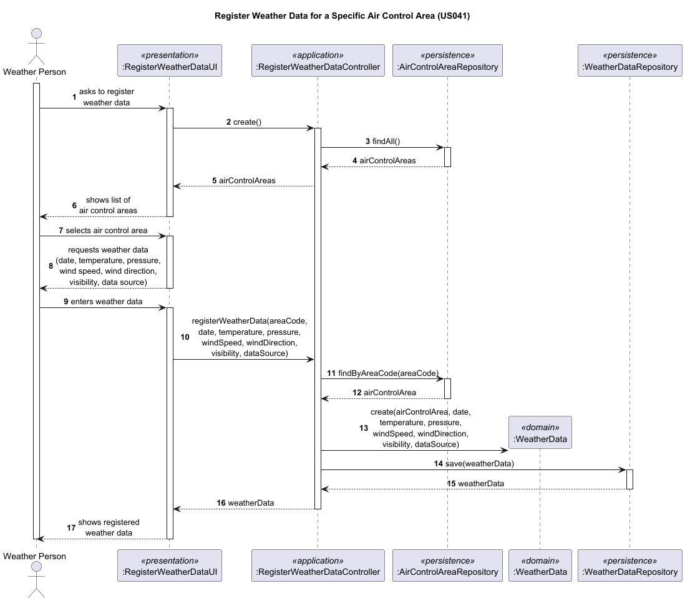

### Why this is an aggregate
The WeatherData aggregate must ensure that each weather record is physically valid and uniquely identifiable within the system.

### Invariants enforced
- each record is associated with exactly one AirControlArea
- temperature, pressure, wind speed, and visibility must be within physically valid ranges
- wind direction must be 0–360 degrees
- duplicate records (same area + date + source) must not be allowed
- DataSource must identify the provider

### Justification
Weather data directly affects simulation accuracy. Weather conditions are not uniform across an entire air control area — they can vary within the same area (PO, 19/03/2026). This means a single AirControlArea may have multiple WeatherData records for different locations or conditions at the same time, reinforcing the need for the uniqueness invariant (same area + date + source) to prevent duplicates while still allowing the necessary granularity.

If records with invalid physical values or duplicate identities were allowed, simulations would produce unreliable results. The aggregate root centralizes validation of both the physical constraints and the uniqueness rule, ensuring that only valid and non-duplicate weather records are stored.