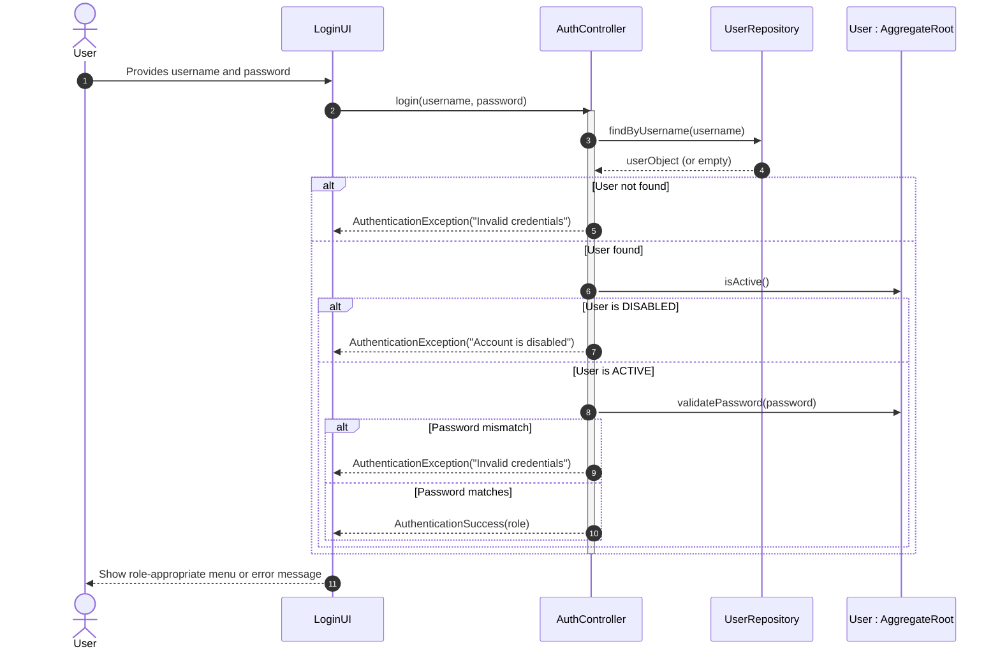

# US 030 - Authentication and Authorization

## Context

*It is the first time this task is assigned. This US is foundational to the entire AISafe backoffice system, establishing the security layer that governs who can access the system and what actions each user is permitted to perform. It is a prerequisite for all other US that require a secured entry point.*

## Requirements

**US 030** As a User, I want to be able to authenticate myself in the backoffice so that only authorized personnel can access the system and its features according to their assigned role.

**Acceptance Criteria:**

- US030.1 The system presents a login interface where a user provides a username and password.
- US030.2 Authentication fails with a clear error message if credentials are invalid or the user does not exist.
- US030.3 A disabled/inactive user cannot authenticate, even with valid credentials.
- US030.4 Upon successful authentication, the user is granted access only to the features permitted by their role.
- US030.5 Unauthorized access attempts to protected features are rejected with an appropriate error message.
- US030.6 The system supports at least the roles defined in the project specification (e.g., ADMIN, OPERATOR).

**Dependencies/References:**

*Regarding this requirement, we understand that it relates to...*

- **US031 (Register Users):** The user accounts that will be authenticated are created and managed in US031. Authentication can only succeed for users that exist and are ACTIVE in the system.
- **US032 (Disable/Enable Users):** A disabled user must be denied authentication, linking the user status managed in US032 directly to the authentication gate.
- **US033 (List Users):** Access to user management features must be role-restricted, relying on the authorization layer defined here.
- **Project Specification §2.1:** Reference to the defined roles and their corresponding access permissions.

## Analysis

Authentication and Authorization form the security backbone of the AISafe backoffice. Every interaction with the system passes through this layer, making its correctness and robustness critical.

### Main Domain Rules & Invariants

* **Credential Validation:** A login attempt is only successful when both the username and password match a record for an existing, ACTIVE user.
* **Status Enforcement:** User status (ACTIVE/DISABLED) is checked at authentication time. A DISABLED user is denied access regardless of whether the password is correct.
* **Role-Based Access Control (RBAC):** Each user is assigned exactly one role (e.g., `ADMIN`, `OPERATOR`). The role determines which use cases and menu options the user can access.
* **Least Privilege:** Users can only perform actions explicitly permitted by their role. Any attempt to access a resource outside their role's scope must be rejected.
* **No Anonymous Access:** All backoffice features require a prior successful authentication. There are no publicly accessible endpoints.
* **Credential Security:** Passwords must not be stored in plain text. A hashing strategy must be applied before persistence.

### Role Definitions

The system enforces access control through predefined roles defined in `AisafeRoles`:

| Role       | Description                                              |
|------------|----------------------------------------------------------|
| `ADMIN`    | Full access to all backoffice features, including user management. |
| `OPERATOR` | Access restricted to operational features; cannot manage users. |

*Additional roles may be added as further US are implemented.*

### Preliminary Domain Model excerpt

The authentication and authorization layer will interact with:

- **User (Aggregate Root)** — the principal being authenticated (defined in US031).
- **AisafeRoles (Enum/Value Object)** — defines the set of valid roles and their associated authorities.
- **UserStatus (Enum)** — ACTIVE or DISABLED; gates authentication.
- **Credential (Value Object)** — encapsulates the hashed password and validation logic.

## Design

The solution for US030 reuses and extends the existing authentication infrastructure of the project, applying it to the AISafe backoffice context.

### Realization

#### Architectural approach

* **Presentation layer (Console UI):** The system presents a login menu before granting access to any backoffice option. The user provides a username and password. On success, the session is established and the role-appropriate menu is displayed. On failure, a clear error message is shown and the user may retry.
* **Application layer (AuthController):** A dedicated authentication controller coordinates credential verification and session establishment. Post-authentication, an authorization guard is applied at the controller level for every subsequent operation.
* **Domain layer (User + Credential + AisafeRoles):** The `User` aggregate exposes the necessary state (status, role, credential) for the authentication decision. Business rules such as status enforcement and role validation are owned by the domain.
* **Infrastructure/Persistence layer:** The `UserRepository` is queried by username to retrieve the stored user and its hashed credential for comparison. The existing Spring Security / authz framework is reused for session and authority management.

#### Dynamic view — Login flow

#### Dynamic view — Authorization enforcement flow

* **Trigger:** Any authenticated user attempts to invoke a protected use case (e.g., Register User).
* **Guard:** The application controller for that use case verifies that the current session's role includes the required authority.
* **Allow:** If the role is authorized, the use case proceeds normally.
* **Deny:** If the role is not authorized, the operation is rejected with an `UnauthorizedException` and the user is informed without exposing internal details.

#### Main design decisions

* **Reuse of existing authz framework:** Spring Security's credential encoding and authority model are reused to avoid reinventing security primitives.
* **Status check at authentication time:** Disabled users are blocked at the login gate, preventing any need for per-feature status checks.
* **Generic error messages for failed logins:** To prevent user enumeration attacks, both "user not found" and "wrong password" scenarios return the same message ("Invalid credentials") to the end user.
* **Role enforcement at controller level:** Authorization checks are centralised in application controllers, keeping domain logic free of access control concerns.
* **Password hashing:** Passwords are hashed using a strong algorithm (e.g., BCrypt) before storage; plain-text passwords are never persisted.

### Acceptance Tests

- `ensureValidCredentialsAuthenticateSuccessfully`: Successful login with valid credentials (US030.1, US030.4)
- `ensureWrongPasswordIsRejected`: Reject login with wrong password (US030.2)
- `ensureNonExistentUserIsRejected`: Reject login for non-existent user (US030.2)
- `ensureDisabledUserCannotLogin`: Reject login for DISABLED user (US030.3)
- `ensureAdminCanAccessUserManagement`: Enforce role-based access: ADMIN can access user management (US030.4, US030.6)
- `ensureOperatorCannotAccessUserManagement`: Enforce role-based access: OPERATOR cannot access user management (US030.5)
- `ensurePasswordIsStoredHashed`: Password is not stored in plain text (US030.1)
