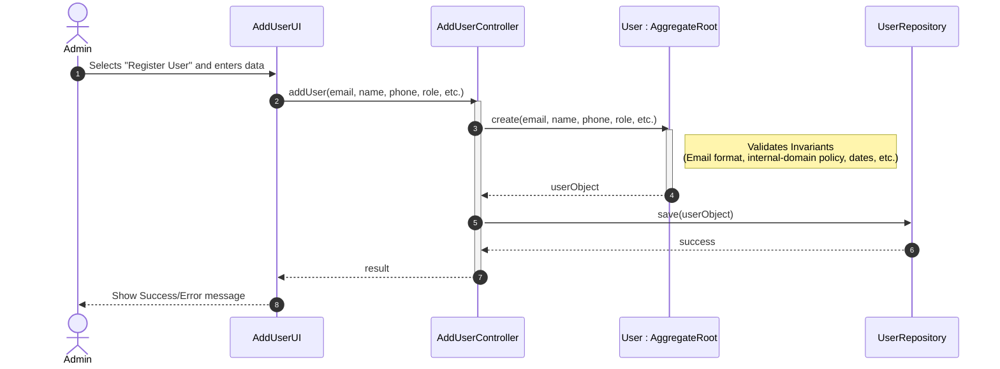

# US 031 - Register Users

## Context

*It is the first time this task is assigned. This US is fundamental as it establishes the user base for the entire AISafe system, including the bootstrap mechanism and the foundational domain entities for authentication (US030).*

## Requirements

**US 031** As Administrator, I want to be able to register users of the backoffice. This must also be achievable by a bootstrap process.

**Acceptance Criteria:**

- US031.1 Admin can register new users through the UI.

- US031.2 Each user has a unique valid email. Internal AISafe users must use an email from the approved email domain list.

- US031.3 Each user has a name, phone number, role, security clearance expiry date, and skills assessment date (valid for 5 years as per regulations).

- US031.4 A bootstrap process can pre-populate users from configuration data.

- US031.5 Duplicate email registrations are rejected with a clear error.

**Dependencies/References:**

*Regarding this requirement, we understand that it relates to...*

- **US030 (Authentication & Authorization):** Users created here will be the subjects of the authentication process.
- **US061 (Collaborator Registration):** Provides the base User entity for airline collaborators.
- **Project Specification §2.1:** Reference to the mandatory fields and the 5-year assessment rule.

## Analysis

The registration of backoffice users is a critical process that ensures only authorized personnel can access the system's management features.

### Main Domain Rules & Invariants
* **Unique Identity:** A user is strictly identified by their email. No two users can share the same email.
* **Email Validation:** `Email` validates the syntactic email format and is shared by all AISafe users.
* **Domain Validation:** `EmailDomainPolicy` enforces the approved-domain whitelist for internal AISafe roles. Per PO clarification of 20/04/2026, external collaborators such as ATCC, FCO and pilots are not subject to domain verification because they may legitimately use emails outside the customer's or AISafe's domains.
* **Mandatory Data:** Name and Phone Number are required. The phone number must follow a basic international format validation.
* **Security & Compliance:**
    * **Security Clearance:** Every user must have an expiry date for their clearance.
    * **Skills Assessment:** By regulation, this assessment is valid for 5 years. The system must store the last assessment date.
* **Default State:** All new users are created with the status "ACTIVE".

### Bootstrap Process
The system must support a bootstrap mechanism (likely via a `Bootstrap` class or a `.csv`/`.txt` file) that bypasses the UI but **must** respect all the domain invariants mentioned above.

### Preliminary Domain Model excerpt
The User aggregate will consist of:
- **User (Aggregate Root)**
- **Email (Value Object)** - Handles format validation.
- **EmailDomainPolicy** - Enforces the approved-domain whitelist for internal roles.
- **PhoneNumber (Value Object)** - Handles format validation.
- **SecurityClearance (Value Object)** - Handles expiry date logic.
- **SkillsAssessment (Value Object)** - Handles the 5-year validity logic.

## Design

The solution for US031 follows the existing layered architecture and reuses the authentication infrastructure already adopted in the project.

### Realization

#### Architectural approach

The design separates authentication identity from business user profile concerns:

* **Presentation layer (Console UI):** Admin accesses the Backoffice menu and triggers the “Register User” option. UI collects all required input fields: username, password, full name, email, phone, role, security clearance expiration date, and skills assessment date.
* **Application layer (Use Case Controller):** A dedicated registration controller coordinates the use case. Authorization is enforced at the controller level (only Admin/authorized roles can execute the use case).
* **Domain layer (User Aggregate + Value Objects):** Business rules are enforced through domain objects and invariants: unique email, valid email format, internal-role email-domain policy, mandatory name and phone, valid security clearance expiration, skills assessment validity (max 5 years), and default status = ACTIVE.
* **Infrastructure/Persistence layer:** Persistence stores both authentication data and business profile data. Bootstrap uses the same application flow to guarantee rule consistency.

#### Dynamic view — Admin registration flow



#### Dynamic view — Bootstrap registration flow

• **Data Source:** Bootstrapper reads predefined user seed data from UserBootstrapper class.
• **Execution Flow:** For each entry, it calls the same registration application logic (`AddUserController`) used by the UI.
• **Rule Enforcement:** Domain invariants and the internal-role email-domain policy are applied exactly as in the interactive flow to ensure data integrity.
• **Persistence:** Valid entries are persisted; duplicate or invalid entries are rejected and logged.
• **Safety:** The process is idempotent, making it safe for reruns during system startup.

#### Main design decisions

• **Reuse of existing authz framework:** services for credential creation and role assignment are reused.
• **Domain-Driven Validation:** Business-specific user attributes are validated with explicit domain rules. The shared `Email` value object validates format, while `EmailDomainPolicy` enforces the approved-domain whitelist for internal roles.
• **Centralized Logic:** Registration logic is centralized in application controllers to avoid duplication between UI and bootstrap.
• **Error Handling:** Error messages are explicit and mapped to causes like duplicate email, malformed email or internal-role domain rejection.

### Acceptance Tests

- `ensureUserIsCreatedSuccessfully`: Successful registration through UI (US031.1, US031.3)
- `ensureInternalUserEmailDomainIsAllowed`: Reject internal-role email outside allowed domains (US031.2)

**Test 2a - Accept external-role email outside allowed internal domains** **Refers to:** US031.2, US061.5  
*Given* a valid external collaborator registration request with a valid email outside AISafe domains, *when* registering, *then* the domain policy allows it.
```java
@Test
public void ensureExternalCollaboratorEmailNeedNotUseInternalDomain() {
    controller.registerUser("atcc", "Password1", "Ana", "Silva",
        "ana.personal@gmail.com", "+351910000001",
        Set.of(AisafeRoles.AIR_TRANSPORT_COMPANY_COLLABORATOR),
        LocalDate.now().plusYears(1), LocalDate.now().minusMonths(1));
}
```

- `ensureEmailUniqueness`: Reject duplicate email (US031.5)
- `ensureNameAndPhoneAreMandatory`: Reject missing mandatory fields (US031.3)
- `ensureSecurityClearanceIsFutureDate`: Reject expired/invalid security clearance (US031.3)
- `ensureSkillsAssessmentIsWithinFiveYears`: Reject outdated skills assessment (US031.3)
- `ensureBootstrapPopulatesUsers`: Bootstrap creates valid users (US031.4)
- `ensureBootstrapEnforcesInvariants`: Bootstrap still enforces invariants (US031.2, US031.5)
