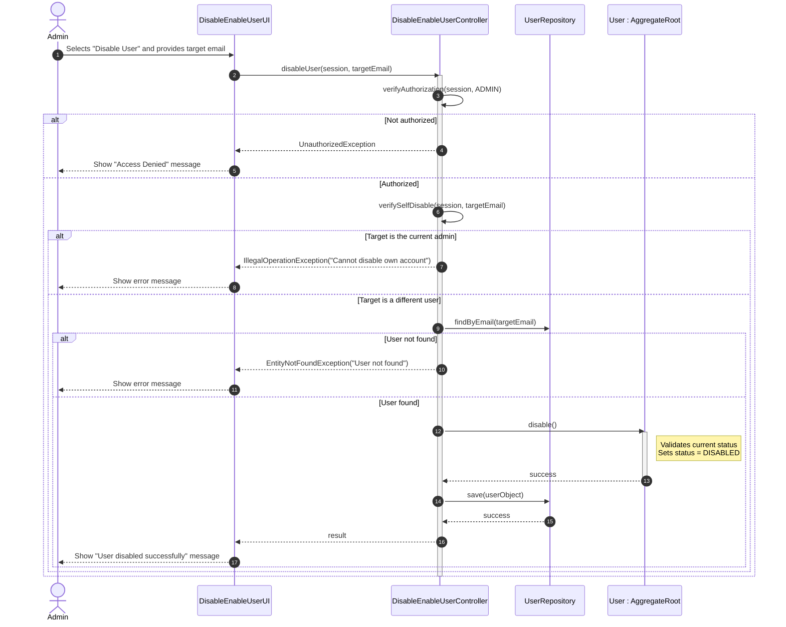

# US 032 - Disable/Enable Users

## Context

*It is the first time this task is assigned. This US provides the backoffice administrator with the ability to control user access to the system by toggling their status between ACTIVE and DISABLED. It complements the user registration process (US031) and relies on the user listing (US033) to identify the target user, and on the authentication layer (US030) to enforce that only authorized roles can perform this operation.*

## Requirements

**US 032** As Administrator, I want to be able to disable/enable users of the backoffice so that I can control who has active access to the system without permanently deleting user records.

**Acceptance Criteria:**

- US032.1 Admin can disable an ACTIVE user, causing their status to change to DISABLED.
- US032.2 Admin can enable a DISABLED user, causing their status to change back to ACTIVE.
- US032.3 A DISABLED user cannot authenticate in the system (enforced by US030).
- US032.4 The operation is rejected if the target user does not exist.
- US032.5 An Administrator cannot disable their own account.
- US032.6 Only authorized roles (e.g., ADMIN) can perform this operation.
- US032.7 The system provides clear feedback upon success or failure of the operation.

**Dependencies/References:**

*Regarding this requirement, we understand that it relates to...*

- **US030 (Authentication & Authorization):** Authorization is enforced before executing the operation. Additionally, a DISABLED user being denied login is the direct runtime consequence of this use case.
- **US031 (Register Users):** The users being disabled or enabled are those originally registered through this process. The `UserStatus` default defined in US031 (ACTIVE) is the starting point for this use case.
- **US033 (List Users):** The administrator identifies the target user through the listing before invoking disable/enable. The updated status must be reflected in subsequent listings.
- **Project Specification §2.1:** Reference to the user lifecycle and status management rules.

## Analysis

Disabling and enabling users is a lifecycle management operation. It does not destroy data — it controls access. This distinction is important: a disabled user's history and data remain intact, and the account can be restored at any time.

### Main Domain Rules & Invariants

* **Authorization Required:** Only users with the appropriate role (e.g., `ADMIN`) may invoke this use case. Unauthorized attempts must be rejected before any state change occurs.
* **Target Must Exist:** The operation can only be performed on a user that exists in the system. If the provided identifier does not match any user, the operation fails with a clear error.
* **Status Toggle Logic:** Disabling an ACTIVE user sets their status to DISABLED. Enabling a DISABLED user sets their status to ACTIVE. Attempting to disable an already DISABLED user, or enable an already ACTIVE user, should be handled gracefully (either as a no-op or with an informational message).
* **Self-Disable Prevention:** An administrator cannot disable their own account. This prevents the system from reaching a state where no admin can log in.
* **No Hard Deletion:** Users are never deleted through this use case. Disabling is a soft deactivation that preserves all user data.
* **Immediate Effect:** Once a user is disabled, any subsequent login attempt by that user must be denied (enforced at the authentication layer per US030).

### User Status State Machine

```
           ┌─────────────┐
  register │             │
  ─────────►   ACTIVE    │
           │             │
           └──────┬──────┘
                  │  disable()
                  ▼
           ┌─────────────┐
           │             │
           │  DISABLED   │
           │             │
           └──────┬──────┘
                  │  enable()
                  ▼
           ┌─────────────┐
           │             │
           │   ACTIVE    │
           │             │
           └─────────────┘
```

All new users start as ACTIVE (per US031). Status transitions are bidirectional and controlled exclusively through this use case.

### Preliminary Domain Model excerpt

The disable/enable use case interacts with:

- **User (Aggregate Root)** — owns the `status` field and exposes `disable()` and `enable()` methods that enforce transition invariants.
- **UserStatus (Enum)** — `ACTIVE` | `DISABLED`; the value being toggled.
- **UserRepository** — used to retrieve the target user by identifier and persist the updated state.

## Design

The solution for US032 follows the existing layered architecture. Status transitions are owned by the `User` aggregate to ensure domain invariants are always enforced, regardless of the calling context.

### Realization

#### Architectural approach

* **Presentation layer (Console UI):** The Admin selects "Disable/Enable User" from the backoffice menu. The UI prompts for the target user's email (or presents the listing from US033 for selection). After the operation, the UI shows a success or error message reflecting the outcome.
* **Application layer (DisableEnableUserController):** A dedicated controller handles the use case. It enforces authorization, retrieves the target user, delegates the status change to the domain, and persists the result. It also enforces the self-disable prevention rule at this level.
* **Domain layer (User Aggregate):** The `User` aggregate exposes `disable()` and `enable()` methods. These methods are responsible for validating the transition (e.g., already in the target state) and updating the internal `status` field. No external code sets the status directly.
* **Infrastructure/Persistence layer:** The `UserRepository` retrieves the target user by email and persists the updated aggregate after the status change.

#### Dynamic view — Disable User flow



#### Dynamic view — Enable User flow

The enable flow follows the same structure as the disable flow, with the following differences:

- The UI prompts for "Enable User" and the controller calls `enable()` on the domain.
- The self-disable prevention check does not apply (enabling one's own account is not a concern).
- The `enable()` method on the domain sets the status back to `ACTIVE`.

#### Main design decisions

* **Status logic owned by the aggregate:** `disable()` and `enable()` are methods on the `User` aggregate root, not setters. This ensures that invariants (e.g., handling already-disabled state) are enforced at the domain level and cannot be bypassed.
* **Self-disable prevention at controller level:** The check that prevents an admin from disabling their own account is enforced in the application layer, as it requires knowledge of the current session — a concern that belongs outside the domain.
* **Soft deactivation only:** No delete operation is exposed through this use case. User data is preserved to maintain auditability and allow reactivation.
* **Immediate persistence:** The status change is persisted immediately after the domain transition, ensuring the authentication layer (US030) reflects the new status on the next login attempt.
* **Consistent UI pattern:** The same UI and controller handle both disable and enable, keeping the interaction model simple and reducing duplication.

### Acceptance Tests

- `ensureActiveUserCanBeDisabled`: Successfully disable an ACTIVE user (US032.1)
- `ensureDisabledUserCanBeEnabled`: Successfully enable a DISABLED user (US032.2)
- `ensureDisabledUserCannotLogin`: Disabled user cannot authenticate (US032.3)
- `ensureDisablingNonExistentUserIsRejected`: Reject operation on non-existent user (US032.4)
- `ensureAdminCannotDisableOwnAccount`: Admin cannot disable their own account (US032.5)
- `ensureOperatorCannotDisableUsers`: Unauthorized role cannot disable users (US032.6)
- `ensureListingReflectsDisabledStatus`: Listing reflects updated status after disable (US032.1, US033.3)
