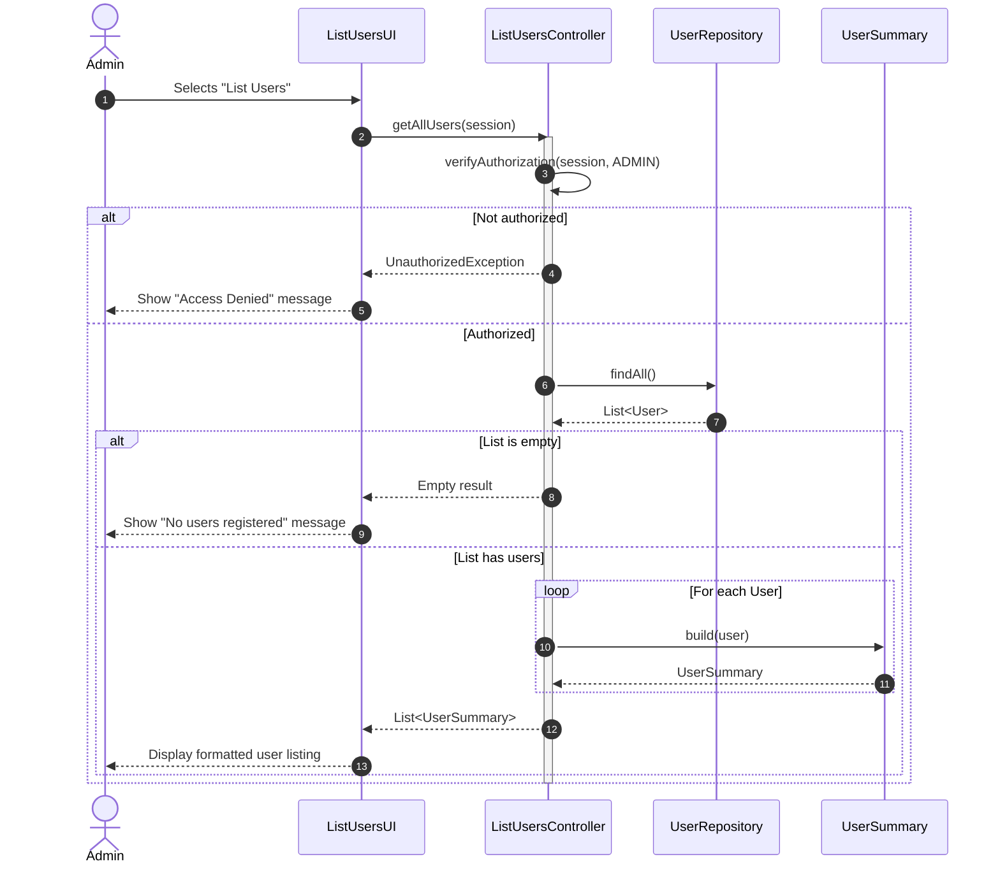

# US 033 - List Users

## Context

*It is the first time this task is assigned. This US provides the backoffice administrator with visibility over all registered users in the AISafe system. It is a necessary support feature for user management operations such as disabling or enabling users (US032), and depends on an authenticated and authorized session (US030) and the existence of registered users (US031).*

## Requirements

**US 033** As Administrator, I want to be able to list all registered backoffice users so that I can have an overview of the system's users and their current status.

**Acceptance Criteria:**

- US033.1 Admin can access a "List Users" option from the backoffice menu.
- US033.2 The listing displays, for each user, at least: name, email, role, status (ACTIVE/DISABLED), security clearance expiry date, and skills assessment date.
- US033.3 The listing reflects the current state of the system (users registered via UI or bootstrap are included).
- US033.4 If no users exist, the system presents an appropriate informational message.
- US033.5 Only authorized roles (e.g., ADMIN) can access the user listing feature.

**Dependencies/References:**

*Regarding this requirement, we understand that it relates to...*

- **US030 (Authentication & Authorization):** Access to the user listing is restricted to authorized roles. An authenticated session is required before the listing can be invoked.
- **US031 (Register Users):** The users displayed in the listing are those created through the registration process (UI or bootstrap).
- **US032 (Disable/Enable Users):** The listing serves as the entry point for identifying which users to disable or enable, making it a direct prerequisite for that use case.
- **Project Specification §2.1:** Reference to the mandatory fields associated with a user.

## Analysis

Listing users is a read-only operation that gives the administrator a consolidated view of the system's user base. While it does not mutate any domain state, it must respect the same authorization rules as any other protected feature.

### Main Domain Rules & Invariants

* **Authorization Required:** Only users with the appropriate role (e.g., `ADMIN`) may invoke this use case. An unauthenticated or unauthorized request must be rejected.
* **Complete and Current Data:** The listing must reflect the actual persisted state. Any user registered via UI or bootstrap, regardless of their current status, must appear in the list.
* **No Domain Side Effects:** This is a pure read operation. Invoking the listing must not alter any domain entity or trigger any business rule.
* **Minimal Exposure:** Only the data relevant for administrative oversight is exposed. Sensitive data such as hashed passwords must never be included in the listing output.
* **Empty State Handling:** If no users are registered, the system communicates this explicitly rather than returning a silent empty result.

### Read Model (UserSummary DTO)

To decouple the display concern from the domain model, a lightweight DTO is used for the listing output:

| Field                     | Description                                      |
|---------------------------|--------------------------------------------------|
| `name`                    | Full name of the user.                           |
| `email`                   | Unique email address (identifier).               |
| `role`                    | Assigned role (e.g., ADMIN, OPERATOR).           |
| `status`                  | Current status: ACTIVE or DISABLED.              |
| `securityClearanceExpiry` | Expiry date of the user's security clearance.    |
| `skillsAssessmentDate`    | Date of the last valid skills assessment.        |

### Preliminary Domain Model excerpt

The listing use case interacts with:

- **User (Aggregate Root)** — the entity being queried (defined in US031).
- **UserRepository** — queried to retrieve all persisted users.
- **UserSummary (DTO)** — the read model returned to the presentation layer, built from the domain entity without exposing internal implementation details.

## Design

The solution for US033 follows the existing layered architecture and is intentionally kept as a lightweight read use case, with no domain mutations.

### Realization

#### Architectural approach

* **Presentation layer (Console UI):** The Admin selects "List Users" from the backoffice menu. The UI receives a list of `UserSummary` DTOs and formats them for console display, one user per line (or in a table-like format).
* **Application layer (ListUsersController):** A dedicated controller handles the use case. It enforces authorization before delegating to the repository, and maps domain entities to DTOs before returning them to the UI.
* **Domain layer (User Aggregate):** No domain logic is triggered beyond reading existing state. The `User` aggregate exposes the fields needed to build the `UserSummary` DTO.
* **Infrastructure/Persistence layer:** The `UserRepository` provides a `findAll()` query that retrieves all persisted users. No complex filtering is required at this stage.

#### Dynamic view — List Users flow

#### Main design decisions

* **DTO over direct entity exposure:** The `UserSummary` DTO shields the presentation layer from internal domain model changes and ensures sensitive fields (e.g., hashed password) are never accidentally exposed.
* **Authorization at controller level:** Consistent with the pattern established in US030, the authorization check is the first operation performed by the controller, before any repository interaction.
* **Read-only repository query:** A simple `findAll()` is used. Future iterations may introduce filtering (e.g., by role or status) without affecting the current design.
* **No pagination at this stage:** Given the expected scale of backoffice users, pagination is not required in this iteration. It can be introduced later if needed.
* **Explicit empty state:** Rather than silently returning an empty collection to the UI, the controller flags the empty state so the UI can display a meaningful message to the administrator.

### Acceptance Tests

- `ensureListUsersReturnsAllRegisteredUsers`: Successful listing with registered users (US033.1, US033.2, US033.3)
- `ensureListingReflectsCurrentUserStatus`: Listing returns the correct status for each user (US033.2, US033.3)
- `ensureEmptyListingIsHandledGracefully`: Empty listing returns informational result (US033.4)
- `ensureOperatorCannotListUsers`: Unauthorized role cannot list users (US033.5)
- `ensureListingDoesNotExposeSensitiveData`: Listing does not expose sensitive fields (US033.2)
- `ensureBootstrapUsersAreIncludedInListing`: Bootstrap users appear in the listing (US033.3)
