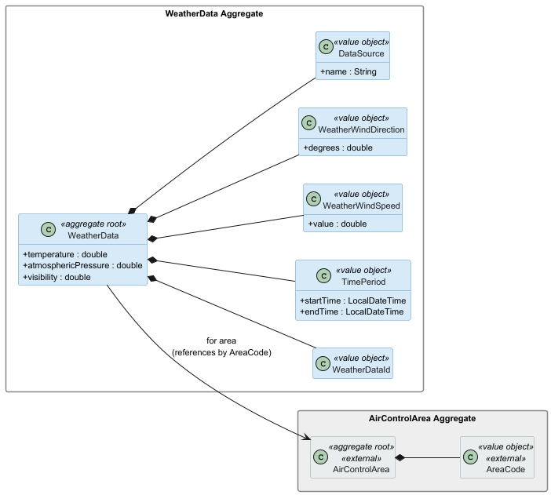
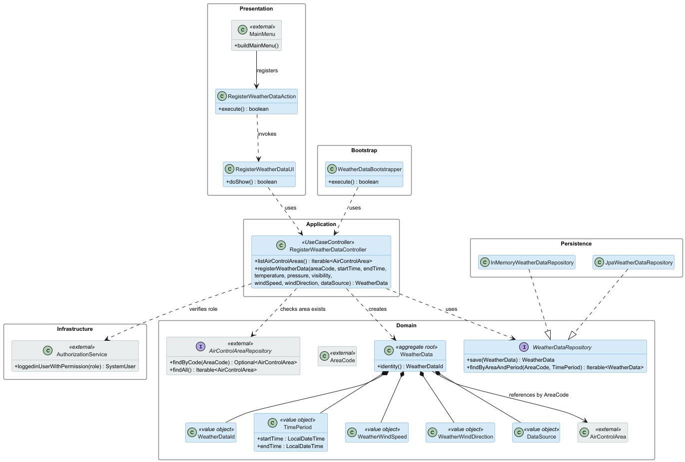

# US041 — Register Weather Data

## Context

This is the first time US041 is assigned for development. It is part of Sprint 2 and was not addressed in Sprint 1.

US041 introduces the `WeatherData` aggregate, which represents a meteorological record associated with a specific air control area and time period. It is the foundational user story for the weather service subdomain: US042 (import bulk weather data) and US043 (consult weather data) both depend on weather records existing in the system. The work covers analysis, design, implementation and end-to-end verification of the use case, plus a bootstrap loader for pre-populated weather data.

## Requirements

**US041** As a Weather Person, I want to register weather data in the system for a specific air control area.

**Acceptance Criteria:**

- US041.1 — The authenticated Weather Person can register a weather data record for an existing air control area.
- US041.2 — The record includes a time period (start time and end time), both defined by the user; no specific granularity is prescribed.
- US041.3 — The record includes meteorological data: temperature, atmospheric pressure, visibility, wind speed, wind direction, and data source.
- US041.4 — The referenced air control area must exist in the system.
- US041.5 — Temperature, atmospheric pressure, visibility, wind speed, and wind direction must be within valid physical ranges.
- US041.6 — Wind direction must be between 0 and 360 degrees.
- US041.7 — Wind speed must be greater than or equal to zero.
- US041.8 — The time period start must precede the end.
- US041.9 — Overlapping weather records for the same area and time period are permitted for the MVP; this simplification is documented.
- US041.10 — A bootstrap process can pre-populate weather data records.

**Dependencies/References:**

- **US050** (Register an air control area): the target air control area must exist before weather data can be registered for it.

---

## Analysis

### Actor and Console

The actor is the Weather Person, per §3.1 of the requirements. The use case is implemented in the `aisafe.app.weather.console` module. Domain classes live in `aisafe.core`, under the package `eapli.aisafe.weather.domain`.

Unlike the ATCC use cases (US070–072), the Weather Person does not belong to a company — they are a system user with the `WEATHER_PERSON` role. Actor resolution is therefore simpler: the controller uses `AuthorizationService` to verify the logged-in user holds the required role, without needing to resolve a company association.

### Requirement Source

US041 (full text): *"As a Weather Person, I want to register weather data in the system for a specific air control area."*

Sprint 2 PO clarification of 28/04/2026: *"The time period (start and end time) of a weather data record is defined by the user at registration time. No specific granularity is prescribed."*

Sprint 2 PO clarification of 02/05/2026: *"Overlapping weather records for the same area and time period reflect real-world complexity. For the MVP, a simplified approach is acceptable provided the simplifications and their rationale are documented."*

### Domain Model

This US introduces the `WeatherData` aggregate. The diagram below shows the aggregate and its value objects, and the external `AirControlArea` aggregate (in grey) that is referenced by each weather record.

Key modelling decisions reflected in the diagram:

- `WeatherDataId` is a system-generated value object serving as the aggregate identity, since weather data records have no natural business key that is guaranteed to be unique.
- `TimePeriod` is a value object encapsulating `startTime` and `endTime`, with validation (start must precede end) enforced at construction time.
- `WeatherWindSpeed` and `WeatherWindDirection` are distinct value objects to enforce their individual physical ranges (speed ≥ 0; direction 0–360°).
- `DataSource` is a value object representing the origin of the record (e.g. a provider name or identifier), in anticipation of US042 which aggregates data from multiple sources.
- `WeatherData` references `AirControlArea` by its `AreaCode` identifier, not by object graph navigation.

### Design Decisions

**Overlapping records allowed for the MVP.** The PO clarification of 02/05/2026 explicitly permits overlapping records for the same area and time period in the MVP. No uniqueness check on `(areaCode, timePeriod)` is performed. The `WeatherDataRepository` does not expose a `findOverlapping` method in this sprint. This simplification is intentional and documented here; if overlap detection becomes a requirement in a future sprint, it will be implemented at the application layer in the same way as was done for `AirControlArea` boundaries in US050.

**System-generated identity.** Weather data records have no natural unique business key: the same area can have multiple records for overlapping periods from different sources. A system-generated `WeatherDataId` (e.g. a UUID) is used as the aggregate identity, keeping the aggregate self-contained.

**Physical range validation in value objects.** Each meteorological measure with a constrained range is encapsulated in its own value object: `WeatherWindDirection` rejects values outside [0, 360]; `WeatherWindSpeed` rejects negative values. Temperature, pressure, and visibility ranges are enforced within the `WeatherData` constructor via domain preconditions, with thresholds chosen conservatively for physical plausibility (e.g. temperature in Kelvin or Celsius with agreed limits — see open question Q1).

**Controller obtains repository via constructor injection.** The `RegisterWeatherDataController` receives `WeatherDataRepository` and `AirControlAreaRepository` as constructor parameters, applying the Dependency Inversion Principle and enabling in-memory testing.

### Invariants

Enforced inside the aggregate (constructors and value objects):

- `TimePeriod` rejects null start or end time.
- `TimePeriod` rejects a period where start is not strictly before end.
- `WeatherWindDirection` rejects values outside [0, 360].
- `WeatherWindSpeed` rejects negative values.
- `WeatherData` requires a non-null `AreaCode`, `TimePeriod`, and `DataSource`.

Enforced at the application layer (controller):

- The authenticated user must hold the `WEATHER_PERSON` role.
- The referenced `AirControlArea` must exist in the system.

### Open Questions

| # | Question | Impact |
|---|---|---|
| Q1 | What are the accepted ranges for temperature, atmospheric pressure, and visibility? | Impacts value-object validation in `WeatherData` constructor |
| Q2 | Is `dataSource` a free-text field or must it reference a known provider entity? | Impacts whether `DataSource` is a simple VO or a reference to a future `WeatherProvider` aggregate |

### Dependencies

**Upstream:**

- US050 — `AirControlArea` must exist with a valid `AreaCode`.

**Downstream:**

- US042 (Import bulk weather data): bulk import creates multiple `WeatherData` records via the same controller.
- US043 (Consult weather data): queries `WeatherData` records by area and date.
- US082 (Insert weather data in a flight): associates `WeatherData` records with a flight plan.
- SCOMP US110 (Integrate environmental influences into simulation): loads wind speed and direction from weather records.

### Bootstrap

Acceptance criterion US041.10 requires a bootstrap process. A `WeatherDataBootstrapper` will pre-populate a fixed set of weather records at system initialisation, going through the same registration use case to ensure all invariants are enforced. The bootstrapper runs after the US050 bootstrapper, since it depends on air control areas already being present.

---

## Design

### Realization

### Acceptance Tests

This section presents the main unit tests that exercise the domain invariants captured during analysis. Tests are written in JUnit 4 style (run via the Vintage Engine on JUnit 5 Platform) and follow the `ensureXxxYyy` naming convention. They are currently annotated `@Ignore("Phase 2 stub - implementation in Phase 3")` pending Phase 3 implementation.

Acceptance criteria covering application-layer enforcement — area existence check (US041.4), role verification (US041.1), and end-to-end registration — are validated in Phase 3 alongside the `RegisterWeatherDataController` and `InMemoryWeatherDataRepository`.

---

- `ensureTimePeriodRejectsStartAfterEnd`: A time period cannot be constructed when start time is equal to or after end time, enforcing the temporal ordering invariant. (US041.8)

---

- `ensureWindDirectionRejectsValueAbove360`: A wind direction value outside the [0, 360] range is rejected at value-object construction time. (US041.6)

---

- `ensureWindSpeedRejectsNegativeValue`: A negative wind speed value is rejected at value-object construction time. (US041.7)

---

- `ensureWeatherDataRejectsNullAreaCode`: A weather data record cannot be constructed without an area reference, enforcing aggregate completeness. (US041.4)

---

- `ensureWeatherDataRejectsNullTimePeriod`: A weather data record cannot be constructed with a null time period. (US041.2)

---

## Observations

- Overlapping weather records for the same area and time period are permitted in the MVP, per Sprint 2 PO clarification of 02/05/2026. This simplification is documented here and in Section 3.4. It must be revisited if US043 or US082 require non-overlapping guarantees.
- The `DataSource` value object is designed to be forward-compatible with US042, which requires aggregating data from multiple external providers. Keeping `DataSource` as a VO (rather than a free string) allows future evolution to a provider reference without breaking the `WeatherData` aggregate interface.
- Open questions Q1 and Q2 must be resolved with the PO before Phase 3 implementation.
