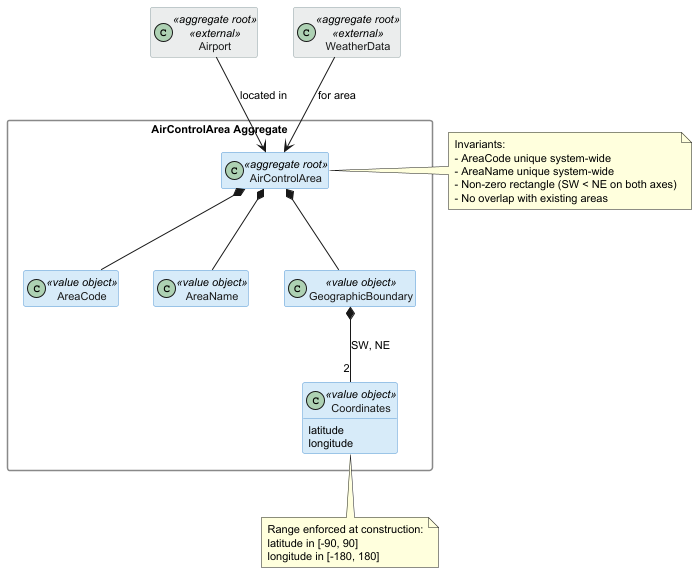
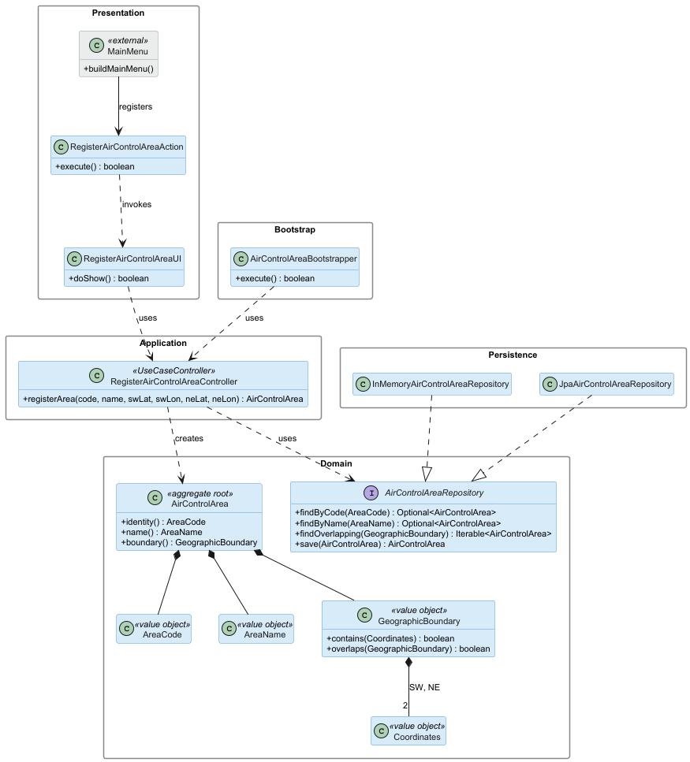
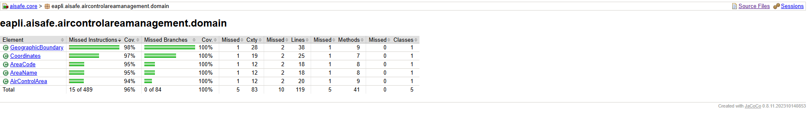

# US 050 - Register Air Control Area

## Context

This is the first time US050 is assigned for development. It is part of Sprint 2 and was not addressed in Sprint 1.

US050 is a foundational user story for the air traffic management subdomain. It has no upstream dependencies, but several downstream user stories rely on having air control areas registered in the system: US052 (an airport must belong to an existing area), US041 (weather data is registered per area), and US100 (simulations operate within an area). Registering this base reference data is therefore a prerequisite for most operational flows.

The work covers analysis, design, implementation and end-to-end verification of the use case, plus a bootstrap loader for pre-populated areas.

## Requirements

**US 050** As a Backoffice Operator, I want to register an air control area. The area code must be unique in the system, and geographic boundaries must be valid. This must also be achievable by a bootstrap process.

**Acceptance Criteria:**

- US050.1 BO Operator can register an air control area.

- US050.2 Area code is unique across the system.

- US050.3 Area name is unique across the system.

- US050.4 Geographic boundaries are represented as a rectangle defined by two opposing corners (SW and NE).

- US050.5 Coordinates use valid latitude [-90, 90] and longitude [-180, 180] ranges.

- US050.6 The boundary defines a non-zero area (SW strictly less than NE on both axes).

- US050.7 Boundaries do not overlap, including shared edges, with any existing air control area.

- US050.8 A bootstrap process can pre-populate air control areas.

- US050.9 Invalid input (missing or duplicate code, missing or duplicate name, invalid coordinates, zero area, overlap with existing area) is rejected with clear errors.

**Dependencies/References:**

None

## Analysis

### Actor and console

The actor is the Backoffice Operator, per §3.1.4 of the requirements: "Base system information (aircraft models, airports, flight control areas, etc.) is fed into the system by Backoffice Operators". The use case is therefore implemented in the `aisafe.app.backoffice.console` module.

### Requirement source

US050 (full text): "As a Backoffice Operator, I want to register an air control area. The area code must be unique in the system, and geographic boundaries must be valid. This must also be achievable by a bootstrap process."

§3.1.4 confirms that flight control areas are part of the base system reference data managed by Backoffice Operators.

### Domain model

The previous version of the global domain model included an `AirControlArea` aggregate with only `AreaCode` and `GeographicBoundary` as value objects. After analysing US050 in light of Sprint 2 PO clarifications, the aggregate was extended as shown below.

Changes introduced for this US:

- Added `AreaName` as a value object. Sprint 2 PO clarification of 23/04/2026: "The area name must also be unique, as it is the identifier used in practice within the air control business."
- Added `Coordinates` as a value object exposing latitude and longitude attributes, with range validity enforced at construction time. Sprint 2 PO clarification of 23/04/2026: "A Value Object for coordinates naturally enforces range validity at construction time."
- `GeographicBoundary` now explicitly composes two `Coordinates` (southwest and northeast corners of the rectangle).

The diagram also shows the two external aggregates (`Airport`, `WeatherData`, in grey) that depend on `AirControlArea`. They are not modified by this US but appear here as relationship context.

### Design decisions

Three decisions were taken at analysis time that the requirements and PO clarifications did not directly prescribe.

**Rectangle representation.** A rectangle is modelled as two opposing corner coordinates (southwest and northeast). This is the simplest unambiguous specification, maps directly to "min/max latitudes and longitudes", and makes the overlap check a straightforward axis-aligned bounding box comparison.

**No overlap is allowed.** Per Sprint 2 PO clarification of 23/04/2026: "no two areas may overlap". Shared edges are overlap: every point on a shared border belongs to both areas. The system rejects any new area whose boundary touches an existing area on any axis.

**Altitude bounds out of scope.** Real-world air control areas are 3D volumes with vertical limits. Sprint 1 PO clarification of 01/04/2026 simplified this to a 2D rectangle: "For simplicity, an air control area's geographic boundaries can be represented as a rectangle". US050 follows that simplification. If later user stories (especially simulation) require vertical bounds, the aggregate will be extended at that point.

**Controller obtains repository via constructor injection.** The `RegisterAirControlAreaController` receives the `AirControlAreaRepository` as a constructor parameter rather than pulling it from a global persistence registry inside the class. This applies the Dependency Inversion Principle directly, keeps the controller's dependencies visible at its class boundary, and allows unit tests to provide an in-memory repository without configuring any global state.

### Invariants

Enforced inside the aggregate (constructors and value objects):

- `AreaCode` is not null and not blank.
- `AreaName` is not null and not blank.
- `Coordinates` rejects latitude outside [-90, 90] and longitude outside [-180, 180].
- `GeographicBoundary` rejects boundaries where the southwest corner is not strictly less than the northeast corner on both axes (zero or negative area).

Enforced at the application layer (controller plus repository):

- `AreaCode` is unique across all registered areas.
- `AreaName` is unique across all registered areas.
- The new area's boundary does not overlap (including shared edges) with any already-registered area's boundary.

The uniqueness and overlap checks cannot live inside the aggregate alone, since the aggregate has no knowledge of other areas. They are enforced by the registration controller querying the `AirControlAreaRepository` before persisting the new area.

### Dependencies

**Upstream:** none. US050 is a foundational user story with no prerequisites.

**Downstream:**

- US052 (Create an airport): an airport must reference an existing air control area, and the airport's coordinates must fall within the area's boundary.
- US041 (Register weather data): weather data is registered for a specific area.
- US100 (Simulate flights in a given area): simulations are scoped to an area.
- Flight Control Operator assignment (later sprints): an FCO is by default responsible for one area, per Sprint 2 PO clarification of 02/05/2026.

### Bootstrap

Acceptance criterion US050.5 requires a bootstrap process. An `AirControlAreaBootstrapper` will pre-populate a fixed set of areas at system initialization, going through the same registration use case to ensure all invariants are enforced (uniqueness and no-overlap included). The bootstrapper runs before any user story that depends on existing areas.

## Design

### Realization

The persistence layer follows the standard EAPLI pattern: the `AirControlAreaRepository` interface lives in `aisafe.core` (alongside the domain it serves) and is implemented twice in `aisafe.persistence.impl`, once in-memory (used for development and testing) and once over JPA (used for the H2-backed deployment). The `RepositoryFactory` Abstract Factory selects the active implementation at runtime based on the persistence configuration.

### Acceptance Tests

This section presents the main unit tests that exercise the domain invariants captured during analysis. Tests are written in JUnit 4 style (run via the Vintage Engine on JUnit 5 Platform) and follow the `ensureXxxYyy` naming convention used in `eapli.base`. They are currently annotated `@Ignore("Phase 2 stub - implementation in Phase 3")` pending Phase 3 implementation; the `@Ignore` annotation is removed on a per-class basis as each domain class is implemented.

Acceptance criteria covering application-layer enforcement — code and name uniqueness across the repository (US050.2, US050.3), the cross-aggregate no-overlap check during registration (US050.7), end-to-end registration (US050.1), and bootstrap loading (US050.8) — are validated by tests added in Phase 3 alongside the `RegisterAirControlAreaController` and the `InMemoryAirControlAreaRepository`. The eight tests below cover the within-aggregate invariants that Phase 2 design exercises.

- `ensureAreaCodeRejectsBlankValue`: An area code cannot be constructed from null, empty, or blank input, rejecting missing-code inputs at the value-object boundary. (US050.9 (also supports US050.2))
- `ensureAreaNameRejectsBlankValue`: An area name cannot be constructed from null, empty, or blank input, rejecting missing-name inputs at the value-object boundary. (US050.9 (also supports US050.3))
- `ensureCoordinatesRejectsLatitudeAboveNinety`: Latitude values outside the valid geographic range [-90, 90] are rejected at coordinate construction, enforcing range validity in the value object itself. (US050.5, US050.9)
- `ensureCoordinatesRejectsLongitudeAboveOneEighty`: Longitude values outside the valid geographic range [-180, 180] are rejected at coordinate construction. (US050.5, US050.9)
- `ensureBoundaryRejectsZeroArea`: A boundary built from two identical corners is rejected, enforcing the non-zero-area invariant. (US050.6, US050.9)
- `ensureBoundaryRejectsInvertedLatitude`: A boundary with the southwest corner not strictly less than the northeast corner on the latitude axis is rejected, enforcing the SW-NE corner ordering required by the rectangle representation. (US050.4, US050.6)
- `ensureBoundaryOverlapsWhenSharingEdges`: Two boundaries sharing only an edge (no interior intersection) are still reported as overlapping, encoding the design decision that any boundary contact constitutes overlap. This is the geometric foundation for the no-overlap registration rule. (US050.7)
- `ensureAirControlAreaRejectsNullCode`: An air control area cannot be constructed without all required parts (code, name, boundary), enforcing the aggregate's required-fields invariants. (US050.9)

## Implementation

- **`feat(US050): implement air control area domain (VOs + aggregate root)`** — Implements all four value objects and the AirControlArea aggregate root, replacing the Phase 2 stubs. Removes `@Ignore` from the 37 domain tests; all now exercise real behaviour.
- **`feat(US050): in-memory and JPA AirControlAreaRepository with factory wiring`** — Adds the persistence layer. `RepositoryFactory` exposes `airControlAreas()` and `airControlAreas(TransactionalContext)`. `InMemoryAirControlAreaRepository` extends `InMemoryDomainRepository` (development and testing); `JpaAirControlAreaRepository` extends `JpaAutoTxRepository` (H2-backed deployment). Custom finders implemented for `findByCode`, `findByName`, `findOverlapping`; the JPA overlap query uses the AABB intersection condition on the embedded boundary coordinate fields with non-strict comparisons so shared edges count as overlap.
- **`feat(US050): RegisterAirControlAreaController with uniqueness and overlap checks`** — Replaces the Phase 2 stub with the application-layer controller that drives the registration use case. Constructs the four value objects from the primitive inputs, then enforces three repository-backed invariants before persisting: duplicate `AreaCode` is rejected via `findByCode`, duplicate `AreaName` via `findByName`, and any boundary intersecting an already-registered area via `findOverlapping`. Each violation surfaces as an `IllegalArgumentException` with a contextual message; on success the new aggregate is saved through the repository.
- **`test(US050): controller unit tests with hand-rolled in-memory repository fake`** — Adds JUnit tests exercising `RegisterAirControlAreaController` against a hand-rolled in-memory `AirControlAreaRepository` fake (no Mockito). The fake implements only the four repository methods the controller depends on (`findByCode`, `findByName`, `findOverlapping`, `save`), keeping the test surface small and the failure modes explicit. Test cases cover the happy path and each invariant: duplicate code, duplicate name, boundary overlap, and null/invalid primitive inputs.
- **`feat(US050): backoffice UI, action and menu entry for register air control area`** — Wires the use case into the backoffice console. `RegisterAirControlAreaUI` extends the framework `AbstractUI`, prompts the operator for area code, name, and the southwest/northeast corner coordinates, then delegates to the controller and reports either success or the validation error message. `RegisterAirControlAreaAction` adapts the UI to the framework `Action` contract, and a new entry is added to the role-gated section of `MainMenu` so the option is visible to the appropriate actor.
- **`feat(US050): air control area bootstrapper with seed reference data`** — Adds `AirControlAreaBootstrapper`, which calls `RegisterAirControlAreaController` to seed three reference areas on every bootstrap run: LPPC (Lisbon TMA), LPPO (Porto TMA), and LPMA (Madeira TMA). Each call is wrapped in idempotent `IllegalArgumentException` handling so re-runs log a warning instead of failing the boot. The bootstrapper is appended to `AisafeBootstrapper`'s action list, the JPA persistence unit registers `AirControlArea` together with its embeddables (`AreaCode`, `AreaName`, `Coordinates`, `GeographicBoundary`), and `AirControlArea` gains `@AttributeOverride` mappings on the embedded `AreaCode`/`AreaName` so their `value` columns no longer collide in the schema.
- **`test(US050): expand domain unit tests to satisfy NFR03 90% coverage`** — Adds further unit tests across `CoordinatesTest`, `GeographicBoundaryTest`, `AreaCodeTest`, `AreaNameTest`, and `AirControlAreaTest` to lift every domain class above the NFR03 threshold. New cases exercise the previously uncovered paths: NaN/infinite coordinate inputs, the four directional outside-points and the `southwest`-short-circuit branch in `GeographicBoundary`, the `equals` self / null / other-type cases on every value object, `hashCode` consistency, `toString` content, the `valueOf` and `compareTo` operations on `AreaCode` and `AreaName`, and `sameAs` plus the `code()` alias on the aggregate root. All five domain classes now report 100% line and branch coverage (see JaCoCo report below).
- **`feat(US050,US052,US061): Add controller-level authz to backoffice create flows #78 #104 #134`** - Adds framework-backed authorization checks to the air control area registration controller, ensuring only a `POWER_USER` or `BACKOFFICE_OPERATOR` can execute the create flow directly.

NFR03 requires ≥90% test coverage on the domain layer. The figure below is the JaCoCo report for `eapli.aisafe.aircontrolareamanagement.domain`, captured after the Phase 3
test additions:

