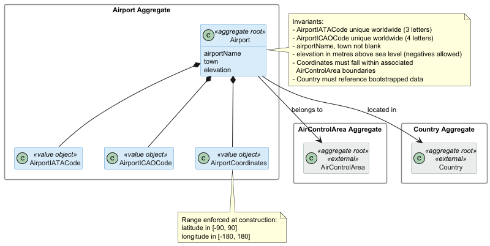
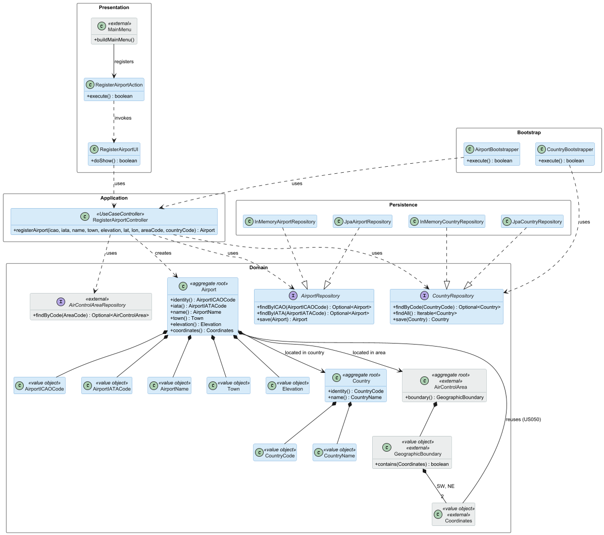
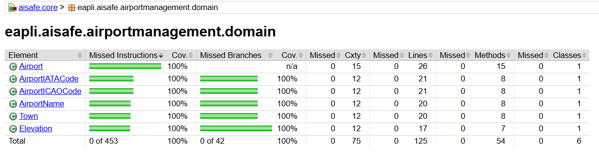
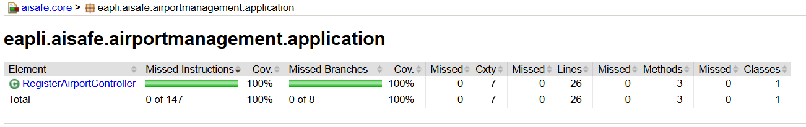

# US 052 - Create Airport

## Context

This is the first time US052 is assigned for development. It is part of Sprint 2 and was not addressed in Sprint 1.

US052 depends directly on US050: an airport must be registered into an existing air control area, and its coordinates must fall inside the area's boundaries. As part of analysing this user story, the Country aggregate is also introduced into the domain model to satisfy Sprint 2 PO clarification of 04/05/2026 ("Country data should be bootstrapped"). The decision to model Country as an aggregate, rather than as a value object, is documented in section 3.

The work covers analysis, design, implementation and end-to-end verification of the use case, plus a bootstrap loader for pre-populated airports.

## Requirements

**US 052** As a Backoffice Operator, I want to register an airport in a given air control area. An airport must be associated with exactly one air control area, has worldwide-unique ICAO and IATA codes, valid coordinates inside the area's boundaries, a town (free text), a country selected from bootstrapped country data, an airport name, and an elevation in metres above sea level. This must also be achievable by a bootstrap process.

**Acceptance Criteria:**

- US052.1 BO Operator can register an airport assigned to exactly one air control area.

- US052.2 IATA (3 letters) and ICAO (4 letters) codes are unique worldwide.

- US052.3 Coordinates fall within the associated air control area's boundaries (cross-aggregate invariant).

- US052.4 Coordinates use valid latitude [-90, 90] and longitude [-180, 180] ranges.

- US052.5 Country is selected from bootstrapped country data.

- US052.6 Town is provided as free text and is not blank.

- US052.7 Airport name is not blank.

- US052.8 Elevation is recorded in metres above sea level (negative values allowed for airports below sea level).

- US052.9 A bootstrap process can pre-populate airports.

- US052.10 Invalid inputs (duplicate IATA or ICAO, malformed code, out-of-bounds coordinates, coordinates outside the area, unknown country, blank name or town) are rejected.

**Dependencies/References:**

- US050 - Register Air Control Area: an airport must reference an existing area, and its coordinates must fall within that area's boundary.

This user story also introduces the Country aggregate. The Country aggregate is not a separate user story but a domain model addition required to satisfy the bootstrapped country reference. The Country bootstrapper must run before the Airport bootstrapper.

## Analysis

### Actor and console

The actor is the Backoffice Operator, per §3.1.4 of the requirements. The use case is implemented in the `aisafe.app.backoffice.console` module, alongside the other base reference data use cases.

### Requirement source

US052 (full text): "As a Backoffice Operator, I want to register an airport in a given air control area. An airport must be associated with exactly one air control area. The airport has an ICAO and IATA code that must be unique worldwide. An airport has location coordinates that must be valid and an elevation in meters above sea level. This must also be achieved by a bootstrap process."

§3.2 of the requirements lists the airport attributes: name, town, country, IATA, ICAO, coordinates, altitude (referred to as elevation in US052).

§3.1.4 confirms airports are part of the base system reference data managed by Backoffice Operators.

### Domain model

The previous version of the global domain model included an `Airport` aggregate with `airportName`, `town`, `country` and `elevation` as plain attributes, plus VOs for the IATA code, ICAO code and coordinates. After analysing US052 in light of Sprint 2 PO clarifications, the model was refactored as shown below.

Changes introduced for this user story:

- Added a new `Country` aggregate, with `name` as a mutable attribute and `CountryCode` as a stable value object identifier. Sprint 2 PO clarification of 04/05/2026: "Country data should be bootstrapped." §3.1.2 of the requirements: "country names a prone to changes, albeit other information (e.g. ITU code) usually doesn't change a lot."
- Removed `country` from the Airport aggregate's attribute list; replaced with a cross-aggregate reference `Airport --> Country : located in country`.
- Knock-on consistency update: `Maker.country` and `Aircraft.registrationCountry` were also converted from plain attributes to cross-aggregate references to the `Country` aggregate. No user story currently exercises these references, but leaving them as free-text strings would be inconsistent with the new model.
- Confirmed that `town` remains as a plain attribute on Airport (Sprint 2 PO clarification of 04/05/2026: "Town name may be entered as free text").

The diagram also shows the two external aggregates (`AirControlArea`, `Country`, in grey) that Airport depends on. They are not modified by this user story beyond the cross-aggregate reference itself.

### Design decisions

**Country as an aggregate, not a value object.** The Country concept does not have rich invariants in the strict DDD sense: its rules are limited to "code is unique" and "name is unique at any given time". A pure value object would be defensible. However, two practical considerations push toward the aggregate route. First, a bootstrapped registry of countries needs a repository for lookups during airport registration; once a repository exists, modelling it as an aggregate is the natural fit. Second, the existing `Maker` aggregate has a similarly thin invariant set (just unique name) and is already an aggregate, so the pattern is consistent. The cost of being wrong is low: if a future user story manages countries, an aggregate is already in place; if no such story appears, the only overhead is one extra bootstrapper.

**Country exposes a stable `CountryCode`.** §3.1.2 explicitly notes that country names change while stable codes (ITU code is given as an example) do not. Cross-aggregate references therefore use `CountryCode`, not name. This insulates `Airport`, `Maker` and `Aircraft` from country renaming events that would otherwise break their references.

**Boundary containment is inclusive.** Since shared edges between air control areas are forbidden (US050 design decision), every coordinate on a boundary edge belongs unambiguously to exactly one area. An airport whose coordinates fall on the edge is therefore considered inside that area. The geometry check uses closed-rectangle containment.

**Elevation allows negative values.** Several real airports sit below sea level (Schiphol, Bahrain). `Elevation` accepts any finite number in metres above sea level, including negatives. It is modelled as a small value object so the finite-number rule is enforced at the domain boundary.

### Invariants

Enforced inside the aggregate (constructors and value objects):

- `AirportIATACode` is exactly three letters.
- `AirportICAOCode` is exactly four letters.
- `Coordinates` rejects latitude outside [-90, 90] and longitude outside [-180, 180].
- `airportName` is not null and not blank.
- `town` is not null and not blank.
- `elevation` is a finite number (no NaN or infinity).

Enforced at the application layer as repository lookups (existence and uniqueness):

- `AirportIATACode` is unique worldwide.
- `AirportICAOCode` is unique worldwide.
- The referenced `AirControlArea` exists.
- The referenced `Country` exists.

Enforced at the application layer with real domain logic (cross-aggregate):

- Airport coordinates fall within the associated `AirControlArea`'s boundary. This is the only US052 invariant that combines two aggregates' state to produce a domain answer. The geometry check (point inside closed rectangle) belongs on `GeographicBoundary` as a method such as `contains(Coordinates)`. The `RegisterAirportController` orchestrates the call by fetching the area from `AirControlAreaRepository` and passing the airport's coordinates into the boundary's domain method. This is what the user story's Definition of Done singles out as "cross-aggregate validation".

### Dependencies

**Upstream:**

- US050 (Register Air Control Area): an airport must reference an existing area and its coordinates must fall inside that area's boundary. The `AirControlArea` repository must be operational before an airport can be registered.

**Downstream:**

- US080 (Create flight): a flight connects two airports.
- US085 (Test/validate flight plan): the destination airport's air control area determines the minimum fuel rule (§3.1.4).
- US100 onwards (Simulation): simulations operate over flights between airports inside an area.

The `Country` aggregate introduced by this user story has no upstream dependency of its own. It must, however, be bootstrapped before any airport can be registered, since airport registration validates the country reference against existing data.

### Bootstrap

Acceptance criterion US052.9 requires a bootstrap process. The order at system initialisation is:

1. `CountryBootstrapper` populates the bootstrapped country registry.
2. `AirControlAreaBootstrapper` (from US050) populates the air control areas.
3. `AirportBootstrapper` populates airports, going through the same registration use case so that all invariants (uniqueness, coordinate range, country existence, area existence, coordinates inside boundary) are enforced for bootstrap data exactly as they are for operator input.

If any bootstrapped airport fails validation (for example, coordinates outside the chosen area), the bootstrap rejects it and logs an error. Bootstrap data is treated like any other input, not as trusted.

## Design

### Realization

The `RegisterAirportController` depends on three repositories because registering an airport requires looking up the associated air control area and country, plus checking that the airport's coordinates fall inside the area's boundary. This cross-aggregate invariant (US052.3) is orchestrated at the application layer using `GeographicBoundary.contains(Coordinates)`. The existing `Coordinates` value object is reused directly because airport location and air-control-area boundaries use the same latitude/longitude concept; duplicating it as `AirportCoordinates` would create two implementations of the same validation rules.

### Acceptance Tests

This section presents the main unit tests that exercise the domain invariants captured during analysis. Tests are written in JUnit 4 style (run via the Vintage Engine on JUnit 5 Platform) and follow the `ensureXxxYyy` naming convention used in `eapli.base`. The implemented US052 domain and controller test classes are active in `aisafe.core/src/test`.

Acceptance criteria covering application-layer enforcement are validated alongside the `RegisterAirportController`. Controller tests live in `aisafe.core/src/test` because the controller belongs to the core module; small hand-rolled fake repositories are used so the tests can exercise the use case without introducing a core-to-persistence dependency cycle. These tests cover end-to-end registration (US052.1), worldwide IATA and ICAO uniqueness across the repository (US052.2 repo-level), the cross-aggregate coordinates-within-boundary check (US052.3), and Country existence in the bootstrapped repository (US052.5). Bootstrap loading (US052.9) is validated by running the bootstrap application. Coordinate range validation (US052.4) is already covered by the existing `CoordinatesTest` and is not duplicated here. The eight tests below cover the within-aggregate invariants that the design exercises.

- `ensureAirportICAOCodeRejectsWrongLength`: An ICAO code with a length different from four characters is rejected at the value-object boundary, enforcing the worldwide-unique 4-letter format invariant. (US052.2, US052.10)
- `ensureAirportIATACodeRejectsWrongLength`: An IATA code with a length different from three characters is rejected at the value-object boundary, enforcing the worldwide-unique 3-letter format invariant. (US052.2, US052.10)
- `ensureAirportICAOCodeRejectsNonAlphaCharacters`: An ICAO or IATA code containing non-letter characters is rejected, enforcing the alpha-only format required by both standards. (US052.2, US052.10)
- `ensureAirportNameRejectsBlankValue`: An airport name cannot be constructed from null, empty, or blank input, rejecting missing-name inputs at the value-object boundary. (US052.7, US052.10)
- `ensureTownRejectsBlankValue`: A town cannot be constructed from null, empty, or blank input, enforcing the free-text-but-required invariant for the town attribute. (US052.6, US052.10)
- `ensureElevationAcceptsNegativeValues`: An elevation value below sea level is accepted, encoding the design decision that negative elevations are valid (real airports such as Schiphol sit below sea level). (US052.8)
- `ensureCountryCodeRejectsNonNumericCharacters`: A country code with non-numeric characters is rejected, enforcing the ITU country-code format invariant (numeric digits only). (US052.5, US052.10)
- `ensureAirportRejectsNullICAOCode`: An airport cannot be constructed without all required parts (ICAO, IATA, name, town, elevation, coordinates, country, air control area), enforcing the aggregate's required-fields invariants. (US052.10)

## Implementation

US052 was implemented across the standard AISafe feature packages:

- `eapli.aisafe.airportmanagement.domain`: adds the `Airport` aggregate root, identified by `AirportICAOCode`, plus `AirportIATACode`, `AirportName`, `Town` and `Elevation` value objects.
- `eapli.aisafe.countrymanagement.domain`: adds the supporting `Country` aggregate root, identified by `CountryCode`, plus `CountryName`.
- `eapli.aisafe.airportmanagement.application.RegisterAirportController`: orchestrates the registration use case. It constructs the domain objects, rejects duplicate ICAO/IATA codes, validates that the referenced `Country` and `AirControlArea` exist, checks boundary containment through `GeographicBoundary.contains(Coordinates)`, and persists the airport.
- `eapli.aisafe.airportmanagement.repositories.AirportRepository` and `eapli.aisafe.countrymanagement.repositories.CountryRepository`: expose the repository lookups required by the controller and bootstrap process.
- `aisafe.persistence.impl`: provides both in-memory and JPA repository implementations for airports and countries, and wires them into `RepositoryFactory`.
- `aisafe.app.backoffice.console`: adds the `Airports > Register Airport` menu entry. No `Countries >` menu was added because countries are bootstrapped reference data for US052, not an actor-managed use case.
- `aisafe.bootstrappers`: adds `CountryBootstrapper` and `AirportBootstrapper`, with the bootstrap order updated so countries are loaded before air control areas and airports.

The JPA persistence unit was updated with `Country`, `Airport` and their embeddable value objects. `Airport` embeds the existing `Coordinates` value object instead of introducing a duplicate `AirportCoordinates` value object.

## Integration/Demonstration

Integration points:

- US052 depends on US050 through `AreaCode`, `Coordinates`, `AirControlAreaRepository` and `GeographicBoundary.contains(Coordinates)`.
- The bootstrap sequence now loads `CountryBootstrapper`, then `AirControlAreaBootstrapper`, then `AirportBootstrapper`, ensuring airport registration can validate both required references.
- Backoffice Operators can access the use case from `Airports > Register Airport`. The UI shows available countries and air control areas before requesting the airport data.
- Repository factory methods `countries()` and `airports()` were added to both in-memory and JPA factories.

The JaCoCo report for `aisafe.core` confirms 100% line and branch coverage for the US052 domain and controller classes:

- `RegisterAirportController`
- `Airport`, `AirportICAOCode`, `AirportIATACode`, `AirportName`, `Town`, `Elevation`
- `Country`, `CountryCode`, `CountryName`

NFR03 requires >=90% test coverage on the domain and controller packages. The figures below are the JaCoCo reports for the US052 domain package and controller class, captured after the final test additions:

The bootstrap smoke run executed the master-data sequence and reached `Bootstrap data done.` after running `CountryBootstrapper`, `AirControlAreaBootstrapper` and `AirportBootstrapper` in order.

## Observations

The implementation deliberately keeps `Country` out of the Backoffice menu. Although `Country` is an aggregate with a repository, US052 only requires countries as bootstrapped reference data selected during airport registration. Adding a country-management menu would introduce actor-facing functionality outside the user story.

The controller uses constructor injection so its dependencies are explicit and so controller tests can exercise the application logic with small hand-rolled repository fakes in `aisafe.core`, avoiding a module dependency cycle between `aisafe.core` and `aisafe.persistence.impl`.

The `Coordinates` value object remains in `aircontrolareamanagement.domain` and is reused by `Airport`. This follows the project decision to align with the eCafeteria reference style, where domain types from one feature package may be imported by another feature when the dependency is meaningful.
