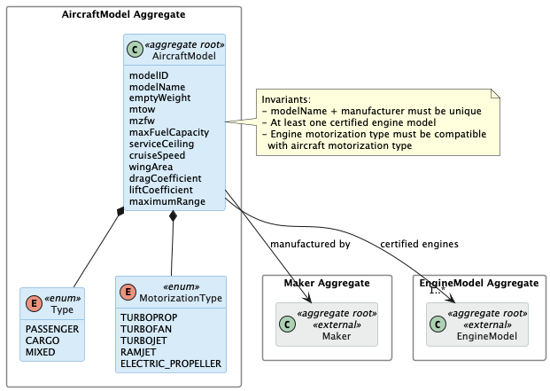
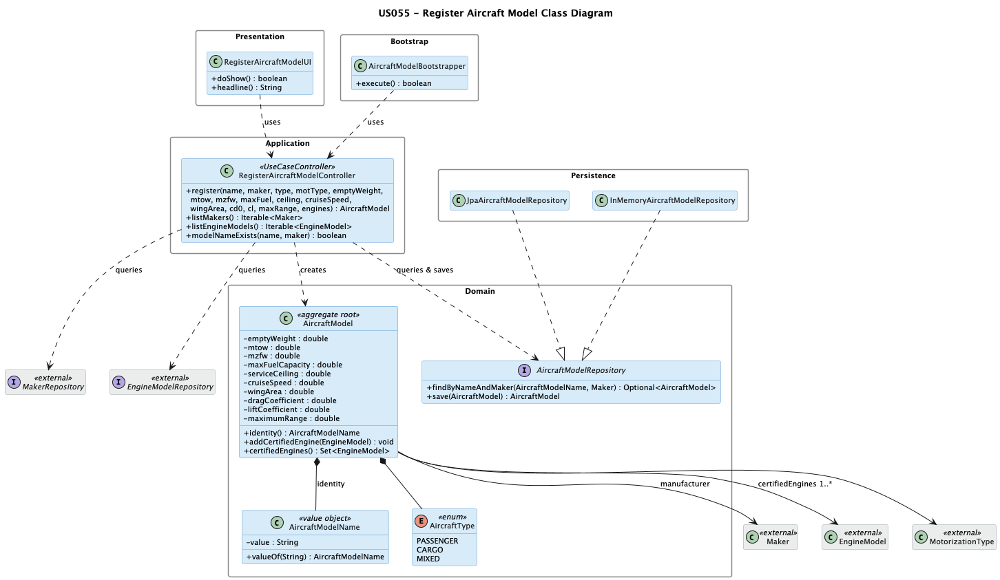

# US 055 - Create Aircraft Model

## Context

This is the first time US055 is assigned for development. It is part of Sprint 2 and was not addressed in Sprint 1.

US055 depends directly on US056: at least one certified engine model must already exist before an aircraft model can be registered. US055 is itself foundational for the aircraft-management subdomain — downstream stories such as US057 (add an engine model to an aircraft model), US058 (remove an engine model), and aircraft instance registration all require aircraft models to be present in the system.

The work covers analysis, design, implementation and end-to-end verification of the use case, plus a bootstrap loader for pre-populated aircraft models.

## Requirements

This user story establishes the `AircraftModel` aggregate as a core reference entity in the aircraft-management subdomain. It defines the full data contract for an aircraft model — manufacturer, type, motorization, performance parameters, and the set of certified engine models — and specifies all invariants that must hold at creation time and throughout the aggregate's lifecycle. The use case also requires a bootstrap process so the system can be pre-populated with reference aircraft models without manual operator input.

**US 055** As a Backoffice Operator, I want to register a new aircraft model. Any model must have at least one engine model (let's assume that all engines are of the same type). Aircraft has a model name and manufacturer, and their combination must be unique. At least one certified engine model must be associated. An aircraft model will have a type, maximum range and other flight characteristics. This must also be achieved by a bootstrap process.

**Acceptance Criteria:**

- US055.1 BO Operator can register an aircraft model.

- US055.2 The (model name, manufacturer) combination is unique.

- US055.3 At least one certified engine model must be associated on creation.

- US055.4 All certified engine models on an aircraft model must be of the same motorization type.

- US055.5 Model captures type (passenger/cargo/mixed), motorization type, empty weight, MTOW, MZFW, max fuel capacity, service ceiling, cruise speed, wing area, drag coefficient (Cd0), lift coefficient (reference Cl), and maximum range.

- US055.6 A bootstrap process can pre-populate aircraft models.

- US055.7 Invalid inputs (duplicate (model name, manufacturer), missing or blank name, missing type or motorization, no certified engine, incompatible engine motorization) are rejected with clear errors.

**Dependencies/References:**

| Relation | Item | Nature |
|---|---|---|
| **Upstream prerequisite** | **US056** *Create Aircraft Engine Model* | At least one engine model must exist before an aircraft model can be created. The certified engine list is mandatory at registration time, so US056 must be complete first. |
| **Downstream consumer** | **US057** *Add an engine model to an aircraft model* | Adds further certified engine models to an aircraft model created here. |
| **Downstream consumer** | **US058** *Remove an engine model from an aircraft model* | Removes a certified engine from an aircraft model; must leave at least one engine in the list. |
| **Downstream consumer** | Aircraft instance registration *(later sprint)* | An aircraft instance will reference an `AircraftModel` registered by this US. |

## Analysis

The team approached US055 in four analytical layers, moving from actor identification to design-decision rationalisation.

### Actor and console

The actor is the Backoffice Operator, per §3.1.4 of the requirements: "Base system information (aircraft models, airports, flight control areas, etc.) is fed into the system by Backoffice Operators". The use case is implemented in the `aisafe.app.backoffice.console` module.

### Requirement source

US055 (full text): "As a Backoffice Operator, I want to register a new aircraft model. Any model must have at least one engine model (let's assume that all engines are of the same type). Aircraft has a model name and manufacturer, and their combination must be unique. At least one certified engine model must be associated. An aircraft model will have a type, maximum range and other flight characteristics. This must also be achieved by a bootstrap process."

§3.2 of the requirements lists the aircraft model attributes: type, motorization type, empty weight, MTOW, MZFW, max fuel capacity, service ceiling, cruise speed, wing area, drag coefficient (Cd0), lift coefficient (reference Cl), and maximum range.

§3.1.4 confirms that aircraft models are part of the base system reference data managed by Backoffice Operators.

### Alternatives considered

Three design choices were evaluated before committing to the final model:

| Design choice | Selected option | Alternative | Reason for selection |
|---|---|---|---|
| Engine list ownership | `AircraftModel` owns a `1..*` certified list | Separate `CertifiedEngine` join aggregate | A join aggregate adds no invariants here; the list is a simple set of references owned by the aircraft model. |
| Manufacturer modelling | Cross-aggregate reference to `Maker` | Free-text `manufacturer` field | Anchoring uniqueness to a stable aggregate identity prevents duplicate manufacturer representations and aligns with how `Maker` is used elsewhere. |
| Performance attributes | Plain numeric fields with positive constraint | Dedicated value object per attribute | Ten attributes each with a single positive constraint do not benefit from dedicated value objects; plain fields keep the constructor readable. |

### Design decisions

**Maker as a cross-aggregate reference.** The uniqueness invariant is `(modelName, manufacturer)`. Using a cross-aggregate reference to `Maker` rather than a free-text manufacturer field anchors that check to a stable identifier and keeps the model consistent with how `Maker` is used elsewhere in the domain.

**Certified engines list mandatory at creation.** Deferring engine association to a separate step (US057) would leave the aggregate temporarily invalid. The creation controller therefore requires a non-empty certified engine list upfront, satisfying US055.3 without ever persisting an incomplete aggregate.

**Same motorization type enforced inside the aggregate.** The requirement states "all engines are of the same type". When an engine model is added to the certified list, the `AircraftModel` aggregate validates that the engine's `MotorizationType` matches its own. This check depends only on the aggregate's own state and the engine's type — no repository call is needed.

**Performance attributes as plain fields.** All numeric performance attributes are kept as plain fields rather than individual value objects. Each has a simple positive-value constraint; no multi-field invariant exists between them. Ten dedicated value object classes would not improve clarity or enforce any additional rule.

### Invariants

Enforced inside the aggregate (constructors):

- `modelName` is not null and not blank.
- `emptyWeight`, `mtow`, `mzfw`, `maxFuelCapacity`, `serviceCeiling`, `cruiseSpeed`, `wingArea`, `dragCoefficient`, `liftCoefficient`, `maximumRange` are strictly positive finite numbers.
- `Type` is not null.
- `MotorizationType` is not null.
- The certified engine list is not empty.
- Every engine model in the certified list has a `MotorizationType` equal to the aircraft model's `MotorizationType`.
- No duplicate `EngineModel` references in the certified list.

Enforced at the application layer (controller plus repositories):

- The `(modelName, Maker)` combination is unique across all registered aircraft models.
- The referenced `Maker` exists.
- Every referenced `EngineModel` in the initial certified list exists.

### Dependencies

**Upstream:**

- US056 (Create Aircraft Engine Model): at least one engine model must exist before an aircraft model can be created. The `EngineModel` repository must be operational before registration.

**Downstream:**

- US057 (Add an engine model to an aircraft model): adds further certified engine models to an aircraft model created here.
- US058 (Remove an engine model from an aircraft model): removes a certified engine model, subject to constraints.
- Aircraft instance registration (later sprint): an aircraft instance references an `AircraftModel`.
- Pilot certification (later sprint): a pilot is certified for one or more `AircraftModel` instances.

### Bootstrap

Acceptance criterion US055.6 requires a bootstrap process. The bootstrap order at system initialisation is:

1. `MakerBootstrapper` populates manufacturers.
2. `EngineModelBootstrapper` (from US056) populates engine models.
3. `AircraftModelBootstrapper` populates aircraft models, going through the same registration use case so that all invariants (uniqueness, motorization compatibility, non-empty engine list) are enforced for bootstrap data exactly as they are for operator input.

### Integration analysis

US055 integrates with four other aggregates and user stories:

- `MakerRepository` and `EngineModelRepository` are read at registration time to resolve the manufacturer and the initial certified engine set.
- `AircraftModelBootstrapper` calls `RegisterAircraftModelController.register()` directly, so the same controller handles both manual and bootstrap registration paths with identical validation.
- US057 and US058 modify the `certifiedEngines` list of an `AircraftModel` registered here; those USs depend on `AircraftModelRepository` being populated by this US.
- Aircraft instance registration (later sprint) will reference an `AircraftModel` by its identity; the domain contract established here (name/manufacturer uniqueness, non-empty engine list) must remain stable.

### Coverage analysis

| Acceptance Criterion | Test method |
|---|---|
| US055.1 — register an aircraft model | `ensureAircraftModelAcceptsValidInput` |
| US055.2 — (name, manufacturer) uniqueness | Enforced at application layer; controller integration test pending |
| US055.3 — at least one certified engine at creation | `ensureAircraftModelRejectsEmptyEngineList` |
| US055.4 — all engines of the same motorization type | `ensureAircraftModelRejectsIncompatibleEngine` |
| US055.5 — performance attributes captured | `ensureAircraftModelAcceptsValidInput`, `ensureAircraftModelRejectsNonPositiveMtow` |
| US055.6 — bootstrap process | `AircraftModelBootstrapperTest` (integration, pending) |
| US055.7 — invalid inputs rejected | `ensureAircraftModelRejectsNullName`, `ensureAircraftModelRejectsEmptyEngineList`, `ensureAircraftModelRejectsIncompatibleEngine`, `ensureAircraftModelRejectsNonPositiveMtow` |

### Domain model

The global domain model includes the `AircraftModel` aggregate with `Type` and `MotorizationType` as enums. The `Maker` aggregate (manufacturer) is referenced cross-aggregate. The `EngineModel` aggregate is referenced via the `certified engines` association (`1..*`).



The diagram shows the two external aggregates (`Maker`, `EngineModel`, in grey) that `AircraftModel` depends on. They are not modified by this user story but appear here as relationship context.

Key aspects of the model relevant to this US:

- `AircraftModel` holds all performance attributes as plain fields. These are numeric domain values without their own identity or multi-field invariants, so value objects would add ceremony without benefit.
- `Type` classifies the aircraft purpose: `PASSENGER`, `CARGO`, or `MIXED`.
- `MotorizationType` classifies the propulsion technology and is shared with `EngineModel`. The requirement states "all engines are of the same type", so all engine models in the certified list must share the aircraft model's `MotorizationType`.
- The certified engine list (`1..*` to `EngineModel`) is owned by `AircraftModel`. The list must be non-empty at creation.

## Design

The solution is structured around a standard EAPLI layered architecture. Five decisions shape the design:

- **Maker as a cross-aggregate reference.** The `(modelName, manufacturer)` uniqueness invariant is anchored to the `Maker` aggregate identity rather than a free-text field, keeping the model consistent with how `Maker` is used across the domain.
- **Certified engines mandatory at creation.** Deferring engine association to US057 would leave the aggregate transiently invalid. The controller requires a non-empty initial engine set, so the aggregate is never persisted in an incomplete state.
- **Motorization compatibility enforced inside the aggregate.** The constructor and `addCertifiedEngine` both verify that every engine's `MotorizationType` matches the aircraft model's own value. This is a pure intra-aggregate rule — no repository access is needed.
- **Performance attributes as plain fields.** The ten numeric performance parameters each carry only a simple positive-value constraint. No multi-field invariant connects them, so dedicated value objects would add ceremony without enforcing any additional rule.
- **Bootstrap goes through the same controller.** `AircraftModelBootstrapper` calls `RegisterAircraftModelController.register(...)` directly, so bootstrap data is subject to exactly the same validation as operator input.

### Realization

The class diagram below shows all classes involved, their responsibilities, and how they relate across the Presentation, Application, Domain, Persistence, and Bootstrap layers.



### Acceptance Tests

The tests below cover the domain invariants for `AircraftModel` and its `AircraftModelName` value object. They follow the `ensureXxxYyy` naming convention and are written in JUnit 4 style.

## Implementation

The design decisions from section 4 are reflected directly in the code.

**Motorization compatibility enforced inside the aggregate.** The `AircraftModel` constructor iterates over the initial engine set and throws `IllegalArgumentException` if any engine's `MotorizationType` differs from the model's own value. The same check runs inside `addCertifiedEngine()`, so the invariant holds for every future addition regardless of which caller triggers it — no repository access is required.

**Certified engines returned as an unmodifiable view.** `certifiedEngines()` wraps the internal `HashSet` with `Collections.unmodifiableSet()`, preventing callers from mutating the collection directly and bypassing the aggregate's validation methods.

**JPA uniqueness constraint at the DB level.** The `@Table` annotation declares `@UniqueConstraint(columnNames = {"model_name", "maker_name"})`, so the database enforces the business uniqueness rule independently of the application-layer pre-check in the controller.

**Optimistic locking.** A `@Version Long version` field is present on `AircraftModel`, preventing lost-update anomalies under concurrent access.

**Bootstrap goes through the same controller.** `AircraftModelBootstrapper.register()` calls `RegisterAircraftModelController.register(...)` directly, so bootstrap data is subject to exactly the same validation as operator input. `IntegrityViolationException` is caught to make re-runs idempotent. The bootstrapper also guards against missing upstream data: if the required makers or engine models are absent, it logs a warning and exits without crashing the startup sequence.

## Integration/Demonstration

### Bootstrap

At system startup, `AisafeBootstrapper` executes bootstrappers in dependency order:

```
MakerBootstrapper → EngineModelBootstrapper → AircraftModelBootstrapper
```

`AircraftModelBootstrapper` seeds two reference aircraft models:

| Model | Maker | Type | Motorization | Certified engines |
|---|---|---|---|---|
| A320neo | Airbus | PASSENGER | TURBOFAN | CFM56-5B, CFM LEAP-1A |
| 787-9 | Boeing | PASSENGER | TURBOFAN | GEnx-1B |

To trigger the bootstrap manually, run the dedicated bootstrap application (`AisafeBootstrap` main class in the `aisafe.app.bootstrap` module).

### Manual demonstration

To register an aircraft model via the backoffice console:

1. Launch the backoffice application and log in as a Backoffice Operator.
2. Select **3. Aircraft** from the main menu.
3. Select **2. Register Aircraft Model**.
4. Follow the prompts: enter a model name, select a manufacturer, choose aircraft type and motorization type, enter the ten performance parameters (empty weight, MTOW, MZFW, max fuel capacity, service ceiling, cruise speed, wing area, drag coefficient, lift coefficient, maximum range), and select at least one compatible engine from the displayed list.
5. The system confirms registration or reports the reason for rejection (duplicate name+maker, incompatible engine motorization, non-positive parameter).
