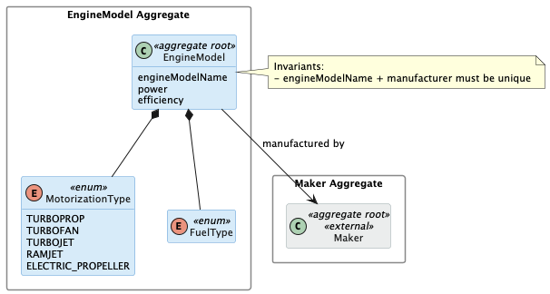
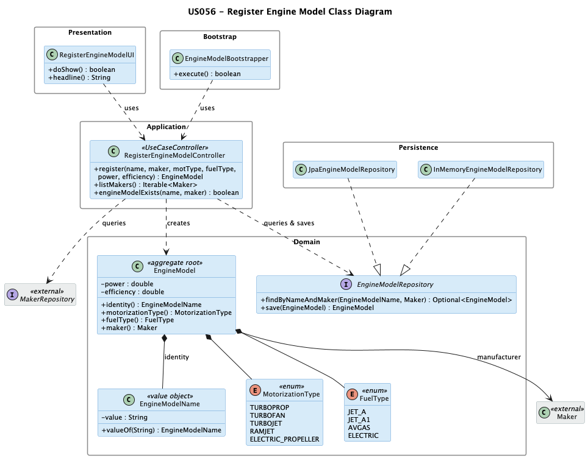

# US 056 - Create Aircraft Engine Model

## Context

This is the first time US056 is assigned for development. It is part of Sprint 2 and was not addressed in Sprint 1.

US056 is a foundational user story for the aircraft-management subdomain. It has no upstream dependencies, but US055 (Create Aircraft Model) depends directly on it — an aircraft model requires at least one certified engine model at creation time. Registering engine models is therefore a prerequisite for all downstream aircraft-related flows.

The work covers analysis, design, implementation and end-to-end verification of the use case, plus a bootstrap loader for pre-populated engine models.

## Requirements

This user story establishes the `EngineModel` aggregate as a foundational reference entity in the aircraft-management subdomain. It defines the data contract for an engine model — name, manufacturer, motorization type, fuel type, thrust (power), and efficiency (TSFC) — and the invariants that must hold at creation time. Because `AircraftModel` requires at least one certified engine model at creation time (US055), registering engine models is a prerequisite for all downstream aircraft-related flows.

**US 056** As a Backoffice Operator, I want to register a new engine model to be used by aircrafts. The model's name and manufacturer combination must be unique. Other important information regarding the type (see section 3.2), power, fuel, and efficiency should be included. This must also be achievable by a bootstrap process.

**Acceptance Criteria:**

- US056.1 BO Operator can register an engine model.

- US056.2 The (name, manufacturer) combination is unique.

- US056.3 Engine captures motorization type, power, fuel type, and efficiency (TSFC).

- US056.4 A bootstrap process can pre-populate engine models.

- US056.5 Invalid inputs (duplicate (name, manufacturer), missing or blank name, missing type or fuel type) are rejected with clear errors.

**Dependencies/References:**

| Relation | Item | Nature |
|---|---|---|
| **Upstream prerequisite** | None | US056 has no upstream dependencies; it is the foundational entity for the aircraft-management subdomain. |
| **Downstream consumer** | **US055** *Create Aircraft Model* | An aircraft model requires at least one certified engine model at registration time. US056 must be executed first. |
| **Downstream consumer** | **US057** *Add an engine model to an aircraft model* | An engine model registered here is associated with an existing aircraft model. |
| **Downstream consumer** | **US058** *Remove an engine model from an aircraft model* | Removal is blocked if the engine model is in active use by aircraft instances. |

## Analysis

The team approached US056 in four analytical layers, moving from actor identification to design-decision rationalisation.

### Actor and console

The actor is the Backoffice Operator, per §3.1.4 of the requirements: "Base system information (aircraft models, airports, flight control areas, etc.) is fed into the system by Backoffice Operators". The use case is implemented in the `aisafe.app.backoffice.console` module.

### Requirement source

US056 (full text): "As a Backoffice Operator, I want to register a new engine model to be used by aircrafts. The model's name and manufacturer combination must be unique. Other important information regarding the type (see section 3.2), power, fuel, and efficiency should be included. This must also be achievable by a bootstrap process."

§3.2 of the requirements defines the engine model attributes: motorization type (turboprop, turbofan, turbojet, ramjet, electric propeller), power, fuel type, and efficiency (Thrust Specific Fuel Consumption — TSFC).

§3.1.4 confirms that engine models are part of the base system reference data managed by Backoffice Operators.

### Alternatives considered

Three design choices were evaluated before committing to the final model:

| Design choice | Selected option | Alternative | Reason for selection |
|---|---|---|---|
| Manufacturer modelling | Cross-aggregate reference to `Maker` | Free-text `manufacturer` field | Anchoring uniqueness to a stable aggregate identity prevents duplicate manufacturer representations and aligns with how `Maker` is used by `AircraftModel`. |
| Fuel type representation | Closed `FuelType` enum | Free-text `fuelType` field | Aviation fuel types are a well-defined, stable set; an enum prevents free-text inconsistencies and can be extended without breaking existing records. |
| Power and efficiency | Plain numeric fields with positive constraint | Dedicated value objects (`Thrust`, `Tsfc`) | Both attributes carry only a simple range constraint; dedicated value objects would add ceremony without enforcing any additional rule. |

### Design decisions

**Maker as a cross-aggregate reference.** The uniqueness invariant is `(engineModelName, manufacturer)`. Using a cross-aggregate reference to `Maker` rather than a free-text field anchors the check to a stable identifier and keeps the model consistent with how `Maker` is used by `AircraftModel`.

**FuelType as an enum.** Fuel types in aviation are a well-defined, stable set. An enum captures the closed set clearly and avoids free-text inconsistencies. If a new fuel type is introduced in a future sprint, the enum can be extended without breaking existing records.

**power and efficiency as plain fields.** Both attributes have simple range constraints (strictly positive). No multi-field invariant connects them. Introducing dedicated value objects would add ceremony without enforcing any additional rule.

### Invariants

Enforced inside the aggregate (constructors):

- `engineModelName` is not null and not blank.
- `power` and `efficiency` are strictly positive finite numbers.
- `MotorizationType` is not null.
- `FuelType` is not null.

Enforced at the application layer (controller plus repositories):

- The `(engineModelName, Maker)` combination is unique across all registered engine models.
- The referenced `Maker` exists.

### Dependencies

**Upstream:** None. US056 is a foundational user story with no prerequisites.

**Downstream:**

- US055 (Create Aircraft Model): at least one engine model must exist before an aircraft model can be registered.
- US057 (Add an engine model to an aircraft model): an existing engine model is associated with an existing aircraft model.
- US058 (Remove an engine model from an aircraft model): removal is blocked if actual aircraft are using the engine model.

### Bootstrap

Acceptance criterion US056.4 requires a bootstrap process. The bootstrap order at system initialisation is:

1. `MakerBootstrapper` populates manufacturers (prerequisite, since engine models reference a maker).
2. `EngineModelBootstrapper` populates engine models, going through the same registration use case so that all invariants (uniqueness, non-blank name, valid type and fuel) are enforced for bootstrap data exactly as they are for operator input.

### Integration analysis

US056 is the foundational entity for the aircraft-management subdomain. Its integration surface is:

- `MakerRepository` is read at registration time to resolve the manufacturer and enforce the `(name, Maker)` uniqueness check.
- `EngineModelBootstrapper` calls `RegisterEngineModelController.register()` directly, ensuring bootstrap data is subject to the same validation as operator input.
- `AircraftModelRepository` (US055) reads `EngineModel` instances at aircraft model creation time; `EngineModelBootstrapper` must run before `AircraftModelBootstrapper`.
- US057 reads `EngineModel` instances by identity when adding them to an aircraft model's certified list; this US must be complete before US057 can be used.

### Coverage analysis

| Acceptance Criterion | Test method |
|---|---|
| US056.1 — register an engine model | `ensureEngineModelAcceptsValidInput` |
| US056.2 — (name, manufacturer) uniqueness | Enforced at application layer; controller integration test pending |
| US056.3 — captures type, power, fuel, efficiency | `ensureEngineModelAcceptsValidInput`, `ensureEngineModelRejectsNullMotorizationType`, `ensureEngineModelRejectsNullFuelType`, `ensureEngineModelRejectsNonPositivePower`, `ensureEngineModelRejectsNonPositiveEfficiency` |
| US056.4 — bootstrap process | `EngineModelBootstrapperTest` (integration, pending) |
| US056.5 — invalid inputs rejected | `ensureEngineModelRejectsNullName`, `ensureEngineModelRejectsNullMaker`, `ensureEngineModelRejectsNullMotorizationType`, `ensureEngineModelRejectsNullFuelType`, `ensureEngineModelRejectsNonPositivePower`, `ensureEngineModelRejectsNonPositiveEfficiency` |

### Domain model

The global domain model includes the `EngineModel` aggregate with `MotorizationType` and `FuelType` as enums, and `power` and `efficiency` as plain attributes. The `Maker` aggregate (manufacturer) is referenced cross-aggregate.

The diagram shows the external aggregate (`Maker`, in grey) that `EngineModel` depends on. It is not modified by this user story but appears here as relationship context.

Key aspects of the model relevant to this US:

- `MotorizationType` classifies the propulsion technology: `TURBOPROP`, `TURBOFAN`, `TURBOJET`, `RAMJET`, or `ELECTRIC_PROPELLER`. This same enum is used on `AircraftModel`, enabling the motorization compatibility check in US057.
- `FuelType` classifies the fuel used by the engine. Its values follow aviation fuel standards (e.g. JET-A, AVGAS, electric). The enum is defined in the aggregate so new fuel types can be added without breaking existing engine model records.
- `power` and `efficiency` are kept as plain attributes. Each has a simple positive-value constraint with no multi-field invariant, so dedicated value objects would not add value.

## Design

- **Maker as a cross-aggregate reference.** The `(engineModelName, manufacturer)` uniqueness invariant is anchored to the `Maker` aggregate identity rather than a free-text manufacturer field. This keeps the model consistent with how `Maker` is used by `AircraftModel` and avoids duplicate manufacturer string representations.
- **FuelType as a closed enum.** Aviation fuel types are a well-defined, stable set. An enum captures the closed vocabulary and prevents free-text inconsistencies. New fuel types can be added in future sprints without breaking existing engine model records.
- **Power and efficiency as plain fields.** Both attributes carry only a simple strictly-positive constraint. No multi-field invariant connects them. Dedicated value objects would add ceremony without enforcing any additional rule.

### Realization

The class diagram below shows all classes involved, their responsibilities, and how they relate across the Presentation, Application, Domain, Persistence, and Bootstrap layers.

### Acceptance Tests

The tests below cover the domain invariants for `EngineModel` and its `EngineModelName` value object. They follow the `ensureXxxYyy` naming convention and are written in JUnit 4 style.

## Implementation

The design decisions from section 4 are reflected directly in the code.

**Strict positivity enforced in the constructor.** `EngineModel` throws `IllegalArgumentException` for `power <= 0` and `efficiency <= 0`. Both are plain `double` fields — no dedicated value object is introduced, consistent with the design decision in §3.3.

**EngineModelName mapped as `@Embedded`.** The name VO is embedded into the `EngineModel` table (column `engine_model_name`) rather than joining to a separate table, keeping the schema simple.

**JPA uniqueness constraint at the DB level.** The `@Table` annotation declares `@UniqueConstraint(columnNames = {"engine_model_name", "maker_name"})`, so the database enforces the business uniqueness rule independently of the application-layer pre-check in the controller.

**Enums stored as strings.** Both `MotorizationType` and `FuelType` are annotated `@Enumerated(EnumType.STRING)`, making the DB values readable and tolerant of enum reordering.

**Optimistic locking.** A `@Version Long version` field is present on `EngineModel`, preventing lost-update anomalies under concurrent access.

**Bootstrap goes through the same controller.** `EngineModelBootstrapper.register()` calls `RegisterEngineModelController.register(...)` directly, so bootstrap data is subject to exactly the same validation as operator input. `IntegrityViolationException` is caught to make re-runs idempotent.

## Integration/Demonstration

### Bootstrap

At system startup, `AisafeBootstrapper` runs `MakerBootstrapper` before `EngineModelBootstrapper`, as engine models require an existing maker. `EngineModelBootstrapper` seeds five reference engine models:

| Name | Maker | Type | Fuel | Power (N) | Efficiency (TSFC) |
|---|---|---|---|---|---|
| CFM56-5B | CFM International | TURBOFAN | JET_A | 120,000 | 0.545 |
| CFM LEAP-1A | CFM International | TURBOFAN | JET_A | 130,000 | 0.510 |
| Trent 700 | Rolls-Royce | TURBOFAN | JET_A | 316,000 | 0.562 |
| PW1100G | Pratt & Whitney | TURBOFAN | JET_A | 120,000 | 0.500 |
| GEnx-1B | GE Aviation | TURBOFAN | JET_A | 339,000 | 0.512 |

To trigger the bootstrap manually, run the dedicated bootstrap application (`AisafeBootstrap` main class in the `aisafe.app.bootstrap` module).

### Manual demonstration

To register an engine model via the backoffice console:

1. Launch the backoffice application and log in as a Backoffice Operator.
2. Select **3. Aircraft** from the main menu.
3. Select **1. Register Engine Model**.
4. Follow the prompts: enter a name, select a manufacturer from the displayed list, choose the motorization type and fuel type, and enter the power and efficiency values.
5. The system confirms registration or reports the reason for rejection (duplicate name+maker, non-positive power or efficiency).
