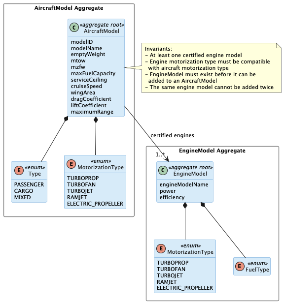
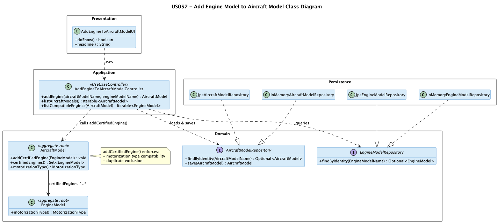

# US 057 - Add an Engine Model to an Aircraft Model

## Context

This is the first time US057 is assigned for development. It is part of Sprint 2 and was not addressed in Sprint 1.

US057 depends on both US055 (aircraft model must exist) and US056 (engine model must exist). It extends the certified engine list of an already-registered aircraft model. The reverse operation — removing an engine model — is covered by US058. Together, US057 and US058 manage the lifecycle of the certified engines association.

The work covers analysis, design, implementation and end-to-end verification of the use case.

## Requirements

This user story extends the `AircraftModel` aggregate by appending a new certified engine model to its existing association list. No new aggregate is introduced; the operation loads the `AircraftModel`, delegates the addition to a domain method that enforces motorization compatibility and duplicate exclusion, and persists the updated aggregate. It complements US055 (creation with an initial engine set) and is the inverse of US058 (removal).

**US 057** As a Backoffice Operator, I want to add an engine model to an aircraft model's list of certified engines. Engine type must be compatible. The same engine model cannot be added twice to the same aircraft. An aircraft model might have several aircraft variants (combinations of model and engine configuration).

**Acceptance Criteria:**

- US057.1 BO Operator can add an engine model to an existing aircraft model's certified engines list.

- US057.2 The engine model's motorization type must be compatible with the aircraft model's motorization type.

- US057.3 The same engine model cannot be added twice to the same aircraft model.

- US057.4 The association is persisted and reflected in subsequent queries of the aircraft model.

- US057.5 Invalid associations (non-existent aircraft model, non-existent engine model, incompatible motorization, duplicate) are rejected with clear errors.

**Dependencies/References:**

| Relation | Item | Nature |
|---|---|---|
| **Upstream prerequisite** | **US055** *Create Aircraft Model* | The target aircraft model must already be registered. US055 creates the aggregate that this US modifies. |
| **Upstream prerequisite** | **US056** *Create Aircraft Engine Model* | The engine model to be added must already be registered in the system. |
| **Downstream consumer** | **US058** *Remove an engine model from an aircraft model* | The reverse operation. US058 must leave at least one engine in the certified list, so it relies on the list populated by US055 and US057. |
| **Domain relationship** | Aircraft instance registration *(later sprint)* | An aircraft instance selects one certified engine from the model's list; the richer that list, the more variants are possible. |

## Analysis

The team approached US057 in four analytical layers, moving from actor identification to design-decision rationalisation.

### Actor and console

The actor is the Backoffice Operator, per §3.1.4 of the requirements. The use case is implemented in the `aisafe.app.backoffice.console` module.

### Requirement source

US057 (full text): "As a Backoffice Operator, I want to add an engine model to an aircraft model's list of certified engines. Engine type must be compatible. The same engine model cannot be added twice to the same aircraft. An aircraft model might have several aircraft variants (combinations of model and engine configuration)."

§3.2 of the requirements defines motorization types: turboprop, turbofan, turbojet, ramjet, electric propeller. Compatibility means both the aircraft model and the engine model share the same `MotorizationType`.

### Alternatives considered

Two design choices were evaluated before committing to the final model:

| Design choice | Selected option | Alternative | Reason for selection |
|---|---|---|---|
| Business rule location | Inside `AircraftModel.addCertifiedEngine()` | In the application controller | Both checks (compatibility and duplicate) depend only on the aggregate's own state and the engine's type — no repository call is needed. Placing them in the aggregate keeps them close to the invariant and ensures they are enforced regardless of how the aggregate is called. |
| Aircraft variant representation | Implied by the certified engines list (no new aggregate) | Dedicated `AircraftVariant` aggregate | The requirement treats variants as an informal concept. Introducing a new aggregate would add unnecessary persistence complexity for what is simply a (model, engine) pair. |

### Design decisions

**Association owned by AircraftModel.** The certified engines list is a property of `AircraftModel`, not of `EngineModel`. An engine model can be certified for multiple aircraft models; an aircraft model owns its certified list. Adding an engine therefore means loading the `AircraftModel` aggregate, calling a domain method on it (e.g. `addCertifiedEngine(engineModel)`), and persisting the updated aggregate. The `EngineModel` aggregate is not modified.

**Motorization compatibility enforced inside the aggregate.** The `addCertifiedEngine` method on `AircraftModel` validates that the engine's `MotorizationType` equals the aircraft model's own `MotorizationType`. This logic belongs inside the aggregate because it depends only on the aggregate's own state and the engine's type — no repository call is needed.

**Duplicate check inside the aggregate.** Checking whether an engine model is already in the certified list is also an intra-aggregate concern. The `addCertifiedEngine` method rejects the addition if the engine model's identity is already present in the list.

**Aircraft variants.** The requirement notes that an aircraft model with multiple certified engines gives rise to several aircraft variants. A variant is an informal concept here (a specific combination of aircraft model and one engine model). No new aggregate is introduced for variants in this sprint; the combination is implied by the certified list.

### Invariants

Enforced inside the aggregate (`addCertifiedEngine` method):

- The engine model's `MotorizationType` must equal the aircraft model's `MotorizationType`.
- The engine model must not already be present in the certified engines list.

Enforced at the application layer (controller plus repositories):

- The target `AircraftModel` exists.
- The `EngineModel` to be added exists.

### Dependencies

**Upstream:**

- US055 (Create Aircraft Model): the aircraft model being modified must exist.
- US056 (Create Aircraft Engine Model): the engine model being added must exist.

**Downstream:**

- US058 (Remove an engine model from an aircraft model): the reverse operation. US058 must ensure at least one certified engine remains after removal.
- Aircraft instance registration (later sprint): an aircraft instance selects one certified engine from its model's list.

### Bootstrap

US057 is a modification operation, not a registration. No bootstrap process is required.

### Integration analysis

US057 is a thin modification operation on an existing aggregate. Its integration surface is:

- `AircraftModelRepository` is both read and written: the aggregate is loaded, mutated via `addCertifiedEngine()`, and saved.
- `EngineModelRepository` is read-only: the engine model is looked up by identity and passed to the domain method.
- No bootstrapper is needed; `AircraftModelBootstrapper` (US055) provides the initial engine set at creation time.
- US058 is the inverse operation and reads the same certified list that this US extends; a richer list from US057 increases the number of engines US058 may remove.

### Coverage analysis

| Acceptance Criterion | Test method |
|---|---|
| US057.1 — add an engine to an existing aircraft model | `ensureAddCertifiedEngineAddsCompatibleEngine` |
| US057.2 — motorization type must be compatible | `ensureAddCertifiedEngineRejectsIncompatibleType` |
| US057.3 — duplicate engine rejected | `ensureAddCertifiedEngineRejectsDuplicate` |
| US057.4 — association persisted and visible in subsequent queries | Controller integration test (pending) |
| US057.5 — invalid inputs rejected | `ensureAddCertifiedEngineRejectsIncompatibleType`, `ensureAddCertifiedEngineRejectsDuplicate`; non-existent model/engine checks at controller layer (pending) |

### Domain model

This user story modifies the `AircraftModel` aggregate by extending its certified engines list. No new aggregates are introduced — the relationship between `AircraftModel` and `EngineModel` already exists in the global domain model.

Key aspects of the model relevant to this US:

- The certified engines list (`1..*` association from `AircraftModel` to `EngineModel`) is owned by `AircraftModel`. Adding an engine means appending a new reference to this list.
- Both `AircraftModel` and `EngineModel` carry a `MotorizationType` enum. Compatibility is established by checking that both values are equal.
- The note in US055 that "all engines are of the same type" means the compatibility check is consistent: every engine in the certified list already has the same `MotorizationType` as the aircraft model, and the new engine must match too.

## Design

The solution is a thin controller operation on an existing aggregate. Three decisions shape the design:

- **Association owned by `AircraftModel`.** The certified engines list is a property of `AircraftModel`, not `EngineModel`. Adding an engine means loading the `AircraftModel` aggregate, calling `addCertifiedEngine(engineModel)`, and saving the updated aggregate. `EngineModel` is never modified.
- **Business rules enforced inside the aggregate.** Both the motorization-compatibility check and the duplicate-exclusion check live in `AircraftModel.addCertifiedEngine()`. They depend only on the aggregate's own state and the engine's type — no repository access is needed — so the aggregate is the right place for them.
- **No bootstrap required.** US057 is a modification operation on already-registered aggregates, not a registration. Pre-populating the certified engine list for bootstrap aircraft models is handled by `AircraftModelBootstrapper` (US055), which supplies the initial engine set at creation time.

### Realization

The class diagram below shows all classes involved and how `AddEngineToAircraftModelController` orchestrates the `AircraftModelRepository` and `EngineModelRepository` to load both aggregates and delegate the business rules to `AircraftModel.addCertifiedEngine()`.

### Acceptance Tests

The tests below exercise the `addCertifiedEngine` method on `AircraftModel`, which is the sole point where US057 business rules are enforced. They are written in JUnit 4 style and live in `AircraftModelTest`.

## Implementation

US057 introduces no new domain class. The implementation is a thin application-layer operation on the existing `AircraftModel` aggregate.

**Business rules live entirely in `AircraftModel.addCertifiedEngine()`.** `AddEngineToAircraftModelController.addEngine()` loads both aggregates by their surrogate IDs, delegates to the domain method, and saves the updated aggregate. No business logic is duplicated in the controller.

**Compatible engines filtered at the DB level.** `AddEngineToAircraftModelController.listCompatibleEngines()` calls `EngineModelRepository.findByMotorizationType()`, which executes a JPQL query — the motorization filter is applied by the database, not in Java code.

**Duplicate detection uses `sameAs`, not `equals`.** `addCertifiedEngine()` checks `certifiedEngines.stream().anyMatch(engine::sameAs)` (business identity: name + maker) rather than `contains()`, which would use the surrogate-key `equals`. This is correct even when two `EngineModel` instances represent the same business entity but were loaded in separate JPA sessions with different in-memory identities.

**The updated aggregate is saved and immediately queryable.** After `addCertifiedEngine()`, `AircraftModelRepository.save()` flushes the change within the same transaction. Subsequent calls to `certifiedEngines()` on the returned instance reflect the new engine.

## Integration/Demonstration

US057 has no bootstrap step — it is a modification operation on already-registered aggregates. The initial certified engine set for each aircraft model is established at creation time by `AircraftModelBootstrapper` (US055).

### Manual demonstration

To add an engine model to an aircraft model via the backoffice console:

1. Launch the backoffice application (ensure bootstrap has run so aircraft models and engine models exist).
2. Select **3. Aircraft** from the main menu.
3. Select **3. Add Engine to Aircraft Model**.
4. The console lists all registered aircraft models; select the target by number.
5. The console lists only engine models whose motorization type is compatible with the selected aircraft model; select the engine to add by number.
6. The system confirms the addition or reports the reason for rejection (incompatible motorization type, engine already present in the certified list).

The association is persisted immediately via `AircraftModelRepository.save()` and is visible in all subsequent queries of that aircraft model.
