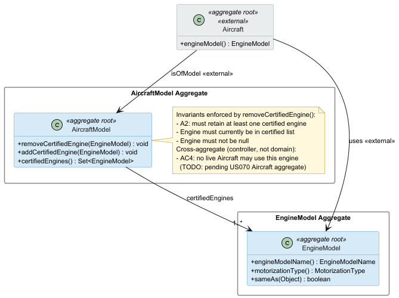
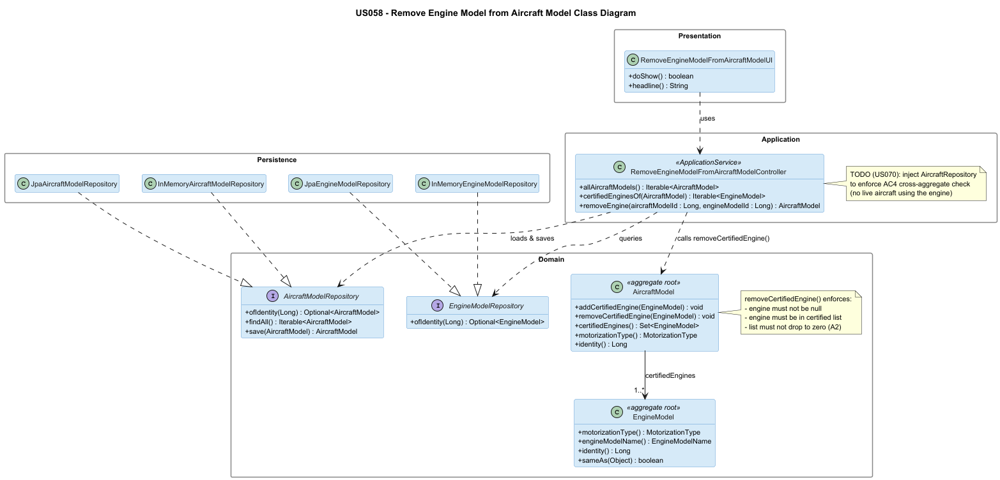

# US 058 - Remove an Engine Model from an Aircraft Model

## Context

This is the first time US058 is assigned for development. It is part of Sprint 2 and was not addressed in Sprint 1.

US058 is the counterpart of US057 (Add Engine Model to Aircraft Model). Together they manage the full lifecycle of the certified-engine relationship on `AircraftModel`. US058 sits within the aircraft configuration sub-domain owned by the Backoffice Operator actor.

The use case requires a cross-aggregate safety check: an engine model may not be removed if actual `Aircraft` instances in the fleet currently use that engine. This check depends on the `Aircraft` aggregate (US070), which is implemented by a different team member. The TODO is documented and will be wired once US070 is merged.

## Requirements

**US 058** As a Backoffice Operator, I want to remove an engine model from an aircraft model's list of certified engines. This is not possible if there are actual aircrafts using that engine model, and the aircraft model must retain at least one certified engine model.

**Acceptance Criteria:**

- US058.1 BO Operator can remove an engine model from an aircraft model's certified engines list.
- US058.2 Removal fails if any aircraft instance currently uses that model/engine combination. Clear error message distinguishes this case.
- US058.3 Removal fails if it would leave the aircraft model with zero certified engines (invariant A2). Clear error message distinguishes this case from US058.2.
- US058.4 Invalid input (model not found, engine not certified for the model, null engine) is rejected with clear error messages.

**Dependencies/References:**

Upstream prerequisites:
- US055 (Create an aircraft model): the `AircraftModel` aggregate must exist.
- US056 (Create an aircraft engine model): the `EngineModel` must exist before it can be associated.
- US057 (Add engine model to aircraft model): the engine must have been certified before it can be removed.

Downstream / parallel dependencies:
- US070 (Add aircraft to air transport company): once implemented, the cross-aggregate check in `RemoveEngineModelFromAircraftModelController` must be completed to enforce US058.2 at runtime.

## Analysis

### Actor and console

The actor is the Backoffice Operator. The use case is implemented in the `aisafe.app.backoffice.console` module under `presentation/aircraftmodel`.

### Domain rules and invariants

The following invariants govern this use case:

- **A2** — An `AircraftModel` must always retain at least one certified `EngineModel`. This invariant is enforced inside the domain method `removeCertifiedEngine()` and cannot be bypassed.
- **A3** (engine compatibility) — already enforced at add-time (US057); no re-check needed at remove-time.
- **AC4** (cross-aggregate) — An `Aircraft`'s engine must be certified for its model. Removing a certification that is in use by live aircraft would violate this invariant. Because `AircraftModel` has no knowledge of `Aircraft`, this check belongs to the application layer (controller). It is left as a TODO pending US070 implementation.

The two failure modes (last engine vs. in-use engine) produce different exception types (`IllegalStateException` vs. `IllegalStateException`) and must be reported with distinct error messages to the operator (US058.3 vs. US058.2).

### Domain model

No new aggregates or value objects are introduced. US058 adds a business method to the existing `AircraftModel` aggregate.

### Design decisions

**Domain enforces A2; controller enforces AC4.** `removeCertifiedEngine()` throws `IllegalStateException` when the collection would drop to zero — this is a domain invariant that must always hold. The cross-aggregate check (no live aircraft using the engine) is an application-layer concern: the aggregate does not and should not know about the `Aircraft` aggregate. The controller orchestrates both checks before delegating to the domain.

**Two distinct error messages.** US058.2 and US058.3 represent different business situations and must be reported separately. The UI catches `IllegalStateException` for both but reads the message to surface the correct explanation.

### Invariants enforced

Inside the aggregate (`AircraftModel.removeCertifiedEngine()`):
- Engine must not be null.
- Engine must currently be in the certified list.
- Removing must not leave the list empty (A2).

At the application layer (`RemoveEngineModelFromAircraftModelController.removeEngine()`):
- Aircraft model must exist.
- Engine model must exist.
- No live aircraft may use this model/engine combination (AC4 — TODO pending US070).

## Design

### Realization

Key points:

- `AircraftModel.removeCertifiedEngine(EngineModel)` contains the domain logic. It uses `sameAs()` equality (not reference equality) when checking membership and when removing, matching the pattern used by `addCertifiedEngine()`.
- `RemoveEngineModelFromAircraftModelController` is named consistently with `AddEngineToAircraftModelController` (US057).
- The controller exposes `allAircraftModels()` and `certifiedEnginesOf(AircraftModel)` to let the UI build its two-step selection flow without exposing repository internals to the presentation layer.
- The cross-aggregate check is present as a documented TODO with the injection point already wired in the constructor signature comment, ready to receive `AircraftRepository` when US070 is merged.

### Acceptance Tests

Tests follow the project's JUnit 4 style with `ensure{Subject}{Verb}For{Condition}` naming and Fake repository inner classes. No mocking framework is used.

- `ensureRemoveCertifiedEngineSucceedsWhenMultipleEnginesExist`: Remove succeeds when multiple engines are certified (US058.1)
- `ensureRemoveCertifiedEngineFailsWhenOnlyOneEngineRemains`: Remove fails when only one engine remains (A2) (US058.3)
- `ensureRemoveCertifiedEngineFailsWhenEngineNotCertifiedForModel`: Remove fails when engine not certified for model (US058.4)
- `ensureRemoveCertifiedEngineRejectsNullEngine`: Null engine rejected at domain level (US058.4)
- `ensureRemoveEngineSucceedsWhenModelHasMultipleEngines`: Controller: remove succeeds with multiple engines (US058.1)
- `ensureRemoveEngineFailsWhenOnlyOneEngineRemains`: Controller: fails when only one engine remains (US058.3)
- `ensureRemoveEngineFailsWhenAircraftModelNotFound`: Controller: fails when aircraft model not found (US058.4)
- `ensureRemoveEngineFailsWhenEngineModelNotFound`: Controller: fails when engine model not found (US058.4)
- `ensureRemoveEngineRequiresBackofficeOperator`: Authorization: requires BACKOFFICE_OPERATOR (NFR09)

## Implementation

US058 was implemented across the standard AISafe feature packages:

- `eapli.aisafe.aircraftmodelmanagement.domain.AircraftModel`: adds `removeCertifiedEngine(EngineModel)` immediately after `addCertifiedEngine()`. The method enforces invariant A2 and the "engine not certified" guard using `sameAs()` equality.
- `eapli.aisafe.aircraftmodelmanagement.application.RemoveEngineModelFromAircraftModelController`: orchestrates the use case. Exposes `allAircraftModels()`, `certifiedEnginesOf()`, and `removeEngine()`. Contains a documented TODO for the cross-aggregate AC4 check, pending US070.
- `aisafe.app.backoffice.console`: adds `RemoveEngineModelFromAircraftModelUI` under `presentation/aircraftmodel` and wires option 4 in the Aircraft sub-menu of `MainMenu`.

## Integration/Demonstration

- US058 depends on US055/US056/US057 through the `AircraftModel` aggregate and its repository.
- The feature is accessible from: `Backoffice App → Aircraft > Remove Engine from Aircraft Model`.
- Verification: `mvn clean compile test` passes with ≥90% coverage on `aircraftmodelmanagement.domain` and `aircraftmodelmanagement.application`.

JaCoCo coverage evidence: 

## Observations

The cross-aggregate check (US058.2) is intentionally left as a TODO. In the current state, an operator could remove an engine that is in use by live aircraft — this will be blocked once `AircraftRepository` (US070) is injected. The partial implementation is acceptable for Sprint 2 MVP because: (a) the domain already prevents the model from dropping to zero engines (A2), and (b) no Aircraft aggregate yet exists in the system.

The `sameAs()` equality used in `removeCertifiedEngine()` deliberately mirrors the approach taken in `addCertifiedEngine()` for consistency. Reference equality would fail for distinct `EngineModel` instances with the same name and maker (e.g., when the engine is loaded from a repository and passed in from outside).
