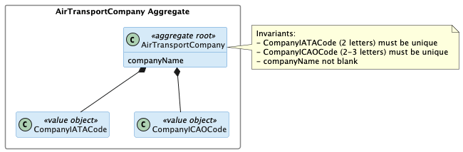
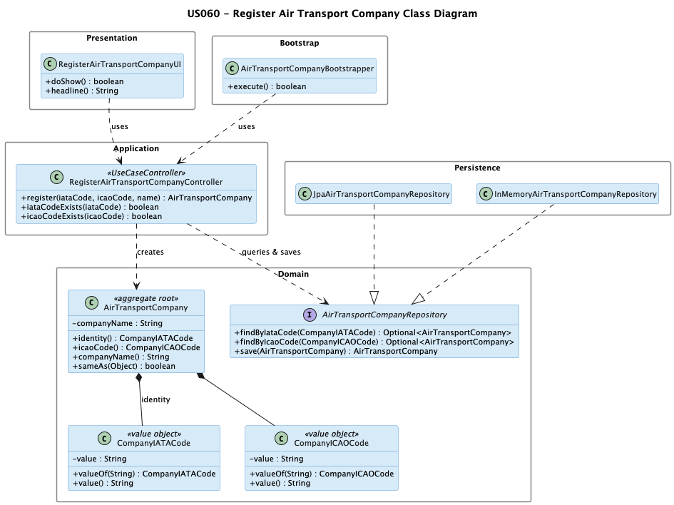

# US 060 - Register Air Transport Company

## Context

This is the first time US060 is assigned for development. It is part of Sprint 2 and was not addressed in Sprint 1.

US060 is a foundational user story for the operations subdomain. It has no upstream dependencies, but several downstream user stories depend on having air transport companies registered: collaborators and pilots belong to a company, aircraft are owned by a company, and flights are operated by a company. Registering this base reference data is therefore a prerequisite for most operational flows.

The work covers analysis, design, implementation and end-to-end verification of the use case, plus a bootstrap loader for pre-populated companies.

## Requirements

This user story establishes the `AirTransportCompany` aggregate as a foundational reference entity in the operations subdomain. It defines the data contract for an air transport company — IATA code, ICAO code, and name — and the invariants that must hold at creation time. Because collaborators, pilots, aircraft, and flights all belong to a company, registering companies is a prerequisite for most downstream operational flows.

**US 060** As a Backoffice Operator, I want to register an air transport company. A company has a company name, and IATA (2 letters) and ICAO code (2-3 letters) that must be unique. This must also be achievable by a bootstrap process.

**Acceptance Criteria:**

- US060.1 BO Operator can register an air transport company.

- US060.2 IATA code is exactly 2 letters and unique across the system.

- US060.3 ICAO code is 2 to 3 letters and unique across the system.

- US060.4 Company name is not blank.

- US060.5 A bootstrap process can pre-populate air transport companies.

- US060.6 Invalid inputs (duplicate IATA or ICAO, malformed code, blank name) are rejected with clear errors.

**Dependencies/References:**

| Relation | Item | Nature |
|---|---|---|
| **Upstream prerequisite** | None | US060 has no upstream dependencies; it is a foundational entity with no cross-aggregate dependencies at creation time. |
| **Downstream consumer** | **US061** *Register a customer's collaborator* | A `CompanyCollaborator` references an `AirTransportCompany`; this US must run first. |
| **Downstream consumer** | Company pilot registration *(later sprint)* | A pilot belongs to exactly one `AirTransportCompany`. |
| **Downstream consumer** | Aircraft registration *(later sprint)* | An aircraft is owned by exactly one `AirTransportCompany`. |
| **Downstream consumer** | Flight route and flight creation *(later sprint)* | Routes and flights are operated by an `AirTransportCompany`. |

## Analysis

The team approached US060 in four analytical layers, moving from actor identification to design-decision rationalisation.

### Actor and console

The actor is the Backoffice Operator, per §3.1.4 of the requirements: "Base system information (aircraft models, airports, flight control areas, etc.) is fed into the system by Backoffice Operators". The use case is implemented in the `aisafe.app.backoffice.console` module.

### Requirement source

US060 (full text): "As a Backoffice Operator, I want to register an air transport company. A company has a company name, and IATA (2 letters) and ICAO code (2-3 letters) that must be unique. This must also be achievable by a bootstrap process."

§3.1.4 of the requirements confirms that air transport companies are part of the base system reference data managed by Backoffice Operators.

### Alternatives considered

Three design choices were evaluated before committing to the final model:

| Design choice | Selected option | Alternative | Reason for selection |
|---|---|---|---|
| IATA and ICAO code modelling | Dedicated value objects (`CompanyIATACode`, `CompanyICAOCode`) | Plain `String` fields | Value objects enforce the format constraint (letter count) at construction time, preventing invalid codes from ever existing in the domain. |
| Company name | Plain `String` field with non-blank constraint | `CompanyName` value object | The name has a single non-blank constraint and is not used as a stable identifier; a dedicated value object would add ceremony without enforcing any additional rule. |
| Airline vs. airport code types | Distinct `CompanyIATACode` / `CompanyICAOCode` types (2-letter IATA, 2–3-letter ICAO) | Reuse airport code value objects | Airline and airport codes have different length rules (2-letter vs. 3-letter IATA; 2–3-letter vs. 4-letter ICAO); sharing types would weaken the domain contract. |

### Design decisions

**IATA and ICAO as value objects.** Both codes have format constraints (letter count) that should be enforced at construction. Encapsulating each in a value object makes the constraint part of the type itself, preventing invalid code strings from ever existing in the domain. This is the same approach used for `AirportIATACode` and `AirportICAOCode` in US052.

**Airline codes vs. airport codes.** The airline IATA code is 2 letters (e.g. TP for TAP), while the airport IATA code is 3 letters (e.g. LIS for Lisbon). The airline ICAO code is 2-3 letters (e.g. TAP), while the airport ICAO code is 4 letters. The two value object types are distinct and must not be confused — `CompanyIATACode` and `AirportIATACode` enforce different length rules.

**companyName as a plain attribute.** The company name has a single non-blank constraint and is not used as a stable identifier for cross-aggregate references (the codes play that role). A dedicated value object would not enforce any additional invariant.

### Invariants

Enforced inside the aggregate (constructors and value objects):

- `CompanyIATACode` is exactly 2 letters (upper-case alphabetic).
- `CompanyICAOCode` is 2 to 3 letters (upper-case alphabetic).
- `companyName` is not null and not blank.

Enforced at the application layer (controller plus repository):

- `CompanyIATACode` is unique across all registered companies.
- `CompanyICAOCode` is unique across all registered companies.

The uniqueness checks cannot live inside the aggregate alone, since the aggregate has no knowledge of other companies. They are enforced by the registration controller querying the `AirTransportCompanyRepository` before persisting the new company.

### Dependencies

**Upstream:** None. US060 is a foundational user story with no prerequisites.

**Downstream:**

- US061 (Register a customer's collaborator): a `CompanyCollaborator` references an `AirTransportCompany`; this US must run first.
- Pilot registration (later sprint): a pilot belongs to exactly one `AirTransportCompany`.
- Aircraft registration (later sprint): an aircraft belongs to exactly one `AirTransportCompany`.
- Flight route and flight creation (later sprint): a route and its flights belong to an `AirTransportCompany`.

### Bootstrap

Acceptance criterion US060.5 requires a bootstrap process. An `AirTransportCompanyBootstrapper` will pre-populate a fixed set of companies at system initialisation, going through the same registration use case to ensure all invariants (code format and uniqueness, non-blank name) are enforced for bootstrap data exactly as they are for operator input.

### Integration analysis

US060 is a self-contained registration with no cross-aggregate read dependencies at creation time. Its integration surface is:

- `AirTransportCompanyRepository` is both queried (IATA and ICAO uniqueness checks) and written (save) during the registration flow.
- `AirTransportCompanyBootstrapper` calls `RegisterAirTransportCompanyController.register()` directly, so bootstrap data is subject to the same validation as operator input.
- US061 (`RegisterCollaboratorController`) reads `AirTransportCompanyRepository` to resolve the customer before creating a `CompanyCollaborator`; this US must have been run first.
- All later downstream USs (pilot, aircraft, flight) will look up `AirTransportCompany` by IATA code; the domain contract established here (code format, uniqueness) must remain stable.

### Coverage analysis

| Acceptance Criterion | Test method |
|---|---|
| US060.1 — register an air transport company | `ensureCompanyAcceptsValidInput` |
| US060.2 — IATA code is exactly 2 letters and unique | `ensureIataCodeRejectsSingleLetter`, `ensureIataCodeRejectsThreeLetters`, `ensureIataCodeRejectsDigits`, `ensureIataCodeAcceptsTwoLetters`; uniqueness at controller layer (pending) |
| US060.3 — ICAO code is 2–3 letters and unique | `ensureIcaoCodeRejectsSingleLetter`, `ensureIcaoCodeRejectsFourLetters`, `ensureIcaoCodeAcceptsTwoLetters`, `ensureIcaoCodeAcceptsThreeLetters`; uniqueness at controller layer (pending) |
| US060.4 — company name is not blank | `ensureCompanyRejectsBlankName`, `ensureCompanyRejectsNullName` |
| US060.5 — bootstrap process | `AirTransportCompanyBootstrapperTest` (integration, pending) |
| US060.6 — invalid inputs rejected | `ensureIataCodeRejectsSingleLetter`, `ensureIataCodeRejectsThreeLetters`, `ensureIataCodeRejectsDigits`, `ensureIcaoCodeRejectsSingleLetter`, `ensureIcaoCodeRejectsFourLetters`, `ensureCompanyRejectsBlankName`, `ensureCompanyRejectsNullName` |

### Domain model

The global domain model includes the `AirTransportCompany` aggregate with `CompanyIATACode` and `CompanyICAOCode` as value objects, and `companyName` as a plain attribute.

Key aspects of the model relevant to this US:

- `CompanyIATACode` is a value object that enforces the 2-letter format constraint at construction time.
- `CompanyICAOCode` is a value object that enforces the 2-to-3-letter format constraint at construction time.
- `companyName` is kept as a plain attribute. It has a single non-blank constraint and no stable identifier role, so a value object would add no benefit.
- No other aggregate is referenced: `AirTransportCompany` is a standalone root with no upstream cross-aggregate dependencies.

## Design

- **IATA and ICAO as distinct value objects.** Both codes have format constraints that differ from those of airport codes. Encapsulating each in a dedicated value object (`CompanyIATACode`, `CompanyICAOCode`) enforces those constraints at the type level and prevents any caller from passing an airport code where a company code is expected.
- **Uniqueness enforced at the controller.** Code uniqueness is a cross-aggregate invariant — the aggregate has no knowledge of other companies. The controller queries `AirTransportCompanyRepository` for each code before persisting, making the check explicit and auditable.
- **Bootstrap goes through the same controller.** `AirTransportCompanyBootstrapper` calls `RegisterAirTransportCompanyController.register(...)` directly, so bootstrap data is subject to exactly the same validation as operator input.

### Realization

The class diagram below shows all classes involved, their responsibilities, and how they relate across the Presentation, Application, Domain, Persistence, and Bootstrap layers.

### Acceptance Tests

The tests below cover the domain invariants for `AirTransportCompany`, `CompanyIATACode`, and `CompanyICAOCode`. They follow the `ensureXxxYyy` naming convention and are written in JUnit 4 style.

## Implementation

The design decisions from section 4 are reflected directly in the code.

**IATA code as `@EmbeddedId`.** `AirTransportCompany` uses `CompanyIATACode` as both its JPA primary key (`@EmbeddedId`) and the return value of `identity()`. This aligns the JPA surrogate identity with the DDD business identity — the IATA code is the stable, externally meaningful identifier for a company.

**ICAO code mapped with `@AttributeOverride`.** Because both `CompanyIATACode` and `CompanyICAOCode` are `@Embeddable` types with an internal field named `value`, the `@AttributeOverride` on the ICAO field maps it to the column `icao_code`, avoiding a naming clash in the single table.

**Case normalisation inside the value objects.** Both `CompanyIATACode` and `CompanyICAOCode` call `value.strip().toUpperCase()` at construction time. Lowercase or mixed-case input is accepted and stored in canonical uppercase form without any sanitisation in the controller.

**Dual uniqueness enforced at the controller.** `RegisterAirTransportCompanyController.register()` queries `findByIataCode()` and `findByIcaoCode()` before persisting. Both calls run JPQL queries in the JPA implementation, so uniqueness is verified at the database level before the insert is attempted.

**Bootstrap goes through the same controller.** `AirTransportCompanyBootstrapper.register()` calls `RegisterAirTransportCompanyController.register(...)` directly, so bootstrap data is subject to exactly the same validation as operator input. `IntegrityViolationException` is caught to make re-runs idempotent.

## Integration/Demonstration

### Bootstrap

`AirTransportCompanyBootstrapper` has no upstream dependency and runs as part of the `AisafeBootstrapper` startup sequence. It seeds three reference companies:

| IATA | ICAO | Name |
|---|---|---|
| TP | TAP | TAP Air Portugal |
| FR | RYR | Ryanair |
| LH | DLH | Lufthansa |

To trigger the bootstrap manually, run the dedicated bootstrap application (`AisafeBootstrap` main class in the `aisafe.app.bootstrap` module).

### Manual demonstration

To register an air transport company via the backoffice console:

1. Launch the backoffice application and log in as a Backoffice Operator.
2. Select **4. Companies** from the main menu.
3. Select **1. Register Air Transport Company**.
4. Follow the prompts: enter the IATA code (exactly 2 letters), ICAO code (2–3 letters), and the company name.
5. The system confirms registration or reports the reason for rejection (duplicate IATA or ICAO code, malformed code, blank name).
