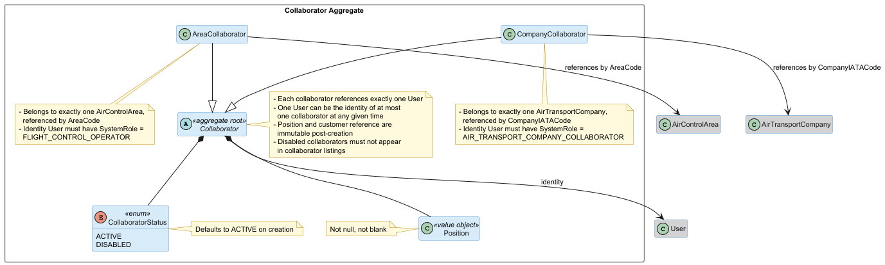
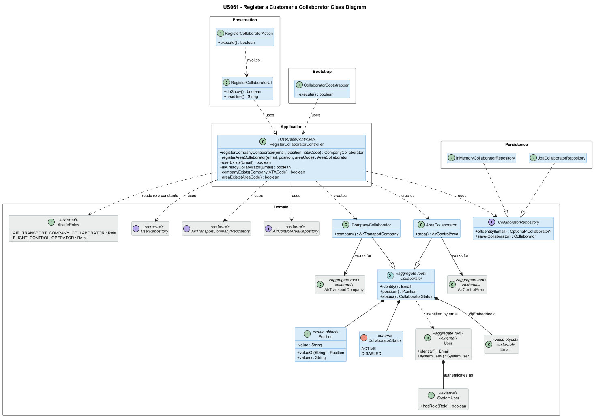
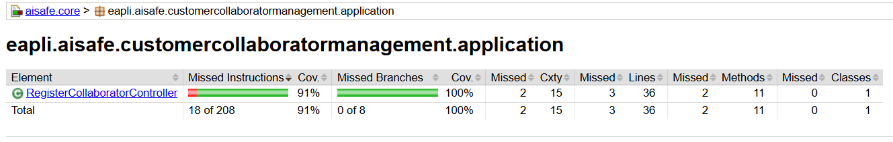
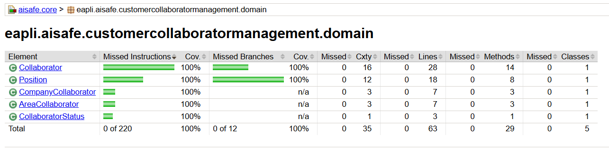

# US 061 - Register a Customer's Collaborator

## Context

This is the first time US061 is assigned for development. It is part of Sprint 2 and was not addressed in Sprint 1.

US061 sits in the customer-side user-onboarding chain. It depends on the customer aggregates already existing (US060 for Air Transport Company, US050 for Air Control Area) and on the User aggregate registration flow (US031). It is, in turn, a prerequisite for every operational user story performed by an ATCC (US070, US071, US072, US073, US074, US075, US076, US077) and for any UC scoped to a Flight Control Operator acting on behalf of an ACA (US100 onwards).

The work covers analysis, design, implementation and end-to-end verification of the registration use case, plus a bootstrap loader for pre-populated collaborators across both customer types.

## Requirements

**US 061** As a Backoffice Operator, I want to register a customer's collaborator. A customer may be an air transport company or an air control area. The collaborator will also be a distinct system user. There is no need to verify that the collaborator's email is in the customer's domain. This must also be achievable by a bootstrap process.

**Acceptance Criteria:**

- US061.1 BO Operator can register a collaborator for an existing customer.
 
- US061.2 A customer is either an Air Transport Company or an Air Control Area.

- US061.3 Each collaborator references exactly one existing System User. One User can be the identity of at most one collaborator at any given time.

- US061.4 The User's SystemRole must match the customer type: `AIR_TRANSPORT_COMPANY_COLLABORATOR` for an air transport company customer, `FLIGHT_CONTROL_OPERATOR` for an ACA customer.

- US061.5 The collaborator's email need not belong to the customer's domain.

- US061.6 The collaborator captures: a reference to the User, the customer, and a position (the collaborator's role within the customer organization).

- US061.7 A bootstrap process can pre-populate collaborators for both customer types, going through the same registration use case.

- US061.8 Invalid input (non-existent customer, non-existent user, missing position, user already linked to another collaborator, role/customer-type mismatch) is rejected with clear errors.

**Dependencies/References:**

Upstream prerequisites:
- US031 (Register users): the User aggregate must already exist for the collaborator's identity.
 
- US060 (Register an air transport company): required when the customer is an air transport company.

- US050 (Register an air control area): required when the customer is an ACA.

Downstream consumers:

- US062, US063, US064 (list / edit / disable a customer's collaborator).

- US070 onwards: every ATCC-actor UC operates on a collaborator created here.

- US075 (Add a pilot): pilots are added by an ATCC, which must exist first.

## Analysis

### Actor and console

The actor is the Backoffice Operator. §3.1.3 of the requirements states: "Backoffice Operators can add air transport companies' collaborators (ATCC) of the companies registered in the system." §3.1.4 establishes that ACA-side system access is held by Flight Control Operators, "directly managed by the system administrator" (read as: through AISafe-side staff, via the system, rather than by the client). US061 names the Backoffice Operator as the actor responsible for both customer types, which we adopt.

The use case is implemented in the `aisafe.app.backoffice.console` module.

### Requirement source

US061 (full text): "As a Backoffice Operator, I want to register a costumer's collaborator. A costumer may be an air transport company or an air control area. The collaborator will also be a user of the system. Thus, each collaborator will be a distinct system user. There is no need to verify that the collaborator's email is in the customer's domain. This could be extremely difficult or even impossible, and many users have emails outside the company's main domain. This must also be achievable by a bootstrap process."

Supporting sections:
- §3.1.1 (Users and roles): defines that a user is identified by a unique valid email, has a name and phone number, and must authenticate to do anything.
- §3.1.3 (Air transport companies): "Email (valid company email), name and position will probably be enough for the purpose of the system."
- §3.1.4 (Flight control): names FCO as the ACA-side role.

PO clarifications consumed:
- (20/04/2026) "For AISafe internal users, a list of valid email domains should be bootstrapped into the system. For external collaborators such as ATCC and pilots, domain verification is not feasible and should not be enforced."
- (22/04/2026) "The 'position' field on a collaborator refers to their role within the company."
- (28/04/2026) "Disabling a user does not cascade into removing their collaborator associations; it is strictly a status change."
- (02/05/2026, 12/05/2026) "For the purposes of the MVP, an Air Control Area is treated as the customer entity. A Flight Control Operator collaborator works in one Air Control Area at a time. While a company may own several areas in practice, they operate independently and this need not be modelled."

### Domain model

The previous version of the global domain model contained a single `CompanyCollaborator` aggregate tied to `AirTransportCompany` only. US061 requires the model to support collaborators for both customer types, so the aggregate is generalized into a hierarchy.



Changes introduced for this US:

- `Collaborator` is promoted to an abstract aggregate root. The two concrete subtypes `CompanyCollaborator` (existing, retargeted) and `AreaCollaborator` (new) capture the customer-specific reference.
- `Position` is modelled as a value object with a non-blank rule. Per PO clarification of 22/04/2026, it represents the collaborator's role within the customer organization. For an ACA collaborator, the position is FCO (and may be entered as such by the BO).
- `CollaboratorStatus` (ACTIVE, DISABLED) is retained on the abstract root; lifecycle status is identical for both subtypes per PO clarification of 28/04/2026.
- The cross-aggregate reference from `Collaborator` to `User` is retained; the subtype-specific references to `AirTransportCompany` and `AirControlArea` are added.
  The three external aggregates (`User`, `AirTransportCompany`, `AirControlArea`, in grey) are not modified by this US and appear here for relationship context only.

### Design decisions

Four decisions were taken at analysis time that the requirements and PO clarifications did not directly prescribe.

**Collaborator as an inheritance hierarchy.** The two collaborator kinds share lifecycle (status), share identity semantics (one User reference, one position), and differ only in the customer aggregate referenced. An abstract `Collaborator` root with two concrete subtypes captures this cleanly and avoids two parallel aggregates with duplicated structure for the downstream listing, editing, and disabling USs (US062–US064). JPA inheritance (single-table or joined) maps the hierarchy at the persistence layer; the choice between strategies is deferred to the design phase.

**Position kept on the abstract root.** Although §3.1.3 introduces "position" in the air transport company context, the field is meaningful for both customer types: for an air transport company it captures the role within the company (e.g., Operations Manager); for an ACA it captures the operational role within the area, which in practice will be FCO. Keeping it on the abstract root keeps the model uniform and avoids a special-case for the ACA branch.

**Role/customer-type binding enforced at registration.** The link between customer type and the User's SystemRole is a registration-time invariant, not a runtime one: once registered, a collaborator does not change customer. This invariant is enforced by the controller (it has access to both the customer and the User), not by the aggregate (which sees only its own customer reference).

**One User, one Collaborator, at any given time.** US061 says "each collaborator will be a distinct system user" but does not explicitly forbid one User from being the identity of multiple collaborators. We adopt the stricter interpretation, consistent with the same invariant in the Pilot aggregate. For the ACA branch this is directly mandated by PO: "A collaborator can only work in an Air Control Area at a time" (12/05/2026, Angelo Martins, US061 forum) — no derivation from role semantics is needed. For both branches, (b) remains: downstream USs (US063 edit, US064 disable) become ambiguous if the same User backs multiple collaborators.

### Invariants

Enforced inside the aggregate (constructors and value objects):

- `Position` is not null and not blank.
- `CollaboratorStatus` defaults to `ACTIVE` on creation.
- A `Collaborator` references exactly one `User`.
- A `CompanyCollaborator` references exactly one `AirTransportCompany`.
- An `AreaCollaborator` references exactly one `AirControlArea`.
  Enforced at the application layer (controller plus repository):

- The referenced customer exists.
- The referenced User exists.
- The User's `SystemRole` matches the customer type: `AIR_TRANSPORT_COMPANY_COLLABORATOR` for a `CompanyCollaborator`, `FLIGHT_CONTROL_OPERATOR` for an `AreaCollaborator`.
- The referenced User is not already the identity of any other collaborator (across both subtypes).
  The user-uniqueness and role-matching checks cannot live inside the aggregate alone: the aggregate has no knowledge of other collaborators, and the relationship between subtype and required SystemRole is policy that belongs at the application boundary.

### Dependencies

**Upstream:**

- US031 (Register users): the User must be created before it can be linked to a collaborator.
- US060 (Register an air transport company): required for the air transport company branch.
- US050 (Register an air control area): required for the ACA branch.
 
**Downstream:**

- US062 (List a customer's collaborators): iterates collaborators of a given customer, filtering out disabled ones.
- US063 (Edit a customer's collaborator): edits an existing collaborator.
- US064 (Disable a customer's collaborator): transitions `CollaboratorStatus` to `DISABLED`.
- US070, US071, US072, US073, US074, US075, US076, US077: every UC scoped to the ATCC actor operates on a `CompanyCollaborator` created by US061.
- US100 onwards: FCO-scoped UCs operate on the User identity of an `AreaCollaborator`.

### Bootstrap

The US requires a bootstrap process. A `CollaboratorBootstrapper` will pre-populate a fixed set of collaborators for bootstrapped customer data (at least one `CompanyCollaborator` and at least one `AreaCollaborator`), going through the same registration use case to guarantee all invariants are enforced (user existence, role match, single-collaborator-per-user). The bootstrapper runs after `UserBootstrapper`, `AirTransportCompanyBootstrapper`, and `AirControlAreaBootstrapper`.

## Design

### Realization



Key points the diagram makes explicit:

- `Collaborator` is an abstract `@Entity` aggregate root using JPA's default `SINGLE_TABLE` inheritance; `CompanyCollaborator` and `AreaCollaborator` are concrete subtypes with no extra inheritance scaffolding.
- `Collaborator`'s identity is the User's `Email`, used directly as `@EmbeddedId`. This makes the "one User, at most one Collaborator" invariant a primary-key constraint at the database level, not an application-layer check that could be bypassed.
- Cross-aggregate references to `AirTransportCompany` and `AirControlArea` are stored by identity: `CompanyCollaborator` embeds a `CompanyIATACode` and `AreaCollaborator` embeds an `AreaCode`. No `@ManyToOne` entity reference is used. This follows AISafe's own pattern — `Airport` (US052) embeds `CountryCode` and `AreaCode` as value objects while the controller verifies the referenced aggregates exist before saving. The subtype-specific columns are `nullable = true` in the schema, which is a SINGLE_TABLE requirement (each row is one subtype and leaves the other subtype's column empty); the constructors enforce non-null at the domain level.
- `RegisterCollaboratorController` is constructed with four repositories injected via constructor (`CollaboratorRepository`, `UserRepository`, `AirTransportCompanyRepository`, `AirControlAreaRepository`), mirroring the US060 wiring style for consistency and testability.
- Role validation calls `user.hasRole(RoleType)`, which delegates to `systemUser().hasRole(...)`; the method is added to `User` as part of this US.

### Acceptance Tests

Tests follow JUnit 4 style (project uses Vintage Engine), `ensure{Subject}{Verb}For{Condition}` naming, and no mocking framework. Aggregate and VO tests are pure unit tests. Controller tests are integration-style: they construct the controller with the real `InMemoryCollaboratorRepository`, `InMemoryUserRepository`, `InMemoryAirTransportCompanyRepository`, and `InMemoryAirControlAreaRepository`, pre-populated via test helpers.

- `ensureRegisterCompanyCollaboratorHappyPath`: The controller successfully registers a company collaborator when the user, company, and role all check out. (US061.1, US061.2, US061.6)
- `ensureRegisterAreaCollaboratorHappyPath`: The controller successfully registers an area collaborator when the user, area, and role all check out. (US061.1, US061.2, US061.6)
- `ensurePositionMustNotBeBlankForCreation`: A blank Position is rejected by the value object. (US061.6, US061.8)
- `ensurePositionMustNotBeNullForCreation`: A null Position is rejected by the value object. (US061.6, US061.8)
- `ensureNewCollaboratorDefaultsToActiveStatus`: A newly created collaborator defaults to ACTIVE status, for both subtypes. (US061.6)
- `ensureRegisterRejectsNonExistentUserForCompanyCollaborator`: The controller rejects registration when the referenced user does not exist. (US061.8)
- `ensureRegisterRejectsNonExistentCompanyForCompanyCollaborator`: The controller rejects registration when the referenced air transport company does not exist. (US061.8)
- `ensureRegisterRejectsNonExistentAreaForAreaCollaborator`: The controller rejects registration when the referenced air control area does not exist. (US061.8)
- `ensureRegisterRejectsUserAlreadyLinkedToAnotherCollaborator`: The controller rejects registering a user who is already linked to another collaborator. (US061.3, US061.8)
- `ensureRegisterRejectsUserWithoutAtccRoleForCompanyCollaborator`: The controller rejects an air transport company collaborator whose user lacks the ATCC role. (US061.4, US061.8)
- `ensureRegisterRejectsUserWithoutFcoRoleForAreaCollaborator`: The controller rejects an ACA collaborator whose user lacks the FCO role. (US061.4, US061.8)
- `ensureRegisterAcceptsCollaboratorEmailOutsideCustomerDomain`: A collaborator's email is accepted regardless of whether it belongs to the customer's domain. (US061.5)
- `ensureBootstrapPopulatesBothCollaboratorSubtypes`: The bootstrap loader pre-populates collaborators for both customer types by going through the same registration use case. (US061.7)

## Implementation

US061 was implemented across the standard AISafe feature packages:

- `eapli.aisafe.customercollaboratormanagement.domain`: adds the `Collaborator` aggregate root hierarchy, identified by `Email`, plus the concrete `CompanyCollaborator` and `AreaCollaborator` subtypes, `Position` and `CollaboratorStatus`.
- `eapli.aisafe.customercollaboratormanagement.application.RegisterCollaboratorController`: orchestrates the registration use case. It validates that the referenced `User` exists, that the referenced customer exists, that the user's role matches the customer type, and that the user is not already linked to another collaborator before persisting the new aggregate.
- `eapli.aisafe.customercollaboratormanagement.repositories.CollaboratorRepository`: exposes collaborator lookup operations by email and by customer identity (`CompanyIATACode` or `AreaCode`), supporting both this user story and downstream listing/edit/disable user stories.
- `aisafe.persistence.impl`: provides both in-memory and JPA repository implementations for collaborators, wires them through `RepositoryFactory.customerCollaborators()`, and registers the collaborator hierarchy in the JPA persistence unit.
- `aisafe.app.backoffice.console`: adds the `Customer Collaborators > Register Customer's Collaborator` menu entry.
- `aisafe.bootstrappers`: adds `CollaboratorBootstrapper`, which registers one company collaborator and one area collaborator through the same application controller used by the UI.
- `eapli.aisafe.usermanagement`: refactors email validation so `Email` is format-only and `EmailDomainPolicy` enforces the approved-domain whitelist only for internal roles, preserving US031 while allowing US061 external collaborators.

The JPA mapping uses a single-table inheritance hierarchy for `Collaborator`. Cross-aggregate references are persisted by identity value object: `CompanyCollaborator` stores `CompanyIATACode`, and `AreaCollaborator` stores `AreaCode`.

Major commit:

- `feat(US061): register customer collaborator, small refactor to us031 #120` - implements the collaborator aggregate hierarchy, registration controller, repository contracts and persistence implementations, backoffice UI/menu integration, bootstrapper, focused domain/controller tests, and the role-aware email-domain policy needed to reconcile US061 with US031.
- `test(US061): expand domain and controller test coverage to > 90% #121` - adds the focused test coverage needed for NFR03 and records the JaCoCo evidence for the US061 domain and controller packages.
- `feat(US050,US052,US061): Add controller-level authz to backoffice create flows #78 #104 #134` - adds framework-backed authorization checks to the collaborator registration controller and aligns the backoffice menu gate so collaborator create/list/edit/disable flows are restricted to `BACKOFFICE_OPERATOR`.

## Integration/Demonstration

Integration points:

- US061 depends on US031 through `User`, `Email`, `AisafeRoles` and the user repository. A collaborator can only be registered for an existing system user.
- US061 depends on US060 through `AirTransportCompanyRepository` and `CompanyIATACode` for company collaborators.
- US061 depends on US050 through `AirControlAreaRepository` and `AreaCode` for area collaborators.
- The bootstrap sequence now loads `AirTransportCompanyBootstrapper`, `CountryBootstrapper`, `AirControlAreaBootstrapper`, then `CollaboratorBootstrapper`, ensuring collaborator registration can validate both customer types before airports are loaded.
- Backoffice Operators can access the use case from `Customer Collaborators > Register Customer's Collaborator`.
- Repository factory method `customerCollaborators()` was added to both in-memory and JPA factories. The existing `collaborators()` method used by early US063/US064 work was left in place to avoid disrupting those user stories.

The bootstrap smoke run executed the master-data sequence and reached `Bootstrap data done.` after running `CollaboratorBootstrapper` in order:

```text
Bootstrapping MasterUsers...
Bootstrapping Maker...
Bootstrapping EngineModel...
Bootstrapping AircraftModel...
Bootstrapping AirTransportCompany...
Bootstrapping Country...
Bootstrapping AirControlArea...
Bootstrapping Collaborator...
Bootstrapping Airport...
Bootstrap data done.
```

NFR03 requires >=90% test coverage on the domain and controller packages. The figures below are the JaCoCo reports for the US061 domain package and controller class, captured after the final test additions:




## Observations

US061 analysis surfaced a US031 boundary issue around email validation: the shared `Email` value object cannot enforce AISafe-only domains if external collaborators are valid system users. The implementation therefore keeps `Email` as a format-only value object and moves the approved-domain whitelist to US031's role-aware `EmailDomainPolicy`, driven by the PO clarification of 20/04/2026.

The eCafeteria reference repository was checked during design review because its `Dish.dishType` mapping is a useful JPA precedent for a required cross-aggregate association with no cascade enabled. That precedent was deliberately kept secondary: US061's main design justification is the AISafe identity-reference convention already used by US052 (`Airport` stores `CountryCode` and `AreaCode`) and the DDD aggregate-boundary rule from T4/Vernon. For that reason, US061 stores `CompanyIATACode` and `AreaCode` rather than direct `@ManyToOne` references to `AirTransportCompany` and `AirControlArea`.

Reference checked: https://bitbucket.org/pag_isep/ecafeteria-base/src/master/
