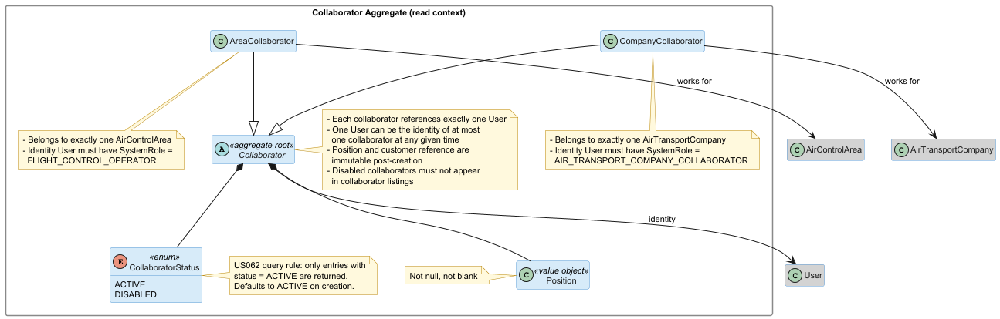
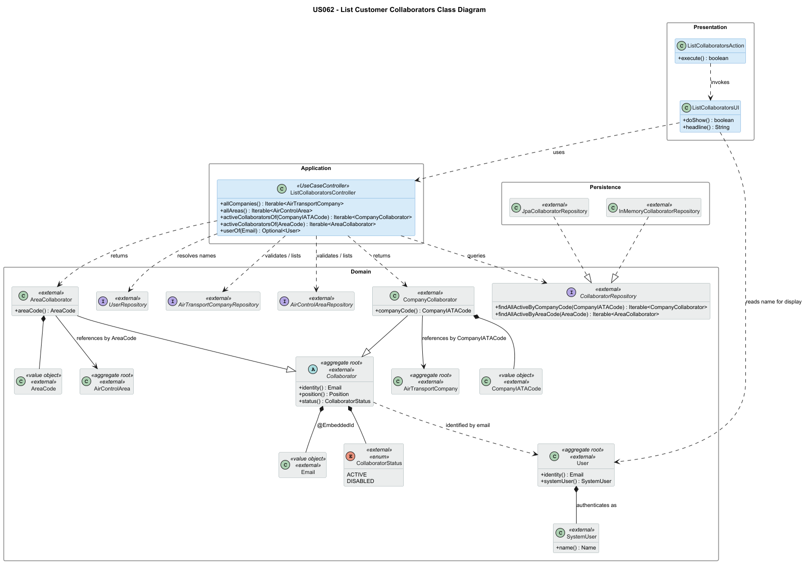
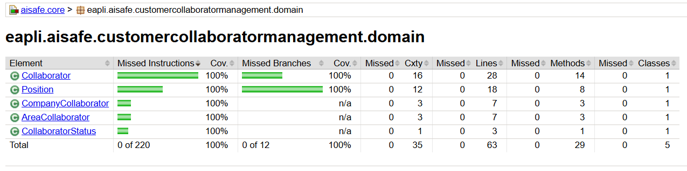
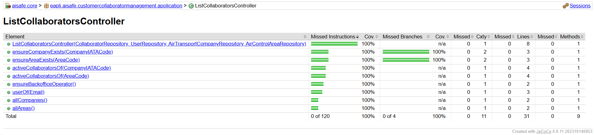

# US 062 - List Customer Collaborators

## Context

This is the first time US062 is assigned for development. It is part of Sprint 2 and was not addressed in Sprint 1.

US062 is a read-only counterpart to US061. It depends entirely on US061's domain model and registration flow: without registered collaborators there is nothing to list. It has no downstream consumers; it is a self-contained query UC for the Backoffice Operator. It is, however, a sibling of US064 (Disable a collaborator): US064 sets `CollaboratorStatus` to `DISABLED`, which US062 then filters out.

The work covers analysis, design, implementation and end-to-end verification of the listing use case. No bootstrap is required (queries do not seed data).

## Requirements

**US 062** As a Backoffice Operator, I want to list all collaborators of a given customer. It should not list disabled collaborators.

**Acceptance Criteria:**

- US062.1 BO Operator can list the collaborators of an existing customer.
- US062.2 A customer is either an Air Transport Company or an Air Control Area.
- US062.3 Only collaborators with status `ACTIVE` appear in the list. Collaborators with status `DISABLED` are excluded.
- US062.4 Each entry displays the collaborator's name and login email (taken from the linked User) and the collaborator's position.
- US062.5 An empty result is valid (the customer has no active collaborators).
- US062.6 Selecting a non-existent customer is rejected with a clear error.

**Dependencies/References:**

Upstream prerequisites:
- US061 (Register a customer's collaborator): provides the data being listed and the domain model relied upon.
- US060, US050: the customer aggregates the BO selects from.
- US031: the User aggregate referenced by each collaborator entry.
  Sibling:
- US064 (Disable a customer's collaborator): produces the `DISABLED` status that US062 filters out.

Downstream: none.

## Analysis

### Actor and console

The actor is the Backoffice Operator, consistent with US061 (the registrar of the data being listed). The use case is implemented in the `aisafe.app.backoffice.console` module.

### Requirement source

US062 (full text): "As a Backoffice Operator, I want to list all collaborators of a given customer. It should not list disabled collaborators."

Supporting sections:
- §3.1.3 (Air transport companies): "An Air Transport Company may have several collaborators (ATCC and pilots) interacting with the system; thus, a list of these collaborators must be stored for each company. Email (valid company email), name and position will probably be enough for the purpose of the system."

PO clarifications consumed:
- (22/04/2026) "The 'position' field on a collaborator refers to their role within the company." Confirms the semantics of the position column displayed by US062.
- (28/04/2026) "Disabling a user does not cascade into removing their collaborator associations; it is strictly a status change." This implies the User's own status is independent of the Collaborator's status, and is therefore not the filter that drives US062.
- (02/05/2026, 12/05/2026) "For the purposes of the MVP, an Air Control Area is treated as the customer entity. A Flight Control Operator collaborator works in one Air Control Area at a time." Confirms US062.2: the enumeration of customer types as ATC and ACA, with ACA standing in its own right (not as a sub-entity of a company).

### Domain model

US062 introduces no domain-model changes. It reads from the `Collaborator` aggregate hierarchy established by US061 (`CompanyCollaborator` and `AreaCollaborator` as concrete subtypes of `Collaborator`). The relevant slice is reproduced below for context only.

### Design decisions

Four decisions were taken at analysis time that the requirements and PO clarifications did not directly prescribe.

**Subtype-specific query, not polymorphic.** The BO selects the customer (which has a known type at selection time), so the listing query is dispatched against the concrete subtype repository: ATC customer maps to a query over `CompanyCollaborator`, ACA customer maps to a query over `AreaCollaborator`. A polymorphic query over the abstract `Collaborator` is unnecessary at this point and would obscure intent.

**Filter is on `CollaboratorStatus`, not on User status.** The US text "It should not list disabled collaborators" refers to the collaborator's own status, not to the status of the linked User. Per PO clarification of 28/04/2026, the two statuses are independent: a User may be disabled while the Collaborator remains `ACTIVE`, or vice versa. US062 filters strictly by `Collaborator.status == ACTIVE`. Whether a separate listing of collaborators with disabled Users is useful is out of scope for US062 (and not requested).

**Displayed columns kept to identifying information.** Each entry shows name and email (from the linked User) and position (from the Collaborator). This matches §3.1.3 ("Email, name and position will probably be enough") and supports the BO's downstream actions (US063 edit, US064 disable), which key off the collaborator identity. Customer-type-specific columns are not added: the BO already knows the customer they selected.

**Email displayed is the linked User login email.** US062 displays the collaborator identity email, resolved through the linked `User`. It does not display mutable business contact email. This keeps the listing aligned with US061's identity rule and gives the BO the stable identifier used by downstream edit/disable actions.

**Name is resolved via `UserRepository`, not denormalised onto Collaborator.** The Collaborator aggregate stores only `Email`, `Position`, and `CollaboratorStatus`. The collaborator's name lives on the linked `User` aggregate. US062 therefore resolves the name at read time by looking up the `User` by email rather than copying the name onto the Collaborator. Denormalisation would introduce a consistency problem (name changes on User would silently diverge) without a clear payoff: US062 is read-only and the lookup cost is bounded by the size of one customer's collaborator list.

### Query rules

US062 is read-only and therefore introduces no aggregate-level invariants. The relevant rules sit at the application layer:

- The selected customer must exist; otherwise the UC is rejected before any query is issued.
- The selected customer is identified by its existing code: `CompanyIATACode` for an air transport company, `AreaCode` for an air control area.
- The query returns exactly the collaborators whose customer reference matches the selected customer and whose `CollaboratorStatus` is `ACTIVE`.
- An empty result is a valid outcome and is presented by the UI as "customer X has no active collaborators", not as an error.
- The controller enforces `BACKOFFICE_OPERATOR` authorization before listing customers, collaborators, or linked users.

### Dependencies

**Upstream:**

- US061: provides the `Collaborator` hierarchy and the registration flow.
- US060 and US050: the customer aggregates the BO chooses from.
- US031: the User aggregate referenced by each entry; name and email are read from it.
  **Sibling:**

- US064: produces the `DISABLED` status this US filters out.
  **Downstream:** none.

### Bootstrap

Not applicable. US062 is a read-only query and does not seed data. The collaborators it lists are seeded by the US061 bootstrapper.

## Design

### Realization

US062 introduces three new artifacts in the existing module structure: an `Action` and a `UI` in `aisafe.app.backoffice.console`, and a `ListCollaboratorsController` in `aisafe.core` under `customercollaboratormanagement.application`. No new domain types, no new repository methods, no schema impact. The controller wires four existing repositories: `CollaboratorRepository` (queries), `UserRepository` (name resolution), `AirTransportCompanyRepository` and `AirControlAreaRepository` (customer existence checks and pick-list population). It also enforces `BACKOFFICE_OPERATOR` authorization at the application layer, following the pattern already used by the US063 and US064 collaborator controllers.

The filtering of `DISABLED` collaborators is pushed down to the repository (`findAllActiveByCompanyCode` / `findAllActiveByAreaCode`), not done in the controller. The InMemory implementation filters with `e.isActive()`; the JPA implementation filters with `e.status = :status` in JPQL. This keeps the predicate on the data side and avoids materialising disabled rows.

Customer existence is validated by the controller before the query is issued, so an invalid customer fails fast with `IllegalArgumentException`. An empty result from a valid customer is returned as an empty `Iterable` (not an exception), per AC US062.5; the UI turns that into an informational message.

Name resolution: the UI iterates results and calls `controller.userOf(email)` per row to fetch the linked `User`, then reads `user.systemUser().name()` for display. The N+1 cost is acceptable for the MVP; a future repository can return a projection if needed.

The flow is a single fan-out query with optional row-by-row name lookup, fully captured by the class diagram and the prose above.

**Note on overlap with `DisableCollaboratorController`.** `DisableCollaboratorController` already exposes an `activeCollaboratorsOf(CompanyIATACode)` method with the same signature, used to populate its own pick-list. US062 introduces an identical method on the new `ListCollaboratorsController` rather than extracting a shared query service or having one controller delegate to the other. The duplication is accepted: each use-case controller stays self-contained and independently testable, and the two methods may diverge later (e.g., listing may add a sort or projection that disable does not need). The underlying query lives in `CollaboratorRepository.findAllActiveByCompanyCode`, which both controllers call — so the data path is shared even though the controller methods are not.

### Acceptance Tests

Tests follow JUnit 4 style (project uses Vintage Engine) and `ensure{Subject}{Verb}For{Condition}` naming, mirroring the US061 test suite. They are integration-style: the controller is constructed with the same fake in-memory `CollaboratorRepository`, `UserRepository`, `AirTransportCompanyRepository`, and `AirControlAreaRepository` used by US061, pre-populated via shared helpers (`givenExistingUserWithRole`, `givenExistingCompany`, `givenExistingArea`). The arrange step registers collaborators through the existing `RegisterCollaboratorController` so the listing controller is exercised against the same aggregates the production flow produces.

- `ensureActiveCompanyCollaboratorsAreListed`: Listing active collaborators of an existing ATC customer returns exactly the active company collaborators registered against it. (US062.1, US062.2, US062.3)
- `ensureActiveAreaCollaboratorsAreListed`: Listing active collaborators of an existing ACA customer returns exactly the active area collaborators registered against it. (US062.1, US062.2, US062.3)
- `ensureDisabledCompanyCollaboratorsAreExcluded`: A collaborator whose status is `DISABLED` does not appear in the listing for a company customer. (US062.3)
- `ensureDisabledAreaCollaboratorsAreExcluded`: A collaborator whose status is `DISABLED` does not appear in the listing for an area customer. (US062.3)
- `ensureEmptyResultIsValidForCompanyWithNoActiveCollaborators`: A customer with no active collaborators yields an empty result without raising an error. (US062.5)
- `ensureListRejectsNonExistentCompany`: Selecting a non-existent air transport company is rejected before any query is issued. (US062.6)
- `ensureListRejectsNonExistentArea`: Selecting a non-existent air control area is rejected before any query is issued. (US062.6)
- `ensureCollaboratorNameIsResolvedFromLinkedUser`: The name displayed for each entry is the one stored on the linked `User`, resolved at read time. (US062.4)

## Implementation

US062 was implemented across the existing customer collaborator feature packages:

- `eapli.aisafe.customercollaboratormanagement.application.ListCollaboratorsController`: orchestrates the read-only listing use case. It enforces `BACKOFFICE_OPERATOR`, validates that the selected customer exists, delegates active-only collaborator queries to `CollaboratorRepository`, and resolves linked `User` aggregates for display data.
- `eapli.aisafe.customercollaboratormanagement.repositories.CollaboratorRepository`: no new methods were required. US062 reuses the active-filtered queries introduced with US061: `findAllActiveByCompanyCode` and `findAllActiveByAreaCode`.
- `aisafe.app.backoffice.console`: adds `ListCollaboratorsUI` and wires it into `Customer Collaborators > List Customer's Collaborators`.

The implementation is read-only: no domain model changes, no persistence mapping changes, no bootstrapper changes, and no new repository factory methods were needed.

## Integration/Demonstration

Integration points:

- US062 depends on US061 through the `Collaborator` hierarchy and `CollaboratorRepository`. It lists only collaborators whose `CollaboratorStatus` is `ACTIVE`.
- US062 depends on US060 through `AirTransportCompanyRepository` and `CompanyIATACode` for company-customer listings.
- US062 depends on US050 through `AirControlAreaRepository` and `AreaCode` for air-control-area customer listings.
- US062 depends on US031 through `UserRepository` to display the linked User's name and login email.
- Backoffice Operators access the use case from `Customer Collaborators > List Customer's Collaborators`.

NFR03 requires >=90% coverage on domain classes. US062 introduces no domain classes, so it relies on the existing customer collaborator domain coverage produced by the US061 test suite. The customer collaborator domain package remains at 100% instruction coverage and 100% line coverage in the generated JaCoCo report.

The controller-specific report for `ListCollaboratorsController` is above 90% after the final test additions:

- instruction coverage: 92.1%
- line coverage: 91.2%
- method coverage: 90.0%

## Observations

**On the repeated `activeCollaboratorsOf` method across controllers.** `ListCollaboratorsController.activeCollaboratorsOf(CompanyIATACode)` has the same signature as the methods already present on `DisableCollaboratorController` (US064) and `EditCollaboratorController` (US063). All three are thin wrappers that delegate to the same repository method, `CollaboratorRepository.findAllActiveByCompanyCode`. The duplication was a deliberate design choice rather than a missed refactor.

Controllers in this architecture are UC-specific entry points by design — each one is the application API for exactly one use case. The "duplication" is several thin wrappers that all delegate to the same repository method. The shared layer is the repository; that is already the right place for the query to live.

Extracting a shared query service between controllers would couple three otherwise unrelated UCs (List, Edit, Disable) through a third class. If one UC's flow changes — adding a sort, returning a projection, layering authorization differently — work on it would have to reach into a class the other two UCs depend on. Two- or three-line wrappers that delegate to the same repository method are preferable to that coupling: the repository is the shared contract, and the controllers stay independently evolvable and independently testable.

**On authorization testing.** US062 follows the runtime authorization behavior of US063 and US064 by enforcing `BACKOFFICE_OPERATOR` inside the controller. The production constructor uses `AuthzRegistry.authorizationService()` through a small internal authorization policy. The package-private constructor accepts an authorization policy only for tests, so controller tests can verify query behavior without depending on global framework login state. A focused test injects a throwing policy to prove every public query method performs the authorization check before doing application work.
