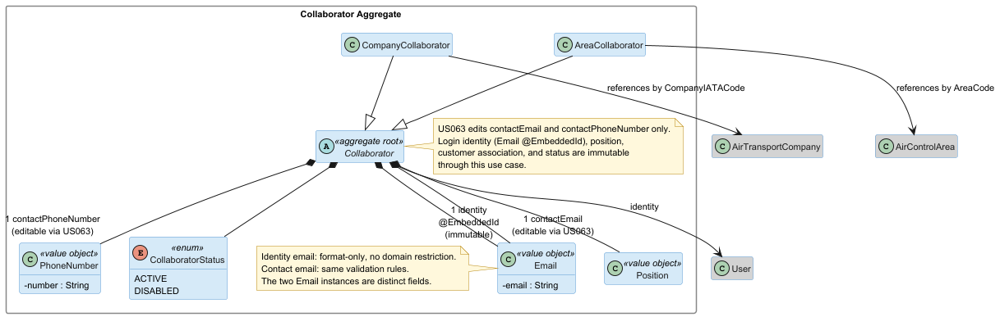
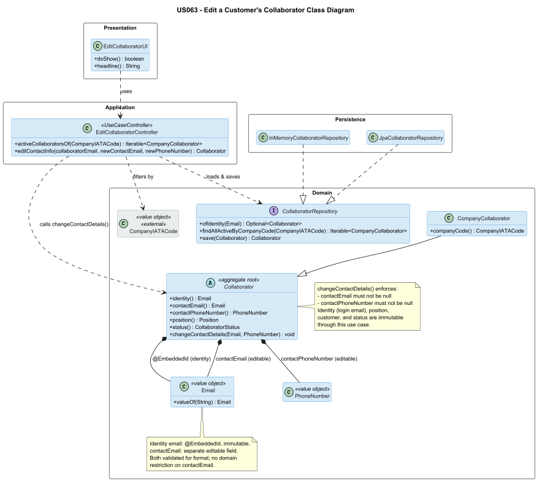

# US 063 - Edit a Customer's Collaborator

## Context

This is the first time US063 is assigned for development. It is part of Sprint 2 and was not addressed in Sprint 1.

US063 depends directly on US061 (Register a Customer's Collaborator), which introduced the `Collaborator` aggregate hierarchy. US063 provides the Backoffice Operator with the ability to update the business contact details of an existing collaborator.

## Requirements

**US 063** As a Backoffice Operator, I want to edit the information (email and phone number) of a customer's collaborator. All other information cannot be changed.

**Acceptance Criteria:**

- US063.1 BO Operator can edit the business contact email and phone number of an existing active collaborator.
- US063.2 Name, position, customer association, and role cannot be modified through this use case.
- US063.3 The business contact email must have a valid format. Domain restriction does not apply (per PO clarification: external collaborators may use any domain).
- US063.4 Phone number must pass basic format validation.
- US063.5 Invalid updates (invalid email format, blank phone number, collaborator not found) are rejected with clear error messages.

**Dependencies/References:**

- US061 (Register a customer's collaborator): the `Collaborator` aggregate and `CollaboratorRepository` introduced here are the foundation for this US.
- US062 (List customer's collaborators): the listing use case used to identify the collaborator to edit.

## Analysis

### Actor and console

The actor is the Backoffice Operator. The use case is implemented in the `aisafe.app.backoffice.console` module under `presentation/customercollaborator`.

### Requirement interpretation — what "edit email and phone" means

The `Collaborator` aggregate uses `Email` as `@EmbeddedId` (the system login identity). This identity is immutable — changing it would require deleting and recreating the primary key, which is not acceptable.

US063 therefore edits the **business contact email** (`contactEmail`) and **contact phone number** (`contactPhoneNumber`) that are stored separately on the `Collaborator` aggregate. These fields are purely for operational contact purposes and do not affect authentication or aggregate identity. This design follows the eCafeteria-style separation between identity/login and contact data.

This interpretation was confirmed as the team design decision (per colleague coordination, 15/05/2026): "A collaborator's login email is immutable and identifies both the User and the Collaborator. US063 edits the collaborator's contact email and phone number only."

### Domain model

US063 does not introduce new aggregates or value objects. It adds `changeContactDetails(Email, PhoneNumber)` to the existing `Collaborator` abstract class (introduced by US061).

### Design decisions

**Contact details stored on Collaborator, not on User.** Storing `contactEmail` and `contactPhoneNumber` directly on `Collaborator` avoids cross-aggregate mutation for a simple operational edit. The `User` aggregate is not modified by this use case.

**Immutable identity.** The `@EmbeddedId` email cannot be changed. The UI makes this explicit by showing the login email as a read-only label and only collecting new values for contact email and phone number.

**No position or customer-association edit.** Per US063.AC2, these fields are immutable post-creation. The domain method `changeContactDetails()` only touches `contactEmail` and `contactPhoneNumber`.

### Invariants enforced

Inside the aggregate (`Collaborator.changeContactDetails()`):
- `contactEmail` must not be null.
- `contactPhoneNumber` must not be null.

At the application layer:
- The referenced collaborator must exist.
- The new contact email must have a valid format (enforced by `Email.valueOf()`).
- The new phone number must not be blank (enforced by `PhoneNumber` constructor).

## Design

### Realization

Key points:

- `EditCollaboratorController` is constructed with `CollaboratorRepository` only — no `UserRepository` is needed since the edit stays within the `Collaborator` aggregate.
- `activeCollaboratorsOf(CompanyIATACode)` delegates to `CollaboratorRepository.findAllActiveByCompanyCode()`, keeping the DB-level filtering consistent with how US062 lists collaborators.
- `editContactInfo()` validates the login-email lookup, calls `collaborator.changeContactDetails()`, and persists the result.
- The UI performs a two-step interaction: first, the operator selects the company and then the collaborator from the active list; then provides new contact details.

### Acceptance Tests

- `ensureCollaboratorContactDetailsCanChangeWithoutChangingIdentity`: Contact details change without changing login identity (US063.1, US063.2)
- `ensureChangeContactDetailsRejectsNulls`: Null contact email rejected (US063.5)
- `ensureChangeContactDetailsRejectsNullPhoneNumber`: Null phone number rejected (US063.5)
- `ensureEditContactInfoUpdatesContactEmailAndPhone`: Edit updates contactEmail and contactPhoneNumber (US063.1, US063.3, US063.4)
- `ensureEditContactInfoDoesNotChangeLoginIdentity`: Login identity unchanged after edit (US063.2)
- `ensureEditContactInfoDoesNotChangePosition`: Position unchanged after edit (US063.2)
- `ensureEditContactInfoDoesNotChangeStatus`: Status unchanged after edit (US063.2)
- `ensureEditContactInfoFailsWhenCollaboratorNotFound`: Collaborator not found rejects (US063.5)
- `ensureEditContactInfoRequiresBackofficeOperator`: Authorization: requires BACKOFFICE_OPERATOR (NFR09)

## Implementation

- `eapli.aisafe.customercollaboratormanagement.domain.Collaborator`: `changeContactDetails(Email, PhoneNumber)` added — changes `contactEmail` and `contactPhoneNumber`, both validated non-null by `Preconditions.noneNull()`.
- `eapli.aisafe.customercollaboratormanagement.application.EditCollaboratorController`: single-repository controller. Provides `activeCollaboratorsOf(CompanyIATACode)` for UI selection and `editContactInfo(String, String, String)` for the actual edit.
- `aisafe.app.backoffice.console`: adds `EditCollaboratorUI` under `presentation/customercollaborator`, wired as option 3 in the Customer Collaborators sub-menu of `MainMenu`.

## Integration/Demonstration

- US063 depends on US061 through the `Collaborator` aggregate and `CollaboratorRepository`.
- The feature is accessible from: `Backoffice App → Customer Collaborators > Edit Customer's Collaborator`.
- The operator selects the company IATA code, selects the collaborator from the active list, and enters new contact email and phone number. The login email is displayed as read-only context.
- Verification: `mvn clean compile test` passes with ≥90% coverage on `customercollaboratormanagement.domain` and `customercollaboratormanagement.application`.

JaCoCo coverage evidence:  

## Observations

The decision to store `contactEmail` separately from the identity `Email` deserves explicit justification: the alternative (editing the system login email) would require deleting and re-inserting the primary key, which is both technically unsafe in JPA and semantically wrong in DDD terms — identity should be stable. The chosen approach is consistent with the design principle "identity/login and contact data are separate concepts" already present in the project (see US031 vs US061 email handling).

The `changeContactDetails()` method deliberately does not validate the email format itself — it delegates to `Email.valueOf()`, which enforces the format-only rule (no domain restriction, per the PO clarification that external collaborators may use any domain). This avoids duplicated validation logic.
