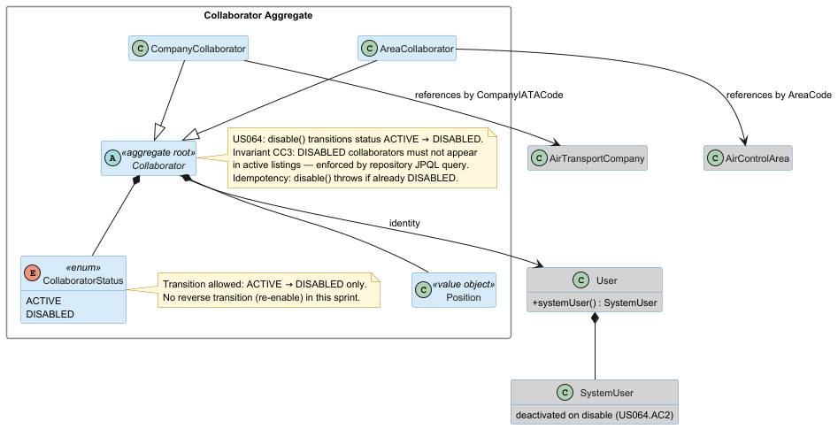
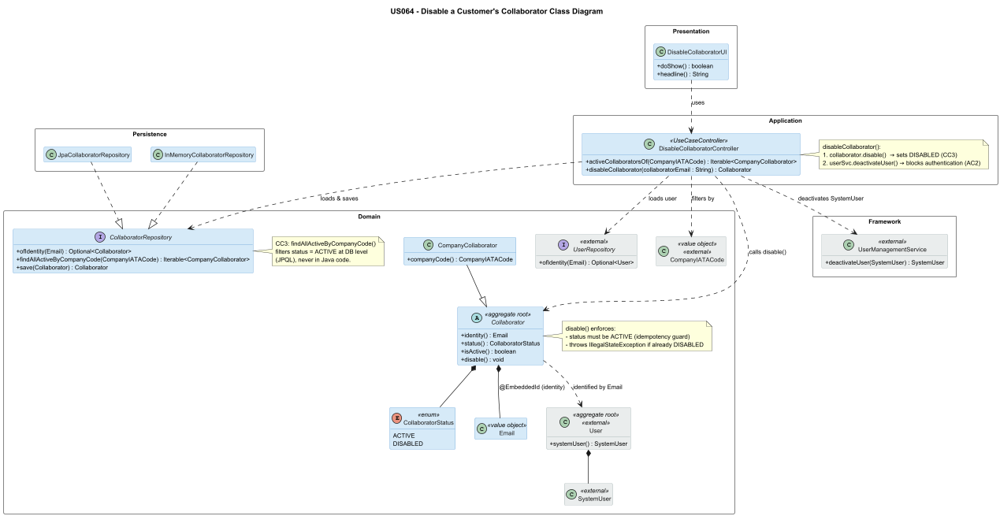

# US 064 - Disable a Customer's Collaborator

## Context

This is the first time US064 is assigned for development. It is part of Sprint 2 and was not addressed in Sprint 1.

US064 closes the collaborator lifecycle: after a collaborator is registered (US061) and potentially edited (US063), the Backoffice Operator can disable them. Disabling a collaborator revokes their access to the system without deleting their data.

## Requirements

**US 064** As a Backoffice Operator, I want to disable a customer's collaborator so that they may not use the system anymore.

**Acceptance Criteria:**

- US064.1 BO Operator can disable an active collaborator.
- US064.2 Disabled collaborators cannot authenticate or access the system.
- US064.3 Already-disabled collaborators cannot be disabled again.
- US064.4 Disabled collaborators must not appear in active collaborator listings (enforced at repository query level — CC3).

**Dependencies/References:**

- US061 (Register a customer's collaborator): the `Collaborator` aggregate and `CollaboratorRepository` are the foundation.
- US062 (List customer's collaborators): used to identify the collaborator to disable; CC3 ensures disabled collaborators are excluded from listings after this US.

## Analysis

### Actor and console

The actor is the Backoffice Operator. The use case is implemented in the `aisafe.app.backoffice.console` module under `presentation/customercollaborator`.

### Domain rules and invariants

- **CC3** — A `Collaborator` with status `DISABLED` must not appear in active listings. This invariant is enforced at the repository query level: `findAllActiveByCompanyCode()` and `findAllActiveByAreaCode()` filter by `status = ACTIVE` in JPQL, so disabled collaborators are excluded at the DB level, not in Java code.
- **Idempotency guard** — `Collaborator.disable()` throws `IllegalStateException` if the collaborator is already `DISABLED`. This prevents double-disabling and gives a clear error message.
- **Authentication revocation (US064.2)** — Setting `CollaboratorStatus.DISABLED` on the aggregate is not sufficient to block authentication, because the authentication layer reads from the framework's `SystemUser` repository, not from `Collaborator`. The controller therefore also calls `userSvc.deactivateUser(user.systemUser())` via the EAPLI framework's `UserManagementService`, which deactivates the `SystemUser` account and blocks future logins.

Per PO clarification (28/04/2026): "Disabling a collaborator does not cascade into removing their collaborator associations; it is strictly a status change."

### Domain model

US064 does not introduce new aggregates or value objects. `disable()` was introduced on `Collaborator` as part of the US061 aggregate design to support the full collaborator lifecycle from the start.

### Design decisions

**Two-step disable: Collaborator status + SystemUser deactivation.** The business requirement (US064.2) states that disabled collaborators cannot authenticate. The framework's `Authenticator` checks `SystemUser` status, not `CollaboratorStatus`. A disable that only sets `CollaboratorStatus.DISABLED` would block the collaborator from active listings but would not prevent them from logging in. The controller therefore executes both operations: `collaborator.disable()` and `userSvc.deactivateUser(user.systemUser())`. This mirrors the pattern used by `DeactivateUserController` (US032).

**Invariant CC3 enforced at DB level.** The repository's `findAllActiveByCompanyCode()` filters by `status = ACTIVE` in JPQL. This ensures no application-layer code ever returns DISABLED collaborators in active listing queries, regardless of how the query is called.

**No cascade deletion.** Per PO, disabling a collaborator does not remove their data. The aggregate simply transitions `CollaboratorStatus` from `ACTIVE` to `DISABLED`. Historical data (position, contact details, customer association) is preserved.

### Invariants enforced

Inside the aggregate (`Collaborator.disable()`):
- Status must be `ACTIVE` before disabling (idempotency guard — US064.3).

At the application layer:
- Collaborator must exist (`IllegalArgumentException` if not found).
- Associated `User` must exist (needed for `userSvc.deactivateUser()`).

At the repository level:
- CC3: `findAllActiveByCompanyCode()` / `findAllActiveByAreaCode()` filter `status = ACTIVE` at the DB, never in Java.

## Design

### Realization

Key points:

- `DisableCollaboratorController` is constructed with `CollaboratorRepository` and `UserRepository`. `UserManagementService` is obtained from `AuthzRegistry.userService()` following the same pattern as `DeactivateUserController`.
- `activeCollaboratorsOf(CompanyIATACode)` is shared with `EditCollaboratorController` and uses the same repository query, ensuring consistent filtering.
- After `collaborator.disable()` and `collaboratorRepository.save()`, the controller looks up the `User` by the same `Email` identity and calls `userSvc.deactivateUser(user.systemUser())` to revoke authentication.

### Acceptance Tests

- `ensureCollaboratorCanBeDisabled`: Disable sets status to DISABLED (US064.1)
- `ensureCollaboratorCannotBeDisabledTwice`: Already-disabled throws IllegalStateException (idempotency guard) (US064.3)
- `ensureDisableCollaboratorSetsStatusToDisabled`: Disable sets status to DISABLED (US064.1)
- `ensureDisabledCollaboratorNoLongerAppearsInActiveListings`: Disabled collaborator excluded from active listings (CC3) (US064.4)
- `ensureDisableCollaboratorFailsWhenAlreadyDisabled`: Already-disabled rejects (idempotency) (US064.3)
- `ensureDisableCollaboratorFailsWhenCollaboratorNotFound`: Collaborator not found rejects (US064 (general))
- `ensureDisableCollaboratorRequiresBackofficeOperator`: Authorization: requires BACKOFFICE_OPERATOR (NFR09)

## Implementation

- `eapli.aisafe.customercollaboratormanagement.domain.Collaborator`: `disable()` was already introduced by US061 design. No further changes to the domain class.
- `eapli.aisafe.customercollaboratormanagement.application.DisableCollaboratorController`: two-repository controller. Provides `activeCollaboratorsOf(CompanyIATACode)` for UI selection and `disableCollaborator(String)` for the actual disable operation, which calls both `collaborator.disable()` and `userSvc.deactivateUser(user.systemUser())`.
- `aisafe.app.backoffice.console`: adds `DisableCollaboratorUI` under `presentation/customercollaborator`, wired as option 4 in the Customer Collaborators sub-menu of `MainMenu`.

## Integration/Demonstration

- US064 depends on US061 through the `Collaborator` aggregate and `CollaboratorRepository`.
- US064 depends on the EAPLI framework's `UserManagementService` (via `AuthzRegistry.userService()`) for `SystemUser` deactivation.
- The feature is accessible from: `Backoffice App → Customer Collaborators > Disable Customer's Collaborator`.
- After disabling, the collaborator will no longer appear in US062 listings, and their login credentials will be rejected at authentication.
- Verification: `mvn clean compile test` passes with ≥90% coverage on `customercollaboratormanagement.domain` and `customercollaboratormanagement.application`.

JaCoCo coverage evidence:  

## Observations

The two-step disable (aggregate status + SystemUser deactivation) is the only correct implementation of US064.AC2. A single-step implementation that only sets `CollaboratorStatus.DISABLED` would leave the collaborator able to authenticate, which violates the acceptance criteria. This design choice mirrors the existing `DeactivateUserController` pattern (US032) and is consistent across both user story families.

The idempotency guard in `Collaborator.disable()` is intentional: attempting to disable an already-disabled collaborator is a UI-level error that should be surfaced clearly to the operator. Silently ignoring the duplicate call would hide data-consistency problems.
