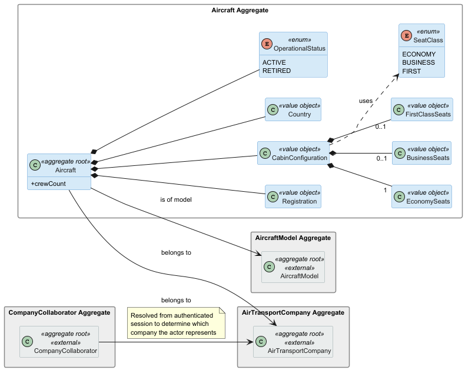
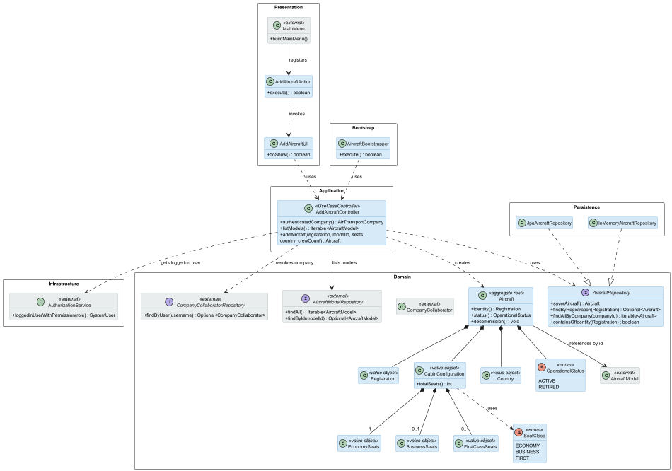

# US070 — Add an Aircraft to an Air Transport Company

## Context

This is the first time US070 is assigned for development. It is part of Sprint 2 and was not addressed in Sprint 1.

US070 introduces the `Aircraft` aggregate, which represents a physical aircraft registered in an air transport company's fleet. It is the foundational user story for the fleet management subdomain: US071 (decommission an aircraft) and US072 (list fleet) both depend on having at least one aircraft registered. The work covers analysis, design, implementation and end-to-end verification of the use case, plus a bootstrap loader for pre-populated aircraft.

## Requirements

**US070** As an Air Transport Company Collaborator, I want to add an aircraft to my company's fleet. The aircraft is of a given model, including the engines, and the number of seats of each type/class must be provided. Total number of seats cannot exceed the model's capacity. An aircraft is identified by the aircraft registration number, that is unique. Also, an aircraft is registered in a country (it may not be the company's home country). An aircraft also has an operational status.

**Acceptance Criteria:**

- US070.1 — The authenticated Air Transport Company Collaborator can add an aircraft to their company's fleet.
- US070.2 — The aircraft is associated with an existing aircraft model (which already has at least one engine model associated).
- US070.3 — The number of seats per cabin class must be provided; the total across all classes must not exceed the model's maximum passenger capacity.
- US070.4 — The aircraft registration number is unique across the entire system.
- US070.5 — The aircraft has a registration country, which may differ from the company's home country.
- US070.6 — The aircraft is created with an initial operational status of ACTIVE.
- US070.7 — A bootstrap process can pre-populate aircraft.

**Dependencies/References:**

- **US055** (Create an aircraft model): an `AircraftModel` must exist before an aircraft of that model can be registered.
- **US056** (Create an aircraft engine model): the aircraft model must have at least one engine model associated.
- **US060** (Register an air transport company): the company to which the aircraft belongs must already exist.
- **US061** (Add a customer's collaborator): the actor must be an authenticated collaborator with a resolved company association.

---

## Analysis

### Actor and Console

The actor is the Air Transport Company Collaborator, per §3.1 of the requirements. The use case is implemented in the `aisafe.app.atcc.console` module. The collaborator must be **authenticated** at the time of use: the aircraft is automatically registered under the collaborator's own company, without requiring them to select a company from a list.

The authenticated user's company is resolved at controller level by combining two steps: obtaining the logged-in `SystemUser` from the EAPLI `AuthorizationService`, then querying the `CompanyCollaboratorRepository` to find the `CompanyCollaborator` record and its associated company identifier. This pattern is consistent across all ATCC use cases (US070, US071, US072).

### Requirement Source

US070 (full text): *"As an Air Transport Company Collaborator, I want to add an aircraft to my company's fleet. The aircraft is of a given model, including the engines, and the number of seats of each type/class must be provided. Total number of seats cannot exceed the model's capacity. An aircraft is identified by the aircraft registration number, that is unique. Also, an aircraft is registered in a country (it may not be the company's home country). An aircraft also has an operational status."*

§3.2 of the requirements additionally defines the `Aircraft` concept with the following attributes: registration (unique ID), company, cabin configuration (number of seats in each class), and number of elements of the flight crew.

### Domain Model

This US introduces the `Aircraft` aggregate. The diagram below shows the aggregate and its relationships to the external aggregates `AircraftModel` and `AirTransportCompany` (shown in grey — not modified by this US but required as references). `CompanyCollaborator` is also shown in grey as the actor resolution mechanism.

Key modelling decisions reflected in the diagram:

- `Registration` is a value object encapsulating the unique registration number string, with validation enforced at construction time.
- `CabinConfiguration` is a value object that holds a map of `SeatClass` to seat count. The capacity invariant (`sum ≤ model.maxCapacity`) is enforced inside the `Aircraft` aggregate constructor, which receives the model's capacity as a parameter.
- `Country` is a value object for the aircraft's registration country.
- `OperationalStatus` is an enum with values `ACTIVE` and `RETIRED`. The initial value on construction is always `ACTIVE`.
- `Aircraft` references `AircraftModel` and `AirTransportCompany` by their respective identifiers, not by object graph navigation. This avoids unnecessary bidirectional associations and keeps aggregate boundaries clean.

### Design Decisions

**Cabin configuration as a flexible map.** The requirements state "number of seats of each type/class" without prescribing a fixed set of classes. Sprint 2 PO clarifications confirmed that no class format is prescribed. For the MVP, `SeatClass` is an enum with `ECONOMY`, `BUSINESS`, and `FIRST`. This enum can be extended without modifying the `Aircraft` aggregate or `CabinConfiguration` value object. This simplification is intentional and documented here.

**Company resolved from authenticated collaborator, not selected from a list.** The collaborator registers aircraft for their own company only. The controller resolves the company automatically from the authenticated session via `AuthorizationService` and `CompanyCollaboratorRepository`. The UI does not present a company selection step.

**Capacity check in the aggregate, not in the controller.** The invariant that total seats must not exceed the model's maximum capacity is a business rule and belongs in the domain. The `Aircraft` constructor receives the model's `maxPassengerCapacity` as an integer parameter rather than a reference to the full `AircraftModel` object, which prevents the aggregate from coupling to another aggregate's internals while still enabling the invariant to be enforced at the correct layer.

**Registration uniqueness enforced at the application layer.** The uniqueness of the registration number across all aircraft cannot be enforced inside the `Aircraft` aggregate alone, since the aggregate has no knowledge of other aircraft. It is enforced by the `AddAircraftController`, which queries the `AircraftRepository` before persisting the new aircraft.

**Controller obtains repositories via constructor injection.** The `AddAircraftController` receives all repositories as constructor parameters. This applies the Dependency Inversion Principle, keeps dependencies visible at the class boundary, and allows unit tests to provide in-memory repositories without configuring any global state.

### Invariants

Enforced inside the aggregate (constructors and value objects):

- `Registration` is not null and not blank.
- `Country` is not null and not blank.
- `CabinConfiguration` rejects any class with a negative seat count.
- `CabinConfiguration` rejects a null or empty seat map.
- `Aircraft` rejects a total seat count exceeding the provided model capacity.
- `Aircraft` initial status is always `ACTIVE`.

Enforced at the application layer (controller):

- The authenticated user must be a `CompanyCollaborator` with a resolved company association.
- The registration number is unique across all registered aircraft.
- The referenced `AircraftModel` exists in the system.

### Dependencies

**Upstream:**

- US055 — `AircraftModel` must exist.
- US056 — `AircraftModel` must have at least one engine model associated.
- US060 — `AirTransportCompany` must exist.
- US061 — The actor must be an authenticated collaborator associated with the target company.

**Downstream:**

- US071 (Decommission an aircraft): operates on aircraft registered via this US.
- US072 (List fleet): lists aircraft registered via this US.
- Future flight plan user stories: a flight plan references a specific aircraft from the company's fleet.

### Bootstrap

Acceptance criterion US070.7 requires a bootstrap process. An `AircraftBootstrapper` will pre-populate a fixed set of aircraft at system initialisation, going through the same registration use case to ensure all invariants are enforced. The bootstrapper runs after US055, US056, US060, and US061 bootstrappers, since it depends on models and companies already being present.

---

## Design

### Realization

### Acceptance Tests

This section presents the main unit tests that exercise the domain invariants captured during analysis. Tests are written in JUnit 4 style (run via the Vintage Engine on JUnit 5 Platform) and follow the `ensureXxxYyy` naming convention. They are currently annotated `@Ignore("Phase 2 stub - implementation in Phase 3")` pending Phase 3 implementation; the `@Ignore` annotation is removed on a per-class basis as each domain class is implemented.

Acceptance criteria covering application-layer enforcement — registration number uniqueness across the repository (US070.4), model existence check (US070.2), authenticated collaborator resolution, and end-to-end registration (US070.1) — are validated by tests added in Phase 3 alongside the `AddAircraftController` and the `InMemoryAircraftRepository`. The tests below cover the within-aggregate and value-object invariants that Phase 2 design exercises.

---

- `ensureRegistrationRejectsBlankValue`: An aircraft registration cannot be constructed from a null, empty, or blank value, rejecting missing registration inputs at the value-object boundary. (US070.4)

---

- `ensureCabinConfigurationRejectsNegativeSeatCount`: A cabin configuration cannot be constructed with a negative seat count for any class, enforcing the non-negative seats invariant at the value-object boundary. (US070.3)

---

- `ensureCabinConfigurationRejectsEmptyMap`: A cabin configuration cannot be constructed from a null or empty seat map. (US070.3)

---

- `ensureAircraftRejectsTotalSeatsExceedingModelCapacity`: An aircraft cannot be created when the total number of seats across all classes exceeds the model's maximum passenger capacity, enforcing the core cabin capacity invariant. (US070.3)

---

- `ensureAircraftInitialStatusIsActive`: An aircraft is created with an initial operational status of ACTIVE, regardless of any other inputs. (US070.6)

---

- `ensureAircraftRejectsNullRegistration`: An aircraft cannot be constructed with a null registration, enforcing aggregate completeness at the constructor level. (US070.1)

---

## Observations

- The `SeatClass` enum is defined with `ECONOMY`, `BUSINESS`, and `FIRST` for the MVP. This decision was taken in response to the Sprint 2 PO clarification of 29/04/2026, which confirmed no fixed format is prescribed for cabin classes.
- The crew size attribute mentioned in §3.2 of the requirements (*"number of elements of the flight crew"*) has not been included in this US pending PO clarification on whether it is required at aircraft registration time or only at flight plan creation time.
- The registration number format has not been validated beyond non-blank, as no format was prescribed in the requirements or PO clarifications to date.
- The company resolution pattern (`AuthorizationService` → `CompanyCollaboratorRepository`) is shared across US070, US071, and US072 and should be implemented consistently.
