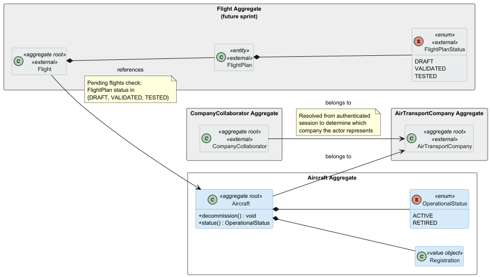
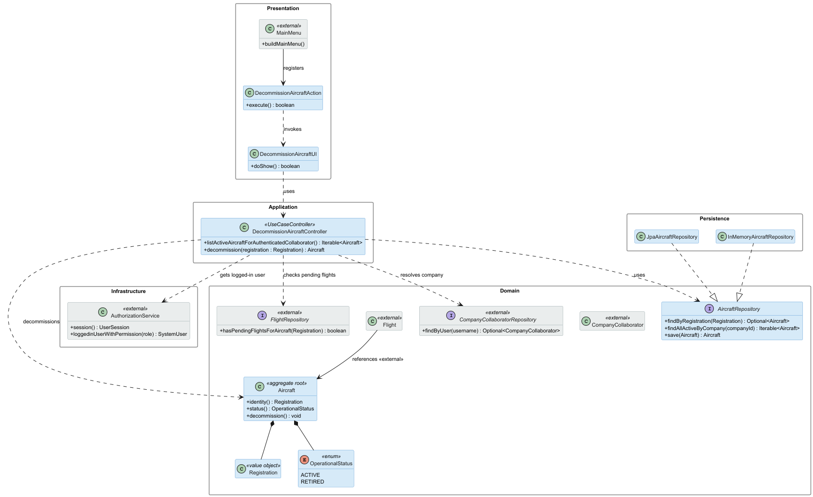

# US071 — Decommission an Aircraft

## Context

This is the first time US071 is assigned for development. It is part of Sprint 2 and was not addressed in Sprint 1.

US071 introduces the decommission operation on the `Aircraft` aggregate, transitioning an aircraft's operational status from `ACTIVE` to `RETIRED`. It depends entirely on US070 having registered at least one aircraft. No new aggregate is introduced; this US modifies the existing `Aircraft` aggregate by adding a state transition operation. The work covers analysis, design, implementation and end-to-end verification of the use case.

## Requirements

**US071** As an Air Transport Company Collaborator, I want to retire an aircraft from my company's fleet. It's not possible to create flights for a retired aircraft, nor is it possible to retire an aircraft that has pending flights registered in the system.

**Acceptance Criteria:**

- US071.1 — The authenticated Air Transport Company Collaborator can decommission an aircraft belonging to their company.
- US071.2 — An aircraft with pending flights registered in the system cannot be decommissioned.
- US071.3 — A decommissioned aircraft cannot be used to create new flights.
- US071.4 — The decommissioned aircraft remains in the system with status RETIRED; it is not deleted.
- US071.5 — An aircraft that is already RETIRED cannot be decommissioned again.
- US071.6 — A collaborator can only decommission aircraft belonging to their own company.

**Dependencies/References:**

- **US070** (Add an aircraft): the aircraft to be decommissioned must have been previously registered.
- **US061** (Add a customer's collaborator): the actor must be an authenticated collaborator with a resolved company association.
- **Flight aggregate** (future sprint): the pending flights check requires querying flights associated with the aircraft. This dependency is partially unresolvable in Sprint 2 — see Section 3.4.

---

## Analysis

### Actor and Console

The actor is the Air Transport Company Collaborator, per §3.1 of the requirements. The use case is implemented in the `aisafe.app.atcc.console` module. Critically, the collaborator must be **authenticated** at the time of use: the system only presents aircraft belonging to the collaborator's own company, and the decommission operation is rejected if the aircraft does not belong to that company.

The authenticated user's company is resolved at controller level by combining two steps: obtaining the logged-in `SystemUser` from the EAPLI `AuthorizationService`, then querying the `CompanyCollaboratorRepository` to find the `CompanyCollaborator` record and its associated company identifier. This pattern is consistent with how other ATCC use cases resolve the acting company.

### Requirement Source

US071 (full text): *"As an Air Transport Company Collaborator, I want to retire an aircraft from my company's fleet. It's not possible to create flights for a retired aircraft, nor is it possible to retire an aircraft that has pending flights registered in the system."*

### Domain Model

This US does not introduce any new aggregate or value object. It adds a state transition operation (`decommission()`) to the existing `Aircraft` aggregate introduced in US070. The diagram below shows the affected aggregate, the `CompanyCollaborator` aggregate used for actor resolution (in grey), and the external `Flight` aggregate (in grey) whose existence is checked before allowing decommission.

The only change to the `Aircraft` aggregate is the enforcement of the `ACTIVE → RETIRED` transition: the `decommission()` method rejects the call if the aircraft is already `RETIRED`. Both the ownership check and the pending flights check are application-layer guards, not in-aggregate invariants, since the aggregate has no knowledge of other aggregates.

### Design Decisions

**State transition inside the aggregate.** The `decommission()` method lives on `Aircraft` and enforces that only `ACTIVE` aircraft can be retired. Calling `decommission()` on an already-retired aircraft throws `IllegalStateException`. This keeps the state machine inside the aggregate root, which is the correct DDD placement.

**Authenticated collaborator → company resolution at the controller.** The controller calls `AuthorizationService` to obtain the logged-in `SystemUser`, then queries `CompanyCollaboratorRepository.findByUser(username)` to retrieve the collaborator record and its company identifier. The aircraft list presented to the UI is then filtered to that company only. This prevents a collaborator from seeing or decommissioning aircraft belonging to other companies.

**Pending flights check at the application layer.** The requirement states that an aircraft with pending flights cannot be retired. A pending flight is any `Flight` whose `FlightPlan` is in state `DRAFT`, `VALIDATED`, or `TESTED` and references this aircraft. Because this check spans two aggregates (`Aircraft` and `Flight`), it cannot live inside `Aircraft` itself. The `DecommissionAircraftController` queries the `FlightRepository` before calling `decommission()`.

**Sprint 2 simplification — partial pending flights check.** The `Flight` aggregate and `FlightRepository` may not be available in Sprint 2 depending on team progress. For the MVP, the controller will attempt the query if the repository is available; if it is not yet implemented, the guard is skipped and documented as a known limitation. This simplification is intentional and recorded here so it can be completed when flights are available.

**Aircraft is not deleted.** Decommissioning is a status change, not a deletion. The aircraft record is retained with `OperationalStatus.RETIRED` for audit and historical flight plan purposes.

### Invariants

Enforced inside the aggregate:

- `Aircraft.decommission()` throws `IllegalStateException` if the aircraft status is already `RETIRED`.

Enforced at the application layer (controller):

- The authenticated user must be a `CompanyCollaborator` with a resolved company association.
- The aircraft must belong to the authenticated collaborator's company.
- The aircraft must not have any pending flights (flights with `FlightPlan` in state `DRAFT`, `VALIDATED`, or `TESTED`).

### Dependencies

**Upstream:**

- US070 — `Aircraft` must exist and be in `ACTIVE` status.
- US061 — The actor must be an authenticated collaborator with a company association.

**Downstream:**

- Flight creation user stories: must check `Aircraft.status()` before allowing a new flight to reference this aircraft.

### Bootstrap

No bootstrap is required for this US. The decommission operation is a state change on existing data seeded by the US070 bootstrapper.

---

## Design

### Realization

### Acceptance Tests

This section presents the main unit tests that exercise the domain invariants captured during analysis. Tests are written in JUnit 4 style (run via the Vintage Engine on JUnit 5 Platform) and follow the `ensureXxxYyy` naming convention. They are currently annotated `@Ignore("Phase 2 stub - implementation in Phase 3")` pending Phase 3 implementation.

The application-layer guards (company ownership check and pending flights check) are validated in Phase 3 alongside the `DecommissionAircraftController`.

---

- `ensureDecommissionTransitionsStatusToRetired`: Calling `decommission()` on an ACTIVE aircraft transitions its status to RETIRED. (US071.1, US071.4)

---

- `ensureDecommissionRetiredAircraftThrows`: Calling `decommission()` on an already RETIRED aircraft throws an exception, preventing double-decommission. (US071.5)

---

- `ensureRetiredAircraftStatusIsRetired`: A RETIRED aircraft's status is correctly reported, confirming the state is persisted on the aggregate. (US071.3, US071.4)

---

## Observations

### Known limitation — pending flight plans check

US071.2 states that an aircraft with pending flights registered in the system cannot be decommissioned. This rule depends on querying the Flight/FlightPlan aggregate to determine whether there are pending flight plans associated with the selected aircraft.

Because this validation spans more than one aggregate, it belongs in the application layer and not inside the `Aircraft` aggregate. In the current Sprint 2 implementation, the required Flight/FlightPlan repository support is not yet available. Therefore, this check is documented as a known limitation and should be completed when the flight planning component exposes the necessary query.

The current implementation enforces the remaining US071 rules: the aircraft is not deleted, its operational status changes from `ACTIVE` to `RETIRED`, an already retired aircraft cannot be decommissioned again, and a collaborator can only decommission aircraft belonging to their own company.

- The pending flights states considered "pending" are `DRAFT`, `VALIDATED`, and `TESTED`, as established by the Sprint 2 PO clarification of 01/05/2026.
- Decommissioning is permanent within the scope of this US. No `recommission()` operation is defined; if needed in a future sprint, it would require a new US and PO approval.
- The company ownership check (US071.6) mirrors the pattern used in all other ATCC use cases: `AuthorizationService` → `CompanyCollaboratorRepository` → company ID. This pattern is consistent across US070, US071, and US072.
