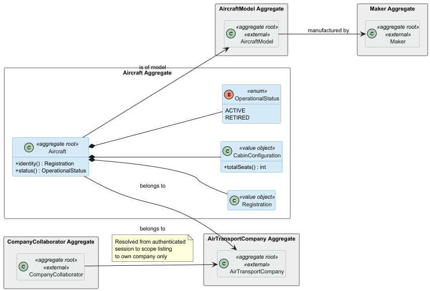
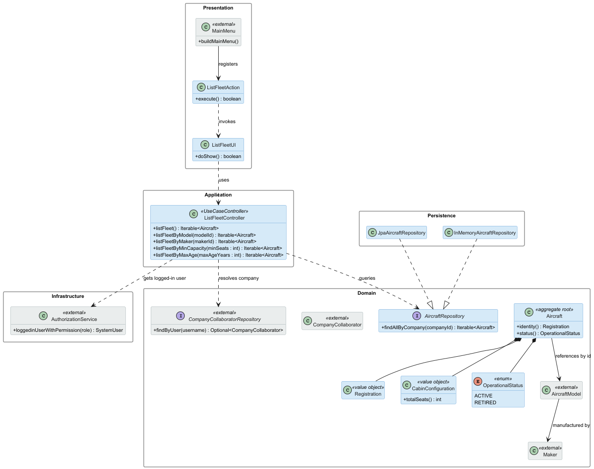

# US072 — List an Air Transport Company's Fleet

## Context

This is the first time US072 is assigned for development. It is part of Sprint 2 and was not addressed in Sprint 1.

US072 is a read-only use case that allows an authenticated Air Transport Company Collaborator to list the aircraft registered in their company's fleet. No new aggregate, value object, or state transition is introduced; this US adds a query operation to the existing `AircraftRepository` and exposes it through a dedicated controller and UI. It depends entirely on US070 having registered at least one aircraft.

The requirements document also defines four optional filter variants — US072a (by model), US072b (by maker), US072c (by capacity), and US072d (by age) — which extend the base listing. The base US072 is implemented first; the variants are noted as extensions in Section 3.4.

## Requirements

**US072** As an Air Transport Company Collaborator, I want to list my company's aircraft fleet.

**US072a** As an Air Transport Company Collaborator, I want to list my company's aircraft of a given model.

**US072b** As an Air Transport Company Collaborator, I want to list my company's aircraft of a given maker.

**US072c** As an Air Transport Company Collaborator, I want to list my company's aircraft of a given capacity (number of passengers).

**US072d** As an Air Transport Company Collaborator, I want to list my company's aircraft of a given age.

**Acceptance Criteria:**

- US072.1 — The authenticated Air Transport Company Collaborator can list all aircraft belonging to their company.
- US072.2 — The list includes aircraft of all operational statuses (ACTIVE and RETIRED), unless filtered.
- US072.3 — A collaborator can only see aircraft belonging to their own company.
- US072.4 — The list can be filtered by aircraft model (US072a).
- US072.5 — The list can be filtered by maker (US072b).
- US072.6 — The list can be filtered by minimum passenger capacity (US072c).
- US072.7 — The list can be filtered by maximum age in years (US072d).
- US072.8 — If the fleet is empty, the system informs the user clearly rather than showing a blank screen.

**Dependencies/References:**

- **US070** (Add an aircraft): at least one aircraft must be registered for the list to be non-empty.
- **US061** (Add a customer's collaborator): the actor must be an authenticated collaborator with a resolved company association.

---

## Analysis

### Actor and Console

The actor is the Air Transport Company Collaborator, per §3.1 of the requirements. The use case is implemented in the `aisafe.app.atcc.console` module. As with US070 and US071, the collaborator must be **authenticated**: the system automatically scopes the listing to the collaborator's own company, resolved from the authenticated session via `AuthorizationService` and `CompanyCollaboratorRepository`.

### Requirement Source

US072 (full text): *"As an Air Transport Company Collaborator, I want to list my company's aircraft fleet."*

US072a–US072d extend this with filter criteria: model, maker, capacity, and age respectively.

### Domain Model

This US introduces no new aggregate or value object. It adds query methods to `AircraftRepository` and reads data from the `Aircraft` aggregate introduced in US070. The diagram below shows the aggregate queried and the external aggregates that contextualise the filter criteria (shown in grey).

For the filter variants, the controller fetches the full aircraft list for the company and applies filtering logic at the application layer. Alternatively, specialised repository methods can be added for each filter; the chosen approach is documented in Section 3.4.

### Design Decisions

**Filtering at the application layer vs. specialised repository queries.** Two approaches are viable for the US072a–d variants. Specialised repository methods (e.g., `findAllByCompanyAndModel`) push filtering to the database and are more efficient at scale. Application-layer filtering (fetch all, then filter in Java) is simpler to implement and test. For the MVP, application-layer filtering is used for all variants, since fleet sizes in the bootstrap data are small. This simplification is intentional and documented here; if performance becomes a concern, repository-level filtering can be introduced without changing the domain.

**Age calculation from manufacturing year.** US072d filters by aircraft age. Age is derived from the aircraft's manufacturing year (`Aircraft.manufacturingYear`) relative to the current date. This attribute must be confirmed with the PO (see Section 3.5, Q1); if it is not part of the `Aircraft` aggregate, the filter cannot be implemented without a domain change.

**All statuses shown by default.** The base listing (US072) shows all aircraft regardless of `OperationalStatus`. The UI can optionally offer a status filter, but no such filter is mandated by the requirements.

**Authenticated collaborator → company resolution.** Identical to the pattern used in US070 and US071: `AuthorizationService` → `CompanyCollaboratorRepository` → company identifier → `AircraftRepository.findAllByCompany(companyId)`.

### Open Questions

| # | Question | Impact |
|---|---|---|
| Q1 | Does `Aircraft` hold a manufacturing year attribute? It is referenced by §3.2 but was not explicitly modelled in US070. | Required to implement US072d (filter by age) |
| Q2 | Should RETIRED aircraft be excluded from the default listing, or shown with a distinct marker? | Impacts US072 base acceptance criteria |

### Invariants

This is a read-only use case. No domain invariants are modified. The only enforcement is:

- The authenticated user must be a `CompanyCollaborator` with a resolved company association (application layer).
- The listing is scoped strictly to the collaborator's own company (application layer).

### Dependencies

**Upstream:**

- US070 — `Aircraft` records must exist.
- US061 — The actor must be an authenticated collaborator with a company association.

**Downstream:**

- US071 — The fleet listing is the natural entry point from which a collaborator selects an aircraft to decommission.

### Bootstrap

No bootstrap is required for this US. The listing operates on data seeded by the US070 bootstrapper.

---

## Design

### Realization

### Acceptance Tests

This section presents the main unit and integration tests that exercise the query behaviour captured during analysis. Tests are written in JUnit 4 style (run via the Vintage Engine on JUnit 5 Platform) and follow the `ensureXxxYyy` naming convention. They are currently annotated `@Ignore("Phase 2 stub - implementation in Phase 3")` pending Phase 3 implementation.

Because this is a read-only use case with no domain invariants to enforce at the aggregate level, the tests focus on the controller's filtering behaviour using an `InMemoryAircraftRepository` pre-populated with test data.

---

- `ensureListFleetReturnsOnlyCompanyAircraft`: Listing the fleet for a company returns only aircraft belonging to that company, and not aircraft from other companies. (US072.1, US072.3)

---

- `ensureListFleetReturnsEmptyIterableWhenNoAircraft`: An empty fleet results in an empty iterable rather than null or an exception. (US072.8)

---

- `ensureFilterByModelReturnsMatchingAircraftOnly`: Filtering by model returns only aircraft of the specified model. (US072.4)

---

- `ensureFilterByCapacityReturnsAircraftAboveThreshold`: Filtering by minimum capacity returns only aircraft whose total seat count meets or exceeds the specified threshold. (US072.6)

---

## Observations

- The three filter variants US072a (by model), US072b (by maker), and US072c (by minimum capacity) are implemented at the application layer for the MVP, as documented in Section 3.4. This is a deliberate simplification given the small dataset size in Sprint 2.
- **US072d (filter by age) is not implemented in this sprint.** This filter requires the `Aircraft` aggregate to hold a manufacturing year or date of manufacture attribute, which is not currently part of the `Aircraft` domain model. The attribute was not introduced in US070 and remains unconfirmed by the PO (see open question Q1 in Section 3.5). Until the PO confirms the attribute and it is added to the domain, the age filter cannot be implemented without a domain change. This limitation is intentional and documented here for traceability.
- The company resolution pattern (`AuthorizationService` → `CompanyCollaboratorRepository`) is shared across US070, US071, and US072 and is implemented consistently in all three controllers.
