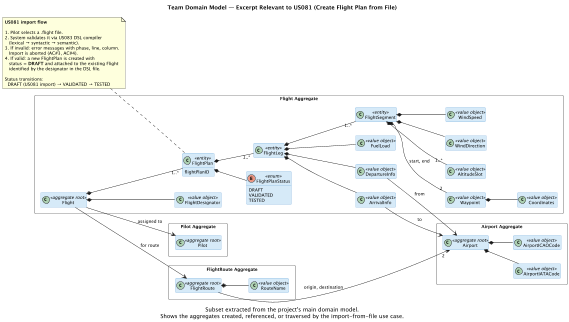
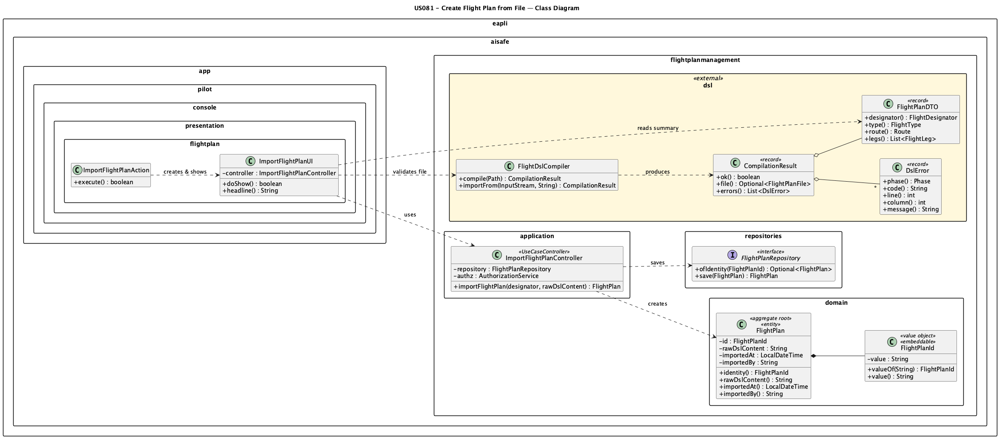

# US 081 - Create Flight Plan from File

## Context

This is the first time US081 is assigned. It is not a bug fix nor a carry-over from a previous sprint.

US081 represents the EAPLI-layer integration point for the Flight Description DSL: a Pilot uses the console application to point to a flight plan file on disk, the system selects the appropriate validator by file extension, runs full lexical/syntactic/semantic analysis, and — if valid — persists the flight plan in the database. The persisted record stores the raw content together with the pilot's identity and the import timestamp, keeping a faithful audit trail.

## Requirements

**US 081** — *As a Pilot, I want to create a flight plan from a file, and I want the file format to be validated before it is used.*

**Acceptance Criteria:**

- **US081.1** The flight plan file must conform to the Core Flight DSL.
- **US081.2** The file must be validated through lexical, syntactic, and semantic analysis.
- **US081.3** Invalid files must produce meaningful error messages (type, line, column).
- **US081.4** Only valid flight plans may be imported and used by the system.
- **US081.5** Multiple file formats can be supported and validated before use.

**Dependencies/References:**

| Relation | Item | Nature |
|---|---|---|
| **Producer** | **US083** *Specify and Validate Flight DSL* | US081 consumes `FlightDslCompiler` and `CompilationResult` from the US083 module. Validation (lexical, syntactic, semantic) is entirely delegated to US083. |
| **Domain antecedent** | **US080** *Create a flight plan* | Defines the concept of a flight plan. US081 persists a `FlightPlan` entity whose identity is the flight designator read from the DSL file. |
| **Future consumer** | **US085** *Test/validate flight plan* | Will load persisted flight plans and run further validation against the DSL and simulation engine. |
| **Non-functional** | **NFR03** *Unit testing*; **NFR10** *Programming language* | Mandates Java and ≥ 90% coverage on domain and application packages. |
| **Process** | **NFR02** *Technical Documentation*, **NFR04** *Source Control* | Require this document and all artifacts to live in the repo under `docs/`, with PlantUML diagrams. |

## Analysis

### Problem framing

US081 sits at the boundary between the DSL layer (US083) and the EAPLI persistence layer. The central question was: **what exactly does the system persist?**

Three options were considered:

| Option | Description | Verdict |
|---|---|---|
| Persist the raw DSL string | Store the file content as a LOB; re-parse on demand. | **Selected.** Simple; preserves the original authoring intent; future consumers can re-validate or re-parse. |
| Persist a mapped domain graph | Convert every `FlightPlanDTO` to JPA entities (legs, segments, …). | Deferred to a later US (US085 / simulation); premature here without a simulation requirement. |
| Persist a serialised AST | Serialise the `FlightPlanFile` record to JSON/bytes. | Couples the DB schema to the AST shape; fragile under grammar evolution. |

The team chose to store the **raw content** plus a minimal metadata envelope (designator, `importedAt`, `importedBy`). This gives US085 a complete, re-parseable record without locking the schema to the current AST version.

**Evolution plan for this strategy:**

| When | Trigger | Change required |
|---|---|---|
| US085 (simulation) | Simulation engine needs leg/segment data as typed objects | Add a `FlightPlanMapper` that converts the re-parsed `FlightPlanFile` DTO to JPA entities; no schema migration needed since the raw content is still the source of truth |
| New format added (JSON, XML, etc.) | Second `FlightPlanImporter` registered in `FlightPlanImporterFactory` | The raw content stored in the LOB changes format; add a `contentType` column to `FlightPlan` so the right importer is selected at re-parse time |
| Grammar evolution (US083/US120) | Grammar changes break stored raw content | The LOB stores the source as written; re-parse will fail on old content. Mitigation: add a `grammarVersion` column and a migration job |

### Integration with US083 / multiple format support

The UI layer calls `FlightPlanImporterFactory.forPath(path)` to select the right importer by file extension, then calls `importer.importFrom(stream, name)` which returns a `CompilationResult`:

- If no importer is registered for the file extension, the UI rejects the file immediately with `"Unsupported file format. Supported extensions: [*.flight]"` — satisfying AC#5 without touching the persistence layer.
- If `result.ok()` is `false`, all errors are printed to the console (phase, code, line, column) and the import is aborted — satisfying AC#3.
- If valid, the UI shows a summary of the flight plans found in the file (designator, type, route, leg count) and asks the pilot to confirm — satisfying AC#4.

The controller layer is intentionally kept **unaware** of the DSL and the import format: it receives a plain `String` (the raw content) and a `FlightId`, creates a `FlightPlan` aggregate, and persists it. This keeps format concerns out of the application service.

**Adding a new format** requires only two steps:
1. Implement `FlightPlanImporter` in a new class (e.g. `JsonFlightPlanImporter`).
2. Register it in `FlightPlanImporterFactory.REGISTRY` with its extension (e.g. `"json"`).
No changes to the controller, domain, or persistence layer are needed.

### Duplicate detection

`ImportFlightPlanController.importFlightPlan` checks whether a `FlightPlan` with the same designator already exists in the repository before persisting. If so, it throws `IntegrityViolationException`, which the UI catches and reports as `[SKIP]`, allowing the rest of the file's flight plans to continue importing.

### Domain model excerpt



## Design

The solution follows the standard EAPLI three-layer architecture (presentation → application → domain/persistence) and delegates all DSL concerns to the US083 module.

Key design decisions:

- **DSL compilation in the UI, not the controller.** The controller's job is authorization, duplicate checking, and persistence — not parsing. Keeping `FlightDslCompiler` in the UI layer prevents ANTLR/DSL types from leaking into the application service.
- **Raw DSL stored as a LOB.** The `FlightPlan` entity holds `rawDslContent`, `importedAt`, and `importedBy`. The designator (`FlightPlanId`) is its identity and is embedded as a JPA `@EmbeddedId`.
- **Per-flight-plan duplicate check.** A single `.flight` file may define multiple flight plans; the UI imports each independently, skipping duplicates and continuing with the rest.

### Realization



### Acceptance Tests

- `valid_file_is_persisted_with_correct_designator`: Importing a valid `.flight` file persists the flight plan. (US081.1, US081.4)
- `invalid_file_produces_errors_and_is_not_persisted`: An invalid file is rejected before persisting. (US081.2, US081.3)
- `duplicate_designator_is_skipped_without_aborting_batch`: Duplicate designators are rejected without aborting the whole batch. (US081.4)

**Test 4:** *Verifies that error messages include phase, line, and column.*

**Refers to Acceptance Criteria:** US081.3

- `factory_routes_flight_extension_to_dsl_compiler`: The factory routes `.flight` files to `FlightDslCompiler` and rejects unknown extensions. (US081.5)

```java
@Test
void error_messages_include_phase_line_and_column() {
    var result = new FlightDslCompiler()
        .compile(resource("dsl/invalid_multi_errors.flight"));

    assertThat(result.errors())
        .isNotEmpty()
        .allSatisfy(e -> {
            assertThat(e.phase()).isNotNull();
            assertThat(e.code()).isNotBlank();
            assertThat(e.line()).isPositive();
            assertThat(e.column()).isNotNegative();
            assertThat(e.message()).isNotBlank();
        });
}
```

## Implementation

The implementation spans three Maven modules:

| Module | Role |
|---|---|
| `aisafe/aisafe.flightplandsl` | `FlightPlanImporter` (interface), `FlightPlanImporterFactory` (routing by extension), `FlightDslCompiler` (`.flight` format) |
| `aisafe/aisafe.core` | `FlightPlan`, `FlightPlanId`, `FlightPlanRepository` — domain and repository interface; `ImportFlightPlanController` |
| `aisafe/aisafe.app.pilot.console` | `ImportFlightPlanUI`, `ImportFlightPlanAction` — console presentation layer |

The application controller (`ImportFlightPlanController`) lives in `aisafe.core` under the package:

```
eapli.aisafe.flightplanmanagement.application
```

The domain classes live under:

```
eapli.aisafe.flightplanmanagement.domain
```

`FlightPlan` is a JPA `@Entity` with an `@EmbeddedId` of type `FlightPlanId`. The `rawDslContent` column is annotated `@Lob` to support large DSL files. The `importedAt` and `importedBy` columns provide the audit trail required by the acceptance criteria.

The UI is wired into the Pilot main menu via `ImportFlightPlanAction`, which is registered in `MainMenu`.

## Integration/Demonstration

### Running the console application

Build and run from the `aisafe/` directory:

```powershell
.\mvnw.cmd -pl aisafe.app.pilot.console -am package
java -jar aisafe.app.pilot.console/target/aisafe.app.pilot.console-1.0.0-SNAPSHOT.jar
```

Log in as a Pilot and select **Import Flight Plan from File** from the menu.

### Sample interaction

```text
  ┌──────────────────────────────────────────────────┐
  │  IMPORT FLIGHT PLAN FROM FILE                    │
  └──────────────────────────────────────────────────┘

  File path: src/test/resources/dsl/valid_multileg.flight

  Validating file (lexical, syntactic and semantic analysis)…

  ── Validation OK — 1 flight plan(s) found ─────────
    TP456         type=regular   LPPT → LEMD  (2 leg(s))

  Import all flight plans into the system? (y/n): y
  [ OK ]  TP456 imported successfully.

  Done: 1 imported, 0 skipped (already exists).
```

If the file is invalid:

```text
  Validation FAILED — 2 error(s):

    [SEMANTIC][S5] line 8:4  leg 1 fuel quantity must be strictly positive
    [SEMANTIC][S15] line 14:8  wind direction must be in [0, 360)
```

## Observations

The team deliberately kept the EAPLI controller unaware of ANTLR and DSL types. This is consistent with the EAPLI plugin pattern documented in the reference `ImportDishesController` from eCafeteria, and ensures that a future swap of the DSL module (or grammar version) does not require changes to the persistence layer.

The `rawDslContent` LOB strategy trades normalisation for simplicity and auditability. A future US may introduce a full relational mapping of legs and segments once the simulation requirement is clearer.
