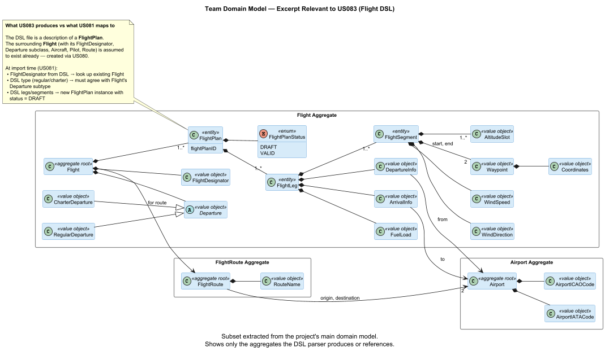
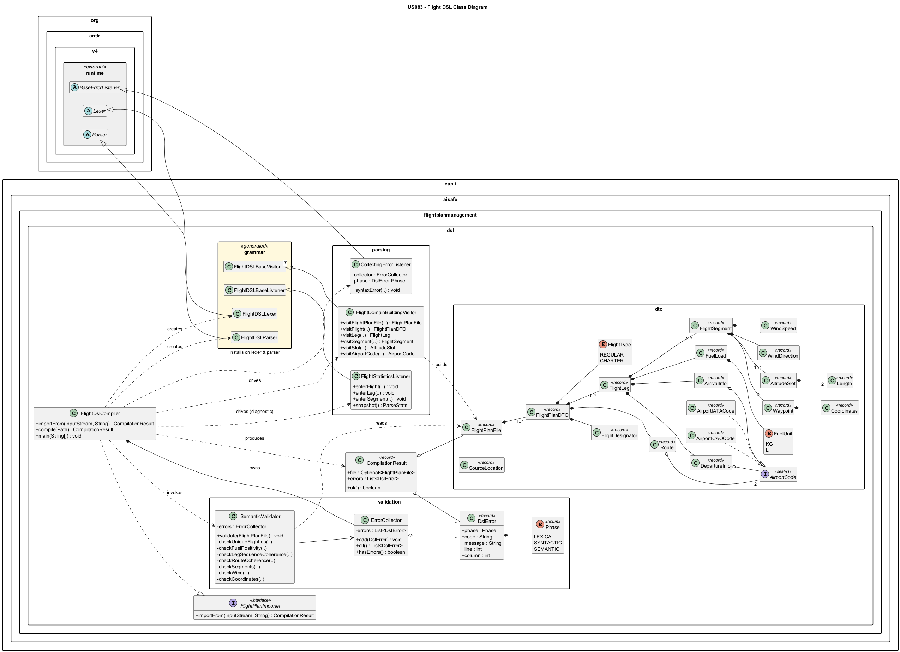

# US 083 - Specify and Validate Flight DSL

## Context

This is the first time US083 is assigned. It is not a bug fix nor a carry-over from a previous sprint.

US083 represents the foundational work for the Flight Description DSL, a textual language used by external tools to describe flight plans, which are then imported into the AlSafe system for validation and (later) simulation.

The DSL is required by the client (AlSafe) to avoid vendor lock-in: flight plans are authored outside the system in a formal language, then imported and validated by the system rather than constructed through ad-hoc UI workflows. Section 3.4 of the project requirements document defines this need; sections 3.4.2 through 3.4.5 provide the informal lexical, syntactic, and semantic specification that the team must formalise.

## Requirements

This requirement establishes the Flight Description DSL as the formal input format for flight plans in the AlSafe system. Authored externally and imported through a plugin mechanism, the DSL must be:

- **Specified** at three levels: lexical (token shapes), syntactic (structural rules), and semantic (cross-element coherence).
- **Implemented** using ANTLR 4 to generate the lexer and parser from a formal grammar.
- **Validated** in a single pass that collects every error rather than failing on the first.
- **Materialised** as an internal representation (AST / domain objects) consumable by the rest of the system.
  The team treats US083 as the LPROG-owned producer of a clean public contract; downstream consumers (US081 EAPLI controller, future US085 flight test/validation) will depend on this contract without dragging in ANTLR types.

**US 083** — *As a Project Manager, I want the team to specify and implement the Flight Description DSL, so that flight plans can be formally defined and validated.*

**Acceptance Criteria:**

- **US083.1** The informal lexical and syntactic specification of the DSL is documented.
- **US083.2** A formal grammar is defined using ANTLR (lexer rules and parser rules).
- **US083.3** The system performs lexical and syntactic validation of flight plan files.
- **US083.4** Parse tree traversal is implemented using listeners or visitors (at least one of each).
- **US083.5** An internal representation (AST or domain objects) is produced.
- **US083.6** Semantic validation rules from section 3.4.5 are enforced (flight-level, leg-level, leg sequence coherence, route coherence, segment coherence, domain consistency).
- **US083.7** All semantic errors are collected and reported in a single execution.
- **US083.8** Error messages include error type, line, and column information.

**Dependencies/References:**

Although the user-story card lists "None" as the dependency, the team has identified the following relationships:

| Relation | Item | Nature |
|---|---|---|
| **Downstream consumer** | **US081** *Create a flight plan from a file* | US081 explicitly states "The flight plan file must conform to the Core Flight DSL" and "The file must be validated through lexical, syntactic and semantic analysis." US081 will consume the output of US083 through the `FlightPlanImporter` contract. |
| **Domain antecedent** | **US080** *Create a flight plan* | Defines the concept of a flight plan that US083 must be able to represent. |
| **Future consumer** | **US085** *Test/validate flight plan* | Acceptance criterion: "The validation must include validation of the flight plan described using the DSL and its test." |
| **Specification source** | Project Requirements §3.4 | Sections 3.4.1 through 3.4.7 contain the entire informal specification, semantic rules, and scope statement. |
| **Specification source** | Project Requirements §3.2 | Defines flight identifier format (`xxn(n)(n)(n)(a)`), airport attributes, segment attributes — all of which constrain the grammar. |
| **Non-functional** | **NFR03** *Unit testing*; **NFR10** *Programming language*; **NFR11** *LPROG assessment* | Mandates Java, 90% coverage, and the qualitative criteria by which the DSL itself will be graded. |
| **Process** | **NFR02** *Technical Documentation*, **NFR04** *Source Control* | Require this document and all artifacts to live in the repo under `docs/`, with PlantUML diagrams in vector format. |

## Analysis

The team approached US083 in five analytical layers, moving from problem framing to design-decision rationalisation.

### Problem framing

The DSL is the *interface* between an externally authored description of a flight plan and the AlSafe internal model. It must therefore satisfy two audiences simultaneously: the **human author** who will write `.flight` files in a text editor, and the **machine consumer** (eventually a `FlightDslCompiler`) that must validate and materialise them.

The team identified the following success conditions, distilled from the requirements:

1. The DSL must express **everything** the conceptual model demands (flight identity, type, legs, departures, arrivals, fuel, segments, route, wind), and **nothing** more.
2. Lexical, syntactic and semantic errors must be **located** (line + column) and **classified** (lexical / syntactic / semantic), per AC#8.
3. A single compilation pass must surface **all** errors, not just the first — per AC#7. This is an architectural constraint, not a convenience.
4. The resulting AST must be **ANTLR-free** so the rest of the system can depend on it without inheriting parser concerns.

### Conceptual model

The conceptual hierarchy from §3.4.3 of the requirements is:

```
FlightPlanFile
└── Flight (1..n)
    ├── id, type
    ├── Route (1)
    └── Leg (1..n)
        ├── Departure (1)
        ├── Arrival (1)
        ├── Fuel (1)
        └── Segment (1..n)
            ├── start, end (Coordinates)
            ├── altitudes, widths (Length list)
            └── Wind (1)
```

A PlantUML rendering of this model is provided in `docs/sprint-2/us083/us083_domain_model_excerpt.puml` and exported to `us083_domain_model_excerpt.png`.

**Editorial note on `route` placement.** The bullet list in §3.4.3 of the requirements lists `route` as a child of `leg`, but §3.4.5 ("Route coherence") describes route endpoints as being compared to the *first* leg's departure and the *last* leg's arrival — which is only meaningful if there is one route per flight. The team interprets this as an editorial inconsistency in the requirements document and treats route as a flight-level concept (see Design Decision D1 in the implementation plan). This will be confirmed with the LPROG PL teacher in the next sprint.

### Comparison of DSL surface-syntax styles

Three surface-syntax styles were considered before committing:

| Style | Example | Pros | Cons |
|---|---|---|---|
| **Block-based with `{}` and `:`** | `flight TP123 { type: regular ... }` | Familiar to most engineers (JSON-like); easy to grammar-design; visually obvious nesting. | Slightly verbose. |
| **Indentation-based (YAML-like)** | `flight TP123:`<br>` type: regular` | Concise; readable. | Significant whitespace complicates ANTLR; semantic indentation is fragile across editors. |
| **S-expression** | `(flight TP123 (type regular) ...)` | Trivial grammar; uniform structure. | Unfamiliar; poor readability for non-LISP audiences. |

The team selected the **block-based style with curly braces** for its grammar simplicity, low cognitive cost for the target authors (pilots and back-office operators reading sample files), and visual alignment with the conceptual hierarchy.

### Grammar-design decisions

Several grammar-level decisions emerged from the analysis:

- **Case sensitivity follows the requirements (§3.4.2):** keywords are case-insensitive, while identifiers and literals (flight IDs, IATA, ICAO) are case-sensitive and uppercase. This requires per-letter fragment rules in the lexer (`fragment F: [fF];` …) rather than ANTLR's whole-file case-insensitive option, because the option would also make airport codes case-insensitive — which would weaken the lexical contract.
- **Lexical disambiguation between airport codes and keywords:** keywords are declared *before* `IATA_CODE`/`ICAO_CODE` in the lexer. ANTLR matches longest first, then declaration order on ties, so `flight` always wins over a hypothetical 6-letter airport code.
- **Fixed property order inside blocks:** the grammar enforces a specific order of properties within each block (departure before arrival before fuel before segments). This produces precise parser error messages ("expected `arrival`") at the cost of slight authoring rigidity. A property-set variant is recorded as a future extension.
- **Mandatory explicit units** on all physical quantities (`8500 kg`, `10000 m`, `15.5 m/s`). The grammar treats `8500` and `8500 kg` as syntactically distinct; the former is a parse error. This makes flight plans self-describing and removes ambiguity at the boundary with downstream physics calculations.

### Internal representation strategy

The team evaluated three approaches for the internal representation:

| Option | Description | Verdict |
|---|---|---|
| Use ANTLR parse-tree contexts directly | No translation layer; downstream code navigates `*Context` objects. | **Rejected.** Couples the rest of the system to ANTLR types; violates the spirit of AC#5 ("AST or domain objects produced"). |
| Build an AST of generic `Node` objects | Single recursive type with children and attributes. | **Rejected.** Erases type information; pushes validation logic into runtime checks. |
| Build a typed domain model of immutable records | One record class per concept (FlightPlan, Leg, Segment, …). | **Selected.** Compile-time type safety; trivial equality/hashCode; serialises cleanly; consumable by US081 with no further translation. |

Every domain record carries a `SourceLocation(line, column)` so the semantic validator — which operates on the AST rather than on the parse tree — can still produce error messages with the precise location of the offending token.

### Visitor vs Listener allocation

AC#4 mandates **at least one** visitor and **at least one** listener. The team allocates them to genuinely distinct responsibilities to make the choice substantively meaningful, not a token compliance exercise:

| Traversal | Class | Role | Why this style |
|---|---|---|---|
| **Visitor** | `FlightDomainBuildingVisitor extends FlightDSLBaseVisitor<Object>` | Builds the typed `FlightPlanFile` domain object from the parse tree, with each `visitX` method returning the domain counterpart of rule `X`. | Visitors *return values* and *selectively traverse* — the right tool when assembling a structured result. The construction is bottom-up and per-rule, mirroring the grammar's compositional structure. |
| **Listener** | `FlightStatisticsListener extends FlightDSLBaseListener` | Gathers statistics during a `ParseTreeWalker` walk: number of flights, legs, segments, and the set of airport codes referenced. Used for diagnostic CLI output. | Listeners observe a tree as it is automatically walked, performing side effects — the right tool when no return value is needed and the traversal pattern is fixed. |

This split also illustrates the conceptual difference between the two ANTLR mechanisms (slide 43 of the ANTLR 4 Introduction lecture material), which the team intends to highlight in the project demo.

### Error-handling strategy

The architecture is shaped by AC#7's single-pass requirement. The team adopts a **collector pattern**:

```
                ┌─────────────────┐
   lex errors   │                 │   semantic errors
   ──────────►  │ ErrorCollector  │  ◄──────────────────
                │                 │
   syntax errs  │   List<DslError>│
   ──────────►  │                 │
                └─────────────────┘
                         │
                         ▼
                  CompilationResult
                  (Optional<AST>, errors)
```

Three boundary decisions follow:

1. **ANTLR's default `ConsoleErrorListener` is removed** on both lexer and parser. A custom `CollectingErrorListener` routes every `syntaxError(...)` call into the shared `ErrorCollector` with phase and location.
2. **The semantic validator never throws.** Every rule method inspects the AST and pushes zero or more `DslError` records; the validator returns even if all seventeen rules report violations.
3. **AST is built only if syntactic errors are zero.** Beyond a syntactic error the parse tree may be partial or recovery-shaped; building a domain model from it would amount to guessing at intent. In that case `CompilationResult.file()` is `Optional.empty()` but the collected errors are still returned.

### Public API and integration analysis

A reference EAPLI project (`ImportDishesController` from eCafeteria) revealed the integration pattern in use:

- A `*ImporterPluginRepository` looks up an importer by file extension.
- The selected plugin exposes an `importer.importFrom(InputStream content)` method returning DTO-shaped objects.
- The use-case controller handles authorization, transaction boundaries, and conversion to persistable entities.
  To allow US081 to register `FlightDslCompiler` as the plugin for `.flight` files **with zero adapter code**, US083's public API is shaped as follows:

```java
public interface FlightPlanImporter {
    CompilationResult importFrom(InputStream content, String sourceName);
}
 
public class FlightDslCompiler implements FlightPlanImporter {
    @Override
    public CompilationResult importFrom(InputStream c, String name) {
        throw new UnsupportedOperationException("shown in implementation");
    }

    public CompilationResult compile(Path file) throws IOException {
        throw new UnsupportedOperationException("shown in implementation");
    }
}
```

Three properties matter here:
- **`InputStream` is the primary input type**, matching the EAPLI plugin convention; `Path` is a thin convenience.
- **`FlightPlanImporter` is a stand-alone interface** so consumers depend on a contract, not a concrete class. `FlightDslCompilerTest` enforces this property through `importerContractAcceptsInputStream` and `importerContractCanCompileInlineContent`.
- **The domain records returned in `CompilationResult.file()` are DTO-shaped already** (immutable, no behaviour, no persistence concerns), so the EAPLI controller can convert them to persistable entities exactly as `DishDTOParser` converts `DishDTO` to `Dish` in the reference project.

### Coverage analysis

NFR03 requires ≥ 90% line coverage on `domain` and `validation` packages. The team's test design ensures this *by construction*:

- One `invalid_S*.flight` file exists for each semantic rule, with the file's content specifically engineered to exercise that rule's failure branch.
- Domain records are exercised by visitor tests for the three valid samples.
- ANTLR-generated lexer/parser classes are excluded from coverage measurement, since they are not "our" code.
  The expectation is therefore that the 90% threshold is hit naturally as the test plan is implemented; the JaCoCo gate in `pom.xml` formalises this as a build-failing rule.

### Domain model excerpt



## Design

The solution is structured as a four-layer pipeline whose layers communicate only through small, well-defined types. Five design decisions shape the architecture:

- **DTO-shaped output, ANTLR-free.** The visitor produces immutable Java records (`FlightPlanFile`, `FlightPlanDTO`, `FlightLeg`, …) that carry no dependency on ANTLR. Downstream modules — particularly the US081 controller — consume the AST without inheriting parser concerns.
- **Public API shaped for US081.** `FlightDslCompiler` implements a tiny `FlightPlanImporter` interface whose primary method is `importFrom(InputStream, String)`. This mirrors the EAPLI importer-plugin pattern (`importer.importFrom(content)`), allowing US081 to register the compiler against the `.flight` extension with zero adapter code.
- **Domain vocabulary aligned with the team model.** DTO class names (`FlightLeg`, `FlightSegment`, `DepartureInfo`, `ArrivalInfo`, `Waypoint`, `AltitudeSlot`, `WindDirection`, `WindSpeed`, `AirportIATACode`, `AirportICAOCode`) mirror the team's persistent entities so the US081 mapper is a one-to-one translation. `FlightPlanDTO` is the lone `DTO`-suffixed type, marking the parser-output boundary unambiguously.
- **Single-pass error collection.** A shared `ErrorCollector` receives lexical, syntactic, and semantic errors from three different sources (`CollectingErrorListener` for lex/parse phases, `SemanticValidator` for the rule sweep). The validator never throws and never short-circuits, ensuring every problem in the file is reported in one execution (AC#7).
- **Distinct visitor and listener responsibilities.** `FlightDomainBuildingVisitor` builds the AST (return-valued, selective traversal — the right tool for assembling structured output). `FlightStatisticsListener` gathers diagnostic metrics during a `ParseTreeWalker` walk (side-effect, fixed traversal — the right tool for observation). Both required by AC#4; both doing genuinely different jobs.

### Realization

The class diagram below captures every type introduced by US083, the ANTLR runtime and generated classes the module depends on, and the compilation pipeline that flows through them.



### Acceptance Tests

The stubs below illustrate how the major acceptance criteria will be validated. Each test uses JUnit 5 + AssertJ (per NFR03) and loads fixtures from `src/test/resources/dsl/`.

- `valid_flight_plan_parses_and_produces_ast`: A syntactically valid flight plan parses without errors and produces a populated internal representation. (US083.3, US083.5)
- `traversal_uses_both_visitor_and_listener`: Both a Visitor and a Listener are used during parse-tree traversal. (US083.4)
- `rejects_leg_airport_mismatch_with_code_S6`: Semantic rule S6 (leg-sequence airport coherence) is enforced. (US083.6)
- `collects_multiple_errors_in_one_pass`: Multiple errors of different phases are collected in a single execution rather than failing fast. (US083.7)
- `errors_include_phase_line_and_column`: Every error carries phase, line, and column information. (US083.8)
- `importer_contract_accepts_stream_and_returns_result`: The public API contract — consumes only the `FlightPlanImporter` interface and a stream, proving US081 can depend on the contract alone. (US083.3, US083.5 (integration shape))

## Implementation

The implementation lives in a dedicated Maven module:

`aisafe/aisafe.flightplandsl`

The module contains the complete US083 pipeline:

| Concern | Main artifact |
|---|---|
| ANTLR grammar | `src/main/antlr4/eapli/aisafe/flightplanmanagement/dsl/grammar/FlightDSL.g4` |
| DTO output model | `eapli.aisafe.flightplanmanagement.dsl.dto` |
| Error model and collection | `DslError`, `ErrorCollector`, `CollectingErrorListener` |
| Visitor traversal | `FlightDomainBuildingVisitor` |
| Listener traversal | `FlightStatisticsListener` |
| Semantic validation | `SemanticValidator` |
| Public importer API | `FlightPlanImporter`, `FlightDslCompiler`, `CompilationResult` |
| CLI demo runner | `FlightDslCli` |

The normal module jar remains a library artifact. A second executable CLI jar is produced with Maven Shade using classifier `cli`; it includes the ANTLR runtime needed to run from the command line.

Build and test command, from the `aisafe/` directory:

```powershell
.\mvnw.cmd -pl aisafe.flightplandsl -am verify
```

At the time of writing, the module test suite contains 64 tests covering lexer rules, parser rules, DTO records, visitor traversal, listener traversal, semantic rules, public compiler behavior, and CLI output. The JaCoCo gate for the DSL module passes.

The implementation uses the package root:

```text
eapli.aisafe.flightplanmanagement.dsl
```

and intentionally keeps parser-output DTOs under:

```text
eapli.aisafe.flightplanmanagement.dsl.dto
```

This avoids collisions with persistent domain classes in other AlSafe modules while preserving the team's domain vocabulary for later US081 mapping.

## Integration/Demonstration

The public integration point for future consumers, especially US081, is:

```java
public interface FlightPlanImporter {
    CompilationResult importFrom(InputStream content, String sourceName);
}
```

`FlightDslCompiler` implements this interface and also provides a `compile(Path)` convenience method for direct file use.

### CLI Demonstration

Build the executable CLI jar:

```powershell
.\mvnw.cmd -pl aisafe.flightplandsl -am package
```

Run a valid flight plan:

```powershell
java -jar aisafe.flightplandsl/target/aisafe.flightplandsl-1.0.0-SNAPSHOT-cli.jar aisafe.flightplandsl/src/test/resources/dsl/valid_multileg.flight
```

Observed output:

```text
Flight DSL validation: OK
File: aisafe.flightplandsl\src\test\resources\dsl\valid_multileg.flight
Flights: 1
Legs: 2
Segments: 2
Airports: LEMD, LPPR, LPPT
AST: 1 flight plan(s) produced
```

Run an invalid flight plan:

```powershell
java -jar aisafe.flightplandsl/target/aisafe.flightplandsl-1.0.0-SNAPSHOT-cli.jar aisafe.flightplandsl/src/test/resources/dsl/invalid_multi_errors.flight
```

Observed output:

```text
Flight DSL validation: FAILED
File: aisafe.flightplandsl\src\test\resources\dsl\invalid_multi_errors.flight
Errors: 3
[SEMANTIC][S5] line 8:4 leg 1 fuel quantity must be strictly positive
[SEMANTIC][S6] line 19:4 leg 2 departs from LEMD but previous leg arrives at LFPG
[SEMANTIC][S15] line 14:8 wind direction must be in [0, 360)
```

This output demonstrates lexical/syntactic parsing, visitor-produced AST creation, listener-produced statistics, and semantic validation with multiple collected errors.

## Observations

US083 is integrated as the `aisafe.flightplandsl` Maven module, while its Java API lives under `eapli.aisafe.flightplanmanagement.dsl`. The distinction is intentional: the module name identifies the build artifact, and the package name keeps the DSL implementation aligned with the rest of the AISafe flight-plan management namespace.

The currently integrated US081 flow consumes `FlightDslCompiler` directly from the Pilot console UI. The application controller remains DSL-agnostic: it receives the selected flight designator and raw DSL content only. This preserves a clean boundary between LPROG parsing/validation concerns and EAPLI persistence/application concerns.

The repository also contains `aisafe.flightdsl-semantic-validator`, an earlier standalone semantic-validation module under `lapr4.lprog.flightdsl.*`. That module is not the runtime integration path for US081; the production DSL compiler, parser, visitor, listener, DTO model, and semantic validator used by the application are all in `aisafe.flightplandsl`.
