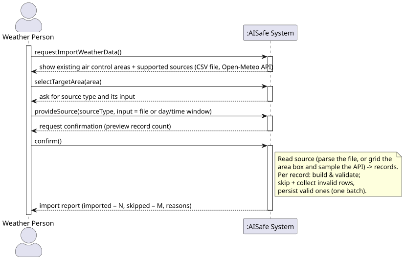
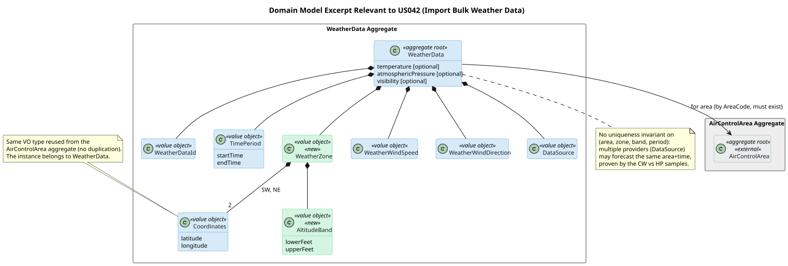
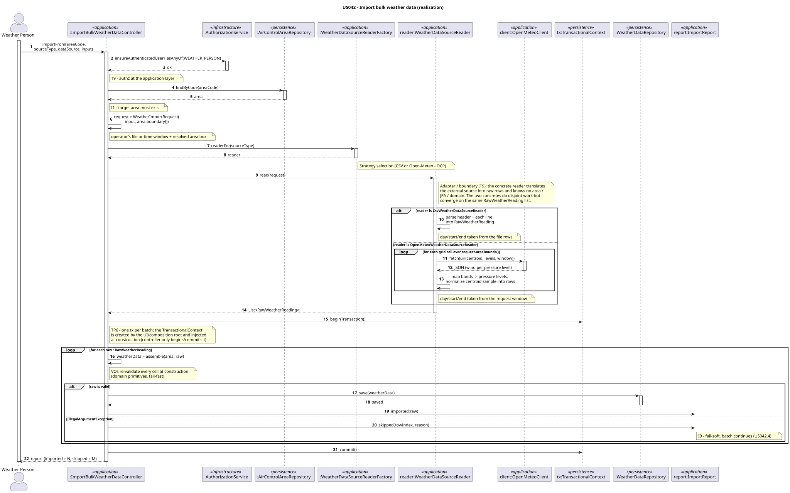
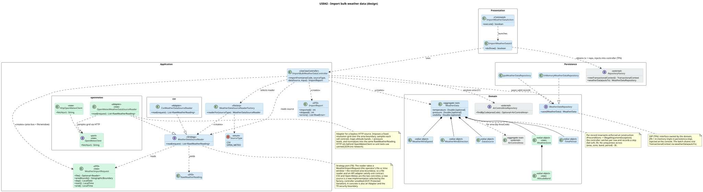
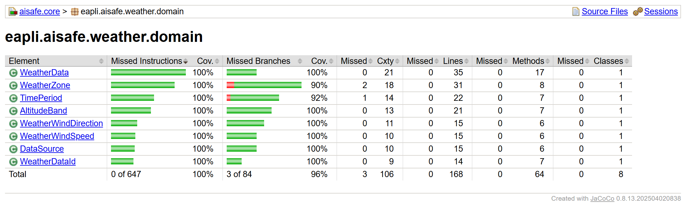
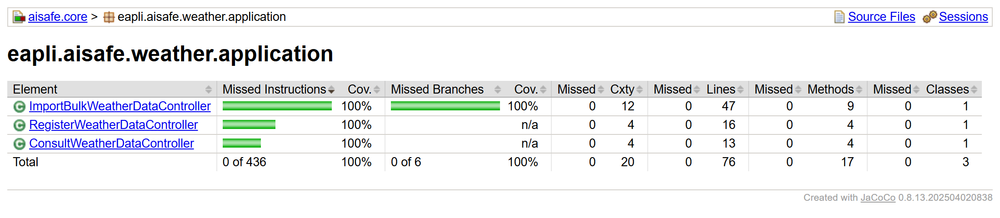
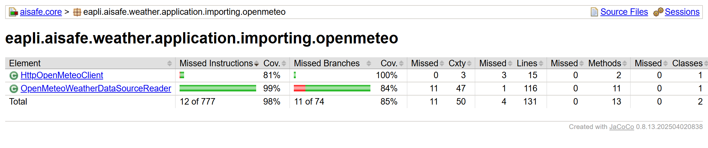

# US 042 - Import bulk weather data

## Requirements

**US 042** As a Weather Person, I want to import bulk weather data into the system.

**Acceptance Criteria:**

- US042.1 Weather Person can import a file containing multiple weather data records.
- US042.2 CSV is supported as the initial file format.
- US042.3 Each record references an existing air control area.
- US042.4 Invalid records are reported and skipped without aborting the whole import.
- US042.5 The system is extensible to new weather data sources beyond CSV.
- US042.6 Successful imports are persisted and queryable.

**Definition of Done:**

- Bulk import UC implemented end-to-end.
- CSV parser implemented and tested.
- Extension point (strategy/adapter) for new data sources documented.
- Tests cover valid, partially-invalid, and fully-invalid imports.
- Coverage ≥ 90% on controller/domain.

**Dependencies/References:**

- US041 - Register Weather Data

## Analysis

### Interpretation

Extensibility is a first-class requirement here. The last sentence of the story (*"the system should be easy to expand to new weather data sources"*) and acceptance criterion **US042.5** require an import *mechanism* whose first source is CSV but whose design admits others. The Open/Closed Principle is stated in the requirement itself.

The actor is the **Weather Person** (`aisafe.app.weather.console`). The SSD below shows the use case as a black box: the operator picks the **target air control area**, the **source type** (a CSV file or the Open-Meteo API) and its **input** (a file location, or a day/time window for the API), confirms, and receives an **import report**.

**Relationship to US041.** US042 introduces no new aggregate. US041 (*Register Weather Data*) already ships the `WeatherData` aggregate, its repository, and the Weather Person console. The two stories differ only in acquisition channel (one record via the UI vs. many read from a source) and converge on the same `WeatherDataRepository`. US042 reuses that aggregate and adds the bulk-import use case in front of it.

**Target area is chosen at import time (documented assumption).** PO (25/05/2026) requires that imported weather *"match the boundaries of an existing ACA"*. We satisfy this by having the operator **select a registered ACA in the UI**; every record in the file is attributed to it, so it is impossible to import against an area that does not exist (**US042.3**). One import therefore targets **one operator-selected area**. This assumption is reversible: if a file ever spans areas, the area moves back into the row payload and only the reader changes, leaving the controller untouched.

The PO clarification (21/05/2026) that *"bulk import may rely on either files or API calls to external systems"* fixes the axis along which the system must stay open: the source of the data. Adding a source must therefore be a new component, not an edit to the import use case; the seam is realised by a CSV **file** reader and an Open-Meteo **API** adapter (§4 Design), exercising both axes the PO named. Because the source is untrusted external input, the import is also required to validate each record and continue past bad ones (US042.4), reporting how many were imported and skipped.

### Domain model

US042 reuses the US041 `WeatherData` aggregate. The **mandatory sample file** forces a small number of deltas on that existing model; the excerpt below tags them `<<new>>` (green).

| Delta | What the sample shows | Decision |
|---|---|---|
| **`WeatherZone` + `AltitudeBand`** (new) | Each wind row is a **sub-area bounding box** plus an **altitude band in feet** (0–1000, 1001–2000, …), not a whole-area value. US041's record is area-level only. | Add a `WeatherZone` VO (2 `Coordinates`, reusing the `AirControlArea` `Coordinates` VO, no duplication) carrying an `AltitudeBand` (lower/upper feet). Each imported row becomes one zone-banded record. |
| **`TimePeriod`** (reused) | The `Day`, `Star` and `End` columns give a real **start/end period**, confirming US041's `TimePeriod` is not a placeholder. | Keep `TimePeriod`; the CSV provides start and end as date/time values the reader parses into `LocalDateTime`. |
| **`DataSource`** (reused) | CW and HP are byte-for-byte structurally identical and differ **only** in wind values and provider. | Keep `DataSource` as the **provenance** axis; it is what tells overlapping forecasts apart. |
| **No uniqueness invariant** | CW vs HP collide on area + zone + band + period, everything except source. | **Deliberately** impose **no** uniqueness on (area, zone, band, period). The system must *tolerate* multiple providers' forecasts (PO 21/05/2026); US043/US082 let consumers choose among them. |
| **Optional measurements** | The sample is **wind-only**, with no temperature, pressure or visibility columns. | Make a record valid with **wind present and the other measurements absent-tolerant**. *(US041 currently mandates `pressure > 0`; relaxing that to absent-tolerant is the one change US042 needs in the existing aggregate, see open items in §3.3.)* |

### Rules & invariants

| # | Rule / Invariant | Enforced where | Source |
|---|---|---|---|
| I1 | Every imported record references an **existing** ACA (area selected once per import). | Controller (area lookup) | US042.3, PO 25/05/2026 |
| I2 | Wind direction ∈ [0, 360]. | `WeatherWindDirection` VO | US041 carry-over |
| I3 | Wind speed ≥ 0. | `WeatherWindSpeed` VO | US041 carry-over |
| I4 | `AltitudeBand` lower < upper, both ≥ 0. | `AltitudeBand` VO | sample |
| I5 | `TimePeriod` start ≤ end. | `TimePeriod` VO | US041 / sample |
| I6 | `DataSource` non-blank. | `DataSource` VO | US041 carry-over |
| I7 | A valid record needs **at least wind**; temperature/pressure/visibility are **absent-tolerant**. | `WeatherData` factory | sample (wind-only), open item below |
| I8 | **No** uniqueness across (area, zone, band, period); multiple `DataSource`s coexist. | (deliberate non-invariant) | PO 21/05/2026, CW vs HP |
| I9 | An invalid record is **reported and skipped**; the batch continues and valid rows persist. | Controller (batch loop) | US042.4 |

I2–I7 are **per-record domain invariants** enforced at construction (fail-fast). I1 is a **cross-aggregate precondition** resolved at the application layer. I8 is a **documented non-invariant**. I9 is **batch-level orchestration** in the controller.

One point is still open: whether US042 is wind-only (as the samples are) or must also import temperature, pressure and visibility. That decides whether I7's relaxation of the US041 `pressure > 0` rule is permanent.

## Design

### Realization

A bulk import is a write across many `WeatherData` aggregates of one operator-selected area; the referenced `AirControlArea` is read-only. The batch runs under a **single transaction** so a failure mid-import never leaves a half-loaded forecast set. The sequence diagram below shows the flow from the controller to persistence.

Responsibilities are assigned by **GRASP** and realise the extension seam identified in §3.1:

- **`ImportWeatherDataAction` / `ImportWeatherDataUI`** (Presentation, `aisafe.app.weather.console`). The action is the framework's **Command** wiring on the Weather Person menu; the UI lists the existing areas, reads the chosen area, source type and the source input (a file location for CSV, or a day/time window for Open-Meteo), obtains the batch `TransactionalContext` and the repository and injects them into the controller, and shows the returned report.
- **`ImportBulkWeatherDataController`** (GRASP *Controller*). Use-case entry point. It authenticates the Weather Person, resolves the target area (I1) and its boundary, assembles the `WeatherImportRequest`, asks the factory for the reader, opens one transaction, drives the per-record loop, and returns the `ImportReport`. It holds no parsing logic and no domain invariant.
- **`WeatherDataSourceReader`** (Strategy port) with two concretes. The port reads a **`WeatherImportRequest`** — the operator's input (a file, or a day/time window) together with the resolved area's `GeographicBoundary` — into `RawWeatherReading` rows, so a file reader and an API adapter satisfy one contract. **`CsvWeatherDataSourceReader`** (mandatory) owns the CSV format concerns (column layout and field parsing) and reads from the request's file. **`OpenMeteoWeatherDataSourceReader`** imposes a fixed-resolution grid over the area boundary, samples each cell at its centroid through a keyless HTTP call, maps each altitude band to the nearest pressure level, and normalises the provider's point/pressure-level data into the same `RawWeatherReading`; its HTTP access sits behind an injectable **`OpenMeteoClient`** seam, so the adapter is unit-tested on canned JSON with no network. These spatial/vertical/temporal conversions are lossy and isolated to the adapter (a documented MVP simplification, Sprint-2 §5); the domain still re-validates every cell on arrival (T9). Each reader depends on nothing in the persistence or domain packages. A new source is a new implementation selected by **`WeatherDataSourceReaderFactory`** from a `SourceType`, so adding one leaves the controller untouched (**OCP**, GRASP *Protected Variation*). That factory is a **Factory** (GRASP *Pure Fabrication*): it carries no domain meaning, it exists only to keep the `SourceType`-to-reader mapping out of the controller, so the choice of concrete is the one place that changes when a source is added. A concrete that wraps a library or an external service is also an **Adapter**, and it is the single point where the external format is translated and the domain is shielded from it (T9 boundary).
- **`WeatherImportRequest`**, **`RawWeatherReading`** and **`ImportReport`** (**DTO**). The request carries the operator's file or time window plus the resolved area boundary inward to the reader; `RawWeatherReading` carries raw cells from the reader to the controller; `ImportReport` carries imported and skipped counts back to the UI. None leaks format types inward nor domain types outward, so they are the GRASP *Indirection* (a *Pure Fabrication* too — they model no domain concept) that keeps the reader ignorant of the domain and the domain ignorant of the source format.
- **`WeatherData`** and its value objects (GRASP *Information Expert*; **domain primitives**). The controller assembles a record by rebuilding each VO from the raw cells; every VO rejects a malformed value at construction, so an injected or out-of-range cell cannot become a valid record.

Two framework mechanisms keep the rules apart, as in US080. **`Preconditions`** (raising `IllegalArgumentException`) guard the VO and assembly inputs; the controller's batch loop **catches that per row**, records a skip, and continues, so one bad row never aborts the import (fail-soft, I9). Valid rows are still committed.

Layering follows the **Dependency Inversion Principle**: `WeatherDataRepository` is owned by the domain, implemented by `JpaWeatherDataRepository` and `InMemoryWeatherDataRepository` in `aisafe.persistence.impl`, and injected at the console. The single batch transaction is obtained from the `RepositoryFactory` and shared with the repository through a `weatherData(TransactionalContext)` overload, mirroring the existing `airControlAreas(autoTx)` (TP6). The Open-Meteo adapter lives alongside the CSV reader in `aisafe.core` and reaches the network only through the JDK HTTP client behind the `OpenMeteoClient` seam, so no third-party dependency is added and unit tests run without network access. The class diagram below shows the resulting structure.

### Acceptance Tests

Tests follow JUnit 4 style (Vintage Engine), the `ensure{Subject}{Verb}For{Condition}` naming convention, and no mocking framework. Controller tests are integration-style: the controller is built with the real `InMemoryWeatherDataRepository` and `InMemoryAirControlAreaRepository` pre-populated via `given...` helpers, and fed by a `StubSourceReader`, a small in-test CSV, or the Open-Meteo adapter wired to a canned-JSON `OpenMeteoClient`, so parsing, sampling and persistence are exercised without a database or network.

- `ensureImportPersistsAllRecordsForValidSource`: An all-valid source imports every record to the chosen area and persists them. (US042.1, US042.2, US042.6)
- `ensureImportRejectsUnknownArea`: The import is rejected when the target area does not exist, before any record is read. (US042.3 (I1))
- `ensureImportSkipsInvalidRowsAndKeepsValidOnes`: A partially-invalid batch skips and reports the bad rows while persisting the valid ones. (US042.4 (I9))
- `ensureImportPersistsNothingWhenEveryRowIsInvalid`: A fully-invalid batch persists nothing and reports every row. (US042.4)
- `ensureControllerImportsThroughOpenMeteoStrategy`: The Open-Meteo source plugs into the same controller with no controller change (substitutability). (US042.5 (OCP / LSP))
- `ensureOverlappingForecastsFromDifferentSourcesCoexist`: Two records for the same zone, band and period but different sources both persist (no uniqueness invariant). (I8 (PO 21/05/2026, CW vs HP))
- `ensureOpenMeteoAdapterGridsAreaAndNormalizesResponse`: The Open-Meteo adapter grids the area boundary and normalizes a canned API response into one reading per cell and altitude band, without a network call. (US042.5 (Adapter / boundary translation))

## Implementation

The first increment makes the `WeatherData` aggregate zone-banded (the §3.2 domain deltas `WeatherZone` and `AltitudeBand`, mandatory) and adds the `WeatherDataSourceReader` Strategy port with its first concrete `CsvWeatherDataSourceReader`, which is the extensible import seam from §3.1 / §4.1. The second increment builds the import use case on top of that seam, wiring the controller, persistence and console as designed in §4.1. The third increment generalises the reader port to a `WeatherImportRequest` and adds the `OpenMeteoWeatherDataSourceReader`, the second concrete that proves the seam is open to a non-file (API) source without touching the controller (§4.1).

**Regression test (real-response).** The adapter's unit tests fed it idealised canned JSON and passed, but they did not mirror the live payload, which carries an `hourly_units` object whose keys (`time`, `wind_speed_1000hPa`, …) appear *before* the data arrays with string values. The naive parser matched those first and read the wrong array, so against the real API every value became `NaN` and **zero records were imported**. A test that runs the adapter over a captured live response (committed as a fixture at `aisafe.core/src/test/resources/weather/openmeteo_sample_response.json`) reproduced the defect and scoping the parse to the `hourly` object fixed it. 

## Integration/Demonstration

The import use case integrates with the existing weather slice rather than adding a parallel one: it reuses the US041 `WeatherData` aggregate, its `WeatherDataRepository`, and the Weather Person console, adding a single `Import Bulk Weather Data` entry next to `Register Weather Data`. Imported records are therefore queryable through the same repository as manually registered ones, and become available to the downstream consult stories (US043, US082).

To demonstrate the functionality:

1. **Regenerate the schema once.** Run `eapli.aisafe.app.bootstrap.AisafeBootstrap`, which uses `drop-and-create`. This is required after the aggregate change because the console apps run with `hibernate.hbm2ddl.auto=update`, which adds the new `zone_*` / `alt_*` columns but does not relax the former `NOT NULL` constraint on `pressure`; a wind-only import needs `pressure` nullable.
2. Run `eapli.aisafe.app.weather.console.WeatherApp` and log in as `poweruser` / `poweruserA1`.
3. Choose `Import Bulk Weather Data`, select the target area (e.g. `LPPO`) and enter the provider name.
4. **CSV** - choose source type `1` and give the path to a CSV in the agreed format; a sample is committed at `aisafe.core/src/test/resources/weather/Lisbon_WeatherData_v0.csv` (48 zone-banded wind records).
5. **Open-Meteo** - choose source type `2` and enter a day (a near-future date, since the forecast API is queried) and a start/end time. The adapter grids the area, samples each cell over HTTP, and reports e.g. `Import finished: 48 imported, 0 skipped.`

**Live verification of the Open-Meteo path.** Importing `LPPO` for one day at 09:00 produced 48 records (8 sub-region cells x 6 altitude bands). The stored values were cross-checked against a fresh Open-Meteo query for one cell's centroid (41.0, -9.75) at that hour: the wind direction and speed matched on all six bands, confirming the full conversion chain end-to-end - centroid derivation, band-to-pressure-level mapping, the requested hour index, and knots pass-through - not merely that the import ran. The records are wind-only with the other measurements null, as designed, and are queryable through the same repository as CSV and manually registered ones.

The coverage figures below were produced with `./mvnw -pl aisafe.core -am test jacoco:report`. NFR03 requires >=90% line coverage on the domain and controller packages; both show **100%**. 

## Observations

The Open-Meteo adapter is the proof that the seam is open to a non-file source: it is a new `WeatherDataSourceReader` registered under a new `SourceType`, and it imports through the **unchanged** controller (the substitutability test). The adapter is the single translation point (T9 boundary) where the provider's point-and-pressure-level data is normalised into the same `RawWeatherReading` the CSV reader yields; its spatial / vertical / temporal conversions are lossy by design and isolated there (a documented MVP simplification), and the domain re-validates every value on arrival. As untrusted external input, a malformed or partial response never produces a bad record - the affected band is skipped, mirroring the CSV reader's fail-soft behaviour.
