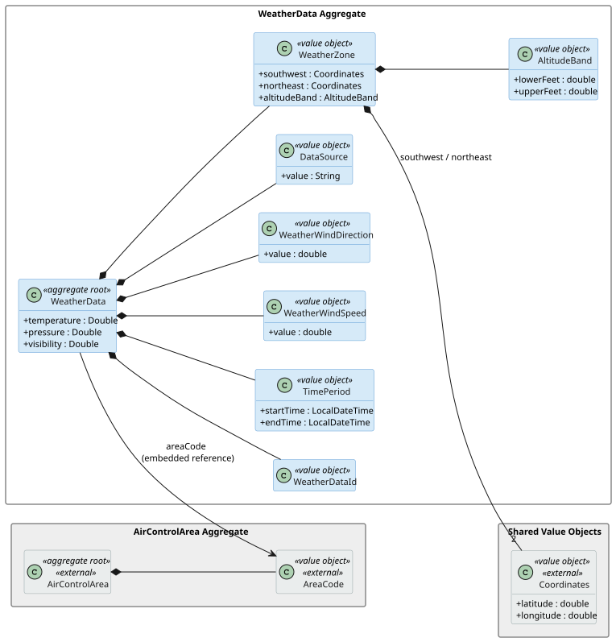
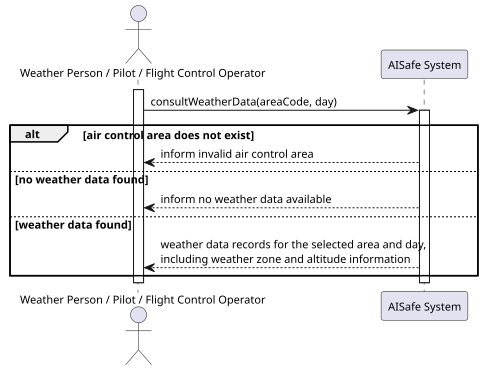
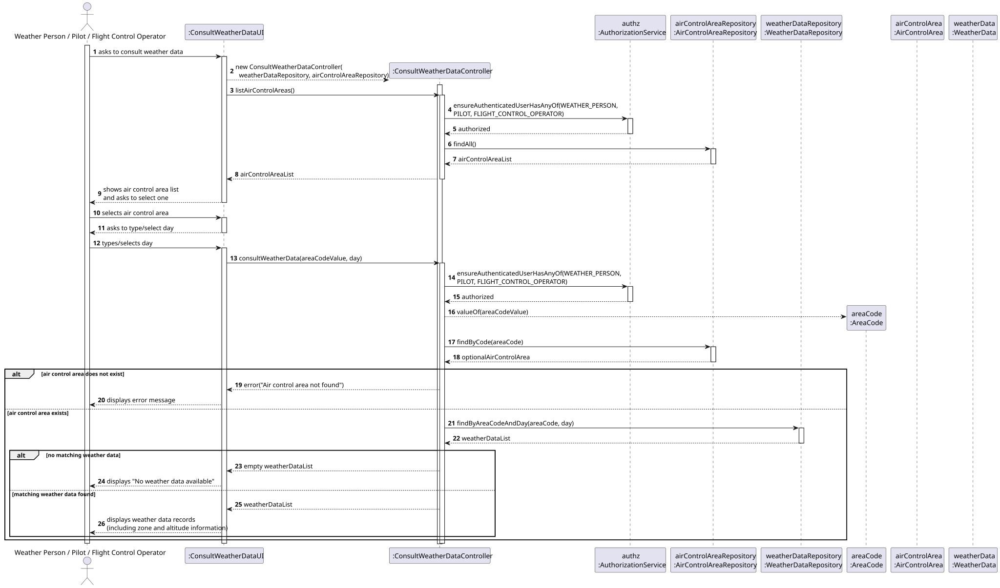
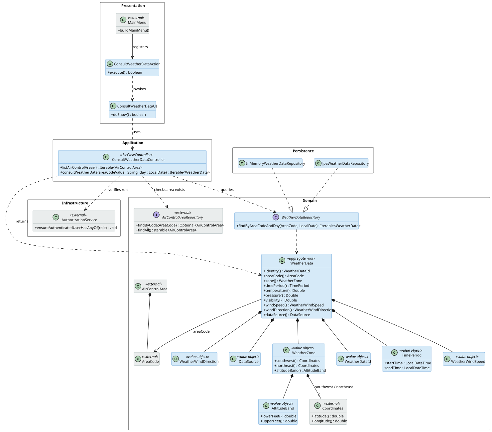

# US 043 - Consult weather data

## Context

US043 allows authorized users to consult weather data already registered in the system for a given day and a specific air control area.

This user story is query-oriented. It does not create or import weather data. Weather data may be registered manually through US041 and may later be imported in bulk through US042. Therefore, US043 is designed independently from the import mechanism and only depends on weather records being available in the system.

## Requirements

**US 043** As a Weather Person, a Pilot, or a Flight Control Operator, I want to consult weather data in the system in a given day and in a specific air control area.

**Acceptance Criteria:**

* US043.1 Authorized actors (Weather Person, Pilot, FCO) can query weather data.
* US043.2 Query is parameterised by day and air control area.
* US043.3 Results show all weather records matching the criteria.
* US043.4 Empty results are handled gracefully.

**Definition of Done:**

* Consult-weather UC implemented end-to-end.
* Authorization restricts access to the three named roles.
* Tests cover populated and empty result sets.
* Coverage ≥ 90% on controller/domain.

**Dependencies/References:**

* US041 - Register Weather Data

## Analysis

US043 is a query-oriented user story introduced in Sprint 3. Its purpose is to allow authorized users to consult weather data already registered in the system for a given day and a specific air control area.

The weather records are represented by the `WeatherData` aggregate, introduced in US041. Each `WeatherData` record is associated with one `AirControlArea`, referenced by its `AreaCode`, and contains a `TimePeriod`, temperature, atmospheric pressure, visibility, wind speed, wind direction and data source.

The actors allowed to execute this use case are:

* Weather Person;
* Pilot;
* Flight Control Operator.

The query is parameterised by:

* air control area;
* day.

The system must validate that the user is authenticated with one of the authorized roles, verify that the selected air control area exists, and then retrieve all weather records matching the selected area and day.

Since this user story only consults existing data, no new domain aggregate is required. The main design decision is where to place the filtering logic. The adopted solution places the query operation in the `WeatherDataRepository`, using a method that receives the selected `AreaCode` and day. This keeps the use case simple and avoids placing persistence/query concerns inside the domain aggregate.

A domain service was not introduced because this use case does not contain complex domain logic or cross-aggregate business rules. The controller coordinates the use case, validates authorization, checks the existence of the selected air control area and delegates the query to the repository.

US043 does not depend directly on US042. US042 may later provide an additional way to populate weather data through bulk import, but US043 can already consult data registered manually through US041. Therefore, the source of the weather data is not relevant for this use case; the use case only requires weather records to exist in the system.

### Domain Model Excerpt

The following domain model excerpt highlights the concepts involved in this user story.



The `WeatherData` aggregate is the central concept of this user story. `AirControlArea` is represented as an external aggregate because US043 only needs to validate and reference an existing area.

### System Sequence Diagram

The following SSD represents the interaction between the authorized user and the system.



## Design

The adopted design follows the existing layered architecture of the project.

The UI is responsible for collecting the query parameters from the user: the air control area and the day. The controller coordinates the use case and enforces the authorization rule. The `AirControlAreaRepository` is used to verify that the selected air control area exists. The `WeatherDataRepository` is responsible for retrieving the weather records that match the selected criteria.

The controller returns `WeatherData` domain objects directly. No DTO or mapper is introduced; the console UI reads and displays the relevant fields directly.

The main classes involved are:

* `ConsultWeatherDataUI`;
* `ConsultWeatherDataAction`;
* `ConsultWeatherDataController`;
* `WeatherDataRepository`;
* `AirControlAreaRepository`;
* `WeatherData`;
* `AirControlArea`.

### Realization

The following full sequence diagram represents the realization of the use case.



The use case starts when an authorized user selects the "Consult Weather Data" option from the menu. `ConsultWeatherDataUI` lists available air control areas, prompts for an area code and a day in `yyyy-MM-dd` format, then calls `ConsultWeatherDataController.consultWeatherData(areaCode, day)`. The controller checks authorization, validates the selected air control area and queries the weather data repository.

If the air control area does not exist, the controller throws `IllegalArgumentException` and the UI displays a clear error message. If no weather data records match the selected criteria, the controller returns an empty collection and the UI prints "No weather data available for the selected area and day." Otherwise, the matching `WeatherData` records are printed with their period, area, temperature, pressure, visibility, wind speed, wind direction and data source.

The menu option is available in the Weather, Pilot and FCO console applications.

The following class diagram shows the main classes involved in the solution.



### Acceptance Tests

The tests are in `ConsultWeatherDataControllerTest` and use inline fake repositories following the pattern established by `RegisterWeatherDataControllerTest`. The day-matching rule applied in both the fake repository and the in-memory repository implementation is:

```
weatherData.timePeriod().startTime().toLocalDate().equals(day)
```

A record matches the queried day when its `TimePeriod` start time falls on that calendar date.

---

- `ensureWeatherPersonCanConsultWeatherData`: Weather Person can consult weather data (US043.1)

---

- `ensurePilotCanConsultWeatherData`: Pilot can consult weather data (US043.1)

---

- `ensureFlightControlOperatorCanConsultWeatherData`: Flight Control Operator can consult weather data (US043.1)

---

- `ensureUnauthorizedUserIsRejected`: Unauthorized actor is rejected (US043.1)

---

- `ensureQueryReturnsOnlyRecordsMatchingAreaAndDay`: Query returns only records matching the selected area and day (US043.2, US043.3)

---

- `ensureEmptyResultDoesNotThrow`: Empty result is handled gracefully (US043.4)

---

- `ensureUnknownAreaCodeIsRejected`: Unknown air control area is rejected (US043.2)

---

- `ensureWeatherPersonCanListAirControlAreas`: Authorized actor can list air control areas (US043.1, US043.2)

## Implementation

### Controller

`ConsultWeatherDataController` follows the pattern of `RegisterWeatherDataController`. It is annotated `@UseCaseController`, receives repositories by constructor injection and enforces authorization at the start of each public method.

```java
public Iterable<WeatherData> consultWeatherData(final String areaCodeValue, final LocalDate day) {
    authz.ensureAuthenticatedUserHasAnyOf(
            AisafeRoles.WEATHER_PERSON, AisafeRoles.PILOT, AisafeRoles.FLIGHT_CONTROL_OPERATOR);
    final AreaCode areaCode = AreaCode.valueOf(areaCodeValue);
    airControlAreaRepository.findByCode(areaCode)
            .orElseThrow(() -> new IllegalArgumentException("Air control area not found: " + areaCodeValue));
    return weatherDataRepository.findByAreaCodeAndDay(areaCode, day);
}
```

No DTO or mapper is created in this step. The controller returns `WeatherData` domain objects directly.

### Repository query method

`WeatherDataRepository` was extended with:

```java
Iterable<WeatherData> findByAreaCodeAndDay(AreaCode areaCode, LocalDate day);
```

**In-memory implementation** (`InMemoryWeatherDataRepository`) iterates `findAll()` and keeps records where:

```java
wd.areaCode().equals(areaCode)
    && wd.timePeriod().startTime().toLocalDate().equals(day)
```

**JPA implementation** (`JpaWeatherDataRepository`) uses a `startTime` interval via the inherited `match()` helper:

```java
"e.areaCode = :areaCode"
+ " AND e.timePeriod.startTime >= :dayStart"
+ " AND e.timePeriod.startTime < :dayEnd"
```

where `dayStart = day.atStartOfDay()` and `dayEnd = day.plusDays(1).atStartOfDay()`. This avoids fragile JPQL `CAST` and is consistent with the existing query patterns in the project (see `JpaAirControlAreaRepository`).

### Authorization test support

`AuthzTestHelper` was extended with a `FCO_USER` constant, seeding of the Flight Control Operator user in `configureAuthz()`, and a `loginAsFlightControlOperator()` login helper — matching the pattern already used for `loginAsWeatherPerson()` and `loginAsPilot()`.

### Console integration

`ConsultWeatherDataUI` and `ConsultWeatherDataAction` were placed in `aisafe.app.common.console` under the package `eapli.aisafe.app.common.console.presentation.weather`. All three console modules (Weather, Pilot and FCO) already depend on `aisafe.app.common.console`, so no additional module dependencies were required.

`ConsultWeatherDataUI` follows the pattern of `RegisterWeatherDataUI`. It instantiates `ConsultWeatherDataController` using `PersistenceContext.repositories()`, lists available air control areas, reads the area code and day from the user, calls `consultWeatherData`, and prints each record or a "No weather data available" message when the result is empty. Invalid date input loops with a format hint. An `IllegalArgumentException` (unknown area) is caught and displayed as a plain error message.

`ConsultWeatherDataAction` is a one-liner that delegates to `new ConsultWeatherDataUI().show()`, consistent with `RegisterWeatherDataAction`.

The menu option "Consult Weather Data" was added to:

* `aisafe.app.weather.console` — option 3, inside the existing `WEATHER_PERSON` role guard;
* `aisafe.app.pilot.console` — option 3, alongside the existing Import Flight Plan option;
* `aisafe.app.fco.console` — option 2, as the first functional item in the FCO menu.

## Integration/Demonstration

### Integration points

US043 integrates with the following existing components:

* **WeatherData records (US041):** the use case queries existing `WeatherData` aggregates. At least one record must be registered through US041 (or the bootstrapper) for the query to return results.
* **AirControlArea management:** the controller validates the requested area against `AirControlAreaRepository`. The area must already exist in the system.
* **Authentication and authorization:** the framework's `AuthzRegistry` enforces that only `WEATHER_PERSON`, `PILOT` or `FLIGHT_CONTROL_OPERATOR` sessions can invoke `consultWeatherData`.
* **Console menus:** the option "Consult Weather Data" is wired into the main menus of the Weather, Pilot and FCO console applications.

### Demonstration steps

To demonstrate US043 end-to-end:

1. Start the system and run the bootstrapper to populate air control areas and weather records.
2. Launch the Weather console (`WeatherApp`) and log in as a Weather Person.
   - Select option **3 — Consult Weather Data**.
   - When prompted, type the area code of an existing air control area (e.g. `LPPC`).
   - Enter a day in `yyyy-MM-dd` format that matches a registered weather record (e.g. `2024-01-15`).
   - The matching weather records are displayed with period, area, temperature, pressure, visibility, wind speed, direction and data source.
3. Repeat using the Pilot console (`PilotApp`), selecting option **3 — Consult Weather Data**.
4. Repeat using the FCO console (`FcoApp`), selecting option **2 — Consult Weather Data**.
5. To verify the empty-result path: enter a day for which no records exist. The message "No weather data available for the selected area and day." is displayed and the application does not crash.
6. To verify the invalid-area path: enter an area code that does not exist (e.g. `ZZZZ`). The error "Air control area not found: ZZZZ" is displayed.

## Observations

US043 was designed as a read/query use case over existing weather data. The solution intentionally avoids introducing a domain service because the current requirement does not involve complex domain decision-making. The filtering by air control area and day is handled by the repository, while the controller coordinates authorization, area validation and result retrieval.

**Day-filtering assumption:** a `WeatherData` record matches the queried day when `timePeriod().startTime()` falls on that calendar date (`startTime().toLocalDate().equals(day)`). Records whose period spans midnight are matched by their start date only and are not treated as a special case. This rule is applied consistently in the in-memory implementation, the JPA implementation and the fake repository used in tests.

US042 may later provide an additional mechanism to import weather data in bulk, but it is not a direct dependency of US043. This decision keeps the consultation use case independent from the source of the weather records.

If future requirements introduce forecast selection rules, provider prioritization, conflict resolution between data sources, or aggregation of weather records, the design may evolve to include a domain service dedicated to weather data selection.
