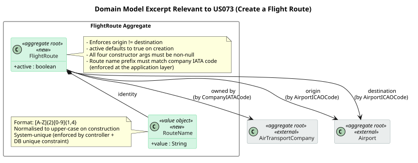
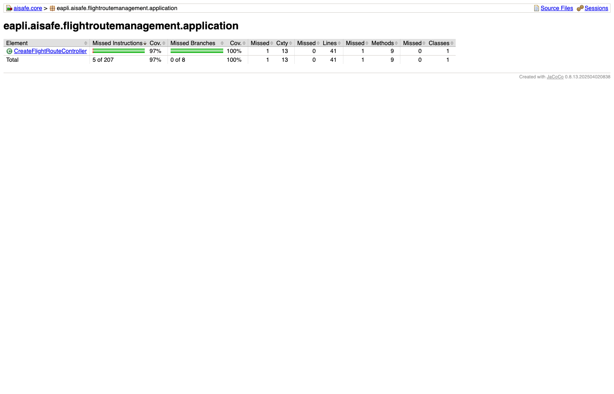
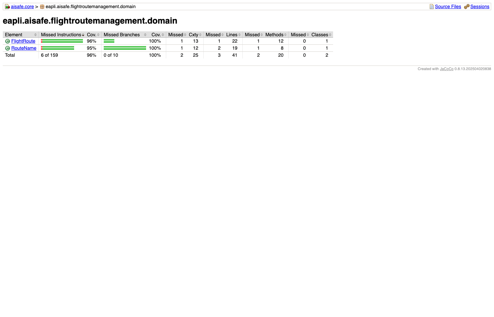
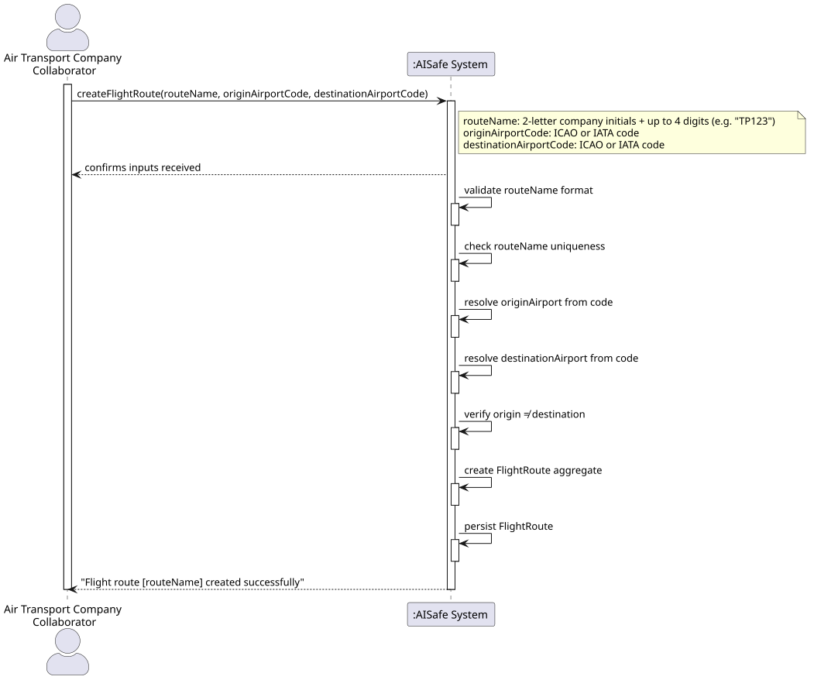
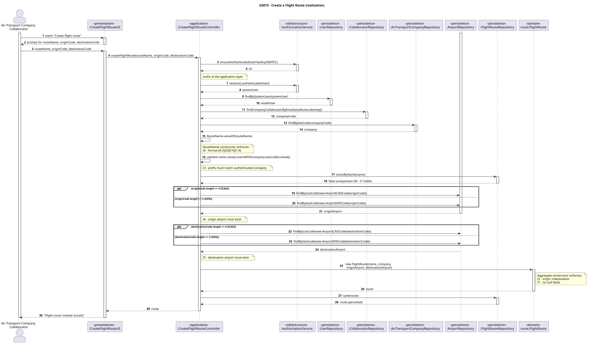
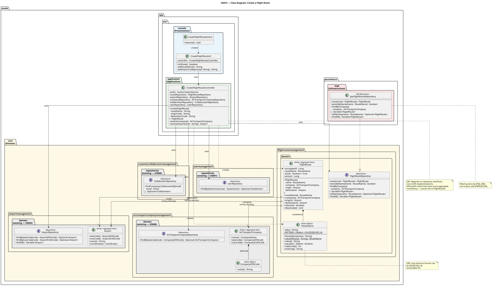

# US073 — Create a Flight Route

## Context

This is the first implementation of US073. It belongs to the Air Companies Configuration functional sub-domain, specifically the flight-route management area. It was developed in Sprint 3 and is owned by Air Transport Company Collaborators (ATCCs).

US073 sits at the centre of the flight-operation chain. Without a flight route, nothing downstream can work — no flight plans, no operations. It depends directly on US060 (company must exist) and US052 (airports must exist), and it unblocks US074 (delete a route) and US080 (create a flight plan).

The work covers analysis, design, full domain implementation, and tests for the creation use case, wired through the ATCC console.

## Requirements

**US073** — *"As an Air Transport Company Collaborator, I want to add a flight route for my company. A route is between two airports (start and end) and has a name with 2 letters (my company's initials) and up to 4 numbers (e.g. TP123). The route's name must be unique."*

**Acceptance Criteria:**

- US073.1 — An ATCC can create a flight route for their company.
- US073.2 — The route name consists of exactly 2 letters (the company's IATA initials) followed by 1 to 4 digits (e.g. `TP123`). No other format is accepted.
- US073.3 — The 2-letter prefix of the route name must match the authenticated ATCC's company IATA code.
- US073.4 — The route name is unique system-wide.
- US073.5 — A route connects exactly two distinct airports: an origin and a destination.
- US073.6 — The origin and destination airports must already be registered in the system.
- US073.7 — Origin and destination airports cannot be the same airport.
- US073.8 — Invalid inputs are rejected with clear error messages.

**Dependencies/References:**

Upstream prerequisites:
- US060 (Register an air transport company): company must exist to validate the IATA prefix and own the route.
- US052 (Create an airport): both airports must be registered before being referenced.

Downstream consumers:
- US074 (Delete a flight route): deactivates a route created here.
- US080 (Create a flight plan): a flight plan references an active `FlightRoute`.

---

## Analysis

### Actor and Console

The actor is the Air Transport Company Collaborator (ATCC). §3.1.3 of the requirements explicitly states that ATCCs are the ones responsible for registering flight routes. That made the choice of console straightforward — this use case lives in `aisafe.app.atcc.console`, consistent with every other ATCC-scoped user story.

### Requirement Source

Reading §3.2 of the requirements, a route is described as the persistent, reusable connection between two airports. A flight plan, by contrast, is an instantiation of that route for a specific operation. This distinction mattered a lot in my analysis: it confirmed that `FlightRoute` should be a long-lived aggregate, not a transient object — and that it needed its own identity (`RouteName`) to be referenced by downstream stories.

§3.1.3 also establishes that the company's IATA code (exactly 2 letters) is the mandatory prefix for the route name. This tied the `RouteName` format directly to the company that owns it — which shaped several of my design decisions below.

### Design Decisions

**Modelling `RouteName` as a Value Object** was the first and most important decision. The format — two uppercase letters followed by one to four digits — is a hard invariant. If I had kept the route name as a plain `String` and validated it only in the controller, any other code path (bootstrappers, tests, future features) could bypass that validation. By encoding the constraint in a VO constructor, I guarantee it holds everywhere with no duplication.

**Keeping the IATA prefix check in the controller, not in the VO.** I considered making `RouteName` aware of the company, but that would mean the VO depends on another aggregate (`AirTransportCompany`), which crosses a DDD boundary. The VO should only know its own format. The prefix-matches-company check is a cross-aggregate concern that belongs in the application layer — the controller has access to both and is the right place to enforce it.

**Airport references as cross-aggregate identities.** `FlightRoute` stores references to two `Airport` entities, but I chose not to embed airport data inside the route. Embedding would duplicate data and make the route stale whenever airport information changes. Instead, the route holds the airport identity (via `@ManyToOne`) and the controller verifies both exist before saving.

**Introducing the `active` flag upfront.** US074 will deactivate routes. Rather than wait and add the column in a later sprint (which would require a schema migration), I added the `active` boolean now, defaulting to `true`. This costs almost nothing and avoids a migration later.

### Invariants

Inside the aggregate (`FlightRoute` constructor):
- `routeName` is not null and matches `[A-Z]{2}[0-9]{1,4}` after upper-casing.
- `company`, `origin`, and `destination` are not null.
- `origin` ≠ `destination`.

At the application layer (controller):
- The route name prefix matches the authenticated company's IATA code.
- The route name is unique across the entire system.
- The referenced origin and destination airports exist.
- The authenticated user belongs to the owning company.

### Domain Model Excerpt

The diagram below shows the `FlightRoute` aggregate and its relationships to the external aggregates it references (`AirTransportCompany` and `Airport`). The external aggregates are shown in grey — they are not modified by this US, only referenced by identity.



The `FlightRoute` aggregate root holds:
- `RouteName` (VO) — 2-letter IATA prefix + 1–4 digits, system-unique.
- Cross-aggregate reference to `AirTransportCompany` (owning company).
- Cross-aggregate references to origin and destination `Airport` (by identity).
- `active` boolean — `true` on creation; set to `false` by US074.

### Coverage Analysis

| Acceptance Criterion | Test method |
|---|---|
| US073.1 — ATCC creates a route | `ensureFlightRouteAcceptsValidInput`, `ensureFlightRouteIsActiveOnCreation` |
| US073.2 — route name format enforced | `ensureRouteNameRejectsOneLetter`, `ensureRouteNameRejectsThreeLetters`, `ensureRouteNameRejectsNoDigits`, `ensureRouteNameRejectsFiveDigits`, `ensureRouteNameAcceptsSingleDigit`, `ensureRouteNameAcceptsFourDigits` |
| US073.3 — IATA prefix matches company | `ensureCreateFlightRouteRejectsWrongIataPrefix` |
| US073.4 — route name uniqueness | `ensureIdentityReturnsRouteName`, `ensureCreateFlightRouteRejectsDuplicateRouteName` |
| US073.5 — exactly two airports | `ensureFlightRouteAcceptsValidInput`, `ensureCreateFlightRouteHappyPathWithIataAirportCodes` |
| US073.6 — airports must exist | `ensureCreateFlightRouteRejectsUnknownOriginAirport`, `ensureCreateFlightRouteRejectsUnknownDestinationAirport` |
| US073.7 — origin ≠ destination | `ensureFlightRouteRejectsSameOriginDestination` |
| US073.8 — invalid inputs rejected | `ensureRouteNameRejectsNull`, `ensureRouteNameRejectsEmpty`, `ensureRouteNameRejectsDigitsBeforeLetters`, `ensureFlightRouteRejectsNullRouteName`, `ensureFlightRouteRejectsNullCompany`, `ensureFlightRouteRejectsNullOrigin`, `ensureFlightRouteRejectsNullDestination`, `ensureFlightRouteRejectsSameOriginDestination` |

### Test Coverage (NFR03)

NFR03 requires >=90% test coverage on the domain and controller packages. The figures below are the JaCoCo reports for the US073 domain package and controller class, captured after the final test additions. Domain: **96% instruction / 100% branch**. Controller: **97% instruction / 100% branch**.




---

## Design

### System Sequence Diagram (SSD)



### Sequence Diagram (SD)



### Class Diagram



### DDD Concepts Applied

| DDD Concept | Artifact | Where & How it is Applied |
|---|---|---|
| **Aggregate** | `FlightRoute` | Aggregate root identified by `RouteName`. Enforces all structural invariants (non-null fields, origin ≠ destination) inside its constructor. All access to a flight route goes through this class — no direct manipulation of its internals from outside. |
| **Entity** | `FlightRoute` | Has a unique, stable identity (`RouteName`) that persists over time. Two `FlightRoute` objects with the same `RouteName` are considered the same entity, regardless of other field values. |
| **Value Object** | `RouteName` | Immutable, no identity of its own — equality is by value. Normalises to upper-case and enforces `[A-Z]{2}[0-9]{1,4}` in the constructor. Any invalid string is rejected immediately, before it can ever reach the aggregate. |
| **Persistence Ignorance** | `FlightRoute`, `RouteName`, `FlightRouteRepository` | Domain classes are plain Java objects — no JDBC, JPA queries, or SQL. The `FlightRouteRepository` interface lives in `aisafe.core`. The JPA implementation lives in `aisafe.persistence.impl` — the domain never references it directly. |

---

## Tests

Domain invariant tests for `RouteName` and `FlightRoute`. All tests follow the `ensureXxxYyy` naming convention and are written in JUnit 4 style.

**Test classes:**
- `eapli.aisafe.flightroutemanagement.domain.RouteNameTest`
- `eapli.aisafe.flightroutemanagement.domain.FlightRouteTest`
- `eapli.aisafe.flightroutemanagement.application.CreateFlightRouteControllerTest`

### RouteNameTest

| Test | Refers to AC |
|---|---|
| `ensureRouteNameRejectsNull` | US073.2, US073.8 |
| `ensureRouteNameRejectsEmpty` | US073.2, US073.8 |
| `ensureRouteNameRejectsOneLetter` | US073.2, US073.8 |
| `ensureRouteNameRejectsThreeLetters` | US073.2, US073.8 |
| `ensureRouteNameRejectsNoDigits` | US073.2, US073.8 |
| `ensureRouteNameRejectsFiveDigits` | US073.2, US073.8 |
| `ensureRouteNameRejectsDigitsBeforeLetters` | US073.2, US073.8 |
| `ensureRouteNameAcceptsSingleDigit` | US073.2 |
| `ensureRouteNameAcceptsFourDigits` | US073.2 |
| `ensureRouteNameNormalisesToUpperCase` | US073.2 |
| `ensureRouteNameEqualsForSameValue` | — |
| `ensureRouteNameEqualsIsCaseInsensitive` | — |
| `ensureRouteNameNotEqualsForDifferentValue` | — |
| `ensureEqualsReturnsTrueForSameInstance` | — |
| `ensureEqualsReturnsFalseForNull` | — |
| `ensureEqualsReturnsFalseForDifferentType` | — |
| `ensureHashCodeConsistentForSameValue` | — |
| `ensureCompareToReturnsNegativeForLesser` | — |
| `ensureCompareToReturnsPositiveForGreater` | — |
| `ensureCompareToReturnsZeroForEqual` | — |
| `ensureToStringReturnsValue` | — |

### FlightRouteTest

| Test | Refers to AC |
|---|---|
| `ensureFlightRouteAcceptsValidInput` | US073.1, US073.5 |
| `ensureFlightRouteRejectsNullRouteName` | US073.8 |
| `ensureFlightRouteRejectsNullCompany` | US073.8 |
| `ensureFlightRouteRejectsNullOrigin` | US073.8 |
| `ensureFlightRouteRejectsNullDestination` | US073.8 |
| `ensureFlightRouteRejectsSameOriginDestination` | US073.7, US073.8 |
| `ensureFlightRouteIsActiveOnCreation` | US073.1 |
| `ensureIdentityReturnsRouteName` | US073.4 |
| `ensureFlightRouteEqualsForSameRouteName` | — |
| `ensureFlightRouteNotEqualsForDifferentRouteName` | — |
| `ensureFlightRouteSameAsForSameRouteName` | — |
| `ensureHashCodeConsistentForSameRouteName` | — |
| `ensureToStringContainsRouteName` | — |
| `ensureFlightRouteProtectedConstructorExistsForORM` | — |

### CreateFlightRouteControllerTest

Integration-style controller tests: the controller is wired with fake in-memory implementations of all five repositories. The authenticated ATCC user is set up in `@Before` via `AuthzTestHelper`, replicating the session state the real UI would produce.

| Test | Refers to AC |
|---|---|
| `ensureCreateFlightRouteHappyPathWithIataAirportCodes` | US073.1, US073.2, US073.5, US073.6 |
| `ensureCreateFlightRouteHappyPathWithIcaoAirportCodes` | US073.1, US073.2, US073.5, US073.6 |
| `ensureCreateFlightRouteRequiresAtccRole` | US073.1 |
| `ensureCreateFlightRouteRejectsInvalidRouteNameFormat` | US073.2, US073.8 |
| `ensureCreateFlightRouteRejectsWrongIataPrefix` | US073.3, US073.8 |
| `ensureCreateFlightRouteRejectsDuplicateRouteName` | US073.4, US073.8 |
| `ensureCreateFlightRouteRejectsUnknownOriginAirport` | US073.6, US073.8 |
| `ensureCreateFlightRouteRejectsUnknownDestinationAirport` | US073.6, US073.8 |
| `ensureCreateFlightRouteRejectsSameOriginAndDestination` | US073.7, US073.8 |
| `ensureCreateFlightRouteRejectsUnrecognisedAirportCodeLength` | US073.8 |
| `ensureCreateFlightRouteFailsWhenUserProfileNotFound` | — |
| `ensureCreateFlightRouteFailsWhenCollaboratorProfileNotFound` | — |
| `ensureCreateFlightRouteFailsWhenCompanyNotFound` | — |

---

## Implementation

Key implementation notes:

- `RouteName` calls `toUpperCase()` before applying the regex — `"tp123"` and `"TP123"` are treated as equal.
- Airport resolution in the controller uses code length: 4-char → try ICAO; 3-char → try IATA. This avoids an exception from `AirportIATACode`'s own validator when a 4-char code is passed.
- `RouteName` is mapped as `@EmbeddedId` — the route name column is the primary key.
- `@Version Long version` on `FlightRoute` provides optimistic locking.
- No bootstrap data is added — routes are company-specific and must be entered through the UI or a custom bootstrapper.

---

## Integration/Demonstration

Integration points:

- US073 depends on US052 through `AirportRepository` and the `Airport` aggregate — both origin and destination airports must be registered before a route can be created.
- US073 depends on US060 through `AirTransportCompanyRepository` and `CompanyIATACode` — the owning company must be registered and the authenticated ATCC must belong to it.
- US073 depends on US061 through the `CollaboratorRepository` — the controller resolves the company from the authenticated user's collaborator profile.
- US074 (Delete a flight route) sets `active = false` on routes created here.
- US080 (Create a flight plan) references an active `FlightRoute` created here.
- `RepositoryFactory.flightRoutes()` was added to both the in-memory and JPA factories. `FlightRoute` and `RouteName` were registered in `persistence.xml`.
- ATCCs can access the use case from the main menu: **Create Flight Route** (option 5).

To manually demonstrate the feature:

1. Run the bootstrap to load master data (`run-bootstrap`).
2. Launch the ATCC application (`run-atcc`).
3. Log in as an ATCC whose company is already registered.
4. Select **Create Flight Route** (option `5`).
5. Enter the route name — e.g. `TP123` (prefix must match your company's IATA code).
6. Enter the origin airport code (IATA: 3 chars, or ICAO: 4 chars).
7. Enter the destination airport code (different from origin).
8. The system confirms the route or reports the specific rejection reason.

The required bootstrap order is:

```
AirControlAreaBootstrapper
  └─► AirportBootstrapper          ← origin and destination airports must exist
AirTransportCompanyBootstrapper    ← owning company must exist
  └─► CollaboratorBootstrapper     ← ATCC user must be registered
```

---

## Observations

The requirement states *"2 letters (my company's initials)"* — in aviation practice these are the IATA airline designator codes (exactly 2 characters). The design anchors this to the `CompanyIATACode` value object already introduced in US060, keeping the model consistent with real-world aviation standards.

The route deactivation story (US074) may require a `deactivatedFrom` date field. This field was intentionally omitted from this aggregate to keep the scope minimal — it will be introduced by US074. The `active` boolean flag is included now (defaulting to `true`) to avoid a schema migration later.
