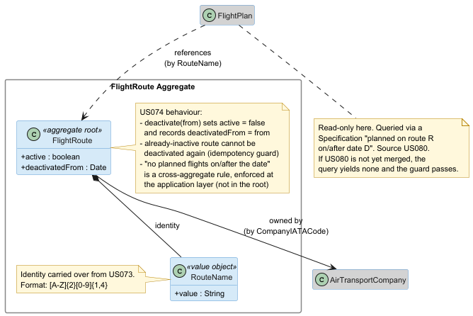
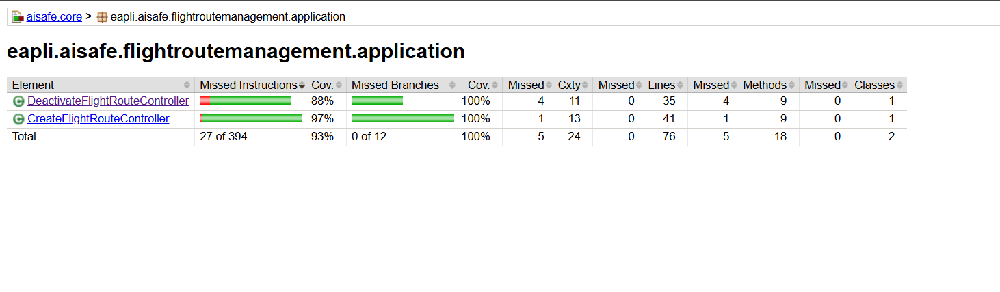
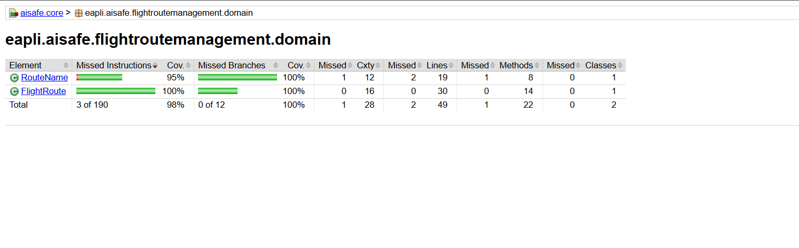
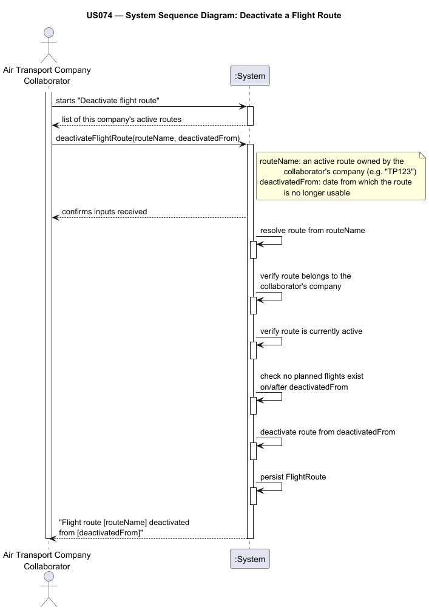
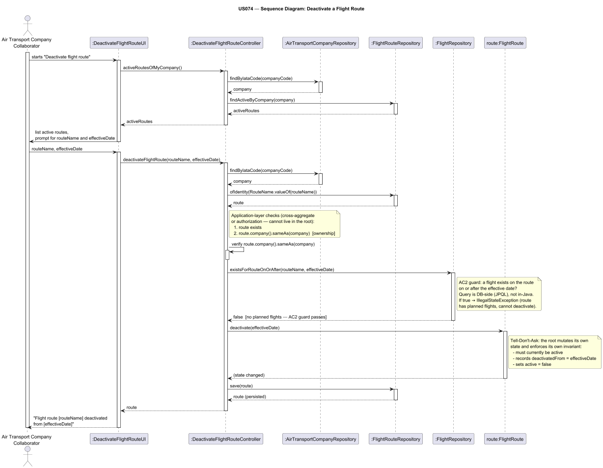
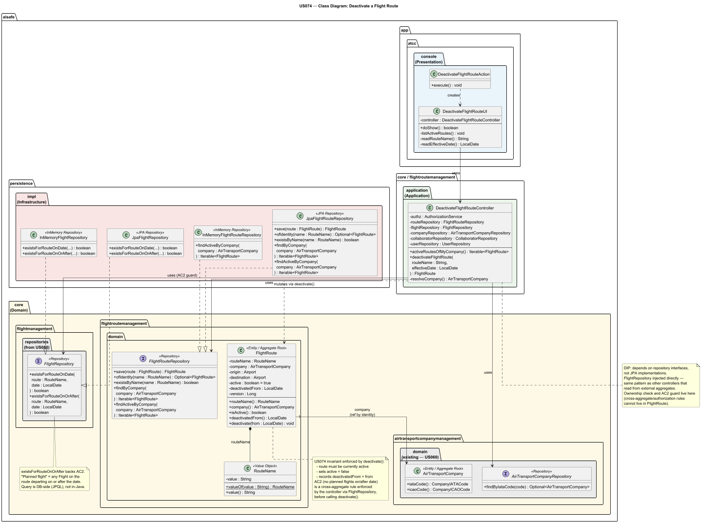

# US074 — Delete (Deactivate) a Flight Route

## Context

This is the first implementation of US074. It belongs to the Air Companies Configuration functional sub-domain, specifically the flight-route management area. It was developed in Sprint 3 and is owned by Air Transport Company Collaborators (ATCCs).

US074 is the lifecycle counterpart of US073: where US073 creates a flight route, US074 retires one. It sits directly downstream of US073 (the route must exist to be deactivated) and is directly related to US080 (a deactivated route cannot receive new flight plans from that date onwards).

The work covers analysis, design, full domain implementation, and tests for the deactivation use case, wired through the ATCC console.

## Requirements

**US074** — *"As an Air Transport Company Collaborator, I want to deactivate a flight route from a given date onwards. A route cannot be deactivated if there are planned flights after that date."*

**Acceptance Criteria:**

- US074.1 — An ATCC can deactivate a route as of a given effective date.
- US074.2 — Deactivation fails if there are planned flights on the route on or after that date.
- US074.3 — After deactivation, no new flights can be created on the route from that date onwards.
- US074.4 — Historical flights (before the date) remain unaffected.

**Definition of Done:**

- Deactivate-route UC implemented end-to-end.
- Both invariants (planned-flight check, future-flight prevention) enforced.
- Tests cover successful deactivation, deactivation with future flights, and post-deactivation creation attempts.
- Coverage ≥ 90% on controller/domain.

**Dependencies/References:**

Upstream prerequisites:
- US073 (Create a flight route): the route aggregate, `RouteName` identity, and the `active` boolean are all introduced there. US073 deliberately added the `active` flag in advance to avoid a schema migration in this US.
- US060 (Register an air transport company): used to resolve the authenticated ATCC's company for the ownership check.

Downstream consumers:
- US080 (Create a flight plan): must check `route.isActive()` / `route.deactivatedFrom()` before allowing a new flight; this US exposes those values.

---

## Analysis

### Actor and Console

The actor is the Air Transport Company Collaborator (ATCC). §3.1.3 of the requirements assigns flight-route management to ATCCs, and US073 already placed creation in `aisafe.app.atcc.console`. US074 lives in the same console for consistency, reusing the same authentication and company-resolution path.

### Requirement Source

§3.2 frames a route as a persistent, reusable connection between two airports — long-lived and referenced by downstream operations. That long-lived nature is exactly why the requirement asks for *deactivation from a date* rather than deletion: a route may have flown for years and be referenced by historical flights, so removing the row would corrupt that history. The phrase *"from a given date onwards"* tells us deactivation is time-scoped: the route stays valid for everything before the cutoff and is closed for everything on or after it.

### Design Decisions

**Soft delete via `deactivate(LocalDate)`, not a `setActive(false)` setter.** The route owns its own lifecycle. Exposing a public setter for `active` would let any caller flip the flag, bypassing the "must currently be active" invariant and the recording of `deactivatedFrom`. Instead the aggregate gets a single intention-revealing command that mutates both fields together and rejects the call if the route is already inactive. This is the Tell-Don't-Ask principle and keeps the invariant in exactly one place (Information Expert).

**Adding `deactivatedFrom` in this US.** US073 introduced the `active` boolean up front (to avoid a migration) but left `deactivatedFrom` out, noting it belonged here. We add it as a nullable `LocalDate` that is `null` while the route is active and set to the cutoff when deactivated. `hbm2ddl.auto=update` adds the column automatically — no `persistence.xml` change needed.

**The "no planned flights on/after the date" rule lives at the application layer.** This rule (AC2) spans two aggregates — `FlightRoute` and `Flight` — so it cannot live inside the `FlightRoute` root without giving the root a dependency on flight management, which crosses a DDD boundary. The controller reads from `FlightRepository` directly before commanding `route.deactivate(...)`. This is the same pattern used by `CreateFlightRouteController`, which reads from `AirportRepository` before creating the route. The query is DB-side (JPQL `e.id.departureDate >= :date`) so filtering happens in the database, not in Java (NFR03/CO4).

**"Planned flight" means any future-scheduled flight.** A `Flight`'s identity is route + departure date. Any `Flight` on the route departing on or after the effective date would be orphaned by deactivation, so its existence blocks the operation regardless of its `FlightPlan` status. This is consistent with AC3: "no new flights from that date onwards" — a flight exactly on the cutoff would also be invalidated.

**Listing active routes first.** The UI first shows the company's still-active routes so the collaborator selects from a list rather than typing a raw name. This improves the demo and naturally scopes selection to owned, active routes — though the controller re-validates ownership and active-status server-side regardless of what the UI offered.

### Invariants

Inside the aggregate (`FlightRoute.deactivate(from)`):
- `from` is not null. — US074.1
- Route must currently be active (cannot deactivate twice). — implicit in DoD
- On success: `active` becomes `false` and `deactivatedFrom` is set to `from`. — US074.1

At the application layer (controller):
- The route identified by `routeName` exists.
- The route belongs to the authenticated ATCC's company (ownership).
- No `Flight` exists on the route with a departure date on or after `from`. — US074.2

### Domain Model Excerpt

The diagram below shows the `FlightRoute` aggregate with the two fields exercised by this US (`active`, `deactivatedFrom`) and its read-only relationship to the external `Flight` aggregate that the guard queries. External aggregates are shown in grey — they are referenced, not modified, by this US.



The `FlightRoute` aggregate root, as seen by US074:
- `RouteName` (VO) — identity, carried over from US073.
- `active` boolean — set to `false` by `deactivate(from)`.
- `deactivatedFrom` (LocalDate) — `null` while active; set to the effective date on deactivation.
- Cross-aggregate reference to `AirTransportCompany` for the ownership check.
- The AC2 guard reads `Flight` aggregate data through `FlightRepository` (application layer, not domain layer).

### Coverage Analysis

| Acceptance Criterion | Test method |
|---|---|
| US074.1 — deactivate as of a date, records date | `ensureDeactivateSetsInactiveAndRecordsTheDate`, `ensureDeactivateMarksRouteInactiveAndRecordsDate` |
| US074.2 — blocked by planned flights on/after date | `ensureDeactivateRejectedWhenFlightExistsOnEffectiveDate`, `ensureDeactivateRejectedWhenFlightExistsAfterEffectiveDate`, `ensureRouteStaysActiveWhenDeactivationBlockedByFlight` |
| US074.2 (boundary) — historical flight does NOT block | `ensureDeactivateSucceedsWhenFlightExistsStrictlyBeforeDate` |
| US074.3 — inactive route refuses new flights | enforced downstream in US080 via `isActive()` / `deactivatedFrom()` |
| US074.4 — historical flights unaffected | soft delete; no `Flight` rows are modified or removed |
| Guard: route must be active | `ensureDeactivateRejectsAlreadyInactiveRoute` |
| Guard: route must exist | `ensureDeactivateRejectsUnknownRoute` |
| Guard: ownership | `ensureDeactivateRejectsRouteOfAnotherCompany` |
| Guard: role | `ensureDeactivateRequiresAtccRole` |
| Listing | `ensureActiveRoutesExcludesInactiveOnes` |
| Domain: null date | `ensureDeactivateRejectsNullDate` |
| Domain: double deactivation | `ensureDeactivateRejectsAlreadyInactiveRoute` |
| Domain: no date on creation | `ensureRouteHasNoDeactivationDateOnCreation` |

### Test Coverage (NFR03)

NFR03 requires ≥ 90% test coverage on the domain and controller packages.




---

## Design

### System Sequence Diagram (SSD)



### Sequence Diagram (SD)



### Class Diagram



### DDD Concepts Applied

| DDD Concept | Artifact | Where & How it is Applied |
|---|---|---|
| **Aggregate** | `FlightRoute` | The deactivation lifecycle is owned by the root. `deactivate(from)` is the only way to retire a route; it mutates `active` and `deactivatedFrom` atomically and enforces the "must be active" invariant. No external code touches those fields directly. |
| **Entity** | `FlightRoute` | Same stable identity (`RouteName`) as US073; deactivation changes state, not identity. |
| **Value Object** | `RouteName` | Reused unchanged from US073 — immutable identity, equality by value. |
| **Persistence Ignorance** | `FlightRoute`, `FlightRouteRepository` | Domain stays plain Java; the `findActiveByCompany` contract lives in `aisafe.core`; the JPA implementation lives in `aisafe.persistence.impl`. |
| **Repository** | `FlightRouteRepository`, `FlightRepository` | Both are defined as interfaces in the domain layer. The controller depends on the interfaces; concrete implementations are injected at runtime (DIP). |

---

## Tests

All tests follow the `ensureXxxYyy` naming convention and are written in JUnit 4 style. Domain invariant tests run with no framework infrastructure; controller tests use `AuthzTestHelper` and fake in-memory repository implementations defined as private static inner classes.

**Test classes:**
- `eapli.aisafe.flightroutemanagement.domain.FlightRouteTest` (US074 tests added to existing class)
- `eapli.aisafe.flightroutemanagement.application.DeactivateFlightRouteControllerTest`

### FlightRouteTest — US074 additions

| Test | Refers to AC |
|---|---|
| `ensureRouteHasNoDeactivationDateOnCreation` | US074.1 |
| `ensureDeactivateSetsInactiveAndRecordsTheDate` | US074.1 |
| `ensureDeactivateRejectsNullDate` | DoD |
| `ensureDeactivateRejectsAlreadyInactiveRoute` | DoD |

### DeactivateFlightRouteControllerTest

The controller is wired with fake in-memory implementations of all five repositories plus a `FakeFlightRepository` that implements `existsForRouteOnOrAfter` with the same lambda logic as the production `InMemoryFlightRepository` — but defined as a private static inner class to avoid a cross-module import (`aisafe.core` tests cannot import `aisafe.persistence.impl`).

| Test | Refers to AC |
|---|---|
| `ensureDeactivateMarksRouteInactiveAndRecordsDate` | US074.1 |
| `ensureDeactivateSucceedsWhenFlightExistsStrictlyBeforeDate` | US074.2 (boundary) |
| `ensureDeactivateRejectedWhenFlightExistsOnEffectiveDate` | US074.2 |
| `ensureDeactivateRejectedWhenFlightExistsAfterEffectiveDate` | US074.2 |
| `ensureRouteStaysActiveWhenDeactivationBlockedByFlight` | US074.2 |
| `ensureDeactivateRejectsUnknownRoute` | DoD |
| `ensureDeactivateRejectsAlreadyInactiveRoute` | DoD |
| `ensureDeactivateRejectsRouteOfAnotherCompany` | DoD (ownership) |
| `ensureDeactivateRequiresAtccRole` | DoD (authorization) |
| `ensureActiveRoutesExcludesInactiveOnes` | US074.1 |

---

## Implementation

Key implementation notes:

- `FlightRoute.deactivate(LocalDate from)` uses `Preconditions.noneNull(from)` and throws `IllegalStateException` if already inactive — single command, single mutation point, no setter exposed.
- `deactivatedFrom` is mapped as `@Column(name = "deactivated_from")`, nullable. `hbm2ddl.auto=update` adds the column automatically on first run; no `persistence.xml` change was needed.
- `FlightRouteRepository.findActiveByCompany` is implemented in JPA as `e.company = :company AND e.active = true` (filtering done in the DB) and in-memory as a lambda predicate — consistent with the existing `findByCompany` pattern.
- `FlightRepository.existsForRouteOnOrAfter` is implemented in JPA as `e.id.routeName = :route AND e.id.departureDate >= :date` (filtering in the DB, NFR03/CO4) and in-memory using `matchOne` with a lambda over `f.departure().toLocalDate()`.
- The controller's `resolveCompany()` method is copied verbatim from `CreateFlightRouteController` — same auth chain (session → `UserRepository` → `CollaboratorRepository` → `AirTransportCompanyRepository`).
- The controller test uses a `FakeFlightRepository` defined as a private static inner class (not `InMemoryFlightRepository` from `aisafe.persistence.impl`, which is a different Maven module and cannot be imported from `aisafe.core` tests).

---

## Integration/Demonstration

Integration points:

- US074 depends on US073 through `FlightRouteRepository` — a route must exist and be active to be deactivated.
- US074 depends on US060 through `AirTransportCompanyRepository` and `CompanyIATACode` — the controller resolves the ATCC's company from the authenticated session.
- US074 depends on US061 through `CollaboratorRepository` — the company is resolved from the user's collaborator profile.
- US074 depends on US080 through `FlightRepository.existsForRouteOnOrAfter` — this is the AC2 guard. If US080 has not yet created any flights, the guard always passes (no planned flight can exist). Once US080 lands, the guard enforces automatically with no controller change required.
- US080 (Create a flight plan) must check `route.isActive()` and `route.deactivatedFrom()` before allowing a new flight — US074 exposes both accessors for that purpose (AC3).
- `RepositoryFactory.flights()` and `RepositoryFactory.flightRoutes()` were already present — no factory changes needed.
- `persistence.xml` required no change; `hbm2ddl.auto=update` adds the `deactivated_from` column automatically.
- ATCCs access the use case from the main menu: **Deactivate Flight Route** (option 7, after "Add Pilot").

To manually demonstrate the feature:

1. Run the bootstrap to load master data (`run-bootstrap`).
2. Launch the ATCC application (`run-atcc`).
3. Log in as an ATCC whose company has at least one active flight route.
4. Select **Deactivate Flight Route** (option `7`).
5. The system lists the company's currently active routes.
6. Enter the route name to deactivate (e.g. `TP123`).
7. Enter the effective date in `YYYY-MM-DD` format (e.g. `2026-07-01`).
8. If no planned flights exist on the route on or after that date, the system confirms deactivation and shows the route as inactive from the given date.
9. If planned flights do exist on or after the date, the system reports the rejection reason and the route remains active.

The required bootstrap order for the demo:

```
AirControlAreaBootstrapper
  └─► AirportBootstrapper
AirTransportCompanyBootstrapper
  └─► CollaboratorBootstrapper     ← ATCC user must be registered
        └─► FlightRouteBootstrapper (if bootstrapped)
```

---

## Observations

The requirement title uses the word *"delete"* but the body says *"deactivate from a given date onwards"*. This is a soft delete: the route row is never removed, so historical flights that reference it remain intact (AC4). US073 anticipated this by adding the `active` boolean upfront; this US adds the `deactivatedFrom` date.

The decision to use **on-or-after** (≥) rather than **strictly after** (>) for the planned-flight guard is deliberate and consistent with AC3 ("no new flights from that date onwards"). A flight scheduled exactly on the deactivation date would also be disallowed, so its existence must block the deactivation.

The AC2 guard (`FlightRepository.existsForRouteOnOrAfter`) references the `Flight` aggregate, which is owned by US080. While US080 is unmerged, no `Flight` rows exist and the guard always passes — logically correct, since if no flight can be created, none can conflict. When US080 merges, the guard enforces automatically with no change to US074's code.
