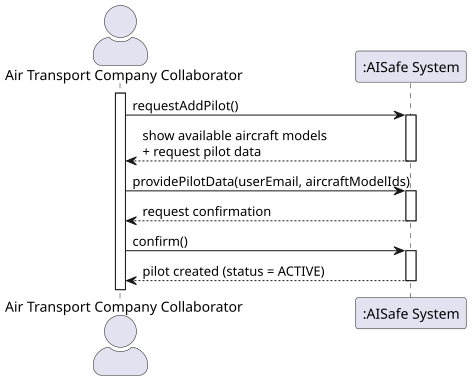
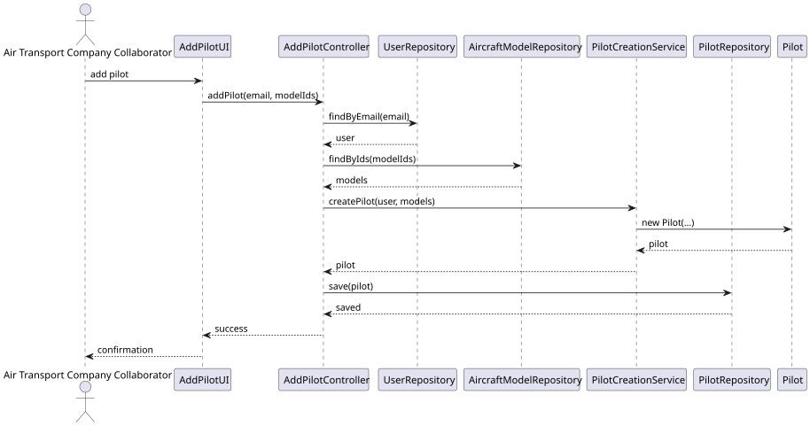
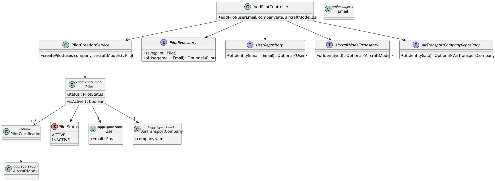

# US 075 - Add a pilot

## Context

This user story allows adding a Pilot to a company, linking a system user to an Air Transport Company and defining their aircraft model certifications.

## Requirements

**US 075**  
As an Air Transport Company Collaborator, I want to add a pilot to my company.  
A pilot is a system’s user. A pilot is certified to pilot one or more aircraft models.

**Acceptance Criteria:**

- US075.1 A collaborator can add a pilot.
- US075.2 A pilot must be associated with an existing system user.
- US075.3 A pilot must belong to exactly one Air Transport Company.
- US075.4 A pilot must be certified for at least one aircraft model.
- US075.5 A pilot is initially created with status ACTIVE.

**Definition of Done:**

- Add-pilot use case implemented end-to-end.
- Pilot aggregate created and persisted.
- Domain invariants enforced (company association, certifications, unique identity).
- Tests cover all invariants.
- Coverage ≥ 90% on controller/domain.

**Dependencies/References:**

- US030 - Authentication and authorization
- US031 - Register users
- US060 - Register an air transport company
- US055 - Create aircraft model

## Analysis

### Interpretation

This US allows an **Air Transport Company Collaborator** to create a `Pilot` within its company.

A pilot:

- Is linked to a **User** (identity)
- Belongs to exactly one **AirTransportCompany**
- Has one or more **certifications** (AircraftModel)

The SSD below illustrates the interaction.

### Pilot as an Aggregate

The `Pilot` is an **aggregate root**, as already defined in the domain model.

Responsibilities:

- Holds identity (via `User`)
- Maintains certifications
- Enforces business rules for pilot lifecycle

Key relationships:

- `Pilot → User`
- `Pilot → AirTransportCompany`
- `Pilot → AircraftModel (certifications)`

### Invariants

| #  | Invariant                                                     | Source      |
|----|---------------------------------------------------------------|-------------|
| I1 | A pilot must be associated with exactly one User.             | US075.2     |
| I2 | A pilot must belong to exactly one AirTransportCompany.       | US075.3     |
| I3 | A pilot must have at least one certification (AircraftModel). | US075.4     |
| I4 | A pilot must have role `PILOT` in the associated User.        | Domain rule |
| I5 | A user can be associated with at most one Pilot.              | Domain rule |
| I6 | A pilot is created with status `ACTIVE`.                      | US075.5     |

### Cross-Aggregate Validation

The following validations are performed **outside the aggregate**, at application level:

- The `User` must exist and have role `PILOT`.
- The `AircraftModel(s)` must exist.
- The `AirTransportCompany` must exist.

These are **preconditions**.

## Design

### Realization

This is a **single-aggregate creation use case**.

- `Pilot` is created and persisted.
- `User`, `AircraftModel` and `AirTransportCompany` are read-only.

### Responsibilities (GRASP)

- **`AddPilotController`**
    - GRASP Controller
    - Entry point of the use case
    - Resolves User, Company and AircraftModels
    - Delegates creation

- **`PilotCreationService`**
    - Domain Service
    - Validates cross-aggregate rules (I2, I3, I4)
    - Creates `Pilot`

- **`Pilot`**
    - Aggregate Root
    - Enforces invariant I6 (status = ACTIVE)
    - Maintains certifications

### Design Principles

- **High Cohesion**: Pilot encapsulates certification logic
- **Low Coupling**: Controller depends only on interfaces
- **Pure Fabrication**: `PilotCreationService` handles cross-aggregate rules
- **Dependency Inversion**: repositories injected

### Class Diagram

### Acceptance Tests

- `ensureAddPilotHappyPath`: Creates a pilot successfully (happy path) (US075.1, US075.2, US075.3, US075.4)
- `ensureRejectUserWithoutPilotRole`: Rejects user without PILOT role (I4)
- `ensureRejectPilotWithoutCertifications`: Rejects pilot without certifications (US075.4 (I3))
- `ensureRejectDuplicatePilotForUser`: Rejects duplicate pilot for same user (I5)
- `ensurePilotCreatedActive`: Pilot is created as ACTIVE (US075.5 (I6))

## Implementation

The implementation follows the design presented in Section 4 and respects the layered architecture of the system (presentation, application, domain, and persistence).

### Main Components

- **AddPilotAction**
  - Integrates the use case into the backoffice console menu.
  - Delegates execution to the UI layer.

- **AddPilotUI**
  - Handles user interaction through the console.
  - Displays available aircraft models.
  - Collects pilot email and certification data.
  - Confirms the operation before execution.

- **AddPilotController**
  - Acts as the entry point for the use case.
  - Ensures that the authenticated user has the required role.
  - Retrieves the company associated with the authenticated collaborator.
  - Validates input data and resolves domain objects.
  - Persists the newly created Pilot.

- **Pilot (Aggregate Root)**
  - Represents a pilot within the system.
  - Enforces invariants such as:
    - mandatory certifications
    - immutable certification set
    - default status ACTIVE

- **PilotRepository**
  - Provides persistence operations for Pilot entities.
  - Implemented using both in-memory and JPA strategies.

### Persistence

- Uses JPA entities for domain persistence.
- InMemory repositories are used for testing purposes.
- Pilot certifications are stored using a join table.

### Tests

- **PilotTest**
  - Validates domain invariants (certifications, immutability, status).

- **AddPilotControllerTest**
  - Covers end-to-end behaviour of the use case.
  - Includes:
    - successful creation
    - invalid user scenarios
    - authorization checks
    - missing data scenarios

## Integration/Demonstration

This use case integrates with several previously implemented features:

### Dependencies Integration

- **User Management (US031)**
  - Ensures that the pilot is linked to an existing system user.

- **Authentication (US030)**
  - Validates that only authenticated Air Transport Company Collaborators can execute the use case.

- **Aircraft Model Management (US055)**
  - Provides the list of available aircraft models for pilot certifications.

- **Air Transport Company Management (US060)**
  - Associates the pilot with the company of the authenticated collaborator.

### Demonstration Steps

1. Run the `backoffice.console` application.
2. Log in as an **Air Transport Company Collaborator**.
3. Navigate to the option **"Add Pilot"**.
4. Input:
  - Pilot email (associated with a user with role `PILOT`)
  - Aircraft model IDs (comma-separated)
5. Confirm the operation.
6. The system returns a success message indicating the pilot was created.

### Expected Results

- A new Pilot entity is created with:
  - status `ACTIVE`
  - association to the collaborator's company
  - selected aircraft model certifications

- Validation errors are displayed in case of invalid input or missing data.

## Observations

### Development Notes

- The Pilot aggregate design follows DDD principles, encapsulating domain rules such as certification requirements and lifecycle state.
- Cross-aggregate validation is handled in the application layer (controller), ensuring separation of concerns.

### Limitations

- The current implementation associates the Pilot with a company using its IATA code instead of a full entity reference, trading off domain richness for simplicity.
- Validation logic is partially handled in the controller instead of a dedicated domain service.

### Possible Improvements

- Introduce a `PilotCreationService` to centralize domain validation logic and improve adherence to DDD principles.
- Refactor the Pilot aggregate to reference `User` and `AirTransportCompany` entities directly instead of identifiers.
- Improve UI feedback with more descriptive success and error messages.

### Lessons Learned

- Proper validation ordering in controllers is crucial to ensure correct behaviour and passing of all test scenarios.
- Integration tests using in-memory repositories provide strong confidence in use case correctness.
- Maintaining consistency between design artifacts (DDD model) and implementation is essential to avoid technical debt.

### External References

- EAPLI framework documentation (for repository and controller patterns)
- JPA/Hibernate documentation (for entity persistence and relationships)
