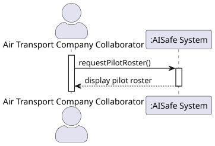
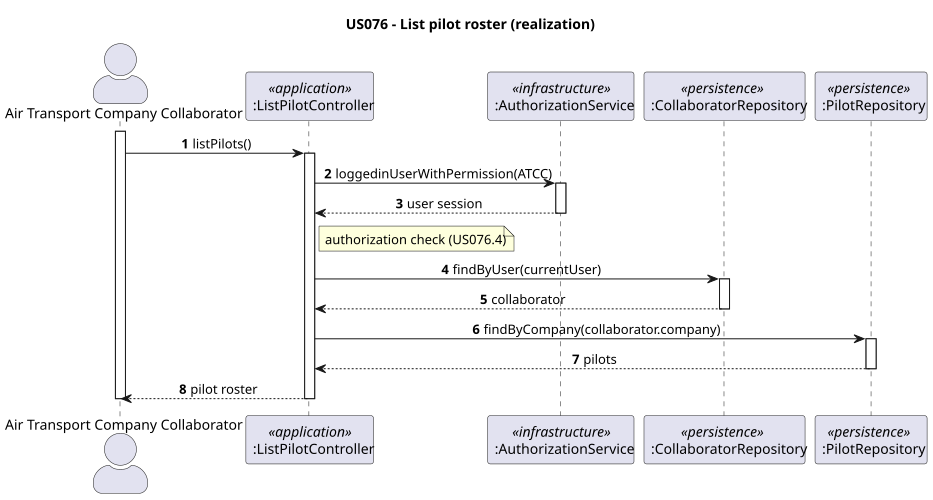
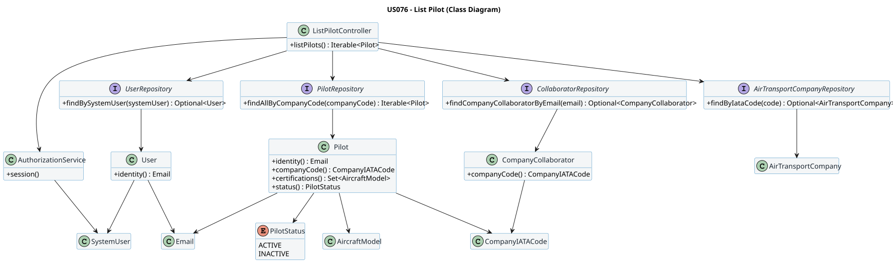

# US 076 - List pilot roster

## Context

This user story allows an Air Transport Company Collaborator to view the list of pilots (roster) associated with their company, including relevant information such as certifications and status.

## Requirements

**US 076**  
As an Air Transport Company Collaborator, I want to list my company’s pilot roster so that I can view all pilots associated with my company.

**Acceptance Criteria:**

- US076.1 A collaborator can list pilots belonging to their company.
- US076.2 Only pilots associated with the collaborator’s company must be displayed.
- US076.3 The list must include relevant pilot information (email, certifications, status).
- US076.4 The system must ensure that only authorized users can access this functionality.

**Definition of Done:**

- Pilot listing use case implemented end-to-end.
- Only company-specific pilots are returned.
- Output includes pilot identity, certifications and status.
- Authorization rules enforced.
- Tests validate correct filtering and access control.

**Dependencies/References:**

- US075 - Add a pilot
- US030 - Authentication and authorization

## Analysis

### Interpretation 

This user story allows an **Air Transport Company Collaborator** to retrieve a list of all pilots belonging to their company.

The system:

- Identifies the company of the authenticated collaborator
- Retrieves all pilots associated with that company
- Displays relevant information

### Domain Considerations

- The `Pilot` aggregate is reused.
- No new aggregate is introduced.
- The main concern is filtering pilots by company.

### Query Responsibility

This is a **read-only use case**.

- No domain invariants are created or modified.
- No aggregates are created or changed.
- Only retrieval and presentation of data.

### Preconditions

- The user must be authenticated.
- The user must have the role `AIR_TRANSPORT_COMPANY_COLLABORATOR`.

### Constraints

- Only pilots belonging to the collaborator’s company must be returned.
- No modifications to pilot data are allowed.
- The system must ensure that user identity is always used to determine company context.

### Risks and Complexity

- Incorrect filtering may expose pilots from other companies.
- Incorrect association between collaborator and company may lead to inconsistent results.
- This use case depends on correct user authentication and company linkage.
  

## Design

### Realization

This is a **query use case**.

- The collaborator requests the list of pilots
- The system verifies authorization
- The controller retrieves the collaborator's company
- The `PilotRepository` returns pilots filtered by company
- The resulting list is presented to the user

Unlike modification use cases, this flow does not involve domain state changes and does not require domain services.

### Responsibilities (GRASP)

- **`ListPilotController`**
  - Acts as GRASP Controller
  - Ensures authorization for the role `AIR_TRANSPORT_COMPANY_COLLABORATOR`
  - Retrieves the current collaborator from the authentication context
  - Coordinates the query and delegates to the repository

- **`PilotRepository`**
  - Responsible for retrieving pilots from persistence
  - Provides filtering capability through methods such as `findByCompany(...)`

- **`Pilot`**
  - Aggregate root
  - Encapsulates pilot data such as identity, certifications and status

- **`Collaborator`**
  - Provides access to the associated `AirTransportCompany`
  - Bridges user identity and company context

### Design Principles

- **Low Coupling** → Controller depends only on repository interfaces and not on implementation details
- **High Cohesion** → Each class has a clear and focused responsibility
- **Separation of Concerns** → UI handles display, controller handles application logic, repository handles data access, domain remains unchanged
- **Encapsulation** -> Pilot data is accessed through its aggregate, preserving domain integrity

### Data Flow and Filtering Strategy

Filtering is performed at the **repository level**.

- The authenticated user's identity is used to obtain the associated collaborator
- The collaborator provides the company context
- The repository query ensures that only pilots belonging to that company are retrieved

This approach:

- Ensures correctness (US076.2)
- Avoids retrieving unnecessary data
- Improves performance and scalability

### Class Diagram

### Acceptance Tests

- `ensureListPilotsReturnsOnlyCompanyPilots`: List pilots for company (happy path) (US076.1, US076.2)
- `ensureListPilotsRequiresAtccRole`: Only authorized users can access this functionality (US076.4)
- `ensureListPilotsReturnsEmptyWhenNoPilotsExist`: Empty list if no pilots (US076.2)
- `ensureListPilotsDoesNotReturnPilotsFromOtherCompanies`: Ignore pilots from other companies (US076.2)
