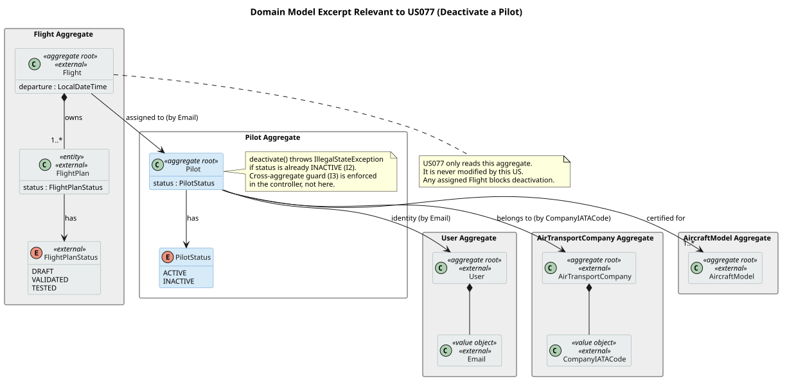
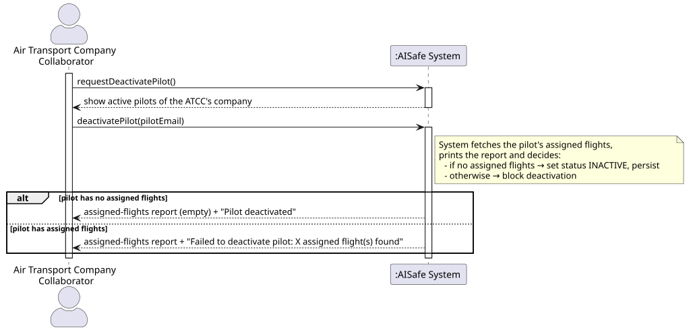
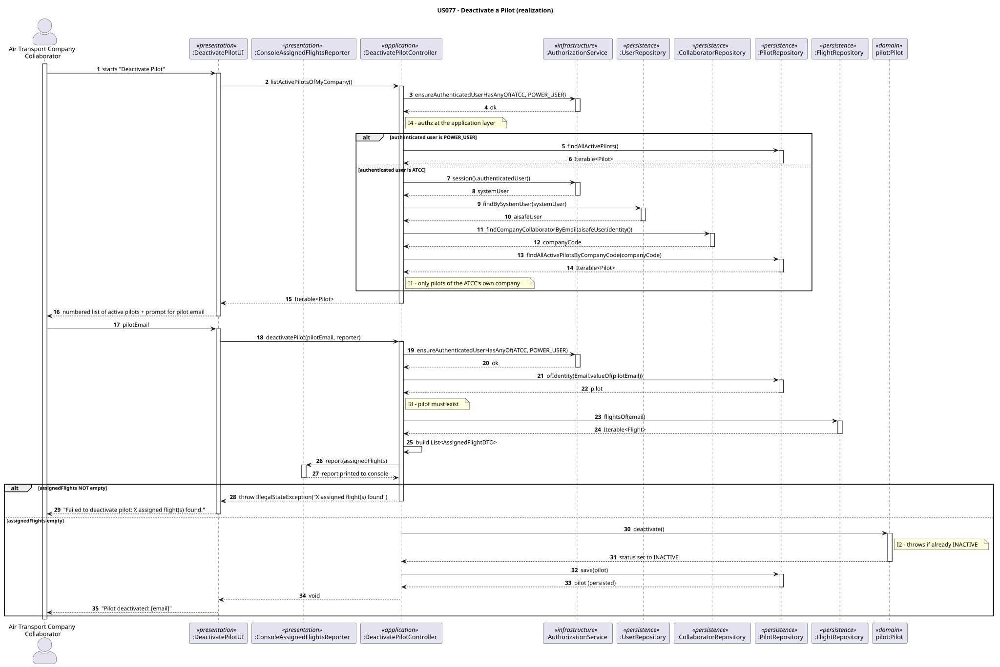
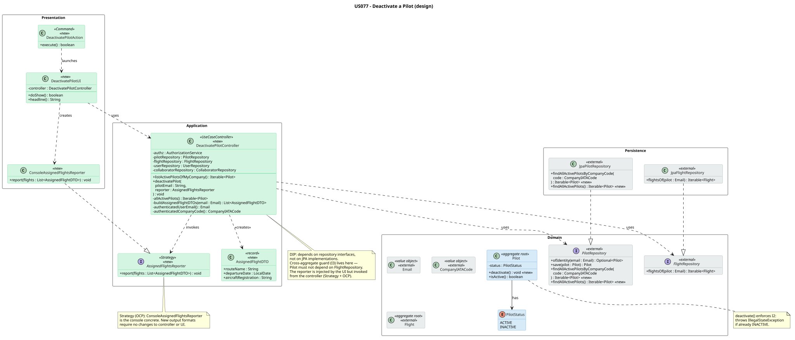
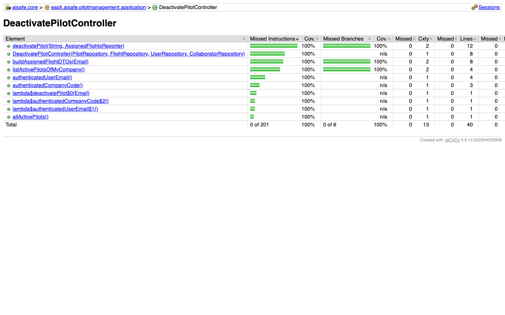
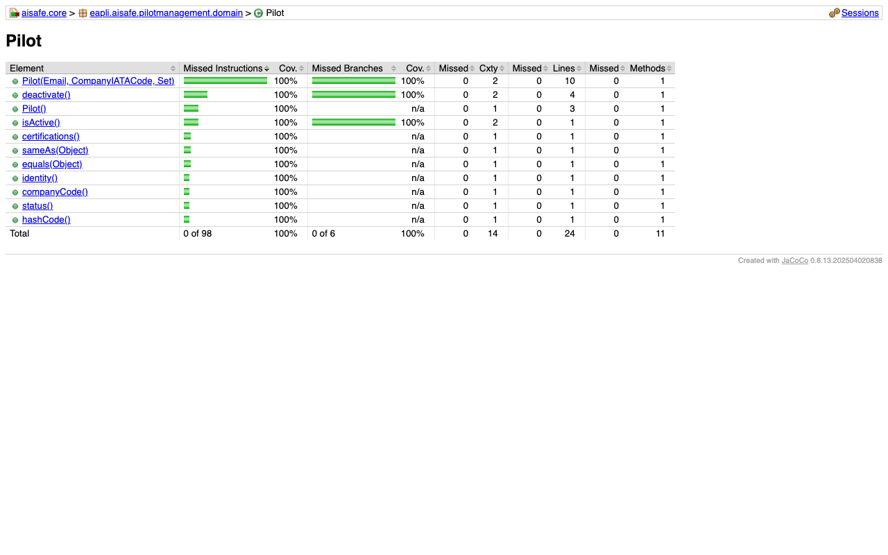

# US 077 - Remove a pilot

## Requirements

**US 077** As an Air Transport Company Collaborator, I want to make a pilot inactive in my company's roster. A pilot cannot be deactivated if they have flight plans assigned.

**Acceptance Criteria:**

- US077.1 ATCC can deactivate a pilot from their own company.
- US077.2 Deactivation fails if the pilot has flight plans assigned.
- US077.3 After deactivation, the pilot cannot be assigned to new flight plans.
- US077.4 Error messages clearly explain the failure reason.

**Definition of Done:**

- Remove-pilot UC implemented end-to-end.
- Invariant (no-flight-plans check) enforced.
- Tests cover successful deactivation and blocked deactivation.
- Coverage ≥ 90% on controller/domain.

**Dependencies/References:**

- US075 - Add a pilot
- US080 - Create a flight plan

## Analysis

### Actor and Console

The actor is the Air Transport Company Collaborator (ATCC). The use case lives in `aisafe.app.atcc.console`, consistent with every other ATCC-scoped user story including US075 (Add a Pilot).

### Pilot Identity in this Domain

A `Pilot` in this codebase is identified by **`Email`** (the pilot's system user email). The `Pilot` aggregate was introduced by US075 and uses `Email` as its `@EmbeddedId`. This shapes every layer: the UI selects a pilot by email from the active list, and the controller looks pilots up by `Email`.

### Cross-Aggregate Guard

The business rule "a pilot cannot be deactivated if they have assigned flights" is a **cross-aggregate** check. The `Flight` aggregate (introduced by US080) stores the pilot's `Email` as a cross-aggregate reference. To enforce the guard, the controller queries `FlightRepository.findByPilot(Email)`. If any `Flight` is returned, deactivation is blocked and the flights are reported to the ATCC.

The check is placed in the **controller** (application layer) rather than inside `Pilot.deactivate()`, because `Pilot` must not depend on `FlightRepository` — that would cross a DDD aggregate boundary from domain into infrastructure. The controller already has access to both repositories and is the correct place for cross-aggregate orchestration.

### CO7 Extra Feature — AssignedFlightsReporter

Before attempting deactivation, the system displays a report of every flight assigned to the selected pilot. This is implemented via a **Strategy interface** `AssignedFlightsReporter`:

```java
public interface AssignedFlightsReporter {
    void report(List<AssignedFlightDTO> flights);
}
```

The concrete `ConsoleAssignedFlightsReporter` prints a formatted table to stdout. The `DeactivatePilotUI` holds a reference to the interface — it never depends on the console implementation directly — satisfying OCP and enabling alternative output strategies without changing the UI or controller.

### Invariants

| ID | Invariant | Enforced by |
|---|---|---|
| I1 | Pilot belongs to the ATCC's own company | Controller |
| I2 | Pilot must be ACTIVE to be deactivated | `Pilot.deactivate()` |
| I3 | No assigned flights with active plans | Controller (cross-aggregate) |
| I4 | Authenticated user must have role ATCC | Controller (`authz.ensureAuthenticatedUserHasAnyOf`) |

### Domain Model Excerpt



The `Pilot` aggregate root holds:
- `PilotStatus` — ACTIVE or INACTIVE.
- Cross-aggregate reference to `User` (by `Email` identity).
- Cross-aggregate reference to `AirTransportCompany` (by `CompanyIATACode`).
- Cross-aggregate references to `AircraftModel` (certifications).

`Email` is owned by the `User` aggregate; `CompanyIATACode` is owned by the `AirTransportCompany` aggregate. The `Pilot` aggregate stores the identifying value objects only as references — it never embeds the foreign aggregates.

The `Flight` aggregate root holds:
- `FlightId` (identity: route + date).
- Cross-aggregate reference to `Pilot` (by `Email` identity — the pilot's `User`).
- `List<FlightPlan>` — each with a `FlightPlanStatus` (DRAFT, VALIDATED, TESTED).

US077 only **reads** `Flight`; it never modifies the Flight aggregate.

### System Sequence Diagram (SSD)



## Design

### Sequence Diagram (SD)



### Class Diagram



### DDD Concepts Applied

| DDD Concept | Artifact | Where & How |
|---|---|---|
| **Aggregate** | `Pilot` | Aggregate root identified by `Email`. `deactivate()` enforces invariant I2 (must be ACTIVE) inside the domain object itself. |
| **Value Object** | `Email`, `CompanyIATACode` | Immutable, equality by value. `Flight` references the pilot by `Email` identity only — no embedding of the Pilot aggregate inside Flight. |
| **Repository** | `PilotRepository`, `FlightRepository` | Interfaces defined in `aisafe.core`; JPA implementations in `aisafe.persistence.impl`. The controller depends only on the interfaces (DIP). |
| **Application Service** | `DeactivatePilotController` | Orchestrates the full use case: auth → list → load flights → report → deactivate → save. Cross-aggregate guard lives here, not in the domain. |
| **Strategy** | `AssignedFlightsReporter` | Decouples report format from the UI and controller. `ConsoleAssignedFlightsReporter` is the console implementation; alternative outputs (HTML, JSON) require no changes to the controller or UI. |
| **Persistence Ignorance** | `Pilot`, `Flight`, repository interfaces | Domain classes are plain Java objects. No JDBC or JPQL inside the domain. |

### Acceptance Tests

Tests follow JUnit 4 style, the `ensure{Subject}{Verb}` naming convention, and no mocking framework. All controller tests use inner static in-memory fakes (no Mockito); the domain tests instantiate `Pilot` directly.

- `ensureDeactivatePilotHappyPath`: An ACTIVE pilot with no assigned flights is successfully deactivated. (US077.1, I2, I4)
- `ensureDeactivatePilotIsBlockedWhenAssignedFlightsExist`: Deactivation is blocked and the assigned flights are reported when the pilot has flights. (US077.2, I3)
- `ensureDeactivatePilotWithFlightsReportsBeforeThrowing`: The reporter is called with the flight data before the exception is thrown. (US077.2, I3)
- `ensureDeactivateAlreadyInactivePilotThrows`: Deactivating an already inactive pilot throws `IllegalStateException`. (I2)
- `ensureDeactivatePilotRequiresAtccRole`: A non-ATCC user cannot deactivate a pilot. (I4)
- `ensureListActivePilotsOnlyReturnsActiveOnesForMyCompany`: `listActivePilotsOfMyCompany` only returns ACTIVE pilots for the authenticated user's company. (US077.1, I1)
- `ensureDeactivateUnknownPilotThrows`: Deactivating an unknown pilot throws `IllegalArgumentException`.

### Test Coverage (NFR03)

NFR03 requires >=90% test coverage on the domain and controller packages. The figures below are the JaCoCo reports for the US077 domain package and controller class, captured after the final test additions. Domain (`Pilot`): **100% instruction / 100% branch**. Controller (`DeactivatePilotController`): **100% instruction / 100% branch**.




## Implementation

The implementation was developed incrementally in strict TDD (RED → GREEN per class).

The first increment adds `Pilot.deactivate()` and `Pilot.isActive()` to the domain: failing tests are committed first (RED), then the method is added and all tests pass (GREEN). The `PilotStatus` enum (`ACTIVE` / `INACTIVE`) was already present from US075.

The second increment extends `PilotRepository` with `findAllActivePilotsByCompanyCode`, updates `InMemoryPilotRepository` and `JpaPilotRepository` in `aisafe.persistence.impl`, and adds the new method to the in-memory fakes already used by `AddPilotControllerTest` and `CreateFlightControllerTest`.

The third increment introduces the `AssignedFlightDTO` record and `AssignedFlightsReporter` interface in `eapli.aisafe.pilotmanagement.application`, followed by the `DeactivatePilotController` (RED test committed first, GREEN implementation second).

The fourth increment adds the presentation layer to `aisafe.app.atcc.console`: `ConsoleAssignedFlightsReporter`, `DeactivatePilotUI`, `DeactivatePilotAction`, and the `MainMenu` entry. No unit tests for UI classes (console I/O dependency).

## Integration/Demonstration

US077 integrates with US075 (Add a Pilot) and US080 (Create a Flight): it reuses the `Pilot` aggregate introduced by US075, and queries the `Flight` aggregate introduced by US080 via `FlightRepository.flightsOf(Email)`. No changes were made to either aggregate or their repositories beyond adding `findAllActivePilotsByCompanyCode` to `PilotRepository`.

The `Deactivate Pilot` menu entry appears on the ATCC console alongside `Add Pilot`, under the same `AIR_TRANSPORT_COMPANY_COLLABORATOR` role guard.

To demonstrate the functionality:

1. Run `eapli.aisafe.app.bootstrap.AisafeBootstrap` once to initialise the schema.
2. Run `eapli.aisafe.app.atcc.console.AtccApp` and log in as a company collaborator.
3. Choose `Add Pilot` to register at least one pilot with an email and an aircraft model certification.
4. Choose `Deactivate Pilot` — the active pilot list is shown.
5. Enter the pilot's email; the system prints any assigned flights and confirms deactivation.
6. Attempting to deactivate the same pilot again prints `Pilot is already inactive.`

## Observations

The `AssignedFlightsReporter` Strategy (CO7 extra feature) was introduced so that the display of assigned flights is decoupled from the controller and the console UI. The controller calls `reporter.report(dtos)` through the interface; `ConsoleAssignedFlightsReporter` is the console concrete. An alternative output — HTML table, JSON export, or a UI dialog — requires only a new implementation, leaving the controller and UI unchanged (OCP). The `AssignedFlightDTO` record carries only the fields needed for display (`routeName`, `departureDate`, `aircraftRegistration`), so neither the controller nor the reporter depend on the `Flight` domain class directly.

The cross-aggregate flight check is placed in `DeactivatePilotController` and not inside `Pilot.deactivate()`. Placing it in the domain would require `Pilot` to depend on `FlightRepository`, which would cross an aggregate boundary from the domain layer into infrastructure — a DDD violation. The controller already holds references to both repositories and is the correct orchestration point for cross-aggregate invariants.
