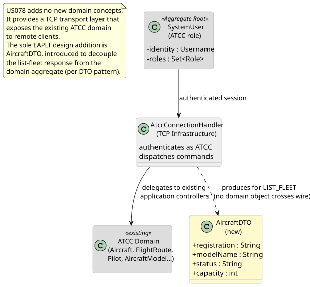
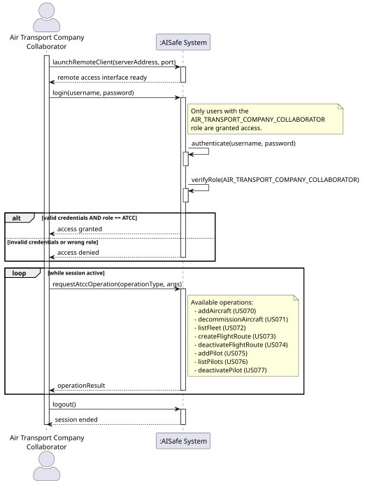
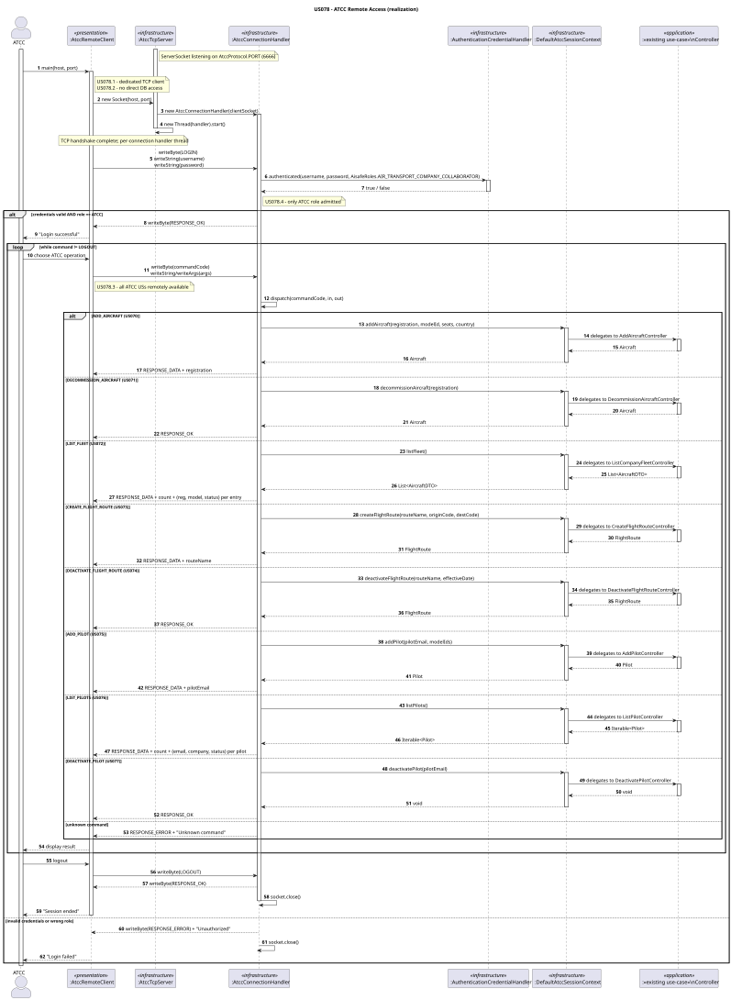
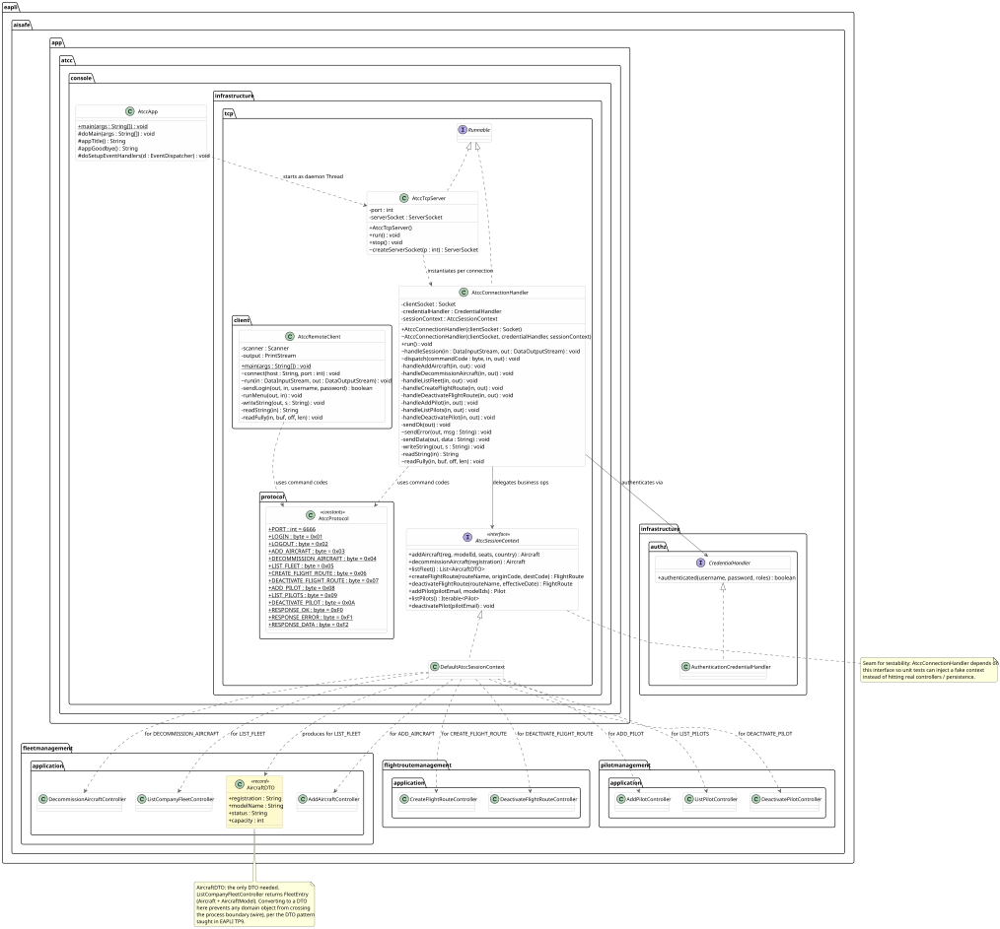
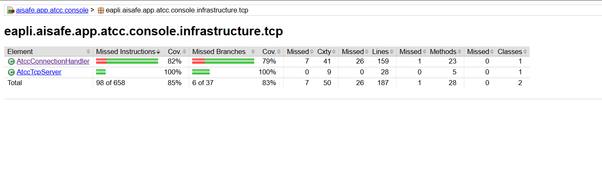
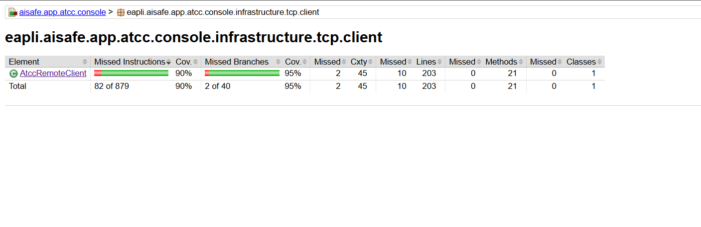

# US078 — ATCC Remote Access

## Context

This is the first implementation of US078. It belongs to the remote access functional area and was developed in Sprint 3. It is jointly owned by RCOMP (TCP/network layer) and EAPLI (application logic, DDD).

US078 adds no new domain concepts. Instead, it wraps the existing ATCC application layer behind a TCP transport, allowing an Air Transport Company Collaborator to operate remotely from a separate workstation without any direct database connection.

## Requirements

**US078** — *"As an Air Transport Company Collaborator, I want to remotely access the system using the Air Transport Company App."*

**Acceptance Criteria:**

- US078.1 — A specific TCP-based network client application is required to communicate with the server.
- US078.2 — Client interaction is limited to the TCP connection; no direct database access from the client.
- US078.3 — All ATCC user stories (US070–US077) are available via this client.
- US078.4 — Authentication and authorization are enforced server-side; only users with the `AIR_TRANSPORT_COMPANY_COLLABORATOR` role are admitted.

**Dependencies/References:**

Upstream prerequisites:
- US030 (Authentication and Authorization): the credential-checking infrastructure must exist.
- US070–US077: all ATCC application controllers must be implemented before they can be exposed remotely.
- US073 (Create a flight route) and US074 (Deactivate a flight route): the flight-route controllers are the ones developed in this sprint.

---

## Analysis

### Actor and Module Placement

The actor is the Air Transport Company Collaborator (ATCC). The TCP server runs embedded inside the `AtccApp` JVM (same process as the local ATCC console UI), listening on port **6666** — chosen to avoid conflicts with the Pilot server (5555) and Weather server. The TCP client is a standalone runnable that lives in `aisafe.app.atcc.console`, under `infrastructure.tcp.client`, keeping all ATCC-related code in one module without introducing a new Maven artifact.

### Requirement Source

§3.1.3 of the requirements defines that ATCCs manage aircraft, flight routes, and pilots for their company. §3.1 (use cases) groups all ATCC operations (US070–US077) under "Air Companies Configuration". The AC2 constraint ("no direct interaction with the database") means the client must hold no JPA or persistence dependency — all data access happens server-side through the existing controllers, which already enforce both authentication and company-scoped authorization.

The AC4 constraint (authentication and authorization enforced) mirrors the role check already in every ATCC controller (`authz.ensureAuthenticatedUserHasAnyOf(AisafeRoles.AIR_TRANSPORT_COMPANY_COLLABORATOR)`). Over TCP, this means credentials and role are verified before the handler enters the command loop, and every controller call runs under the authenticated session established at login.

### Design Decisions

**Thread-per-connection model.** Each accepted TCP connection spawns a dedicated `AtccConnectionHandler` thread. This is the same model as the Pilot and Weather servers — simple, correct for low concurrency, and each handler holds its own session state without shared mutable state between connections.

**Length-prefixed strings over the wire.** Every string is sent as a 2-byte unsigned length followed by the UTF-8 bytes. `readFully` guarantees all bytes are received before processing, preventing partial-read bugs on slow or lossy connections. This protocol is identical to US086 and US044, keeping the wire format consistent across all remote services.

**No domain objects cross the wire.** The client and server exchange only primitives and strings. Domain aggregates (`Aircraft`, `FlightRoute`, `Pilot`, `AircraftModel`) are never serialised — the server extracts the relevant fields and sends them as formatted strings. This keeps the client dependency-free and prevents accidental coupling to domain internals. This is the key EAPLI design point: the TCP transport layer is the new "presentation layer," and the DTO pattern from EAPLI TP9 applies precisely here.

**AircraftDTO as the one explicit DTO.** `ListCompanyFleetController.listFleet()` returns `List<FleetEntry>` (a record bundling `Aircraft` + `AircraftModel`). Converting this to a simple `AircraftDTO` (registration, modelName, status, capacity) keeps the handler's serialisation code clean and prevents any domain record from crossing the wire. For all other commands the response is a single string identifier (registration, routeName, pilotEmail) or a plain OK, so no additional DTO class is needed.

**Authentication before command loop.** The very first message in every session must be LOGIN. If authentication fails or the user does not carry the `AIR_TRANSPORT_COMPANY_COLLABORATOR` role, the server sends RESPONSE_ERROR and closes the socket. There is no way to reach any ATCC command without a valid authenticated session.

**Seats encoding over the wire.** `AddAircraftController.addAircraft` takes `Map<SeatClass, Integer>` seats. Over the wire these are sent as three unsigned shorts: economy count, business count, first-class count — matching the three `SeatClass` enum values in declaration order. The server reconstructs the map before calling the controller.

**DeactivatePilot and AssignedFlightsReporter.** `DeactivatePilotController.deactivatePilot` takes an `AssignedFlightsReporter` callback. For the TCP handler a capturing no-op reporter is passed; if it receives any flights it serialises them into the error message returned to the client ("Pilot has N assigned flight(s): …"), making the refusal reason visible remotely.

### Invariants

Server-side, enforced in `AtccConnectionHandler`:
- The first and only accepted command before authentication is LOGIN.
- After a failed login the socket is closed; no retry is offered.
- Only users with `AisafeRoles.AIR_TRANSPORT_COMPANY_COLLABORATOR` are admitted.
- Every command dispatched to a controller runs in the authenticated session context established at login time.
- All existing controller-level invariants (ownership checks, business rules) are enforced exactly as in the local console — the TCP layer adds no new rules and bypasses none.

### Domain Model Excerpt

US078 introduces no new aggregate, entity, or value object. The diagram below shows how the TCP infrastructure layer relates to the existing ATCC domain, and identifies `AircraftDTO` as the one new class introduced for the list response.



### System Sequence Diagram



---

## Design

### System Sequence Diagram (SSD)

Already shown in §3.6.

### Sequence Diagram (SD)



### Class Diagram

The class diagram covers all new classes across the TCP infrastructure and presentation (client) layers, and shows the dependency relationships to the eight existing ATCC application controllers. `AircraftDTO` is shown in the fleet management application package where it is defined, with a note explaining why it is the only DTO needed.



### DDD Concepts Applied

| DDD Concept | Artifact | Where & How it is Applied |
|---|---|---|
| **Layered Architecture** | `infrastructure.tcp` packages | All TCP/network code is isolated in the infrastructure layer. The application controllers and domain layer are completely unaware that a TCP transport exists. |
| **Persistence Ignorance** | `AtccRemoteClient` | The TCP client has no JPA dependency and no access to the database. All data access happens server-side through the existing repositories — enforcing US078.2. |
| **Single Responsibility** | `AtccConnectionHandler` | Handles exactly one concern: managing the lifecycle of one TCP session (auth + command dispatch). It does not contain business logic — it delegates to the appropriate application-layer controller for each command. |
| **Dependency Inversion** | `CredentialHandler` interface | `AtccConnectionHandler` depends on the `CredentialHandler` interface, not on `AuthenticationCredentialHandler` directly, keeping the handler testable with a lambda stub. |
| **Open/Closed** | `AtccProtocol` + `dispatch()` | New ATCC command codes can be added to `AtccProtocol` and handled in `dispatch()` without modifying any existing controller or domain class. |
| **DTO** | `AircraftDTO` | `ListCompanyFleetController` returns `FleetEntry` (Aircraft + AircraftModel). Converting to `AircraftDTO` prevents domain objects from crossing the process boundary (the wire), decouples the client from domain internals, and isolates serialisation logic — per TP9. |

---

## Tests

Tests follow JUnit 4 style, the `ensure{Subject}{Verb}` naming convention, and no mocking framework. `AtccConnectionHandler` is tested by wiring it with a stub `CredentialHandler` and a stub `AtccSessionContext`, piping `ByteArrayInputStream`/`ByteArrayOutputStream` in place of a real socket — no network required.

**Test classes:**
- `eapli.aisafe.app.atcc.console.infrastructure.tcp.AtccConnectionHandlerTest`
- `eapli.aisafe.app.atcc.console.infrastructure.tcp.AtccTcpServerTest`
- `eapli.aisafe.app.atcc.console.infrastructure.tcp.client.AtccRemoteClientTest`

### Coverage Analysis

| Acceptance Criterion | Test method |
|---|---|
| US078.1 — dedicated TCP client | `ensureAtccRemoteClientIsStandaloneApplication` |
| US078.2 — no direct DB access | `ensureAtccRemoteClientHasNoPersistenceDependency` |
| US078.4 — valid ATCC credentials admitted | `ensureHandlerSendsResponseOkForValidAtccCredentials` |
| US078.4 — invalid credentials rejected | `ensureHandlerSendsResponseErrorForInvalidCredentials` |
| US078.4 — wrong role rejected | `ensureHandlerSendsResponseErrorForNonAtccRole` |
| US078.3 — ADD_AIRCRAFT dispatched | `ensureHandlerDispatchesAddAircraftCommand` |
| US078.3 — DECOMMISSION_AIRCRAFT dispatched | `ensureHandlerDispatchesDecommissionAircraftCommand` |
| US078.3 — LIST_FLEET dispatched | `ensureHandlerDispatchesListFleetCommand` |
| US078.3 — CREATE_FLIGHT_ROUTE dispatched | `ensureHandlerDispatchesCreateFlightRouteCommand` |
| US078.3 — DEACTIVATE_FLIGHT_ROUTE dispatched | `ensureHandlerDispatchesDeactivateFlightRouteCommand` |
| US078.3 — ADD_PILOT dispatched | `ensureHandlerDispatchesAddPilotCommand` |
| US078.3 — LIST_PILOTS dispatched | `ensureHandlerDispatchesListPilotsCommand` |
| US078.3 — DEACTIVATE_PILOT dispatched | `ensureHandlerDispatchesDeactivatePilotCommand` |
| Guard — first command must be LOGIN | `ensureHandlerRejectsNonLoginAsFirstCommand` |
| Guard — unknown command | `ensureHandlerSendsErrorForUnknownCommand` |

---

### JaCoCo Coverage Report

NFR03 requires ≥90% test coverage on the tested classes.

The two wiring classes — `AtccApp` (entry point) and `DefaultAtccSessionContext` (delegates everything to the application controllers through `PersistenceContext`) — are excluded from JaCoCo via `pom.xml`: they are infrastructure glue with no branching logic of their own, and unit tests would only re-test the underlying controllers.




---

## Implementation

The implementation is split across seven files in `aisafe.app.atcc.console`:

| File | Package | Role |
|---|---|---|
| `AtccProtocol.java` | `infrastructure.tcp.protocol` | Constants: port (6666), command codes (0x01–0x0A), response codes |
| `AtccTcpServer.java` | `infrastructure.tcp` | `ServerSocket` accept loop; spawns one handler thread per connection |
| `AtccConnectionHandler.java` | `infrastructure.tcp` | Per-session lifecycle: login → command loop → logout |
| `AtccSessionContext.java` | `infrastructure.tcp` | Strategy interface abstracting the eight ATCC application-layer operations |
| `DefaultAtccSessionContext.java` | `infrastructure.tcp` | Production wiring: builds each controller from `PersistenceContext` |
| `AtccRemoteClient.java` | `infrastructure.tcp.client` | Standalone CLI client: connects, authenticates, presents menu |
| `AircraftDTO.java` | `fleetmanagement.application` (core) | Record carrying the fields serialised over the wire for LIST_FLEET |

`AtccTcpServer` is started as a daemon thread inside `AtccApp.doMain()`, so it is alive for the lifetime of the application without blocking the local console UI. The package-private `createServerSocket(int)` factory method allows tests to substitute a controlled server socket.

`AtccConnectionHandler` uses two constructors: a public one (production) that wires `AuthenticationCredentialHandler` + `DefaultAtccSessionContext`, and a package-private one (tests) that accepts any `CredentialHandler` and any `AtccSessionContext` stub. The session method `handleSession`, `dispatch`, `sendError`, and `readFully` are all package-private, allowing unit tests to drive them with `ByteArray` streams — no real TCP socket needed.

`AtccRemoteClient` accepts a `Scanner` and a `PrintStream` via a package-private constructor so that menu and command tests can pipe stdin and capture stdout. The default public constructor wires it to `System.in`/`System.out` for the production CLI.

The wire format for every string: `[2-byte unsigned length][UTF-8 bytes]`. Seat counts are sent as three unsigned shorts (economy, business, first class). Pilot model IDs are sent as a short count followed by that many longs. Dates are sent as ISO strings (`yyyy-MM-dd`).

---

## Integration/Demonstration

### Starting the server

Run `AtccApp` normally. The TCP server starts automatically on port **6666** as a daemon thread alongside the local console UI.

```
[AtccTcpServer] listening on port 6666
```

### Connecting with the remote client

Run `AtccRemoteClient` from a separate terminal (or machine), passing the server address and port:

```
java -jar aisafe.app.atcc.console.jar localhost 6666
```

The client prompts for credentials:

```
  Connecting to localhost:6666 …
  Username: atcc@tap.pt
  Password: ********
  [ OK ] Login successful.
```

### Using the menu

```
  ┌────────────────────────────────────────┐
  │  ATCC REMOTE ACCESS                    │
  ├────────────────────────────────────────┤
  │  1. Add aircraft (US070)               │
  │  2. Decommission aircraft (US071)      │
  │  3. List fleet (US072)                 │
  │  4. Create flight route (US073)        │
  │  5. Deactivate flight route (US074)    │
  │  6. Add pilot (US075)                  │
  │  7. List pilots (US076)                │
  │  8. Deactivate pilot (US077)           │
  │  0. Logout                             │
  └────────────────────────────────────────┘
  Option:
```

Selecting an option prompts for the required arguments and prints the server's response (`[ OK ]`, `[ OK ] <data>`, or `[FAIL] <reason>`).

### Integration points

| US | Controller invoked server-side |
|---|---|
| US070 | `AddAircraftController.addAircraft` |
| US071 | `DecommissionAircraftController.decommissionAircraft` |
| US072 | `ListCompanyFleetController.listFleet` |
| US073 | `CreateFlightRouteController.createFlightRoute` |
| US074 | `DeactivateFlightRouteController.deactivateFlightRoute` |
| US075 | `AddPilotController.addPilot` |
| US076 | `ListPilotController.listPilots` |
| US077 | `DeactivatePilotController.deactivatePilot` |

### US090 (remote access logging)

Every login, logout, failed login, and abnormal disconnect is logged to the Remote Accesses Logging Server via the existing `RemoteAccessLogger` with service tag `"US78"`. This is identical to how US086 (Pilot) and US044 (Weather) report their events — no additional infrastructure is needed.

---

## Observations

- The thread-per-connection model is adequate for the expected low concurrency of an ATCC operations system. A thread pool could be introduced later without changing the handler.
- The binary protocol is intentionally minimal: only the operations required by US078.3 are exposed. Adding new commands requires only a new constant in `AtccProtocol` and a new case in `dispatch()`.
- Password transmission is in plain text over the TCP stream. For a production system, TLS (`SSLSocket`) should be used. This is out of scope for the current sprint.
- Port 6666 is chosen to avoid conflicts with the Pilot server (5555) and to leave room for Weather and other services on other ports. The port is a constant in `AtccProtocol` and configurable at startup.
- `AircraftDTO` is placed in `eapli.aisafe.fleetmanagement.application` (in `aisafe.core`) rather than in the TCP infrastructure package, so it is available to both the server-side `DefaultAtccSessionContext` and any future client that needs the same data shape. This is the same placement philosophy as `AssignedFlightDTO` in the pilot management application package.
