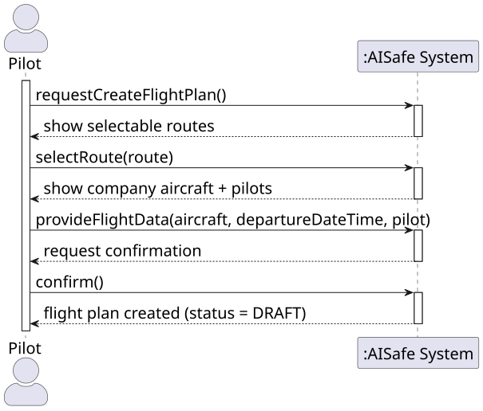
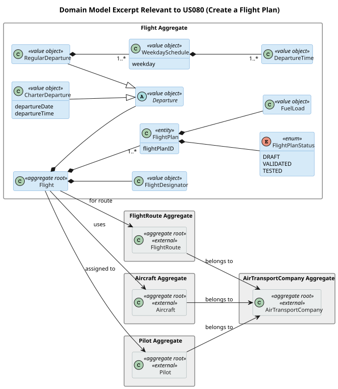
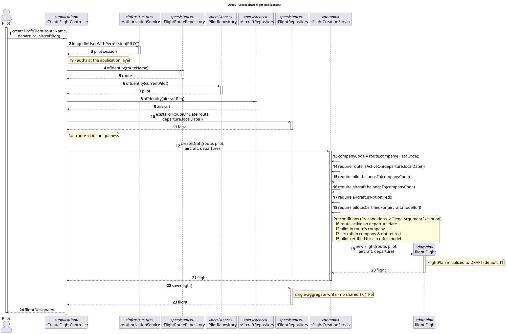
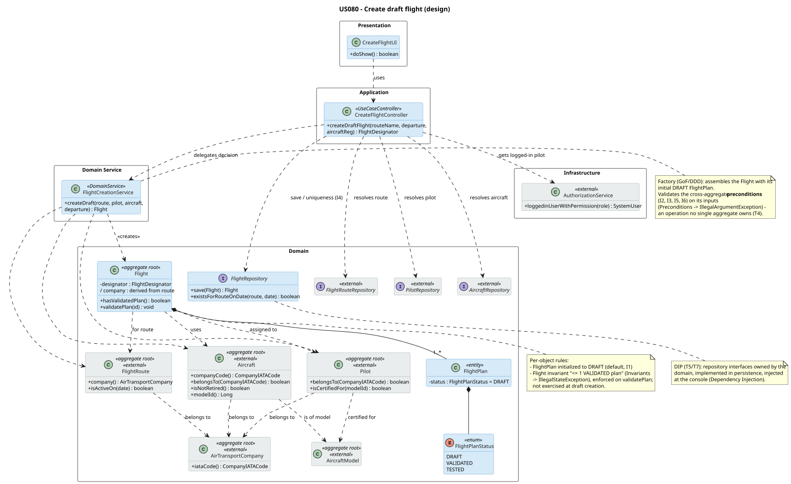
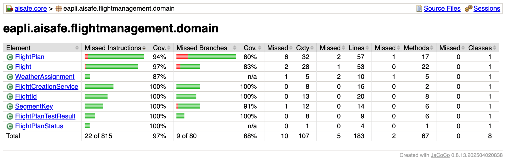
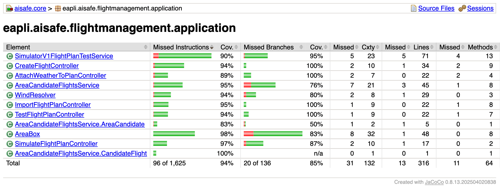

# US 080 - Create a flight plan

## Requirements

**US 080** As a Pilot, I want to register a flight plan for a route. I must add the aircraft, departure date/time, fuel quantity, and pilot. The pilot must belong to the route's company, and flight plan status is set to "draft" on creation.

**Acceptance Criteria:**

- US080.1 Pilot can create a flight plan for a route.
- US080.2 Flight plan references aircraft, departure date/time, fuel quantity, and pilot.
- US080.3 The pilot must belong to the route's owning company.
- US080.4 The aircraft must belong to the route's company and must not be decommissioned.
- US080.5 New flight plans have status "draft".
- US080.6 A route cannot have more than one flight on the same day (local time).

> **Note on fuel quantity (US080.2).** The spec lists fuel quantity as a flight-plan field. Per PO (02/06/2026), fuel quantity belongs in the flight-plan DSL description *per leg* and is used only for simulation, not duplicated on the `Flight` entity. US080 therefore captures route, aircraft, departure date/time and pilot; fuel is treated as legacy wording and is not stored at this stage (see §3.2).

**Definition of Done:**

- Create-flight-plan UC implemented end-to-end.
- Flight aggregate distinguishes Flight from FlightPlan per PO clarification.
- Domain invariants (pilot-company match, aircraft-company match, draft initial state, route+date uniqueness) enforced.
- Tests cover all invariants.
- Coverage ≥ 90% on controller/domain.

**Dependencies/References:**

- US055 - Create Aircraft Model
- US070 - Add Aircraft to Air Transport Company
- US073 - Create a flight route
- US075 - Add a pilot

## Analysis

### Interpretation

The SSD below shows how the Pilot (from `pilot.console`) interacts with the system to create a flight and its initial flight plan.

Per PO clarification (01/05/2026), a flight plan goes `draft` → `validated` → `tested`; US080 handles **only** `draft` creation, with no DSL or simulation validation at this stage.

### Flight / FlightPlan boundary

`Flight` is the **aggregate root**; `FlightPlan` is an **entity inside it**, with its own `FlightPlanStatus`. The invariant *"a flight has at most one VALIDATED flight plan at a time"* spans the whole set of plans, and DDD guarantees ACID consistency only within one aggregate boundary – so the plans must live inside `Flight`. PO clarified (04/05/2026) that a flight is identified by route + date (one flight per route per day, local time).

**Working assumption (PO 30/05/2026, 02/06/2026).** `Flight` stores the first leg's departure date/time (duplicated from the DSL description, with a consistency check in US085) but **not** fuel, which lives only in the `FlightPlan`/DSL and is used solely for simulation; the DSL permits multi-leg flights, but the system only simulates direct flights. The aircraft used for a flight must belong to the same company that owns the route (code-sharing is out of scope).

**Unvalidated draft content.** Per PO (21/05/2026), US080 *does not parse the flight plan line by line*, and **no validation is required at this stage**. The `DRAFT` `FlightPlan` is an entity inside `Flight`, so US080 creates it with an empty/optional DSL body (which may later be empty, partial, or malformed); US121 imports a `.flight` file, validates it (lexical/syntactic/semantic per US120), supersedes the body, and promotes `DRAFT → VALIDATED`. "No validation" refers to the flight-plan *body*; the domain invariants in §3.3 (which the US080 spec itself mandates) still apply.

### Invariants

| # | Invariant | Source |
|---|---|---|
| I1 | New flight plan created with status `DRAFT`. | US080.5 |
| I2 | Pilot must belong to the route's owning company. | US080.3 |
| I3 | Aircraft must belong to the route's company and not be retired. | US080.4, PO 30/05/2026 (code-sharing out of scope) |
| I4 | One flight per route per day (local time). | US080.6, PO 04/05/2026 |
| I5 | Pilot must be certified for the aircraft's model. | PO 23/05/2026 |
| I6 | Route must be active (not deactivated) as of the departure date. | US074, PO 25/05/2026 |

I2, I3, I5 and I6 are cross-aggregate preconditions: the referenced aggregates (`FlightRoute`, `Pilot`, `Aircraft`, `AircraftModel`) are resolved at the application layer and validated before the `Flight` is constructed. I4 is a uniqueness query against the `Flight` repository. The `DRAFT` initialization (I1) is enforced inside the domain object itself.

Beyond creation, `Flight` also owns the internal invariant *"at most one VALIDATED plan at a time"* (§3.2). It is not exercised by US080 – which only adds a `DRAFT` plan – but it is the reason the plans must live inside the aggregate boundary.

## Design

### Realization

The use case is a single-aggregate write: `Flight` is created and persisted; `FlightRoute`, `Pilot`, `Aircraft`, and `AirTransportCompany` are read-only. No shared transaction needed.

The sequence diagram below shows the flow from `pilot.console` to persistence.

Responsibilities are assigned by **General Responsibility Assignment Software Patterns (GRASP)**:

- **`CreateFlightController`** – GRASP *Controller*. Use-case entry point. Authenticates the Pilot (Secure by Design), resolves the referenced aggregates via their repositories, runs the route+date uniqueness query (I4), then delegates the business decision. Holds no business rule.
- **`FlightCreationService`** (Domain Service) – receives the resolved aggregates, validates the cross-aggregate **preconditions** (I2, I3, I5, I6) on its inputs, and returns a constructed `Flight`. It never persists.
- **`Flight` / `FlightPlan`** – GRASP *Information Expert*. `FlightPlan` is **initialized** to `DRAFT` (I1), and `Flight` enforces the **invariant** "at most one VALIDATED plan" across its plan set (§3.2).

Two framework mechanisms keep the rules apart: **`Preconditions`** (→ `IllegalArgumentException`) validates an operation's inputs; **`Invariants`** (→ `IllegalStateException`) asserts an object's internal state.

- **Preconditions** – the cross-aggregate checks (I2, I3, I5, I6) on `FlightCreationService.createDraft(...)`, plus the per-object constructor checks (formats, non-null), as already coded in `RouteName`, `Aircraft`, and `FlightRoute`.
- **Invariants** – only `Flight`'s "≤ 1 VALIDATED plan" (§3.2); not exercised at draft creation. The `DRAFT` start (I1) is an initialization default, not an assertion.

`FlightCreationService` is a **Domain Service** because I2, I3 and I5 form one operation owned by no single aggregate (**T4**): `Pilot`, `Aircraft`, and `FlightRoute` each know only their own data, yet the check spans all three – the **money-transfer case**. In framework terms these are **preconditions of an operation no single aggregate owns** (TP5). The company checks share one operand (`route.company().iataCode()`, resolved once), so they are a single decision – **Pure Fabrication** + **Low Coupling** (GRASP).

The class diagram below shows the resulting structure.

`FlightCreationService` acts as a **Factory** (Gang of Four / DDD), encapsulating assembly of the `Flight` with its initial `DRAFT` `FlightPlan` so construction logic stays out of the controller. Layering follows the **Dependency Inversion Principle (SOLID)**: the domain owns the repository interfaces, persistence implements them, and the controller depends on the abstractions injected at the console (Dependency Injection).

`Flight` does not store its own company; it is derived from the route (`/company`), so no fifth company value can drift from the four already held by route, pilot, aircraft, and the route's company.

### Acceptance Tests

Tests follow JUnit 4 style (project uses the Vintage Engine), the `ensure{Subject}{Verb}For{Condition}` naming convention, and no mocking framework. The `CreateFlightController` tests are integration-style: the controller is built with the real `InMemoryFlightRepository`, `InMemoryFlightRouteRepository`, `InMemoryAircraftRepository`, and `InMemoryPilotRepository`, pre-populated via `given...` test helpers.

Each test maps to one invariant from §3.3. I5 and I6 depend on the `Pilot` certification list (US075) and route deactivation (US074); both dependencies have since landed, so their tests are now implemented and active. For I6, beyond the rejection test below the service-level suite also asserts the boundary case (a route deactivated *after* the departure date still allows creation, per US074.4).

- `ensureCreateDraftFlightHappyPath`: The controller creates a flight whose initial plan is `DRAFT` and references the supplied route, aircraft and departure (happy path). (US080.1, US080.2, US080.5 (I1))
- `ensureCreateDraftFlightRejectsPilotFromAnotherCompany`: The controller rejects a pilot that does not belong to the route's owning company. (US080.3 (I2))
- `ensureCreateDraftFlightRejectsAircraftFromAnotherCompany`: The controller rejects an aircraft that does not belong to the route's owning company. (US080.4 (I3))
- `ensureCreateDraftFlightRejectsRetiredAircraft`: The controller rejects a retired (decommissioned) aircraft. (US080.4 (I3))
- `ensureCreateDraftFlightRejectsSecondFlightSameRouteSameDay`: The controller rejects a second flight for the same route on the same local date. (US080.6 (I4))
- `ensureCreateDraftFlightRejectsPilotNotCertifiedForAircraftModel`: The controller rejects a pilot not certified for the aircraft's model (depends on US075). (I5 (PO 23/05/2026))
- `ensureCreateDraftFlightRejectsRouteDeactivatedOnDepartureDate`: The controller rejects creation on a route deactivated as of the departure date (depends on US074). (I6 (US074, PO 25/05/2026))

## Implementation

Implementation followed TDD, with the domain classes built leaf-first: `FlightId`, then `FlightPlanStatus` and `FlightPlan`, then the `Flight` aggregate root that composes them.

The application layer was then built on top of the green domain:

- `test(US080): FlightCreationService cross-aggregate preconditions #210` - unit tests for the domain service covering I2 (pilot/route company), I3 (aircraft company + decommissioned), I5 (pilot certified for the aircraft's model) and the happy-path assembly of a `DRAFT` flight.
- `feat(US080): add FlightCreationService domain service #209` - adds the `FlightCreationService` (Factory) that validates the cross-aggregate preconditions on the resolved aggregates and assembles the `Flight` with its initial `DRAFT` plan; it never persists.
- `test(US080): CreateFlightController acceptance tests #210` - integration-style tests wired with fake repositories that exercise the seven acceptance scenarios (happy path, I2, I3 ×2, I4, I5) plus authorization, unknown route/aircraft and missing pilot/user profiles.
- `feat(US080): add CreateFlightController for draft flight creation #209` - adds the `CreateFlightController` (authenticates the Pilot, resolves route/aircraft/model/pilot, runs the route+date uniqueness query for I4, delegates to the service and persists).
- `feat(US080): add Create Flight pilot console UI #209` - adds the `CreateFlightUI`/`CreateFlightAction` and wires the **Create Flight** entry into the pilot console `MainMenu`.
- `refactor(US080): drop superseded flightplanmanagement FlightPlanStatus #209` - removes the legacy `DRAFT`-only `flightplanmanagement.domain.FlightPlanStatus`, now superseded by `flightmanagement.domain.FlightPlanStatus` (`DRAFT`/`VALIDATED`/`TESTED`).

The flight's pilot is the authenticated user, resolved through the application user profile (session `SystemUser` → `Email` → `Pilot`). I5's certification check compares the resolved `AircraftModel` against the pilot's certifications by natural key (`sameAs`: model name + maker), so it is independent of JPA-generated ids. I6 (route deactivated as of the departure date) is enforced in the service using US074's date-based deactivation: a `Flight` is rejected only when the route is inactive *and* its departure date falls on or after `route.deactivatedFrom()`, so a route deactivated from a future cutoff still accepts earlier departures (US074.4) while departures on or after the cutoff are refused (US074.3). The check guards on `route.isActive()` first, so `deactivatedFrom()` is only read when it is non-null.

### Test coverage (JaCoCo)

JaCoCo is bound to the `test` phase, so `mvn test -pl aisafe.core` writes the report to `aisafe.core/target/site/jacoco/`. The whole `aisafe.core` suite passes (**988 tests, 0 failures**); per NFR03 the US080 domain and controller classes are all ≥ 90 %.

**`flightmanagement.domain`** (the `Flight` aggregate plus the US080 value objects and the creation service):

**`flightmanagement.application`** (the use-case controller):

> The US080 classes are `FlightId`, `FlightCreationService` and `FlightPlanStatus` (100 %), `Flight` (98 % lines) and `FlightPlan` (94 %) in the domain, and `CreateFlightController` (94 %) in the application package. The package **totals** read lower than these only because later stories share the same packages — e.g. `WeatherAssignment`/`FlightPlanTestResult`/`SegmentKey` (US085/US090) in the domain and the simulation/weather controllers in the application; every **US080** class is ≥ 90 %.

## Integration/Demonstration

US080 integrates the existing aggregates from earlier stories: it reads `FlightRoute` (US073), `Aircraft` (US070), `AircraftModel` (US055) and `Pilot` (US075) through their repositories and writes a new `Flight` aggregate via `FlightRepository` (in-memory + JPA). It is also the prerequisite of US121: the file-import use case now enriches the `DRAFT` plan created here instead of creating a flight of its own.

To demonstrate from the **pilot console** (`aisafe.app.pilot.console`):

1. Build and launch the pilot console (`aisafe\mvnw.cmd -pl aisafe.app.pilot.console -am install` then run `PilotApp`) and log in as a Pilot.
2. Choose **Create Flight**.
3. Enter the route name (e.g. `TP123`), the aircraft registration (e.g. `CS-TUA`) and the departure date/time. The pilot performing the use case must belong to the route's company and be certified for the aircraft's model; the aircraft must belong to the same company and not be decommissioned; the route must not already have a flight on that day.
4. On success the console reports the created flight and its initial `DRAFT` plan status. A later **Import Flight Plan from File** validates a `.flight` file against this draft and promotes it to `VALIDATED` (US121).
