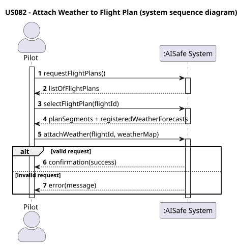
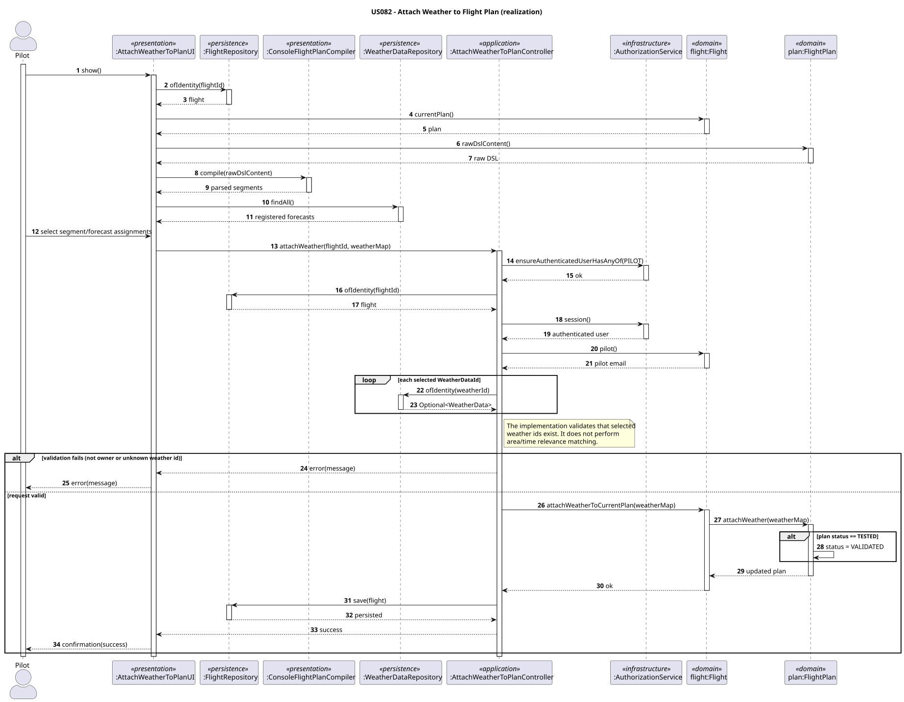
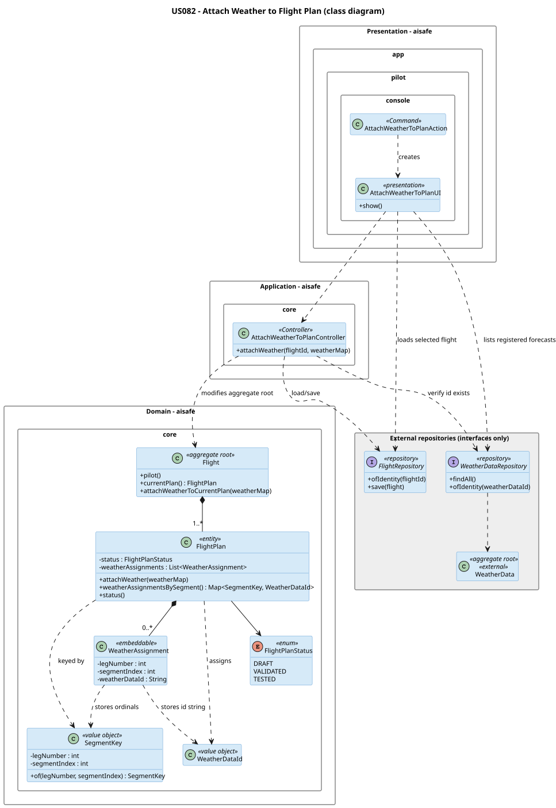

# US 082 - Insert weather data in a flight

## Context

This user story allows a Pilot to associate registered weather forecasts to one of their flight plans.

Instead of creating or uploading weather data, the pilot selects forecasts already registered in the system and attaches them to the flight plan. The current implementation lists all registered forecasts; it does not filter the selection by area or time.

If the flight plan was previously tested, adding weather data invalidates the test.

## Requirements

**US 082** As a Pilot, I want to add weather data to one of my flight plans.

**Acceptance Criteria:**

- US082.1 A pilot can select weather data from existing forecasts.
- US082.2 Weather data may vary across segments of the flight plan.
- US082.3 If the flight plan is in TESTED state, adding weather data invalidates the test.
- US082.4 The system must validate that selected weather data exists.

**Definition of Done:**

- Weather data can be associated with a flight plan.
- TESTED → VALIDATED transition is implemented.
- Only existing weather data can be selected.
- Validation ensures each selected `WeatherDataId` resolves in the weather repository.
- End-to-end flow implemented (UI → Controller → Domain → Repository).
- Domain tests cover tested and non-tested plan behavior.
- ≥90% coverage on controller/domain.

**Dependencies/References:**

- US041 - Register Weather Data
- US042 - Import bulk Weather Import
- US043 - Consult weather data
- US080 - Create a flight plan
- US085 - Test flight plan

## Analysis

### Interpretation

This use case allows a **Pilot** to associate existing weather forecasts with one of their flight plans.

The pilot does not create or upload weather data. Instead, the system provides weather forecasts that were previously registered through dedicated use cases (US041, US042, US043).

The pilot selects one or more forecasts and attaches them to the flight plan.

If no weather forecasts are registered, no selection is possible.

If the flight plan is already in the `TESTED` state, attaching weather invalidates the test results. However, the plan remains valid, so the state transitions to `VALIDATED`, not `DRAFT`.

### Key Concepts

- Weather data is **pre-existing** and managed outside this use case.
- Multiple forecasts may exist for the same area and time (different providers).
- The pilot may select multiple weather entries.
- Weather conditions may vary across different segments of the flight route.

This use case is focused on **selection and association**, not data creation.

### Aggregate Responsibility

The aggregate root for this use case is `Flight`.

- `FlightPlan` is an entity inside `Flight`.
- All modifications to the flight plan must go through the `Flight` aggregate.

The interaction flow follows:

Pilot → Controller → Flight → FlightPlan

Direct access to `FlightPlan` from outside the aggregate is not allowed.

### Domain Decisions

#### Weather Association Model

Weather data is associated at **segment level** using an ordinal mapping:

`(legNumber, segmentIndex) → WeatherDataId`

This approach:

- Supports variability across segments (US082.2)
- Handles multiple providers for the same area/time
- Avoids the need for persistent segment entities

The mapping is stable because the DSL defining the plan is immutable.

### State Transition

- If a flight plan is in `TESTED` state, attaching weather invalidates the simulation results.
- The plan transitions from `TESTED` to `VALIDATED`.

This ensures:

- The flight plan remains structurally valid
- Only the simulation result is invalidated

### Invariants

| #  | Invariant                                                                  | Source      |
|----|----------------------------------------------------------------------------|-------------|
| I1 | The authenticated pilot must be the owner of the flight plan.              | Controller rule |
| I2 | Selected WeatherData must exist in the system.                             | US082.4     |
| I3 | Selected WeatherData is resolved by identity before attachment.            | US082.4     |
| I4 | TESTED plans must transition to VALIDATED when weather is attached.        | US082.3     |
| I5 | Weather data must be associated at segment level.                          | US082.2     |

### Constraints

- Weather data cannot be created or modified in this use case.
- Only existing forecasts can be selected.
- Multiple forecasts may coexist for the same area and time.
- The system must support per-segment weather variability.
- The current UI lists all registered forecasts and does not apply area/time filtering.
- The controller validates weather existence by repository identity lookup.

### Risks and Complexity

- Implementing the TESTED → VALIDATED transition correctly is critical.
- Mapping weather data per segment without explicit segment entities requires careful design.
- Validating correct weather-to-segment matching is limited to the UI deriving segment keys from the compiled DSL; the controller/domain accept the supplied `SegmentKey` values.
- Coordination with US085 is necessary since this use case invalidates test results.

Despite these challenges, the use case fits entirely within the existing `Flight` aggregate.

## Design

### Realization

This is a **modification use case**.

- The pilot selects weather identifiers
- The UI loads the selected flight by route/date
- The UI recompiles the current plan DSL to display segment ordinals
- The UI lists all registered forecasts
- The UI collects segment-to-forecast assignments
- The controller loads the corresponding `Flight`
- The controller verifies that the authenticated pilot owns the flight
- The controller verifies that each selected `WeatherDataId` exists
- The `Flight` delegates to its `FlightPlan`
- The repository persists the updated aggregate

### Responsibilities (GRASP)

- **AttachWeatherToPlanController**
    - Ensures authorization (PILOT)
    - Loads the flight
    - Ensures the authenticated pilot owns the flight
    - Validates selected weather ids using `WeatherDataRepository.ofIdentity(...)`
    - Delegates to domain

- **Flight**
    - Aggregate root
    - Controls all modifications

- **FlightPlan**
    - Stores weather assignments as a JPA-compatible `List<WeatherAssignment>`
    - Exposes assignments as a derived `Map<SegmentKey, WeatherDataId>` lookup
    - Handles state transition

- **WeatherDataRepository**
    - Provides registered forecasts to the UI
    - Resolves selected weather ids for controller validation

### Design Principles

- Encapsulation → mutations inside aggregate
- Low coupling → controller uses repositories
- High cohesion → FlightPlan manages its data
- Consistency → aligned with ImportFlightPlan

### Class Diagram

### Acceptance Tests

**Implementation-source-of-truth note:** The current automated coverage is mainly at domain level for weather assignment and state transitions. A dedicated `AttachWeatherToPlanControllerTest` for ownership and unknown-weather validation is described by the intended acceptance tests below but is not present in the implementation; this is a test-plan outlier.

- `ensureAttachWeatherToPlan`: It is possible to attach weather data to a valid flight plan (US082.1)
- `ensureTestedPlanRevertsToValidated`: A TESTED plan transitions to VALIDATED when weather is attached (US082.3)
- `ensureNonTestedPlanKeepsStatus`: Attaching weather to a non-tested plan does not change its status (US082.3)
- `ensureRejectUnknownWeatherData`: It is not possible to attach non-existing weather data (US082.4)
- `ensureRejectIfPilotDoesNotOwnFlight`: It is not possible to attach weather to a flight not owned by the pilot (US082.1)
- `ensureAttachWeatherPerSegment`: Different weather data can be assigned to different segments (US082.2)
- `ensureRejectEmptyWeatherAssignment`: It is not possible to attach an empty set of weather data (US082.1)

## Implementation

The implementation of this use case follows a layered architecture aligned with the Domain-Driven Design principles used throughout the project.

The main changes were introduced in the **domain layer**, supported by the **application layer** through a dedicated controller.

### Domain Layer

- A new value object `SegmentKey` was introduced to identify flight segments using `(legNumber, segmentIndex)`.
- A new class `WeatherAssignment` was created to persist weather associations in a JPA-compatible way.
- The `FlightPlan` entity was extended with the method `attachWeather(...)`, which:
  - Associates weather data to segments
  - Validates input (non-empty weather map)
  - Handles the state transition from `TESTED` to `VALIDATED`
- `FlightPlan` stores assignments internally as `List<WeatherAssignment>` and exposes a derived map through `weatherAssignmentsBySegment()`.
- The `Flight` aggregate root was extended with `attachWeatherToCurrentPlan(...)`, ensuring all modifications go through the aggregate root.

### Application Layer

- The `AttachWeatherToPlanController` was implemented to:
  - Ensure authorization (Pilot role)
  - Load the `Flight` aggregate from the repository
  - Verify that the authenticated pilot owns the selected flight
  - Validate that each selected `WeatherDataId` exists through `WeatherDataRepository.ofIdentity(...)`
  - Delegate the operation to the domain
  - Persist the updated aggregate

### Presentation Layer

- The Pilot console includes an `Attach Weather to Flight Plan` menu option.
- The UI asks for route and departure date, loads the flight, recompiles the current plan DSL to obtain segment ordinals, lists all registered forecasts, and collects one or more segment-to-forecast assignments.
- The UI does not filter forecasts by area or time.

### Persistence

- Weather assignments are stored as a collection of embeddable elements (`WeatherAssignment`), ensuring compatibility with JPA.
- No direct persistence modifications were required in existing repositories.

### Commits

The implementation was tracked using the following commits:

- **Implementation (Issue #236)**
  - Domain logic and controller implementation
- **Tests (Issue #237)**
  - Domain tests for weather attachment behaviour

## Integration/Demonstration

This functionality was fully integrated into the existing flight management module without requiring structural changes to other modules.

### Integration Points

- The use case integrates with:
  - **Flight aggregate** (US080)
  - **Flight plan validation/testing** (US085)
  - **Weather data management** (US041, US042, US043)

- Weather data is listed via the `WeatherDataRepository`, and selected weather ids are resolved by identity before attachment.

### Demonstration Flow

The complete execution flow is:

Pilot → UI → AttachWeatherToPlanController → Flight → FlightPlan → Repository

Steps:

1. The pilot selects an existing flight.
2. The system presents registered weather forecasts.
3. The pilot selects weather data per segment.
4. The controller validates authorization, ownership, and weather id existence, then loads the `Flight`.
5. The domain updates the current plan.
6. The updated flight is persisted.

### Execution

The system can be demonstrated by:

- Creating a flight and flight plan (US080)
- Importing/validating a plan (US121)
- Testing the plan (US085)
- Attaching weather data using this use case

All steps execute successfully, and the expected state transitions are enforced.

## Observations

The implementation of this use case required careful consideration of domain modelling and encapsulation.

### Key Observations

- The decision to model weather association using `(SegmentKey → WeatherDataId)` allowed flexibility without introducing unnecessary entities.
- The use of `WeatherAssignment` ensured JPA compatibility while preserving domain intent.
- Encapsulation was maintained by enforcing all operations through the `Flight` aggregate root.
- Area/time relevance filtering is not part of the current implementation; selection is based on registered forecasts and repository identity validation.

### Testing Considerations

- Due to the encapsulation of `WeatherDataId`, direct instantiation in tests was not straightforward.
- Tests were focused on behavioural validation rather than inspecting the internal representation of weather data.
- This approach maintains domain integrity while still providing meaningful test coverage.
- Outlier: the documented controller-level checks for unknown weather and ownership do not currently have a dedicated `AttachWeatherToPlanControllerTest`.

### Alternative Approaches

- A Map-based persistence approach was considered but rejected due to JPA limitations.
- A dedicated segment entity was also considered but deemed unnecessary given the stability of the flight plan DSL.

### Final Remarks

The solution aligns with the overall architecture and maintains consistency with previously implemented use cases.

The use case was successfully implemented with clear separation of concerns, strong domain modelling, and maintainable code structure.
`` should include in this section statements/references regarding third party works that were used in the development this work.*
