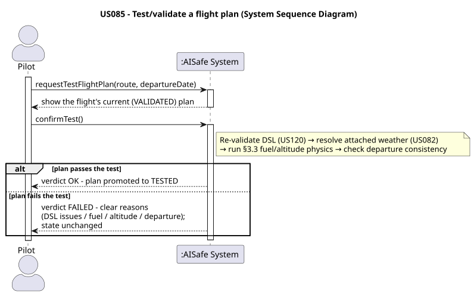
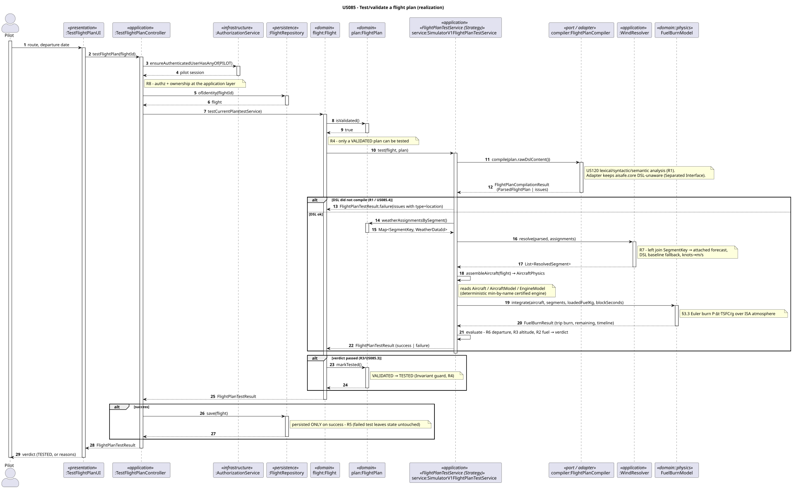
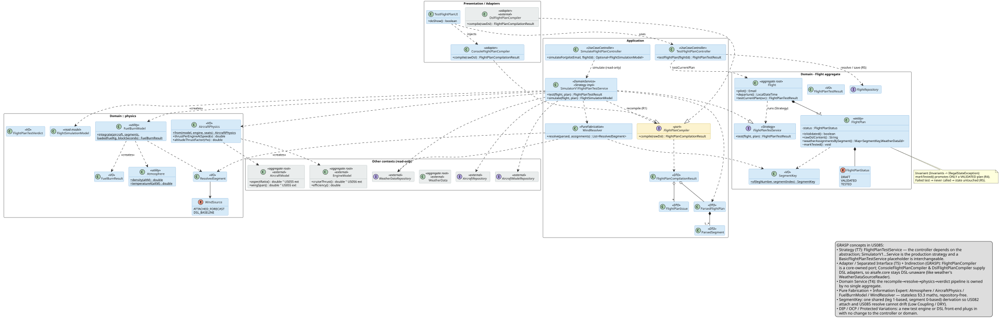
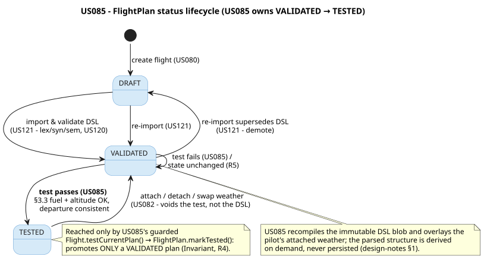
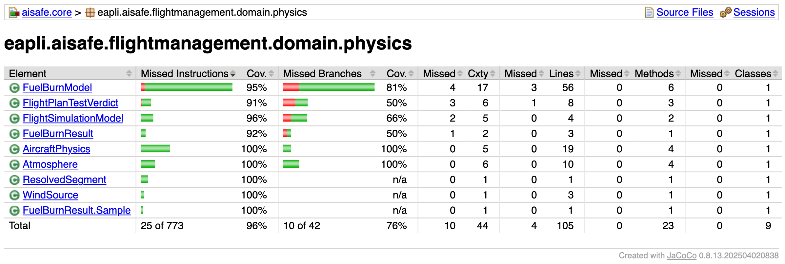
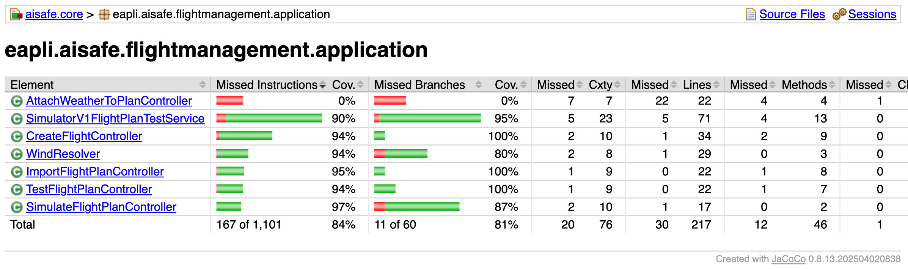
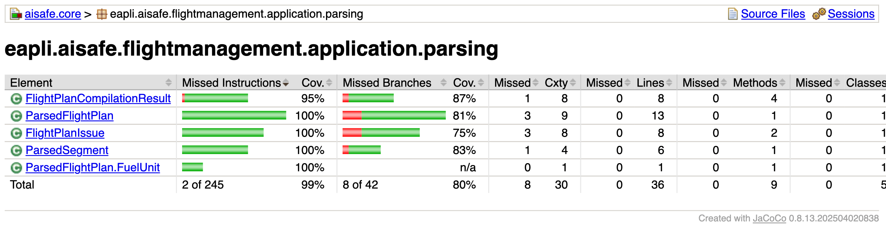
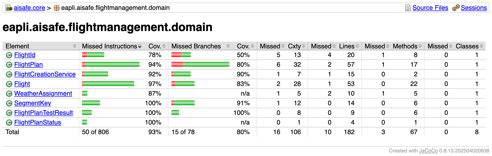

# US 085 - Test/validate a flight plan

## Context

It is
the **central flight-simulation user story** of the sprint: the first time the
system reconstructs a flight plan from its stored DSL, overlays the pilot's
attached weather, runs the §3.3 aircraft-physics model, and promotes the plan to
`TESTED`. It depends on US080 (a `DRAFT` flight exists), US121/US081 (the DSL was
imported and the plan promoted to `VALIDATED`), US120 (the DSL lexical/syntactic/
semantic analysis it re-runs), and US082 (the per-segment weather the pilot
attached).

## Requirements

**US 085** As a Pilot, I want to test/validate a flight plan I've made, so that I
know the planned path and altitudes are valid and the aircraft carries enough fuel
to comply with the safety regulations.

From the requirements (§2 and §3.3): *"The objective of testing a flight is to
verify the aircraft carries enough fuel and meets the minimum altitude
requirements."* The fuel/altitude analysis is grounded in classical mechanics:
lift, drag, two-point thrust with an altitude lapse, and a TSFC-based burn (§3.3).

**Acceptance Criteria:**

- **US085.1** Testing re-runs the DSL validation of the flight plan (lexical/
  syntactic/semantic, per US120) before the physics test.
- **US085.2** The test computes fuel sufficiency and minimum-altitude compliance
  from the §3.3 aircraft-physics model.
- **US085.3** On a successful test the flight plan transitions `VALIDATED → TESTED`.
- **US085.4** Test/validation errors are reported clearly, with **type and
  location** (DSL errors) or a clear physics reason (fuel/altitude/departure).
- **US085.5** A failed test does **not** corrupt the flight plan's state; the plan
  stays exactly as it was.

> **Note on US085.2 ("C language").** The original backlog wording said the test
> *"is implemented in the C language"*. PO clarified (03/06/2026) that the US085
> simulation *"may be implemented in either C or Java"* and is a **separate matter**
> from the SCOMP air-control simulation (US100). The team implemented it in **Java**,
> inside `aisafe.core` (see §3.1 and §7). The C component remains the SCOMP
> air-control simulator, not this fuel/altitude test.

**Definition of Done:**

- Test-plan use case implemented end-to-end (pilot console → controller → domain).
- LPROG DSL validation (US120) re-run on the stored blob (US085.1).
- The physics test (fuel + minimum altitude) implemented per §3.3.
- State machine `VALIDATED → TESTED` implemented and guarded in the domain
  (PO clarification).
- The pilot's attached weather (US082) overrides the DSL baseline wind at test time.
- The first-leg departure stored on `Flight` is verified consistent with the DSL
  (PO 02/06/2026).
- Failed test leaves state untouched (US085.5).
- Coverage ≥ 90 % on the Java controller/domain packages (NFR03).

**Dependencies/References:**

- US080 - Create a flight: supplies the `Flight` and the `DRAFT` plan.
- US121 - Import a flight plan from a file: promotes `DRAFT → VALIDATED`, stores the DSL blob.
- US120 - Flight DSL specification and validation: the lexical/syntactic/semantic analysis re-run here.
- US082 - Insert weather data in a flight: the per-segment weather attachments overlaid at test time.
- US055 - Create Aircraft Model / US056 - Create Engine Model: extended here with the §3.3 attributes (wing span / aspect ratio, second thrust point).

## Analysis

### Interpretation

The SSD below shows how the Pilot (from `pilot.console`) asks the system to test the
current plan of one of their flights and receives a verdict.



A flight plan moves `DRAFT → VALIDATED → TESTED` (PO clarification). US085 owns the
**`VALIDATED → TESTED`** edge: only a plan that has already been imported and
validated (US121) can be tested, and only a *passing* test promotes it. The PO
confirmed (03/06/2026) that the US085 physics-based test of the flight plan (fuel
sufficiency, minimum-altitude compliance) *"may be implemented in either C or
Java."* The team implemented it in **Java**, inside `aisafe.core`, so the test
reuses the existing domain (aircraft models, engine models, weather aggregates) and
the same controller pattern as every other use case in the project.

### The DSL blob is the single source of truth

A flight plan persists only three things: the immutable raw DSL blob
(`rawDslContent`), the pilot's weather decision (US082), and a status. The parsed
structure the physics needs (legs, segments, geometry, altitudes, baseline wind,
loaded fuel) is **not** persisted; it is **re-derived on demand** by recompiling the
blob. This follows the PO's policy that fuel *"belongs in the flight plan
description (per leg), not duplicated on the Flight entity … used only for
simulation"* (02/06/2026), and that the first-leg departure may be duplicated onto
`Flight` for convenience *"but US085 must verify that the two values remain
consistent"* (02/06/2026).

So US085 re-runs the compiler (US085.1) instead of persisting a parallel,
drift-prone object graph; the only field the PO asked to keep consistent is the
departure, which US085 checks (R6). To keep `aisafe.core` independent of the LPROG
DSL module, the recompile goes through a **port** (`FlightPlanCompiler`) that
returns DSL-free DTOs, mirroring the weather context's `WeatherDataSourceReader`
(§4).

### The §3.3 physics model and the data it needs

The test integrates the §3.3 fuel burn over the route (an Euler step of
`burn = P·Δt·TSFC/g`), driven by the standard atmosphere:

1. **ISA atmosphere** from each step's altitude: `T = T₀ − λh`,
   `p = p₀(1 − λh/T₀)^5.2561`, `ρ = p/(R·T)`.
2. `C_L = 2mg/(ρ·A·v²)` (§3.3).
3. `C_D = C_{D0} + C_L²/(π·AR·e)` (§3.3).
4. `D = ½·ρ·v²·A·C_D` (§3.3).
5. Level flight ⇒ thrust balances drag, `P = D`; the two-point thrust line and the
   `(ρ/ρ₀)^0.9` altitude lapse only bite in the climb/descent ramps.
6. `burn = P·Δt·TSFC/g`; `mass -= burn`.

Two of the §3.3 inputs are aircraft/engine attributes the domain did not yet store,
so they were added (US055/US056):

| §3.3 need | Source in the domain | Resolution |
|---|---|---|
| Wing area `A`, cruise speed `v`, weights, ceiling, `C_d`, `C_l` | `AircraftModel` | already present |
| Max + per-engine thrust, TSFC | `EngineModel` | already present |
| **Aspect ratio `AR` (= span²/area)** | `AircraftModel` had **no wing span** | **US055 extended:** added `wingSpan` → `aspectRatio()` |
| **Second thrust point (cruise thrust)** | `EngineModel` stored a single thrust | **US056 extended:** added `cruiseThrust` |
| ρ, T, p, a | derived from altitude (ISA) | `Atmosphere` (new) |
| Oswald efficiency `e`, `C_{D0}` | pure physics constants | named constants (`e = 0.8`, `C_{D0} = dragCoefficient`) |
| TSFC unit | stored `efficiency` is lb/(lbf·hr) | normalised `/3600` to N/N/s on read |

Two values the spec leaves to the implementation were fixed in code: the
thrust-altitude lapse exponent is **`0.9`** (per §3.3), and the stored `efficiency`
is divided by `3600` so TSFC reaches the N/N/s the burn formula expects (the stored
value is in lb/(lbf·hr)).

### Rules

| # | Rule | Kind | Source |
|---|---|---|---|
| R1 | The plan's DSL must re-compile cleanly (lexical/syntactic/semantic); otherwise the issues are reported with type + location and the test fails. | Precondition of the test | US085.1, US085.4 |
| R2 | Loaded fuel ≥ trip burn + 10 % contingency + 600 kg reserve. | Pass criterion | US085.2, §3.3 |
| R3 | Every segment altitude must be `0 < altitude ≤ service ceiling`. | Pass criterion | US085.2 (minimum-altitude) |
| R4 | Only a `VALIDATED` plan can be tested; a pass promotes it `VALIDATED → TESTED`. | Invariant | US085.3, PO clarification |
| R5 | A failing test leaves the plan's state unchanged. | Invariant | US085.5 |
| R6 | The first-leg departure stored on `Flight` must equal the DSL's first-leg departure. | Precondition (consistency) | PO 02/06/2026 |
| R7 | The pilot's attached forecast (US082) overrides the DSL baseline wind per segment; with no/dangling attachment the DSL wind is the fallback. | Resolution rule | US082 |
| R8 | Only the flight's owning pilot may test it. | Authorization | PO 03/06/2026 (exclusive plan ownership) |

R1, R6 and R8 are **preconditions** checked before the physics runs; R2 and R3 are
the **pass criteria** the physics produces; R4 and R5 are **invariants** enforced
inside the `Flight`/`FlightPlan` aggregate (the `markTested()` guard). R7 is the
weather-resolution rule shared with US082 through a single `SegmentKey` helper, so
the per-segment ordinals cannot drift, which is the main correctness risk for this
feature.

### Design concepts applied

The relevant patterns and principles, by name:

- **Strategy (GoF):** `FlightPlanTestService` is the strategy interface; the
  controller depends on the abstraction, so `SimulatorV1FlightPlanTestService` can be
  replaced by another test engine without touching the controller.
- **Adapter / Separated Interface (GoF) with Indirection (GRASP):** the
  `FlightPlanCompiler` port keeps `aisafe.core` independent of the DSL module; the
  console and web supply the adapters.
- **Domain service / orchestration:** the test is a pipeline (recompile, resolve
  weather, run physics, build verdict) that belongs to no single aggregate.
- **Pure Fabrication and Information Expert (GRASP):** the stateless physics
  (`Atmosphere`, `AircraftPhysics`, `FuelBurnModel`) and the `WindResolver`.
- **DIP, OCP and Protected Variations (SOLID/GRASP):** the domain owns the repository
  and port interfaces; adapters and a new test engine plug in without changing the
  controller or the domain.
- **Preconditions vs Invariants:** input checks (`Preconditions`) versus the
  state-machine guard on `markTested()`.

## Design

### Realization

The test is a read-mostly pipeline with a single, guarded write at the end. The
sequence diagram below shows the flow from `pilot.console` to the `VALIDATED → TESTED`
promotion.



Responsibilities are assigned by **GRASP**:

- **`TestFlightPlanController`** is the GRASP *Controller* and use-case entry point.
  It authenticates the Pilot (Secure by Design, R8), resolves the `Flight`, checks
  ownership, delegates to the aggregate, and persists **only on success** (R5). It
  holds no physics.
- **`Flight` / `FlightPlan`** are the *Information Expert* for the state machine.
  `Flight.testCurrentPlan(...)` guards that the current plan is `VALIDATED`, runs the
  injected test **strategy**, and calls `FlightPlan.markTested()` **only on success**,
  so the `VALIDATED → TESTED` **invariant** (R4) lives where the state does.
- **`FlightPlanTestService`** is the **Strategy** interface (a domain service). The
  production `SimulatorV1FlightPlanTestService` orchestrates the pipeline: recompile
  through the `FlightPlanCompiler` port, resolve winds (`WindResolver`), assemble
  `AircraftPhysics`, integrate (`FuelBurnModel`), build the verdict (R1, R2, R3, R6).
  It never persists and never mutates the plan.
- **`FlightPlanCompiler`** is the **Adapter / Separated Interface** port. Core defines
  it and consumes DSL-free DTOs; `ConsoleFlightPlanCompiler` (console) and
  `DslFlightPlanCompiler` (web) implement it over the LPROG module, running the US120
  analysis (R1, US085.1/.4).
- **`WindResolver`** is a **Pure Fabrication**: a left-join from each `SegmentKey` to
  the attached forecast, with the DSL baseline as fallback and a knots→m/s
  normalisation (R7); it never throws on a dangling id.
- **`Atmosphere` / `AircraftPhysics` / `FuelBurnModel`** are **Pure Fabrications**
  holding the §3.3 maths: stateless, repository-free, unit-testable.

Two framework mechanisms keep the rules apart: **`Preconditions`** (→
`IllegalArgumentException`) validates an operation's inputs (the controller/service
constructors, the `Parsed*` DTOs, `SegmentKey`); **Invariants / state guards** (→
`IllegalStateException`) assert an object's internal state (`FlightPlan.markTested()`
rejects any non-`VALIDATED` plan, R4).

A **read-only twin**, `SimulateFlightPlanController`, runs the *same*
`SimulatorV1FlightPlanTestService.simulate(...)` computation with **no** state change,
returning a `FlightSimulationModel` for the web simulator and console reports, so
they read the physics from `aisafe.core` instead of carrying a copy. This
single-source point (Indirection) lets the browser visualization stop duplicating
the physics constants.

The class diagram below shows the resulting structure.



Layering follows the **Dependency Inversion Principle (SOLID)**: the domain owns the
`FlightPlanTestService`, `FlightPlanCompiler` and repository interfaces; persistence
and the DSL/web adapters implement them; the console injects the concrete
implementations (Dependency Injection). Adding a different test engine (e.g. a future
C bridge) or a new DSL front-end is **OCP**: a new `FlightPlanTestService` /
`FlightPlanCompiler` implementation, no edit to the controller or the domain
(**Protected Variations**).

The `VALIDATED → TESTED` edge does not stand alone: the state machine the US085 guard
protects is shared with US121 (`DRAFT → VALIDATED`) and US082 (`TESTED → VALIDATED`
when weather changes void the test). The full lifecycle:



### Acceptance Tests

Tests follow the project convention (JUnit, Vintage engine; `ensure…`-style names).
The pipeline pieces are covered by focused **unit tests** (no mocking framework) and
the whole verdict by **integration-style** tests that wire the real
`SimulatorV1FlightPlanTestService` against **in-memory fake repositories**
pre-loaded with the `FR401` reference plan. Each test maps to an acceptance
criterion / rule from §3.4.

- `ensureValidFr401PlanPasses`: Happy path.** *Verifies a valid `VALIDATED` plan (FR401) passes the §3.3 (US085.1, US085.2, US085.3 (R1, R2, R3, R6))
- `ensureDslCompileErrorsAreReportedWithTypeAndLocation`: DSL re-validation reports type + location.** *Verifies a plan whose DSL no (US085.1, US085.4, US085.5 (R1, R5))
- `ensureInsufficientFuelFails`: Insufficient fuel fails.** *Verifies a plan loading less than trip burn + (US085.2 (R2))
- `ensureAltitudeAboveServiceCeilingFails`: Altitude above service ceiling fails.** *Verifies a segment cruising above (US085.2 (R3))
- `ensureDepartureMismatchFails`: Departure mismatch fails (PO 02/06/2026).** *Verifies the consistency (R6)
- `ensureAttachedForecastOverridesBaselineWindWithKnotsConversion`: Attached weather overrides DSL wind (knots→m/s).** *Verifies the pilot's (R7 (US082 integration))
- `ensureSuccessfulTestPromotesToTested`: `VALIDATED → TESTED` only on success; failure preserves state.** *Verifies (US085.3, US085.5 (R4, R5))

The §3.3 building blocks have their own unit suites: `AtmosphereTest` (sea-level and
9 km density against the ISA table, lapse, speed of sound), `FuelBurnModelTest`
(FR401 trip burn realistic and leaving margin, monotonic timeline, low-cruise burns
more than high-cruise) and `WindResolverTest` (baseline / override+conversion /
dangling fallback).

## Implementation

Implementation followed **TDD**, built **leaf-first**: the pure, repository-free
pieces (the DSL-free DTOs, the ISA atmosphere, the §3.3 fuel-burn model) were
written and tested first; the orchestrating `SimulatorV1FlightPlanTestService` was
layered on the green physics; then the two controllers and the pilot console UI.
Throughout, `aisafe.core` stays DSL-unaware: the recompile goes through the
`FlightPlanCompiler` port, whose adapter lives in the console and web (Separated
Interface, §4.1).

Two supporting model extensions had to land first, because the §3.3 physics needs
attributes the domain did not yet store: **US055** added the wing span (giving
`aspectRatio() = span²/area`, the induced-drag term) and **US056** added the cruise
thrust (the second of §3.3's two thrust points). Both used overloaded constructors
so existing callers and tests were untouched.

### Commit trail

**Supporting §3.3 attributes (US055 / US056):**

- `test(US055): wing span + aspect ratio invariants #37` (`e2f0041`)
- `feat(US055): add wing span + aspectRatio() to AircraftModel #37` (`53de5d4`)
- `feat(US055): thread wing span through registration + bootstrap #37` (`7355e97`)
- `feat(US056): add cruise thrust (2nd thrust point) to EngineModel #39` (`066a0fe`)
- `feat(US056): thread cruise thrust through registration + bootstrap #39` (`9c529a3`)

**Port + DSL-free DTOs (keeps core DSL-unaware):**

- `feat(US085): add FlightPlanCompiler port + DSL-free Parsed* DTOs #162` (`cc9edcf`): the `FlightPlanCompiler` port and the `ParsedFlightPlan` / `ParsedSegment` / `FlightPlanIssue` / `FlightPlanCompilationResult` records core consumes instead of the DSL AST.

**Physics, pure and stateless (test-first):**

- `test(US085): ISA atmosphere #162` (`3a76170`) → `feat(US085): add ISA Atmosphere model #162` (`4ff7c28`): `Atmosphere` (ρ, T, p, a).
- `test(US085): fuel-burn test #162` (`8494d37`) → `feat(US085): add fuel-burn model + aircraft physics #162` (`24864ef`): `AircraftPhysics`, `FuelBurnModel`/`FuelBurnResult`, `ResolvedSegment`, `WindSource`, the verdict/sim records.

**Orchestration (repository-backed):**

- `test(US085): wind resolution #162` (`8563c62`) → `feat(US085): add WindResolver (attached forecast over DSL baseline) #162` (`0aff172`): the left-join with DSL fallback and knots→m/s.
- `test(US085): Simulator end-to-end test #162` (`723be94`) → `feat(US085): add SimulatorV1FlightPlanTestService #162` (`9334e7e`): recompile → resolve → physics → verdict, the production `FlightPlanTestService`.
- `feat(US085): add read-only SimulateFlightPlanController for the simulator view #162` (`eaf8cfd`): the same computation with no state change.

**Console use case:**

- `feat(US085): add ConsoleFlightPlanCompiler + Test Flight Plan pilot UI #162` (`7176735`): the DSL adapter and the `TestFlightPlanUI`/`TestFlightPlanController` wiring, plus the **Test / Validate Flight Plan** entry in the pilot `MainMenu`.

**Coverage hardening + cleanup:**

- `test(US085): cover simulate controller, aircraft physics, parsing DTOs and result VOs #162` (`a26100b`): extends the suite over `SimulateFlightPlanController`, the `AircraftPhysics` thrust/lapse helpers, the parsing DTOs and the `FlightPlanTestResult`/`SegmentKey` value objects (plus the litres→kg and generic compile-failure paths), and removes the superseded `BasicFlightPlanTestService` placeholder.

### Implementation notes

**Failed test never corrupts state (US085.5 / R5).** The promotion is driven only by
`Flight.testCurrentPlan(...)`, which calls `FlightPlan.markTested()` **only when the
result is a success**; `markTested()` itself rejects any non-`VALIDATED` plan
(`IllegalStateException`). The controller then `save`s the aggregate **only on
success**, so a failing test touches neither the in-memory object nor the database.

**Decided constants and unit conversions** are held as named constants so they are
auditable:

| Constant | Value | Where |
|---|---|---|
| Thrust-altitude lapse exponent | `0.9` (per §3.3) | `AircraftPhysics.altitudeThrustFactor` |
| TSFC normalisation | stored `efficiency / 3600` (lb/(lbf·hr) → N/N/s) | `AircraftPhysics.TSFC_TO_N_PER_N_PER_S` |
| Oswald efficiency `e` | `0.8` (class-typical) | `AircraftPhysics.OSWALD_EFFICIENCY` |
| `Cd0` | `= AircraftModel.dragCoefficient()` | `AircraftPhysics.from` |
| Reserve fuel | `tripBurn · 1.10 + 600 kg` | `SimulatorV1FlightPlanTestService` |
| JET A-1 density (L→kg) | `0.804 kg/L` | `SimulatorV1FlightPlanTestService.FUEL_DENSITY_KG_PER_L` |
| Wind knots→m/s | `0.514444` | `WindResolver.KNOTS_TO_MPS` |
| ISA sea-level temperature | `288.15 K` | `Atmosphere.T0_K` |
| Euler steps / climb-descent ramp | `240` / `12 %` | `FuelBurnModel` |

**Deterministic engine selection.** An `AircraftModel` may certify several engines but
the `Aircraft` does not record which is installed; `assembleAircraft` picks the
engine with the smallest name (`min`-by-name) so the test is reproducible (a `Set`'s
iteration order is not guaranteed).

### Test coverage (JaCoCo)

JaCoCo is bound to the `test` phase, so `mvn test -pl aisafe.core` writes the report to
`aisafe.core/target/site/jacoco/`. The whole `aisafe.core` suite passes (**866 tests,
0 failures**); per NFR03 the US085 controller/domain classes are all ≥ 90 %.

**`flightmanagement.domain.physics`** (the §3.3 model):



**`flightmanagement.application`** (the controllers, the simulator service and the wind resolver):



**`flightmanagement.application.parsing`** (the DSL-free DTOs the port exchanges):



**`flightmanagement.domain`** (the Flight aggregate and the US085 value objects):



> The `flightmanagement.application` package total reads below 90 % only because of
> `AttachWeatherToPlanController` (US082, not yet under test); every **US085** class
> in the package is ≥ 90 %.

## Integration/Demonstration

### Integration with other components

US085 introduces no aggregate of its own; it is almost entirely integration by
reuse of what earlier stories produced:

- **Reads upstream:** the `Flight` and its `DRAFT` plan (US080); the imported DSL
  blob on a `VALIDATED` plan (US121/US081); the US120 compiler, reached through the
  `FlightPlanCompiler` port (the `ConsoleFlightPlanCompiler` adapter in the console,
  `DslFlightPlanCompiler` in the web); the pilot's attached `WeatherData` (US082); and
  the `AircraftModel`/`EngineModel` it now drives, including the `wingSpan`/
  `cruiseThrust` attributes US055/US056 added for the §3.3 physics. The forecasts
  themselves are US042's imported data.
- **The `SegmentKey` contract with US082:** US082 writes the per-segment weather
  choice keyed by `SegmentKey`, US085 reads it by the same key, and both derive the
  key through the one `SegmentKey.of(...)` helper, so the ordinals cannot drift.
- **Shared state machine:** US085 drives `VALIDATED → TESTED`; US082 drives
  `TESTED → VALIDATED` when a weather change voids the test. They co-own one lifecycle.
- **Cross-module (aisafeweb):** the read-only `SimulateFlightPlanController` is
  consumed by the web `FlightSimViewService` through a second `FlightPlanCompiler`
  adapter (`DslFlightPlanCompiler`), so the browser simulator reads the physics and
  weather-resolved winds from `aisafe.core` instead of a hard-coded table (issue
  #200, commits `c80731b`, `51adac0`).
- **Persistence:** US085 reads existing aggregates and writes only the `Flight`
  status on success; it runs under both the in-memory and the JPA/H2 backends (NFR08).

### Demonstration (end-to-end run)

The scenario was executed in a single process through the **real production
controllers** and the **real DSL compiler**, on the actual `FR401-OPO-LIS.flight`
sample, with in-memory repositories so no database is involved. The run produced:

| Step | What was created / done | Result |
|---|---|---|
| Register + log in pilot user | `demo.pilot` &lt;`pilot@aisafe.test`&gt;, role PILOT | authenticated |
| Add pilot to FR (US075) + aircraft | `Pilot pilot@aisafe.test` for FR (Ryanair), certified A320neo; FR aircraft `CS-TUA` (A320neo) | seeded |
| Create flight (US080) | flight `FR401@2026-06-12` on route FR401, aircraft `CS-TUA`, departure `2026-06-12T13:00` | plan status `DRAFT` |
| Import plan (US121) | imported `FR401-OPO-LIS.flight`; lexical/syntactic/semantic validation | validation OK, plan `DRAFT → VALIDATED` |
| Test plan (US085) | recompiled the DSL, ran the §3.3 physics | **PASSED**, plan `VALIDATED → TESTED` |

The US085 verdict reported a trip burn of **2215 kg** against **3300 kg** loaded (a
**263 kg** margin over the required reserve), both segment altitudes within the
A320neo service ceiling, and the `Flight` departure consistent with the DSL first
leg. The plan was promoted to `TESTED`.

The run is scripted in `Us085DemoRunner` (pilot console module) and launched the same
way as the console apps:

```bash
cd aisafe
./mvnw -pl aisafe.app.pilot.console package dependency:copy-dependencies -DskipTests
java -cp "aisafe.app.pilot.console/target/aisafe.app.pilot.console-1.0.0-SNAPSHOT.jar:aisafe.app.pilot.console/target/dependency/*" \
     eapli.aisafe.app.pilot.console.demo.Us085DemoRunner
```

The same flow is available interactively in the pilot console (`run-pilot.sh`): log
in as a pilot, then **Create Flight**, **Import Flight Plan from File**, and **Test /
Validate Flight Plan**. A plan that loads too little fuel or cruises above the service
ceiling returns a failure verdict instead, and the plan stays `VALIDATED` (US085.5),
as the §4.2 tests show.

## Observations

**Alternatives considered.** The backlog originally framed the test as a C component.
With the PO allowing either language (03/06/2026), the test was implemented in Java
so it lives in `aisafe.core`, reuses the aircraft, engine and weather aggregates
directly, and runs as ordinary unit tests with no external process; the separate C
work is the SCOMP air-control simulator (US100), which does not share this physics.
The other option weighed was persisting the parsed plan as domain entities;
recompiling the immutable DSL on demand was chosen instead, to avoid a second source
of truth and the per-field consistency checks it would require (§3.2).

**Third-party works.** The physics follows the classical-mechanics formulas in the
requirements (§3.3). The FR401 sample winds come from Open-Meteo forecast data
already imported into the system (US042).
