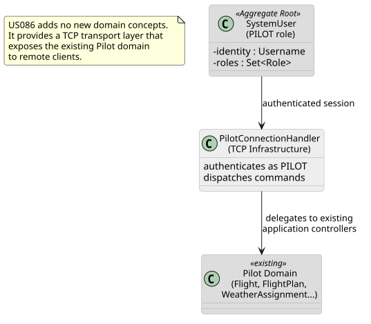
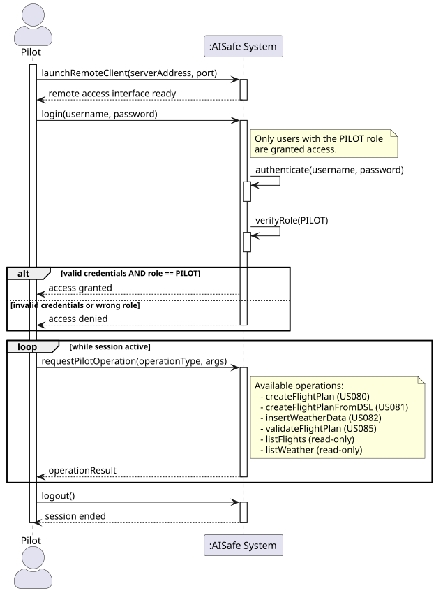
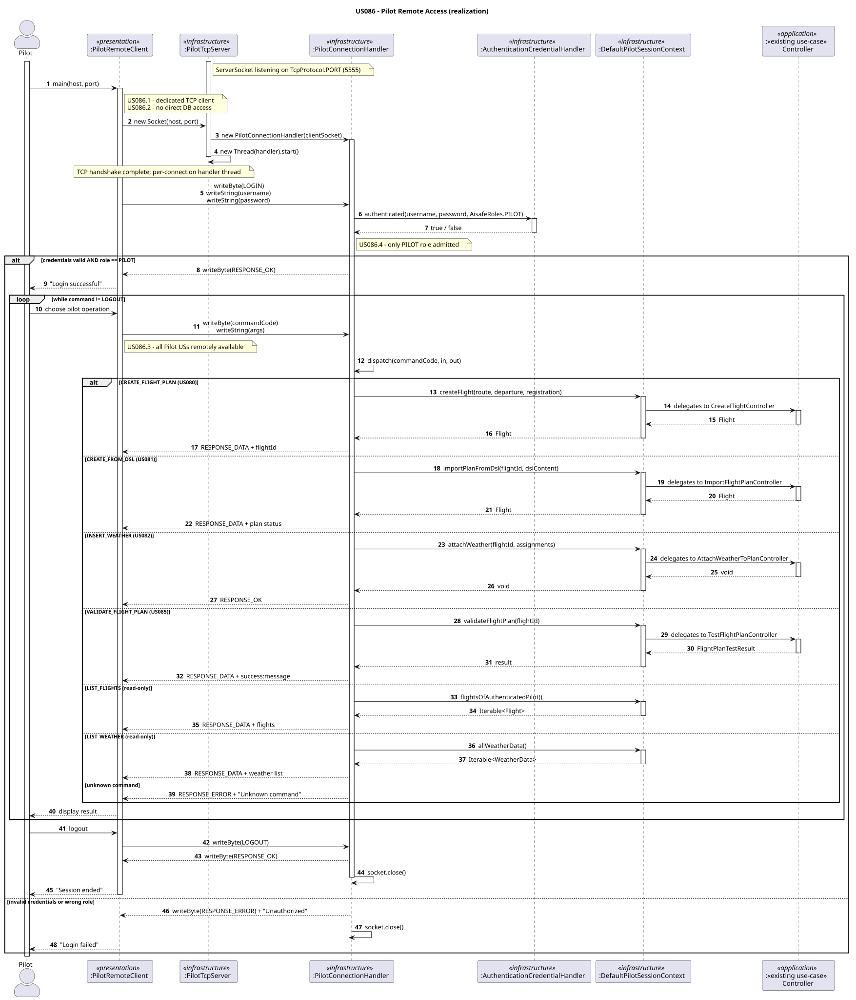
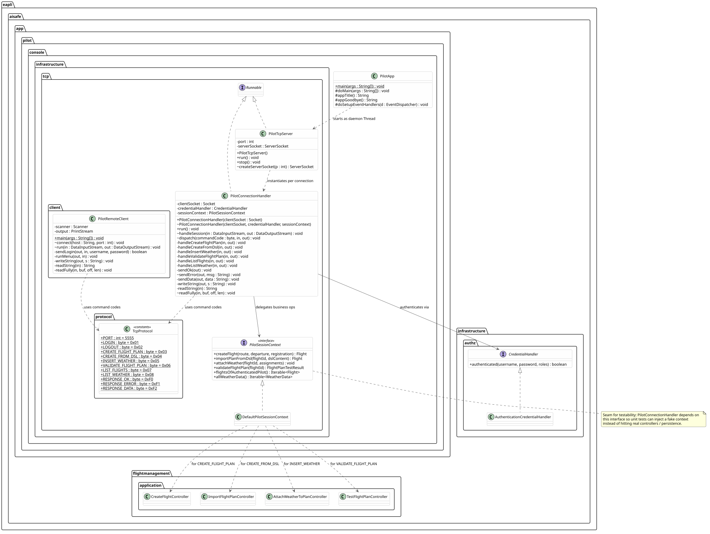
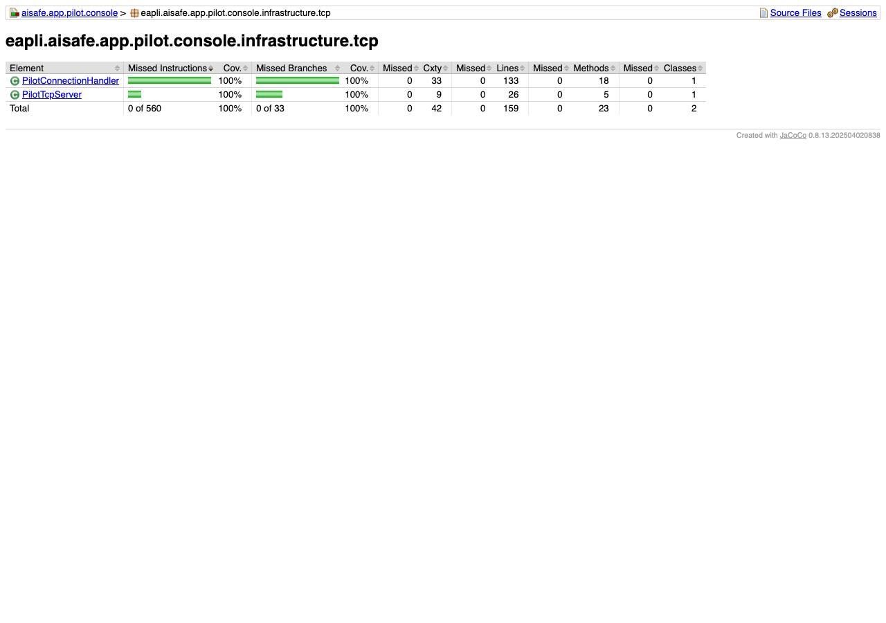
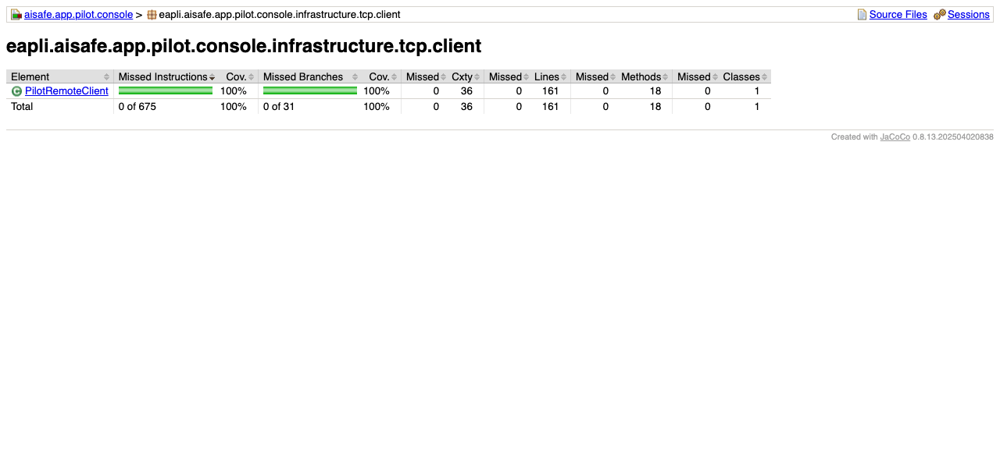

# US086 — Pilot Remote Access

## Context

This is the first implementation of US086. It belongs to the remote access functional area and was developed in Sprint 3. It is jointly owned by RCOMP (TCP/network layer) and EAPLI (application logic, DDD).

US086 adds no new domain concepts. Instead, it wraps the existing Pilot application layer behind a TCP transport, allowing a Pilot to operate remotely from a separate workstation without any direct database connection.

## Requirements

**US086** — *"As a Pilot, I want to remotely access the system using the dedicated TCP client application."*

**Acceptance Criteria:**

- US086.1 — A specific TCP-based network client application is required to communicate with the server.
- US086.2 — Client interaction is limited to the TCP connection; no direct database access from the client.
- US086.3 — All Pilot user stories (US080, US081, US082, US085) are available via this client.
- US086.4 — Authentication and authorization are enforced server-side; only users with the PILOT role are admitted.

**Dependencies/References:**

Upstream prerequisites:
- US030 (Authentication and Authorization): the credential-checking infrastructure must exist.
- US080, US081, US082, US085: the Pilot application controllers must be implemented before they can be exposed remotely.

---

## Analysis

### Actor and Module Placement

The actor is the Pilot. The TCP server runs embedded in the Cloud Node (same JVM as the pilot application). The TCP client is a standalone runnable that lives in `aisafe.app.pilot.console`, under `infrastructure.tcp.client` — keeping all pilot-related code in one module without introducing a new Maven artifact.

### Requirement Source

§3.2 of the requirements defines that remote access must be TCP-only — the client must not hold a database driver or any JPA dependency. All business logic remains in the server-side controllers; the client is a thin CLI that serialises user input into bytes and prints the server's response.

The constraint that only Pilots may use this client (US086.4) mirrors the role check already enforced in the local `PilotApp`. The difference is that here authentication happens over the wire: the server verifies credentials and role before entering the command loop, and rejects the connection otherwise.

### Design Decisions

**Thread-per-connection model.** Each accepted TCP connection spawns a dedicated `PilotConnectionHandler` thread. This is the simplest correct model for an academic setting: no connection pooling complexity, and each handler holds its own session state (authenticated user) without shared mutable state between handlers.

**Length-prefixed strings over the wire.** TCP is a byte-stream protocol with no message boundaries. Every string is sent as a 2-byte unsigned length followed by the UTF-8 bytes of the value. `readFully` is used on the receiver side to guarantee all N bytes are read before proceeding, preventing partial-read bugs.

**No domain objects cross the wire.** The client and server exchange only primitives and strings. Domain aggregates (`Flight`, `FlightPlan`, `WeatherData`) are never serialised — the server extracts the relevant fields and sends them as formatted strings. This keeps the client dependency-free and prevents accidental coupling to domain internals.

**Authentication before command loop.** The very first message in every session must be LOGIN. If authentication fails or the user does not carry the PILOT role, the server sends RESPONSE_ERROR and closes the socket immediately. There is no way to reach any command without a valid authenticated PILOT session.

### Invariants

Server-side, enforced in `PilotConnectionHandler`:
- The first and only accepted command before authentication is LOGIN.
- After a failed login the socket is closed; no retry is offered.
- Only users with `AisafeRoles.PILOT` are admitted.
- Every command dispatched to a controller runs in the authenticated session context established at login time.

### Domain Model Excerpt

US086 introduces no new aggregate, entity, or value object. The diagram below shows how the TCP infrastructure layer relates to the existing Pilot domain.



### System Sequence Diagram



---

## Design

### System Sequence Diagram (SSD)

Already shown in §3.6.

### Sequence Diagram (SD)



### Class Diagram



### DDD Concepts Applied

| DDD Concept | Artifact | Where & How it is Applied |
|---|---|---|
| **Layered Architecture** | `infrastructure.tcp` packages | All TCP/network code is isolated in the infrastructure layer. The application and domain layers are completely unaware that a TCP transport exists. |
| **Persistence Ignorance** | `PilotRemoteClient` | The TCP client has no JPA dependency and no access to the database. All data access happens server-side through existing repositories — enforcing US086.2. |
| **Single Responsibility** | `PilotConnectionHandler` | Handles exactly one concern: managing one TCP session (auth + command dispatch). It does not contain business logic — it delegates to the appropriate application-layer controller for each command. |
| **Dependency Inversion** | `CredentialHandler` interface | `PilotConnectionHandler` depends on the `CredentialHandler` interface, not on `AuthenticationCredentialHandler` directly, keeping the handler testable with a stub. |
| **Open/Closed** | `TcpProtocol` + `dispatch()` | New command codes can be added to `TcpProtocol` and handled in `dispatch()` without modifying any existing controller or domain class. |

---

## Tests

Tests follow JUnit 4 style, the `ensure{Subject}{Verb}` naming convention, and no mocking framework. `PilotConnectionHandler` is tested by wiring it with a stub `CredentialHandler` and piping `ByteArrayInputStream`/`ByteArrayOutputStream` in place of a real socket — no network required.

**Test class:** `eapli.aisafe.app.pilot.console.infrastructure.tcp.PilotConnectionHandlerTest`

### Coverage Analysis

| Acceptance Criterion | Test method |
|---|---|
| US086.1 — dedicated TCP client | `ensurePilotRemoteClientIsStandaloneApplication` |
| US086.2 — no direct DB access | `ensurePilotRemoteClientHasNoPersistenceDependency` |
| US086.4 — valid PILOT credentials admitted | `ensureHandlerSendsResponseOkForValidPilotCredentials` |
| US086.4 — invalid credentials rejected | `ensureHandlerSendsResponseErrorForInvalidCredentials` |
| US086.4 — wrong role rejected | `ensureHandlerSendsResponseErrorForNonPilotRole` |
| US086.3 — commands dispatched to controllers | `ensureHandlerDispatchesCommandToController` |

---

### JaCoCo Coverage Report

NFR03 requires >=90% test coverage on the tested classes. The figures below are the JaCoCo reports for the `eapli.aisafe.app.pilot.console.infrastructure.tcp` and `infrastructure.tcp.client` packages, captured after the final test additions. `PilotConnectionHandler`: **100% instruction / 100% branch**. `PilotTcpServer`: **100% instruction / 100% branch**. `PilotRemoteClient`: **100% instruction / 100% branch**.

The two wiring classes — `PilotApp` (entry point) and `DefaultPilotSessionContext` (delegates everything to the application controllers through `PersistenceContext`) — are excluded from JaCoCo via `pom.xml`: they are infrastructure glue with no branching logic of their own, and unit tests would only re-test the underlying controllers.




---

## Implementation

The implementation is split across six files in `aisafe.app.pilot.console`:

| File | Package | Role |
|---|---|---|
| `TcpProtocol.java` | `infrastructure.tcp.protocol` | Constants: port, command codes, response codes |
| `PilotTcpServer.java` | `infrastructure.tcp` | `ServerSocket` accept loop; spawns one handler thread per connection |
| `PilotConnectionHandler.java` | `infrastructure.tcp` | Per-session lifecycle: login → command loop → logout |
| `PilotSessionContext.java` | `infrastructure.tcp` | Strategy interface that abstracts the application-layer operations the handler dispatches to |
| `DefaultPilotSessionContext.java` | `infrastructure.tcp` | Production wiring: builds each controller from `PersistenceContext` |
| `PilotRemoteClient.java` | `infrastructure.tcp.client` | Standalone CLI client: connects, authenticates, presents menu |

`PilotTcpServer` is started as a daemon thread inside `PilotApp.doMain()`, so it is alive for the lifetime of the application without blocking the local UI. The package-private `createServerSocket(int)` factory method allows tests to substitute a `SocketTimeoutException`-prone server socket for accept-error path coverage.

`PilotConnectionHandler` uses two constructors: a public one (production) that wires `AuthenticationCredentialHandler` + `DefaultPilotSessionContext`, and a package-private one (tests) that accepts any `CredentialHandler` and any `PilotSessionContext` stub. The session method `handleSession(DataInputStream, DataOutputStream)`, the `dispatch(...)` method, the wire helpers `sendError`/`readFully` are all package-private, allowing unit tests to drive them with `ByteArray` streams — no real TCP socket needed for the dispatch tests.

`PilotRemoteClient` accepts a `Scanner` and a `PrintStream` via a package-private constructor so that menu and command tests can pipe in stdin and capture stdout without touching `System.in`/`System.out`. The default public constructor wires it to `System.in`/`System.out` for the production CLI.

The wire format for every string is: `[2-byte unsigned length][UTF-8 bytes]`. `readFully` guarantees the full payload is read before processing, protecting against partial reads on slow connections.

---

## Integration/Demonstration

### Starting the server

Run `PilotApp` normally. The TCP server starts automatically on port **5555** as a daemon thread alongside the local console UI.

```
[PilotTcpServer] listening on port 5555
```

### Connecting with the remote client

Run `PilotRemoteClient` from a separate terminal (or machine), passing the server address and port:

```
java -jar aisafe.app.pilot.console.jar localhost 5555
```

The client prompts for credentials:

```
  Connecting to localhost:5555 …
  Username: pilot@isep.ipp.pt
  Password: ********
  [ OK ] Login successful.
```

### Using the menu

```
  ┌────────────────────────────────────────┐
  │  PILOT REMOTE ACCESS                   │
  ├────────────────────────────────────────┤
  │  1. Create flight (US080)              │
  │  2. Import flight plan from DSL (US081)│
  │  3. List my flights                    │
  │  4. Attach weather to plan (US082)     │
  │  5. Validate flight plan (US085)       │
  │  0. Logout                             │
  └────────────────────────────────────────┘
  Option:
```

Selecting an option prompts for the required arguments and prints the server's response (`[ OK ]`, `[ OK ] <data>`, or `[FAIL] <reason>`).

### Integration points

| US | Controller invoked server-side |
|---|---|
| US080 | `CreateFlightController.createDraftFlight` |
| US081 | `ImportFlightPlanController.importFlightPlan` |
| US082 | `AttachWeatherToPlanController.attachWeather` |
| US085 | `TestFlightPlanController.testFlightPlan` |

---

## Observations

- The thread-per-connection model is adequate for the expected low concurrency of a pilot operations system. A thread pool could be introduced later if needed without changing the handler.
- The binary protocol is intentionally minimal: only the operations required by US086.3 are exposed. Adding new commands requires only a new constant in `TcpProtocol` and a new case in `dispatch()`.
- Password transmission is in plain text over the TCP stream. For a production system, TLS (`SSLSocket`) should be used. This is out of scope for the current sprint.
- The `PilotRemoteClient` reads from `System.in` via a static `Scanner`. If multiple client instances were needed in the same JVM (e.g., tests), this would be a problem. Since the client is always a standalone process, this is not an issue in practice.
