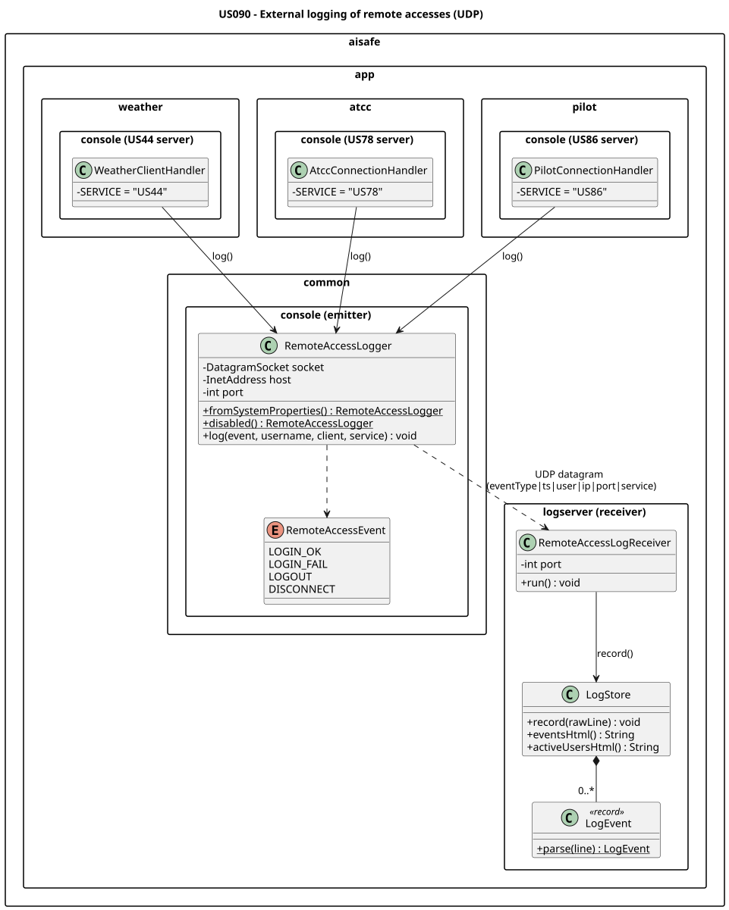

# US 090 - External logging of remote accesses

## Requirements

**US 090** As Administrator, I want to have logs for every remote access to the system.

**Acceptance Criteria:**

- US090.1 Remote access events are transmitted via UDP datagrams to a Remote Accesses Logging Server.
- US090.2 Successful logins, failed logins, logouts, and disconnects are all logged.
- US090.3 Logged data includes timestamp, username, client IP, client port, and service (US44 / US78 / US86).
- US090.4 The Remote Accesses Logging Server runs at a dedicated network node in the cloud.

**Definition of Done:**

- UDP client integrated into all three remote-access services.
- UDP logging server application implemented.
- Logging server deployable to a cloud node.
- All event types (login success/fail, logout, disconnect) verified end-to-end.

**Dependencies/References:**

- US044 - Weather Person remote access
- US078 - Air Transport Company Collaborator remote access
- US086 - Pilot remote access

## Analysis

Remote-access events must reach a separate Remote Accesses Logging Server. The transport is **UDP**: logging is fire-and-forget — the emitter never waits for a reply, so it can neither block nor slow down a login, and an occasionally lost datagram leaves the service unaffected.

## Design

A shared `RemoteAccessLogger` (a UDP client in `aisafe.app.common.console`) sends one datagram per event — `eventType|isoTimestamp|username|clientIp|clientPort|service` — fired from the Weather (`US44`), ATCC (`US78`) and Pilot (`US86`) handlers at login, logout and disconnect. A standalone `aisafe.app.logserver` module runs a `DatagramSocket` receive loop that parses each line into a `synchronized` `LogStore` (recent-events ring buffer + active-user set), shared with the US091 HTTP threads.

### Realization



## Implementation

The work splits into an **emitter** (inside the existing remote-access services) and a standalone **receiver**.

**Emitter — `aisafe.app.common.console`** (`remote/logging/`)
- `RemoteAccessLogger` — wraps one `DatagramSocket`; per event builds a `DatagramPacket` and `send()`s it fire-and-forget, swallowing `IOException` so logging can never break the service. `fromSystemProperties()` resolves the target node; `disabled()` is a no-op used where logging is unwired (and in tests).
- `RemoteAccessEvent` — the `LOGIN_OK | LOGIN_FAIL | LOGOUT | DISCONNECT` enum.

**Hooks — the three TCP servers**
- `WeatherClientHandler` (`service = US44`), `AtccConnectionHandler` (`service = US78`) and `PilotConnectionHandler` (`service = US86`) call the logger right after the credential check, on logout, and on abnormal close. `WeatherRemoteServer` / `AtccTcpServer` / `PilotTcpServer` each build one logger (`RemoteAccessLogger.fromSystemProperties()`) and inject it into every connection handler.

**Receiver — new module `aisafe.app.logserver`** (registered in `aisafe/pom.xml`, no AISafe/DB dependency)
- `RemoteAccessLogReceiver` — a `DatagramSocket` receive loop; each datagram is one event line.
- `LogStore` — a `synchronized` recent-events ring buffer + active-user set; `LogEvent` parses the pipe-separated line.

**Configuration.** The emitter target is set with `-Daisafe.logserver.host` / `-Daisafe.logserver.port` (defaults `localhost:9090`); the receiver UDP port is the first CLI argument to `LogServerApp`.

## Integration/Demonstration

US090 plugs the remote-access services (US044 Weather, US078 ATCC, US086 Pilot) into a
separate **Remote Accesses Logging Server**. Each TCP server emits a fire-and-forget UDP
datagram on every login/logout/disconnect; the Logging Server receives them and (US091)
renders them live.

> **Run every command below from the `aisafe/` directory.** In IntelliJ, the ▶ gutter icon
> next to each `shell` block runs it in the built-in terminal.

### Topology (local single-machine demo)

| Process | Role | Port(s) |
|---|---|---|
| Logging Server (`LogServerApp`) | UDP receiver + HTTP/AJAX pages | UDP `9090`, HTTP `8090` |
| Weather Main App (`WeatherApp`) | US044 TCP server + UDP emitter | TCP `5556` → UDP `9090` |
| ATCC Main App (`AtccApp`) | US078 TCP server + UDP emitter | TCP `6666` → UDP `9090` |
| Pilot Main App (`PilotApp`) | US086 TCP server + UDP emitter | TCP `5555` → UDP `9090` |
| Weather / ATCC / Pilot remote clients | the remote actors (the "logins") | — |
| Web browser | US091 status pages | `http://localhost:8090/` |

The emitter targets `localhost:9090` by default, so the local demo needs no extra flags. For a
multi-node (cloud) demo, launch a Main App with `-Daisafe.logserver.host=<logHost> -Daisafe.logserver.port=9090`.

### One-time — seed the demo users

```shell
./run-bootstrap.sh
```

> ⚠️ The bootstrap **drops and recreates** the shared H2 database — it wipes existing data.
> Intentional for a clean demo; skip it if a teammate has data you need in that shared DB.

### Launch sequence

**1 — Logging Server** (build the jar once, then run it; leave it running):

```shell
./mvnw -q -pl aisafe.app.logserver package -Dmaven.javadoc.skip=true
```

```shell
java -jar aisafe.app.logserver/target/aisafe.app.logserver-1.0.0-SNAPSHOT.jar 9090 8090
```

**2 — Weather Main Application** (starts the TCP server on 5556; leave it at its console prompt):

```shell
./run-weather.sh
```

**3 — Weather remote client** (this is the actual US044 login that generates the event):

```shell
java -cp "aisafe.app.weather.console/target/aisafe.app.weather.console-1.0.0-SNAPSHOT.jar:aisafe.app.weather.console/target/dependency/*" eapli.aisafe.app.weather.console.remote.client.WeatherPersonRemoteClient localhost 5556
```

**4 — Pilot Main Application** (TCP server on 5555):

```shell
./run-pilot.sh
```

**5 — Pilot remote client:**

```shell
java -cp "aisafe.app.pilot.console/target/aisafe.app.pilot.console-1.0.0-SNAPSHOT.jar:aisafe.app.pilot.console/target/dependency/*" eapli.aisafe.app.pilot.console.infrastructure.tcp.client.PilotRemoteClient localhost 5555
```

**6 — ATCC Main Application** (starts the TCP server on 6666; the console then waits at its
own login prompt — leave it there, the TCP server already runs as a daemon thread):

```shell
./run-atcc.sh
```

**7 — ATCC remote client:**

```shell
java -cp "aisafe.app.atcc.console/target/aisafe.app.atcc.console-1.0.0-SNAPSHOT.jar:aisafe.app.atcc.console/target/dependency/*" eapli.aisafe.app.atcc.console.infrastructure.tcp.client.AtccRemoteClient localhost 6666
```

**Demo credentials** (all seeded with password `Password1`):

| Service | Username | Password |
|---|---|---|
| US044 Weather (`WEATHER_PERSON`) | `weatherperson` | `Password1` |
| US078 ATCC (`AIR_TRANSPORT_COMPANY_COLLABORATOR`) | `tapcollab` | `Password1` |
| US086 Pilot (`PILOT`) | `fr.pilot1` | `Password1` |

### Exercising the four event types

> The Main App's **console** login (in the IDE/terminal) is the local desktop app and does **not**
> emit US090 events. Only the **remote client** TCP login does.

| Action in a remote client | Event logged | On the page |
|---|---|---|
| Log in with valid credentials | `LOGIN_OK` | user appears in *Active users* |
| Log in with a wrong password | `LOGIN_FAIL` | event row only; never active |
| Choose *Logout* | `LOGOUT` | user leaves *Active users* |
| Kill the client while logged in | `DISCONNECT` | user leaves *Active users* |

### Probing the transport directly (no app needed)

Hand-send a fake event datagram to prove the UDP intake independently:

```shell
echo 'LOGIN_OK|2026-06-13T16:05:01|jdoe|192.168.1.7|54213|US44' | nc -u -w1 localhost 9090
```

The line format is `eventType|isoTimestamp|username|clientIp|clientPort|service` — the five required
fields plus the event type. Open `http://localhost:8090/` (US091) to see it land within ~2 s.

## Observations

- **Why UDP, not TCP.** Logging is fire-and-forget; TCP would add connection overhead and could block the service if the log node were slow or down. UDP's lack of a delivery guarantee is acceptable — a lost event line does not affect the running service.
- **In-memory store.** `LogStore` keeps only the last *N* events in a ring buffer plus the active-user set; data does not survive a restart. Adequate for live monitoring; a file/DB backing could be added if persistence were required.
- **Service coverage.** All three remote-access services emit through the same constructor-injected hook, tagged by the `service` field: `US44` (Weather), `US78` (ATCC) and `US86` (Pilot).
- **No channel security.** Usernames travel in clear over UDP; wrapping the transport in (D)TLS is out of scope for this sprint.
- **Third-party work.** None beyond the JDK `java.net` (Berkeley sockets) API; the emitter and receiver follow the course UDP client/server references.
