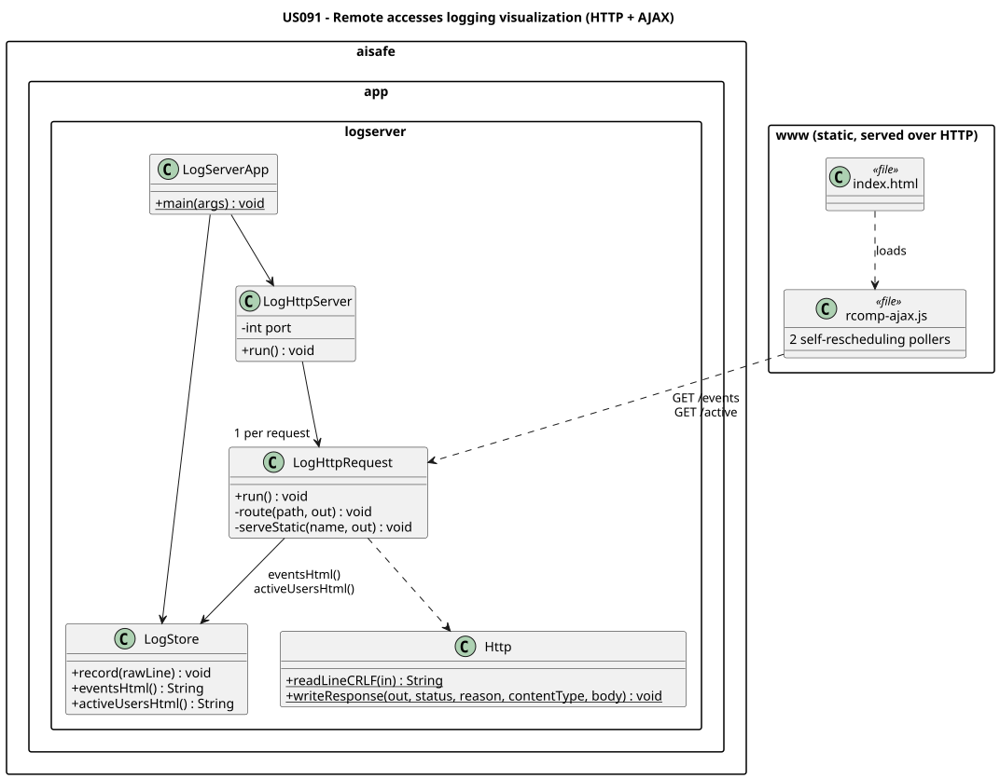

# US 091 - Remote accesses logging visualization

## Requirements

**US 091** As Administrator, I want to view the logs stored at the Remote Accesses Logging Server.

**Acceptance Criteria:**

- US091.1 The Remote Accesses Logging Server contains an HTTP server providing status pages to standard web browsers.
- US091.2 At least two pages are available: a list of the last recorded events, and a list of currently active remote users.
- US091.3 Both pages are kept updated to reflect the current state.
- US091.4 AJAX is used to update presented data without reloading the page.

**Definition of Done:**

- HTTP server integrated into the logging server application.
- Both required pages implemented and serve current state.
- AJAX polling/streaming works without page reload.
- Pages render correctly in a standard browser.

**Dependencies/References:**

- US090 - External logging of remote accesses

## Analysis

The Logging Server must expose the live event data to a standard web browser, kept current without page reloads. Implementing a small subset of **HTTP** (one TCP connection per request, text headers) together with **AJAX** polling is enough to satisfy this.

## Design

`LogHttpServer` is a thread-per-request HTTP server reading from the shared `LogStore`. It exposes two endpoints — `GET /events` and `GET /active` — that return HTML fragments, plus the static page assets from `www/`. The page (`index.html` + `rcomp-ajax.js`) runs **two self-rescheduling AJAX pollers**, one per region, each refreshing its `<div>` roughly every 2 s by rescheduling itself in `onload` (never `setInterval`), so both regions stay current with no reload.

### Realization



## Implementation

Implemented inside the same `aisafe.app.logserver` module, over the shared `LogStore`.

**HTTP server — `http/`**
- `LogHttpServer` — a `ServerSocket` accept loop, one `LogHttpRequest` thread per connection.
- `LogHttpRequest` — reads the request line, drains the headers, then routes: `GET /events` and `GET /active` return HTML fragments from `LogStore`; `GET /` and other names serve static files from `www/`; anything else is `404` (non-`GET` → `405`).
- `Http` — CRLF line reading and response writing (`Content-Length`, `Connection: close`).

**Views & static assets**
- `LogStore.eventsHtml()` / `activeUsersHtml()` render the two fragments (HTML-escaped), guarded by the same `synchronized` lock the UDP thread writes under.
- `www/index.html` + `www/rcomp-ajax.js` are served from the classpath; the JS runs two self-rescheduling pollers, one per region.

**Configuration.** The HTTP port is the second CLI argument to `LogServerApp` (default `8090`).

## Integration/Demonstration

US091 is the **web visualization** of the same Logging Server that receives the US090 datagrams.
It serves two AJAX pages over HTTP that stay current without reloading.

> **Run from the `aisafe/` directory.** In IntelliJ, the ▶ gutter icon next to a `shell` block runs it.

### Bring up the stack

The full launch sequence (Logging Server + Main Apps + remote clients + demo credentials) is in
[US090 §6 — Integration/Demonstration](../us090/readme.md#6-integrationdemonstration). At minimum, for
the visualization you need the Logging Server running:

```shell
./mvnw -q -pl aisafe.app.logserver package -Dmaven.javadoc.skip=true
```

```shell
java -jar aisafe.app.logserver/target/aisafe.app.logserver-1.0.0-SNAPSHOT.jar 9090 8090
```

### Open the status pages

```shell
open http://localhost:8090/
```

The page hosts two regions, each refreshed by its own self-rescheduling AJAX poller (~2 s):

- **Active users** — fetched from `GET /active`: the remote users currently logged in.
- **Last events** — fetched from `GET /events`: the most recent accesses, newest first
  (timestamp, username, client IP, port, service).

### Show it staying live

With the page open, trigger a remote login/logout (see US090 §6.3) or hand-send an event:

```shell
echo 'LOGIN_OK|2026-06-13T16:10:00|demo|127.0.0.1|55001|US44' | nc -u -w1 localhost 9090
```

Both regions update **in place within ~2 s, with no page reload** — satisfying "kept updated" + "AJAX".

### Inspecting the raw fragments

Browsers only issue `GET`; the endpoints return ready-to-insert HTML fragments. View them directly
(browser, `curl`, or Postman):

```shell
curl -s http://localhost:8090/active
```

```shell
curl -s http://localhost:8090/events
```

## Observations

- **AJAX polling vs. push.** Polling (not WebSocket/SSE) was chosen to match the course HTTP+AJAX reference and keep the server a trivial HTTP subset; the trade-off is a small (~2 s) refresh latency and repeated requests.
- **No request pile-up.** Each poller reschedules itself in `onload`/`ontimeout`/`onerror` rather than on a fixed `setInterval`, so a slow or dead server cannot accumulate overlapping requests.
- **Minimal HTTP.** The server implements only what the status pages need — HTTP/1.0, `Connection: close`, `GET` only, one connection per request — not a general-purpose server.
- **Concurrency.** The two pages are read by HTTP threads while the UDP thread writes; the single `synchronized` `LogStore` provides the mutual exclusion.
- **No auth.** The status pages are unauthenticated, as the requirement does not ask for it.
- **Third-party work.** None beyond the JDK; the server follows the course HTTP+AJAX voting reference.
