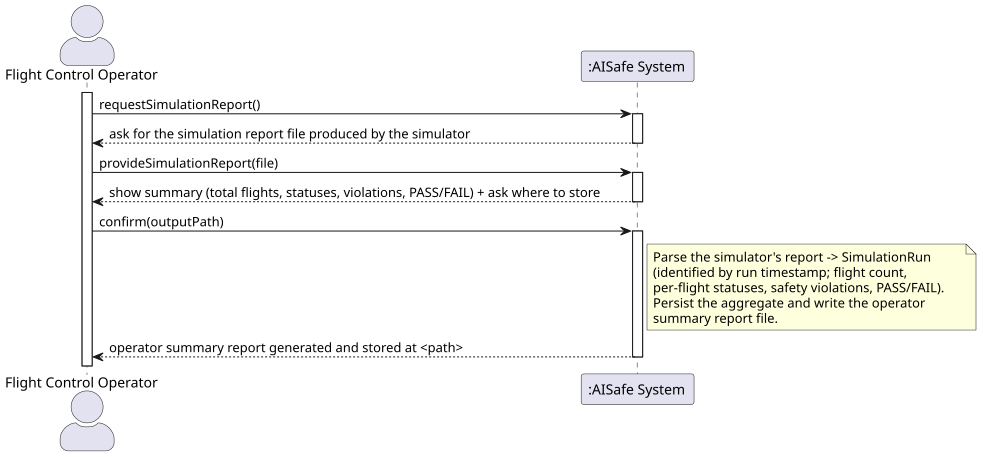
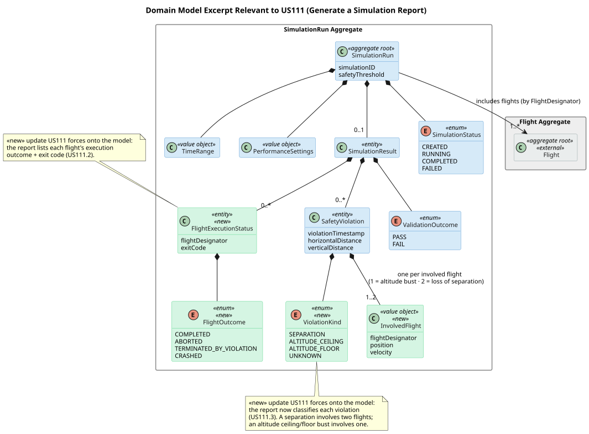
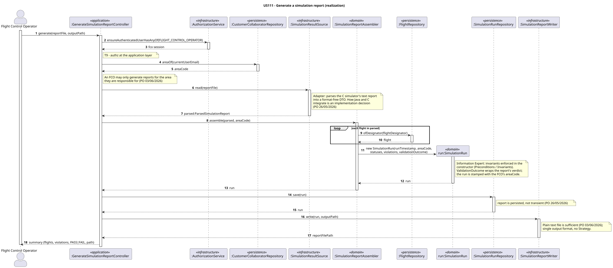
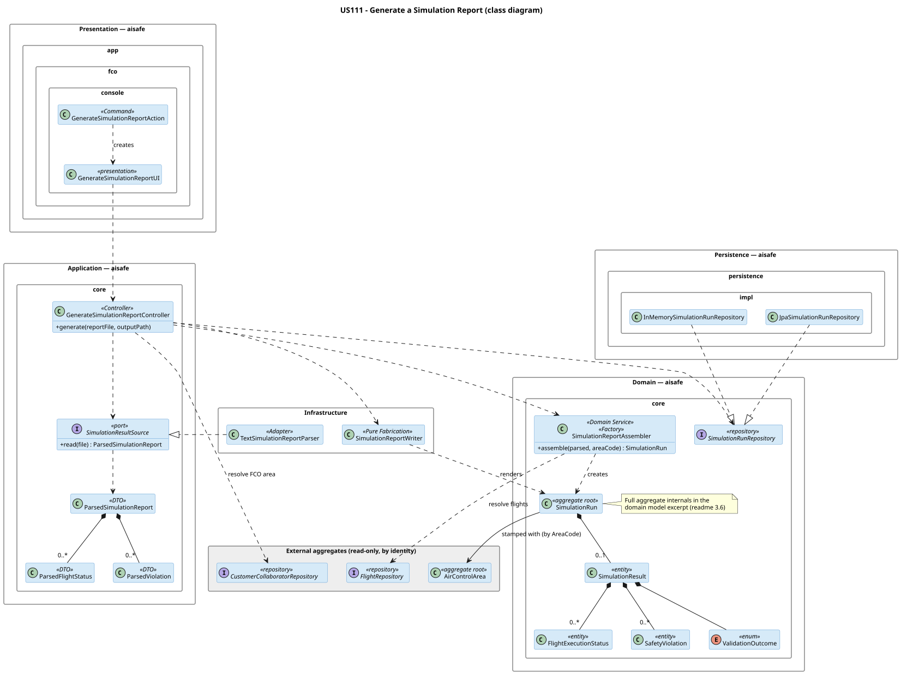
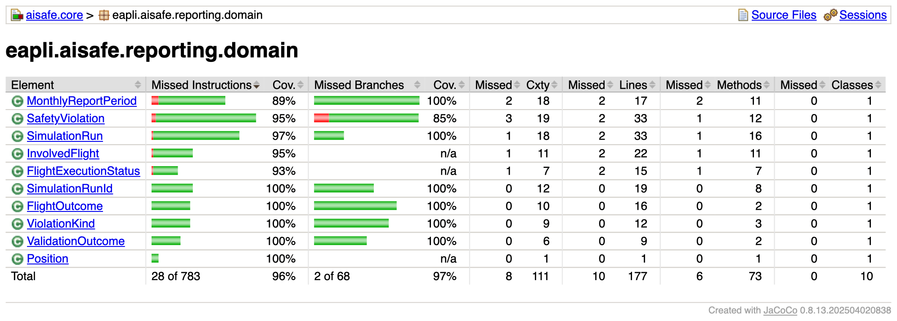
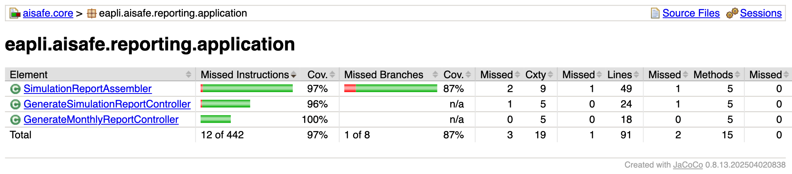

# US 111 - Generate a simulation report

## Requirements

**US 111** As a Flight Control Operator, I want to receive a summary of the simulation results so that I can determine if the programmed flights are safe to run.

**Acceptance Criteria:**

- US111.1 The system generates a report and stores it in a file.
- US111.2 The report includes the total number of flights and their execution status.
- US111.3 If safety violations occur, the report lists their timestamps and positions.
- US111.4 The report clearly indicates whether the scheduled flights plan passed or failed validation.

**Definition of Done:**

- Generate-report UC implemented end-to-end on the EAPLI side.
- Integration with the SCOMP report (US109) consumes the C-side output.
- Pass/fail validation logic implemented.
- File storage works on Linux.
- Tests cover successful and failed simulation outcomes.
- Coverage ≥ 90% on controller/domain.

**Dependencies/References:**

- US085 - Test/validate flight plan
- US109 - Generate and store final simulation report

## Analysis

### Actor and Console

The actor is the **Flight Control Operator (FCO)**, responsible for testing flight plans and
simulating air control. The use case lives in `aisafe.app.fco.console`.

### Approach

US111 ingests the simulation report produced by the C component (US109) and turns it into a
domain record. An **adapter** parses the report; the **controller** populates a `SimulationRun`
aggregate (flight count, per-flight execution statuses, safety violations, and the PASS/FAIL
verdict) and persists it through `SimulationRunRepository`.

The adapter sits behind a `SimulationResultSource` port so the domain stays unaware of the
report's concrete format, reusing the project's existing port/adapter boundary : if the layout changes, only the adapter changes.

### Persistence: file *and* domain (both required)

- **File**: the operator-facing summary is written to disk (US111.1).
- **Domain/DB**: the `SimulationRun` is *also* persisted as an aggregate, through a repository
  interface defined in `aisafe.core` with in-memory and JPA implementations (NFR08). This is
  required because **US112 (monthly report) aggregates across runs**, e.g. total violations in
  a month, violations per area. A file cannot be queried; the persisted aggregate is what US112
  reads.

### The Report

A versioned, line-oriented text file: a `key=value` header (run metadata + overall result),
followed by a per-flight statuses section and a violations section. Each violation row carries
the simulation step, a violation **kind**, and a position + velocity vector per involved
aircraft. The kind classifies the event as a **loss of separation** (two flights) or an
**altitude ceiling/floor bust** (a single flight); for the latter only the first aircraft's
fields are meaningful. Violations are indexed by **step**, so US111 derives each event's
timestamp as `run_timestamp + step × seconds_per_step`.

### System Sequence Diagram (SSD)



### Domain Model & Invariants

The reporting domain reuses the global Sprint-3 `SimulationRun` aggregate: `SimulationRun` (run
timestamp, scenario, totals, end reason), `FlightExecutionStatus` (flight identifier, outcome,
exit code), `SafetyViolation` (step → derived timestamp, a `ViolationKind`, and one or two
`InvolvedFlight` value objects), and `ValidationOutcome` (the PASS/FAIL value, wrapping the
report's overall validation result). A `ViolationKind` is one of `SEPARATION`,
`ALTITUDE_CEILING`, `ALTITUDE_FLOOR` or `UNKNOWN`; each `InvolvedFlight` holds one aircraft's
reference plus its position and velocity at the moment of the event. Key invariants:

- the number of status entries equals the reported total flight count;
- a `SafetyViolation` involves exactly **two distinct** flights when it is a `SEPARATION`, and
  exactly **one** flight when it is an altitude bust; the kind and the involved-flight count are
  always consistent (enforced by the `separation(...)` / `altitude(...)` factories);
- `ValidationOutcome` reflects the report's overall validation result (PASS/FAIL).



## Design

### Realization

The use case is a single-aggregate write: one `SimulationRun` is assembled from the parsed
report and persisted; `Flight`, the FCO's `AreaCollaborator` and `AirControlArea` are read-only.
The sequence diagram below shows the flow from `aisafe.app.fco.console` to persistence and the
output file.



Responsibilities are assigned by **General Responsibility Assignment Software Patterns (GRASP)**:

- **`GenerateSimulationReportController`** is the GRASP **Controller** and the use-case entry point. It
  authenticates the operator with `ensureAuthenticatedUserHasAnyOf(FLIGHT_CONTROL_OPERATOR)`
  (Secure by Design, **T9**, authz at the application layer), resolves the FCO's own area from
  the `CustomerCollaboratorRepository`, reads the report through the source port, delegates
  assembly, persists the run, and drives the file writer. It holds no parsing logic and no
  domain invariant. Resolving the area here enforces the PO rule that *"a Flight Control
  Operator may only generate reports for the air control area(s) they are responsible for"*
  (PO 03/06/2026).
- **`SimulationReportAssembler`** (**Domain Service**, **T4**) receives the parsed report and
  the resolved `AreaCode`, resolves each report flight to its `Flight` by identity, maps each
  parsed violation's `ViolationKind` onto the matching `SafetyViolation` factory (`separation(...)`
  for a two-flight event, `altitude(...)` for a single-flight bust), and returns a constructed
  `SimulationRun` stamped with the FCO's area. The assembly spans more than one aggregate
  (`SimulationRun` + `Flight` + the FCO's area), so it belongs to no single aggregate, the
  textbook reason for a domain service. It never persists.
- **`SimulationRun`** and its value objects are the GRASP **Information Expert**. The aggregate
  enforces its own invariants in the constructor (status-count consistency), and `SafetyViolation`
  enforces its own through the self-validating `separation(...)` / `altitude(...)` factories — a
  separation needs two distinct `InvolvedFlight`s, an altitude bust needs exactly one and an
  altitude `ViolationKind`. `ValidationOutcome` carries the report's PASS/FAIL verdict (US111.4).

Two framework mechanisms keep the rules apart, as in US080/US042: **`Preconditions`**
(→ `IllegalArgumentException`) validate the assembler's inputs and each VO's construction;
**`Invariants`** (→ `IllegalStateException`) assert the aggregate's internal state.
`SimulationReportAssembler` also acts as a **Factory** (Gang of Four / DDD), encapsulating the
assembly of the `SimulationRun` so construction logic stays out of the controller.

The class diagram below shows the resulting structure.



The structural backbone is the boundary to the C component. **`SimulationResultSource`** is a
**Separated Interface** (port, **T5**) defined in `aisafe.core`; **`TextSimulationReportParser`**
is its **Adapter** (Gang of Four), the single place that understands the C simulator's text
format and translates it into format-free DTOs. This realises GRASP **Protected Variation** /
**Indirection**: the domain and controller never see the report layout, so a future change to
that layout touches only the adapter (**Open/Closed Principle**, SOLID). It also honours the
PO's position that *"how the Java system and the C simulation module integrate is an
implementation decision"* (PO 26/05/2026), the boundary is ours to shape.

- **`ParsedSimulationReport`**, **`ParsedFlightStatus`**, **`ParsedViolation`** are **DTOs**
  (GRASP **Pure Fabrication** / **Indirection**): they carry data from the adapter to the
  assembler without leaking the text format inward or domain types outward.
- Layering follows the **Dependency Inversion Principle** (SOLID): `SimulationRunRepository`,
  `SimulationResultSource`, `FlightRepository` and `CustomerCollaboratorRepository` are
  interfaces owned by `aisafe.core`; `JpaSimulationRunRepository` and
  `InMemorySimulationRunRepository` implement the repository in `aisafe.persistence.impl`
  (NFR08, both backends), all injected at the console (Dependency Injection).
- **`SimulationReportWriter`** renders the operator summary file from a `SimulationRun`, a
  GRASP **Pure Fabrication**. Because *"a plain text file is sufficient for the report output"*
  (PO 03/06/2026) and there is a single C engine, it deliberately uses **no Strategy and no
  Template Method**: introducing a format hierarchy here would be premature abstraction. (US112,
  by contrast, is explicitly mandated to use **Strategy**, PO 03/06/2026, a different concern.)
- **`GenerateSimulationReportAction`** is the framework's **Command** wiring on the FCO menu, and
  **`GenerateSimulationReportUI`** reuses `AbstractUI`'s **Template Method** for the console
  walkthrough.

### Acceptance Tests

Tests follow JUnit 4 style (Vintage Engine), the `ensure{Subject}{Verb}For{Condition}` naming
convention, and no mocking framework. The controller tests are integration-style: the controller
is built with the real `InMemorySimulationRunRepository`, `InMemoryFlightRepository` and
`InMemoryCustomerCollaboratorRepository` (pre-populated via `given...` helpers), a real
`TextSimulationReportParser`, and a real `SimulationReportWriter`. Each parse is fed by a
representative **sample report file** under `src/test/resources/` that carries the full field
set (including `seconds_per_step`), so parsing, assembly, persistence and file output are
exercised without a live simulation run. The output path uses a `@TempDir`. The current FCO is
seeded as an `AreaCollaborator` of area `LPPC`.

- `ensureGeneratePersistsRunAndWritesFileForCleanReport`: A valid report is parsed, persisted as one `SimulationRun`, and an (US111.1, US111.2)
- `ensureRunCarriesPerFlightExecutionStatuses`: The persisted run carries one execution status per flight, with the (US111.2)
- `ensureSeparationViolationIsListedWithTimestampAndPositions`: A loss-of-separation event is listed as a two-flight `SEPARATION` (US111.3)
- `ensureAltitudeViolationIsListedWithSingleFlightAndTimestamp`: An altitude ceiling/floor bust is listed as a single-flight altitude (US111.3)
- `ensureVerdictIsPassForCleanReport`: The verdict is PASS for a report that ended normally within the violation (US111.4)
- `ensureVerdictIsFailForThresholdExceededReport`: The verdict is FAIL for a report whose violations exceeded the threshold (US111.4)
- `ensureRunIsStampedWithTheFcoArea`: The persisted run is stamped with the area the FCO is responsible for. (PO 03/06/2026 (FCO may only report for their own area))
- `ensureGenerateRejectsNonFcoUser`: A user without the Flight Control Operator role cannot generate a report. (NFR09 (authorization))

## Implementation

Built **leaf-first and test-first**: the value objects, then the parsing adapter, then
the assembler/controller and the FCO console UI. `aisafe.core` stays format-unaware:
the C report's text layout lives only in the adapter, behind the `SimulationResultSource`
port (§4.1). All US111 code is under `eapli.aisafe.reporting.*` (domain / application /
application.parsing / infrastructure / repositories); the repository has in-memory and
JPA/H2 implementations (NFR08).

US111 reads a **run folder**: the C `report.txt` plus a `flights.csv` sidecar
(`surrogate_id,route,departure_date`) so each report `flight_id` resolves to its
`FlightId` (route + departure date). A hand-authored pair is a complete fixture, so the
use case is testable without a live simulation run.

A few decisions worth noting: the assembler derives each violation timestamp as
`run_timestamp + step × seconds_per_step` (US111.3); `ViolationKind.fromReport` maps the
C `kind` column to the domain enum and the assembler routes each row to the matching
`SafetyViolation` factory — `separation(...)` for a two-flight event, `altitude(...)` for a
single-flight ceiling/floor bust (US111.3); `FlightOutcome.fromReport` maps the C
`outcome`/`exit_code` to the domain enum (US111.2); the controller stamps the run with the
FCO's area resolved from the session (PO 03/06/2026); and the aggregate asserts
*status count == total flights* as its invariant.

### Commit trail (TDD)

- `feat(US111): add SimulationRun aggregate and value objects #246`: `SimulationRun`,
  `SimulationRunId`, `ValidationOutcome`, `FlightOutcome`, `FlightExecutionStatus`,
  `SafetyViolation`, `Position`.
- `test(US111): parse report.txt + flights.csv sidecar to DTOs #247`: parser tests and
  the `clean`/`violation` fixtures.
- `feat(US111): add SimulationResultSource port, DTOs and text parser #246`: the port,
  the `Parsed*` DTOs and `TextSimulationReportParser`.
- `feat(US111): add SimulationRunRepository with in-memory and JPA impls #246`: the
  repository port, both backends and their factory wiring.
- `test(US111): GenerateSimulationReportController acceptance tests #247`: the
  integration-style controller tests over the fixtures.
- `feat(US111): add assembler, controller, report writer and FCO console UI #246`:
  `SimulationReportAssembler`, `GenerateSimulationReportController`,
  `SimulationReportWriter` and the console UI/action wired into the FCO menu.
- `test(US111): egress writes flights.csv id-map sidecar #247`: sidecar writer + runner
  tests.
- `feat(US111): write flights.csv id-map sidecar on the egress run #246`:
  `SurrogateIdMapWriter`, emitted by `ScompProcessAreaSimulationRunner`.

The acceptance tests cover US111.1 (file written) + US111.2 (totals + per-flight
statuses) via the clean report; US111.3 (kind + timestamp + positions) via both the
two-flight separation report and the single-flight altitude report; US111.4 (PASS/FAIL)
via both verdicts; NFR09 (authz) via the non-FCO rejection; the area-stamp rule via the
`LPPC` assertion. The full `aisafe.core` suite stays green.

### Coverage (NFR03)

NFR03 requires ≥90% coverage on the domain and controller layers; the US111
`reporting.domain` and `reporting.application` packages sit at **96%** and **97%**, with every
US111 class above 90%. Beyond the controller acceptance tests, each value object and entity has a
focused unit test: the factories' validation branches (`SafetyViolation.separation`/`altitude`),
the `fromReport` mappings (`ViolationKind`, `FlightOutcome`, `ValidationOutcome`), the
`SimulationRun` invariant and guards, and `SimulationRunId` equality/ordering.





## Integration/Demonstration

US111 lands one C simulation run as a persisted Java aggregate. It **consumes** the
SCOMP `report.txt` (US109) and the `flights.csv` sidecar from the egress area-simulation
US. It never runs the simulator itself, and reads the FCO's area
(`CollaboratorRepository`) and `FlightRepository`. The persisted `SimulationRun` is what
US112's monthly report will aggregate once its stub becomes a JPA query.

To demonstrate, produce a report and ingest it from the FCO console:

```bash
cd scomp/sprint-3/flight_sim && make && make run-violation   # writes ./report.txt
```

Then run `aisafe/run-fco.sh` (after `run-bootstrap.sh`), log in as a Flight Control
Operator, choose **Generate Simulation Report**, and give the run folder + an output
path. The console prints the verdict, flight/violation counts and the stamped area, and
persists the run. The same flow runs headlessly in
`GenerateSimulationReportControllerTest`, so it is reproducible in CI.

## Observations

**Violation kinds.** `SafetyViolation` started life strictly pairwise; once the C report began
classifying events it was generalised to model one *or* two `InvolvedFlight`s behind the
`separation(...)` / `altitude(...)` factories, with `ViolationKind.UNKNOWN` absorbing any future
kind the report may add without breaking ingestion.

**Held-flight semantics.** A flight held for the whole run by the SCOMP staggered-entry
change reports `COMPLETED` with no distinct "never entered" marker;
acceptable for US111.2. A dedicated outcome would need both a new report field and a
`FlightOutcome` value, and is left as a future enrichment.
