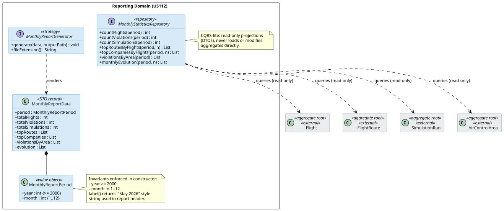
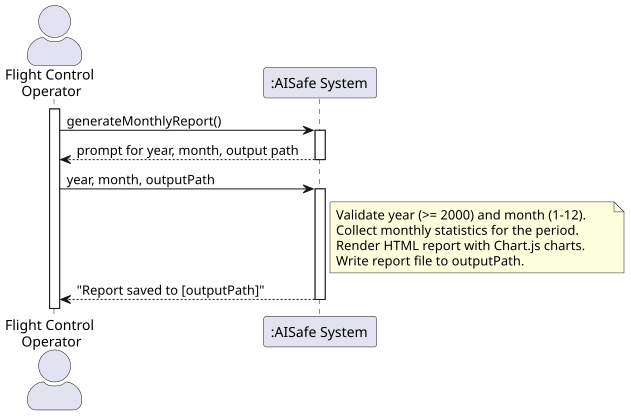
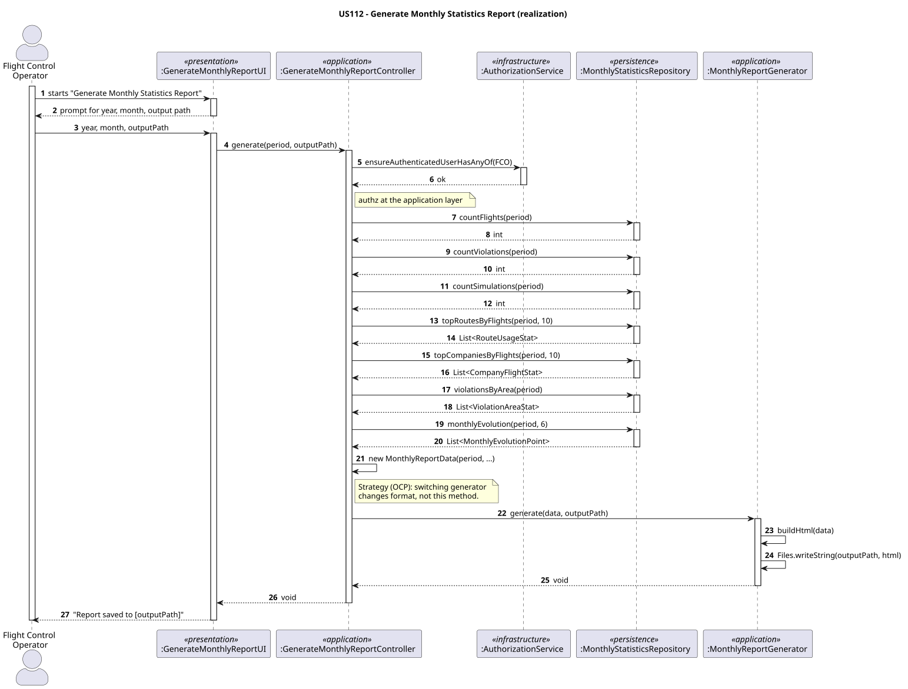
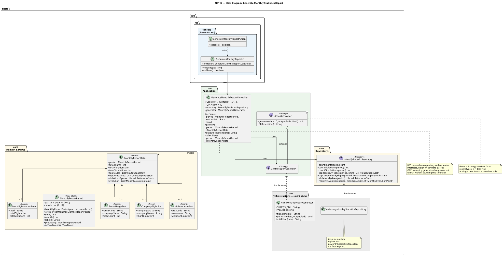
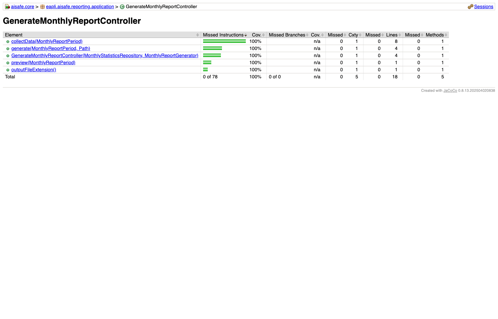
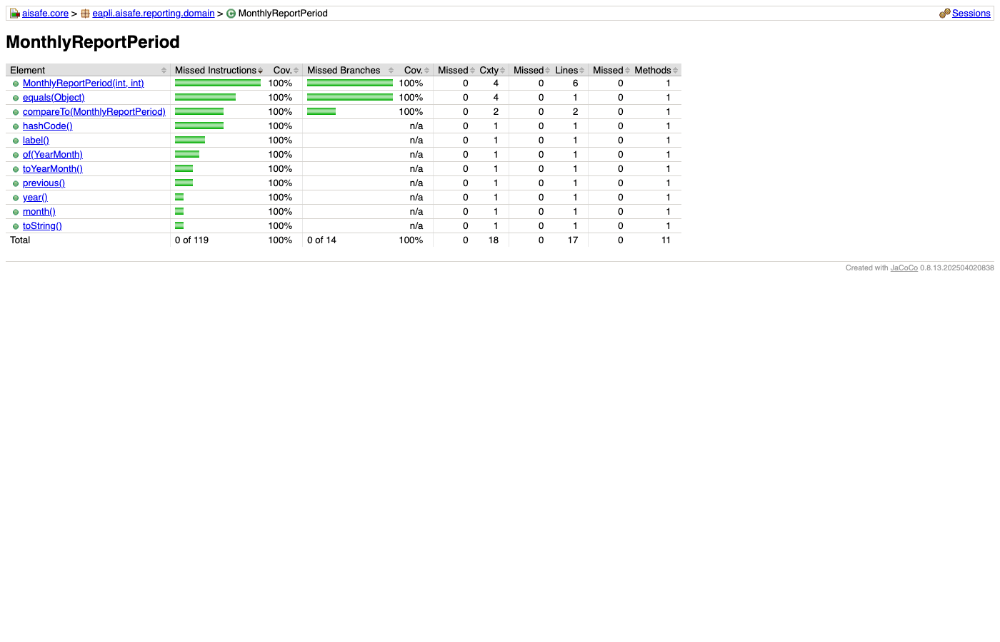

# US112 — Monthly Statistics Report

## Context

This is the first implementation of US112. It belongs to the Flight Control Operations functional sub-domain, specifically the reporting area. It was developed in Sprint 3 and is owned by Flight Control Operators (FCOs).

US112 introduces the reporting infrastructure for the entire system. Without this foundational layer, no future report type (compliance, incident, safety) can be added in a consistent way. It depends on US080 (flight plans must exist to have statistics to report), and it establishes the `ReportGenerator<D>` Strategy hierarchy that all subsequent reporting user stories will extend.

The work covers analysis, design, full implementation of the reporting framework (domain VO, DTOs, Strategy interfaces, HTML generator, in-memory stub repository), and integration tests wired through the FCO console.

## Requirements

**US112** — *"As a Flight Control Operator, I want to generate a monthly statistics report. This work should be foundational so that future report types (compliance, incident, etc.) follow consistent branding and structure."*

**Acceptance Criteria:**

- US112.1 — An FCO can trigger the generation of a monthly statistics report.
- US112.2 — The report includes flight statistics aggregated over a calendar month.
- US112.3 — The report structure follows a reusable template pattern designed for future report types.
- US112.4 — The report includes the data sections and graphics defined for the monthly type.
- US112.5 — Branding is consistent and centralised so future reports can reuse it.

**Dependencies/References:**

Upstream prerequisites:
- US080 (Create a flight plan): flight plans must exist in the system to produce meaningful statistics.

Downstream consumers:
- Future reporting user stories (compliance, incident) will extend the `ReportGenerator<D>` Strategy introduced here.

---

## Analysis

### Actor and Console

The actor is the Flight Control Operator (FCO). The requirements establish that FCOs are responsible for monitoring flight operations and generating reports. That made the choice of console straightforward — this use case lives in `aisafe.app.fco.console`, consistent with every other FCO-scoped user story.

### Requirement Source

Reading the requirements, "foundational so that future report types follow consistent branding and structure" was the key phrase. It means the design must not just deliver one report — it must deliver a framework that makes the second report trivially easy to add. That single constraint drove most of my design decisions.

The monthly report itself is data-heavy: top routes, top companies, violations by area, and a six-month evolution trend. Reading these requirements, I noticed they are pure read operations. No aggregates are modified — this is a reporting query. That distinction shaped how I modelled the repository layer.

### Design Decisions

**Introducing `ReportGenerator<D>` as a generic Strategy interface** was the first and most important decision. The requirement explicitly asks for future extensibility. A plain method `generateHtml(data)` would have worked for US112, but adding a PDF report later would require changing the controller. By defining `ReportGenerator<D>` with a type parameter, the controller depends on an interface, and a new format (PDF, CSV) is just a new class — no existing code changes. This is OCP applied at the framework level.

**CQRS-lite: `MonthlyStatisticsRepository` returns DTOs, not aggregates.** I considered loading `FlightPlan` aggregates and computing statistics from them in memory. That would have worked for a small dataset but is unscalable and exposes unnecessary domain internals to the reporting layer. Instead, `MonthlyStatisticsRepository` exposes projection methods (`countFlights`, `topRoutesByFlights`, etc.) that return lightweight record DTOs. This also means a future JPA implementation can push the aggregation into a SQL query, which is far more efficient.

**`MonthlyReportPeriod` as a Value Object.** Year and month together form a bounded concept with clear invariants (year >= 2000, month 1–12). If I had used two plain `int` parameters throughout, every caller would need to validate them independently. By encoding the constraint in the VO constructor, any invalid combination is rejected immediately — once, in one place — before it can ever reach the controller or generator.

**Placing `HtmlMonthlyReportGenerator` and `InMemoryMonthlyStatisticsRepository` in `aisafe.core`, not `aisafe.persistence.impl`.** These classes have zero JPA or database dependencies — they are pure Java. Putting them in `persistence.impl` would be a misclassification and, more critically, would break compile-time visibility in `aisafe.app.fco.console`, which only depends on `persistence.impl` at runtime scope. Keeping them in `aisafe.core` ensures the console can reference them directly without a module dependency change.

### Invariants

Inside the `MonthlyReportPeriod` constructor:
- `year` is >= 2000.
- `month` is in range 1–12.

At the application layer (controller constructor):
- `repository` is not null.
- `generator` is not null.

At the application layer (`generate` method):
- `period` is not null.
- `outputPath` is not null.

### Domain Model Excerpt

The diagram below shows the `MonthlyReportPeriod` value object, the `MonthlyReportData` DTO it anchors, and the read-only relationships to the external aggregates that the repository queries. The external aggregates are shown in a separate package — they are never modified by this US, only queried by identity.



The reporting domain contains:
- `MonthlyReportPeriod` (VO) — year + month pair, validated in constructor.
- `MonthlyReportData` (DTO record) — assembled by the controller from repository projections.
- `MonthlyStatisticsRepository` (interface) — read-only, returns DTOs; never touches aggregate state.
- `MonthlyReportGenerator` (Strategy interface) — decouples format from data collection.

### Coverage Analysis

| Acceptance Criterion | Test method |
|---|---|
| US112.1 — FCO triggers report generation | `generate_validPeriodAndPath_createsHtmlFile`, `preview_validPeriod_returnsDataWithMatchingPeriod` |
| US112.2 — statistics aggregated over a month | `generate_validPeriodAndPath_createsHtmlFile`, `generate_htmlContainsPeriodLabel`, `constructor_validYearAndMonth_createsInstance`, `toString_returnsHumanReadableLabel` |
| US112.3 — reusable template pattern | `outputFileExtension_htmlGenerator_returnsHtml`, `constructor_nullRepository_throwsNullPointerException`, `constructor_nullGenerator_throwsNullPointerException` |
| US112.4 — data sections and graphics defined for monthly type | `generate_htmlContainsExpectedChartIds` |
| US112.5 — consistent branding centralised | `generate_htmlContainsPeriodLabel`, `generate_htmlContainsExpectedChartIds` |

---

## Design

### System Sequence Diagram (SSD)



### Sequence Diagram (SD)



### Class Diagram



### DDD Concepts Applied

| DDD Concept | Artifact | Where & How it is Applied |
|---|---|---|
| **Value Object** | `MonthlyReportPeriod` | Immutable, no identity of its own — equality is by value (year + month). Encodes the valid range (year >= 2000, month 1–12) in the constructor, guaranteeing the invariant everywhere with no duplication. |
| **Repository** | `MonthlyStatisticsRepository` | Interface defined in `aisafe.core` — the domain never references a concrete implementation. The interface exposes only CQRS read projections; it never mutates aggregate state. |
| **Persistence Ignorance** | All domain and DTO classes | `MonthlyReportPeriod`, `MonthlyReportData`, and all DTOs are plain Java objects — no JPA annotations, no JDBC. The `MonthlyStatisticsRepository` interface lives in `aisafe.core`; the future JPA implementation will live in `aisafe.persistence.impl`. |
| **Strategy (Application Service Pattern)** | `ReportGenerator<D>`, `MonthlyReportGenerator`, `HtmlMonthlyReportGenerator` | The controller depends only on `MonthlyReportGenerator`. Adding a PDF or CSV format means adding one new class that implements the interface — the controller, the UI, and all existing code remain unchanged. |

---

## Tests

All tests are written in JUnit 5 (Jupiter) style. Controller tests use a real `HtmlMonthlyReportGenerator` and `InMemoryMonthlyStatisticsRepository` — no mocks.

**Test classes:**
- `eapli.aisafe.reporting.domain.MonthlyReportPeriodTest`
- `eapli.aisafe.reporting.application.GenerateMonthlyReportControllerTest`

### MonthlyReportPeriodTest

| Test | Refers to AC |
|---|---|
| `constructor_minimumValidYear_createsInstance` | US112.2 |
| `constructor_validYearAndMonth_createsInstance` | US112.2 |
| `constructor_yearBeforeMinimum_throwsIllegalArgumentException` | — |
| `constructor_monthZero_throwsIllegalArgumentException` | — |
| `constructor_monthThirteen_throwsIllegalArgumentException` | — |
| `year_returnsCorrectYear` | — |
| `month_returnsCorrectMonth` | — |
| `toString_returnsHumanReadableLabel` | US112.2 |
| `equals_sameYearAndMonth_returnsTrue` | — |
| `equals_sameInstance_returnsTrue` | — |
| `equals_differentMonth_returnsFalse` | — |
| `equals_differentYear_returnsFalse` | — |
| `equals_null_returnsFalse` | — |
| `equals_differentType_returnsFalse` | — |
| `hashCode_sameValues_returnsSameHash` | — |
| `compareTo_lesserMonth_returnsNegative` | — |
| `compareTo_greaterMonth_returnsPositive` | — |
| `compareTo_equalPeriod_returnsZero` | — |
| `compareTo_earlierYear_returnsNegative` | — |
| `compareTo_laterYear_returnsPositive` | — |
| `of_yearMonth_createsCorrectPeriod` | — |

### GenerateMonthlyReportControllerTest

Integration-style controller tests: the controller is wired with a real `HtmlMonthlyReportGenerator` and `InMemoryMonthlyStatisticsRepository`. Each test that writes a file uses a temporary directory provided by `@TempDir`.

| Test | Refers to AC |
|---|---|
| `constructor_nullRepository_throwsNullPointerException` | — |
| `constructor_nullGenerator_throwsNullPointerException` | — |
| `generate_validPeriodAndPath_createsHtmlFile` | US112.1, US112.2 |
| `generate_htmlContainsExpectedChartIds` | US112.4, US112.5 |
| `generate_htmlContainsPeriodLabel` | US112.2, US112.5 |
| `generate_nullPeriod_throwsNullPointerException` | — |
| `generate_nullPath_throwsNullPointerException` | — |
| `preview_validPeriod_returnsDataWithMatchingPeriod` | US112.1, US112.2 |
| `preview_nullPeriod_throwsNullPointerException` | — |
| `outputFileExtension_htmlGenerator_returnsHtml` | US112.3 |

### Test Coverage (NFR03)

NFR03 requires >=90% test coverage on the domain and controller packages. The figures below are the JaCoCo reports captured after the final test additions. Controller: **100% instruction / 100% branch**. Domain: **100% instruction / 100% branch**.




---

## Implementation

Key implementation notes:

- `MonthlyReportPeriod.label()` uses `Month.of(month).getDisplayName(TextStyle.FULL, Locale.ENGLISH)` to produce the human-readable label ("May 2026") embedded in the report header and used by tests.
- `HtmlMonthlyReportGenerator` embeds all data as inline JS constants (`const routeLabels = [...]`) so the generated HTML is fully self-contained — no AJAX calls, no external data source needed to open the report.
- Chart.js 4.x syntax is used: `borderDash` (not the removed `lineDash`), named Y-axis IDs (`yFlights`, `yViolations`) for the dual-axis evolution chart, and the `umd` bundle from CDN.
- The dark theme CSS variables (`--bg: #0d1117`, `--surface: #161b22`, `--accent: #58a6ff`) are defined once in the `<style>` block, making a future re-theme a one-line change.
- `InMemoryMonthlyStatisticsRepository` returns the same realistic aviation dataset regardless of the period passed — suitable for sprint review demos without a running database.
- The controller uses `Objects.requireNonNull` in its constructor and in `generate()` to fail fast on null inputs, producing clear stack traces instead of a `NullPointerException` deep in the rendering code.

---

## Integration/Demonstration

Integration points:

- US112 depends on US080 through `MonthlyStatisticsRepository` — the repository's data source is the `FlightPlan` aggregate. Without flight plans, statistics are zero but the report still generates.
- The `InMemoryMonthlyStatisticsRepository` uses realistic aviation data and is suitable for sprint review demonstrations without a running database; swap it for a JPA implementation when the database is available.
- FCOs can access the use case from the FCO main menu: **Generate Monthly Statistics Report**.

To manually demonstrate the feature:

1. Run the bootstrap to load master data (`run-bootstrap`).
2. Launch the FCO application (`run-fco`).
3. Log in as an FCO user.
4. Select **Generate Monthly Statistics Report** from the main menu.
5. Enter the year and month (or press Enter for current month).
6. Enter the output path (or press Enter for the default `report-YYYY-MM.html`).
7. Open the generated `.html` file in any modern browser to see the interactive charts.

### Programmatic usage

```java
var repo      = new InMemoryMonthlyStatisticsRepository(); // or JPA impl
var generator = new HtmlMonthlyReportGenerator();
var ctrl      = new GenerateMonthlyReportController(repo, generator);
ctrl.generate(new MonthlyReportPeriod(2026, 5), Path.of("report-2026-05.html"));
```

---

## Observations

The `ReportGenerator<D>` generic Strategy is intentionally designed so that non-monthly report types (compliance, incident) can introduce their own `D` type without altering existing code. The type parameter `D` is the extension point — each new report type defines its own data record and its own generator implementation.

Chart.js 4.x uses `borderDash` (not `lineDash`) and named Y-axis IDs for dual-axis charts. The HTML generator embeds all data as inline JS constants so no AJAX call is made — the report file is completely portable.

The `InMemoryMonthlyStatisticsRepository` is a sprint-demo stub intentionally placed in `aisafe.core` rather than `aisafe.persistence.impl`. When a real JPA implementation is built, it will live in `persistence.impl` and the stub will be retired. No changes to the controller, UI, or any other class will be required at that point.
