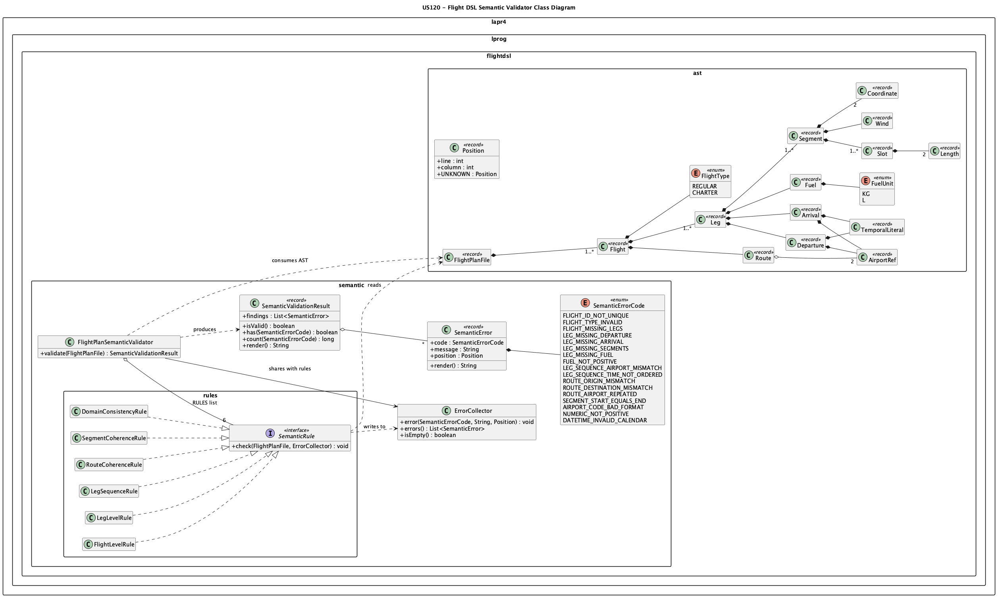
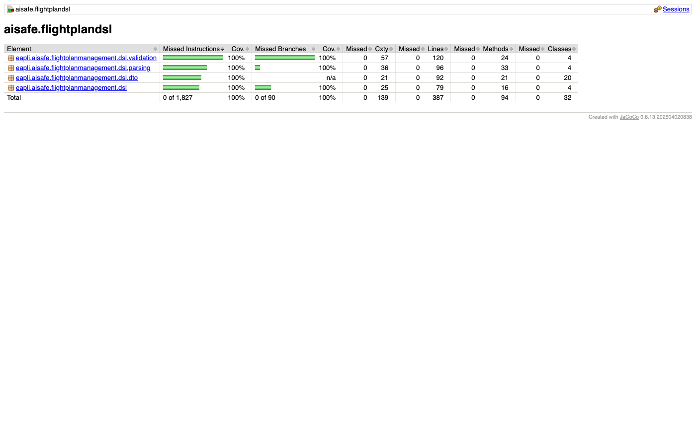
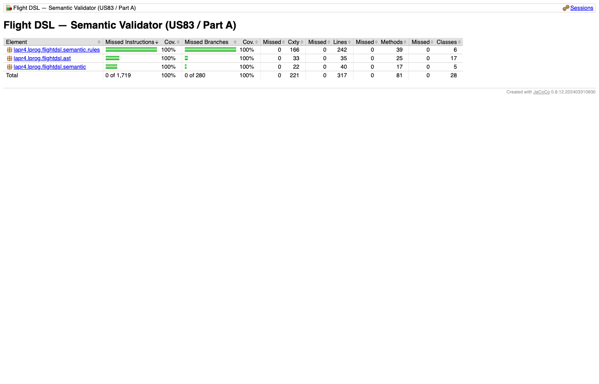

# US 120 - Flight DSL specification and validation

## Context

US120 is the Sprint 3 continuation of US083 (Sprint 2). US083 established the grammar and the
lexical/syntactic pipeline; US120 extends it with **full semantic analysis**, a rule-based
validator with a shared error collector, and an independent semantic-validator module with its
own AST.

## Requirements

**US 120** As a Project Manager, I want the team to specify and implement the Flight Description DSL with full semantic analysis, so that flight plans can be formally defined and validated.

**Acceptance Criteria:**

- US120.1 Informal lexical and syntactic specification is documented.
- US120.2 Formal grammar is defined using ANTLR (lexer + parser rules).
- US120.3 The system performs lexical, syntactic, AND semantic analysis.
- US120.4 At least one listener and one visitor are used in parse tree traversal.
- US120.5 Internal representation (AST or domain objects) is produced.
- US120.6 All semantic validation rules from section 3.4.5 are enforced.
- US120.7 Semantic errors are collected and reported in a single execution.
- US120.8 Error messages include type, line, and column information.

**Definition of Done:**

- ANTLR grammar finalised with full semantic coverage.
- Lexer, parser, visitor, and listener implementations pass all test inputs.
- All semantic rules (flight-level, leg-level, sequence, route, segment, domain) enforced.
- Error reporting clear and actionable.
- Tests cover valid inputs and every category of semantic violation.
- Coverage meets the 90% threshold.

**Dependencies/References:**

- US083 - Specify and Validate Flight DSL
- [DSL Lexical/Syntactic Specification (US083)](../../sprint-2/us083/dsl-spec.md)
- [DSL Semantic Specification (this US)](dsl-spec.md)

## Analysis

### Scope of US120 relative to US083

US083 delivered the formal grammar (`FlightDSL.g4`), the lexer/parser pipeline, a
visitor that builds domain DTOs (`FlightDomainBuildingVisitor`), a listener for parse
statistics (`FlightStatisticsListener`), and a first-generation semantic validator
(`SemanticValidator`) integrated in `aisafe.flightplandsl`.

US120 adds:

| Concern | US083 | US120 |
|---|---|---|
| Semantic analysis | Inline `SemanticValidator` class | Rule-based `FlightPlanSemanticValidator` in a separate module |
| AST | DTOs in `aisafe.flightplandsl` | Dedicated AST classes in `aisafe.flightdsl-semantic-validator` |
| Rules | S1, S5–S11, S14–S16 | Rule families: flight-level, leg-level, leg-sequence, route, segment, domain |
| Error collection | Single pass, collect-all | Shared `ErrorCollector` passed to every rule — still collect-all |

### Design decisions

**Two-module split.** The rule-object semantic validator lives in a separate Maven
module (`aisafe.flightdsl-semantic-validator`, package `lapr4.lprog.flightdsl`) as a
**standalone** implementation of the §3.4.5 rule set — a self-contained AST + rule
classes, exercised by its own unit tests. It is the LPROG-course exhibit of the
rule-pattern design and is deliberately kept independent of the ANTLR runtime; it is
**not** wired into the application (no module depends on it). The validation the
running app performs lives in `aisafe.flightplandsl` (the inline `SemanticValidator`,
see §4.1 and §6.1) — that module is the EAPLI / Java integration.

**Rule object pattern.** Each rule family is a `SemanticRule` implementor. Adding a
new rule requires no changes to `FlightPlanSemanticValidator` — only a new class added
to its `RULES` list. This was preferred over a large `validate()` method because the
rules in §3.4.5 are independent and the professor's feedback stressed clarity of structure.

**Collect-all errors.** Both the lexer/parser errors and all semantic rules share one
`ErrorCollector`. The result is returned at the end of a single compilation call, so the
user sees every problem in one run — satisfying US120.7.

**Fail-fast between phases.** Semantic analysis is skipped when the parse phase already
produced errors, because syntactic errors would yield misleading semantic findings (missing
nodes lead to false-positive "missing field" errors).

### DSL extensions beyond the enunciado

The following features were added beyond the minimum required by the project statement.
They are marked here explicitly in response to Sprint 2 feedback.

| Feature | Present in enunciado | Extension rationale |
|---|---|---|
| Case-insensitive keywords | No — enunciado shows lowercase only | Improves usability; standard practice in DSL design |
| `//` and `/* */` comments | Not specified | Allows annotated flight files; zero grammar complexity cost |
| `FLIGHT_ID` pattern `[A-Z]{2}[0-9]{1,4}[A-Z]?` | Partially specified | Matches real ICAO/IATA designator conventions |
| `slots` block with `altitude` + `width` | Not specified | Required by the simulation US downstream |
| `wind` block inside `segment` | Not specified | Required by the simulation US downstream |
| `m/s` unit token | Not specified | Explicit unit avoids ambiguity in wind speed |

The core structure (`flight`, `type`, `route`, `leg`, `departure`, `arrival`, `fuel`,
`segments`, `segment`, `start`, `end`) matches the enunciado directly.

## Design

### Realization



> PlantUML source: [`us120_class_diagram.puml`](us120_class_diagram.puml)
> Domain model excerpt: [`us120_domain_model_excerpt.puml`](us120_domain_model_excerpt.puml)

The compilation pipeline has four sequential phases:

```
Source (InputStream / Path)
        │
        ▼
  FlightDSLLexer   ──→  CollectingErrorListener  (LEXICAL errors)
        │
        ▼
  FlightDSLParser  ──→  CollectingErrorListener  (SYNTACTIC errors)
        │
        ▼
  FlightStatisticsListener  (parse-tree walk, listener pattern)
        │
        ▼
  FlightDomainBuildingVisitor  (parse-tree visit → DTOs / AST)
        │
        ▼
  SemanticValidator  ──→  ErrorCollector  (SEMANTIC errors S1–S17)
        │
        ▼
  CompilationResult  (Optional<FlightPlanFile> + List<DslError>)
```

`FlightDslCompiler` (entry point) orchestrates all phases and exposes two public
methods: `compile(Path)` and `importFrom(InputStream, String)`.

The standalone `FlightPlanSemanticValidator` in `aisafe.flightdsl-semantic-validator`
(the LPROG rule-pattern exhibit, not on the runtime path — see §6.1) expresses the
same rules as six rule families over its own AST:

| Rule class | §3.4.5 rules enforced |
|---|---|
| `FlightLevelRule` | Unique flight ID, valid flight type |
| `LegLevelRule` | Leg present, departure/arrival/segments/fuel not null, fuel positive |
| `LegSequenceRule` | Consecutive legs share airport; arrival time < next departure time |
| `RouteCoherenceRule` | Route origin = first departure; route destination = last arrival; no repeated airport |
| `SegmentCoherenceRule` | Segment start ≠ end |
| `DomainConsistencyRule` | Airport code format; numeric values positive; datetime calendar-valid |

### Acceptance Tests

**Test 1 — Valid inputs compile without errors (US120.3, US120.5)**

`FlightDslCompilerTest#compilesValidFileAndReturnsAst` and the parameterised
`SemanticValidatorTest#acceptsValidFixtures` verify that `valid_simple.flight`,
`valid_multileg.flight`, and `valid_multisegment.flight` each produce
`result.ok() == true` and a non-empty `FlightPlanFile`.

**Test 2 — Lexical error is detected with location (US120.3, US120.8)**

`FlightDslCompilerTest#returnsErrorsAndNoAstForLexicalFailures` feeds
`invalid_lexical_lowercase_iata.flight` (lowercase IATA code) and asserts
`DslError.Phase.LEXICAL` is present with line/column populated.

**Test 3 — Syntactic error is detected with location (US120.3, US120.8)**

`FlightDslCompilerTest#returnsErrorsAndNoAstForSyntaxFailures` feeds
`invalid_syntax_missing_brace.flight` and asserts `DslError.Phase.SYNTACTIC`.

**Test 4 — Semantic rules S1, S5–S11, S14–S17 are each triggered (US120.6)**

`SemanticValidatorTest#reportsExpectedRuleForDedicatedInvalidFixtures` is a
`@ParameterizedTest` over 18 `.flight` files covering rule codes S1, S5–S11 and
S14–S17 (several codes have more than one fixture — e.g. S14×3, S15×2, S16×4 — to
exercise each boundary). Each case asserts that the expected code appears in
`errors.all()`.

**Test 5 — Multiple errors are collected in one pass (US120.7)**

`FlightDslCompilerTest#collectsMultipleSemanticErrorsAndReturnsNoAst` feeds
`invalid_multi_errors.flight` (S5 + S6 + S15) and asserts all three codes appear
in the single `CompilationResult`.

**Test 6 — IO error reported as LEXICAL phase error (US120.8)**

`FlightDslCompilerTest#reportsIoErrorWhenStreamThrowsWithNullSourceName` passes a
broken `InputStream` and verifies the error has `Phase.LEXICAL`, code `IO`, and a
non-null message.

**Test 7 — Rule-level semantic validation (US120.6, US120.7)**

`FlightPlanSemanticValidatorTest` in `aisafe.flightdsl-semantic-validator` exercises
all six rule families against hand-crafted AST fixtures from `AstFixtures`.

## Implementation

### Module overview

```
aisafe/
├── aisafe.flightplandsl/              ← ANTLR grammar + compiler pipeline (US083 base)
│   ├── src/main/antlr4/.../FlightDSL.g4
│   ├── src/main/java/.../
│   │   ├── FlightDslCompiler.java     ← entry point; orchestrates all phases
│   │   ├── FlightPlanImporter.java    ← interface consumed by US081
│   │   ├── CompilationResult.java
│   │   ├── parsing/
│   │   │   ├── FlightDomainBuildingVisitor.java   ← VISITOR
│   │   │   ├── FlightStatisticsListener.java      ← LISTENER
│   │   │   └── CollectingErrorListener.java
│   │   ├── validation/
│   │   │   ├── SemanticValidator.java
│   │   │   ├── ErrorCollector.java
│   │   │   └── DslError.java
│   │   └── dto/  (FlightPlanFile, FlightPlanDTO, FlightLeg, …)
│   └── src/test/resources/dsl/  (27 .flight fixtures)
│
└── aisafe.flightdsl-semantic-validator/   ← rule-based semantic validator (US120)
    ├── src/main/java/.../
    │   ├── ast/    (FlightPlanFile, Flight, Leg, Segment, …)
    │   ├── semantic/
    │   │   ├── FlightPlanSemanticValidator.java
    │   │   ├── SemanticValidationResult.java
    │   │   ├── SemanticError.java
    │   │   ├── SemanticErrorCode.java
    │   │   └── ErrorCollector.java
    │   └── semantic/rules/
    │       ├── SemanticRule.java         ← interface
    │       ├── FlightLevelRule.java
    │       ├── LegLevelRule.java
    │       ├── LegSequenceRule.java
    │       ├── RouteCoherenceRule.java
    │       ├── SegmentCoherenceRule.java
    │       └── DomainConsistencyRule.java
    └── src/test/java/.../
        └── AstFixtures.java  ← shared AST builder for all rule tests
```

### Key commits

| Commit | Description |
|---|---|
| `f34271b` | `feat(us083)`: ANTLR grammar, compiler, validation, fixtures, CLI demo |
| `2e9cc07` | `feat(US081)`: semantic-validator AST and rule classes |
| `39f967d` | `feat(US081)`: semantic-validator AST (continued) |

## Integration/Demonstration

### Dependency graph

```
aisafe.pilot.app  ──uses──▶  aisafe.flightplandsl  (FlightPlanImporter / FlightDslCompiler)
                                                    — the wired EAPLI/Java pipeline

aisafe.flightdsl-semantic-validator  (FlightPlanSemanticValidator, lapr4.lprog.flightdsl)
                                      — standalone LPROG rule-pattern exhibit;
                                        not depended on by any module (exercised by its own tests)
```

The pilot console (US121) calls `FlightDslCompiler.compile(path)` directly; all
lexical/syntactic/semantic validation the app runs happens inside `aisafe.flightplandsl`.
The result's `ok()` flag gates persistence; errors are printed to the console with phase,
code, line, and column before aborting the import. The standalone
`aisafe.flightdsl-semantic-validator` module is **not** on this path — it is a separate
implementation of the same rule set kept for the LPROG deliverable (see §3.2, §4.1).

### Running the CLI demo

The `aisafe.flightplandsl` module packages a standalone CLI JAR:

```bash
cd aisafe/aisafe.flightplandsl
mvn package -q
java -jar target/aisafe.flightplandsl-1.0.0-SNAPSHOT-cli.jar \
     src/test/resources/dsl/valid_simple.flight

# Expected output (valid file):
# [OK] TP123  REGULAR  LPPT → LFPG  legs=1  segments=1

java -jar target/aisafe.flightplandsl-1.0.0-SNAPSHOT-cli.jar \
     src/test/resources/dsl/invalid_S6_leg_airport_mismatch.flight

# Expected output (invalid file):
# [SEMANTIC] S6  line 14:4  leg 2 departs from LEMD but previous leg arrives at LFPG
# Compilation failed: 1 error(s).
```

### Running tests and coverage

```bash
cd aisafe/aisafe.flightplandsl
mvn test
# 84 tests, 0 failures; instruction coverage = 100 % / branch coverage = 100 %
#   (grammar package excluded)

cd ../aisafe.flightdsl-semantic-validator
mvn test
# 117 tests, 0 failures; instruction coverage = 100 % / branch coverage = 100 %
```

JaCoCo summary screenshots:




## Observations

### Sprint 2 feedback addressed

The Sprint 2 review noted that the DSL deviates from the assignment format in some
points without making those deviations explicit. Section 3.3 above lists every
extension and its rationale. The core structure (flight/route/leg/departure/arrival/
fuel/segments/segment/start/end) follows the enunciado; the extensions (`slots`,
`wind`, case-insensitive keywords, comments) are additions required by the simulation
downstream or standard DSL ergonomics.

The build failure reported during Sprint 2 evaluation (`maven-compiler-plugin`) has
been resolved; `mvn test` now passes cleanly on `aisafe.flightplandsl`.

### Third-party tools

- **ANTLR 4.13.2** — parser generator. Grammar written by the team; generated lexer,
  parser, base visitor, and base listener classes are excluded from coverage metrics
  as they are not hand-written code.
- **JaCoCo 0.8.13** — coverage measurement. The `grammar` package is excluded from
  the report via `<excludes>` in `pom.xml`.
