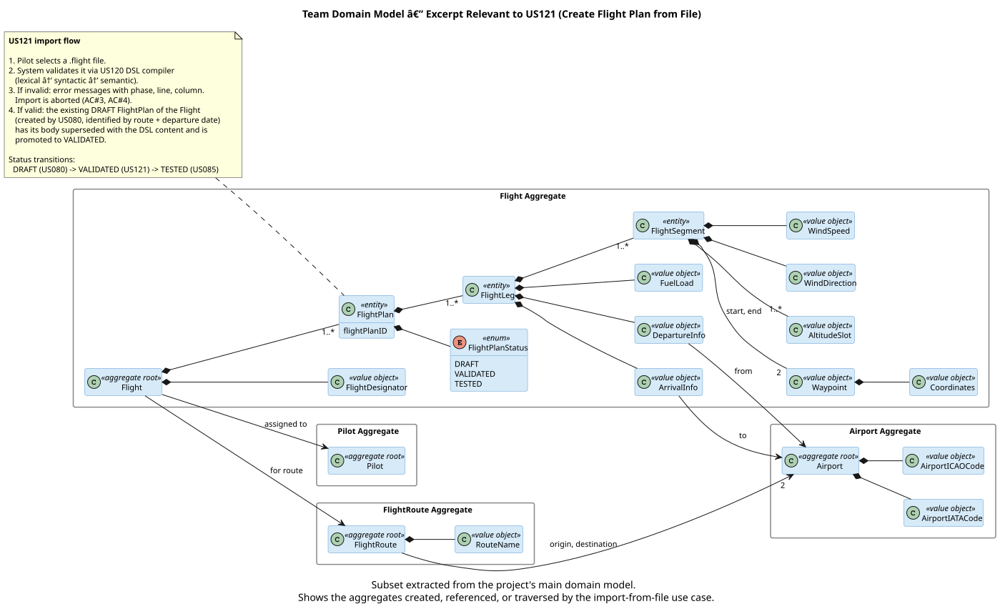
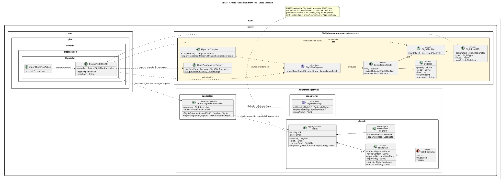
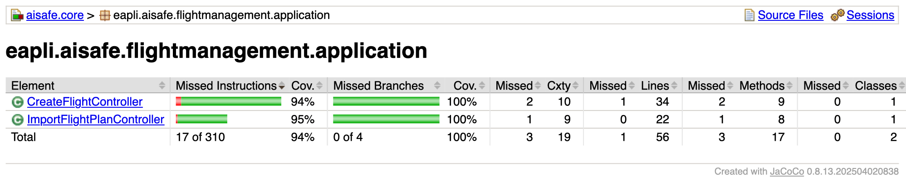
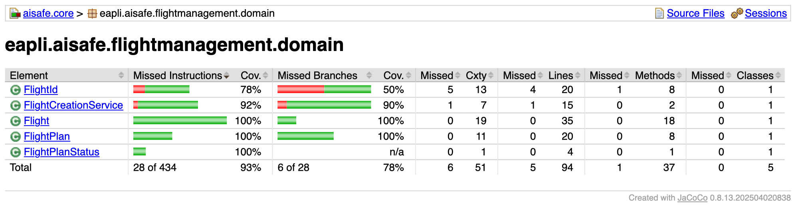

# US 121 - Create a flight plan from a file

## Context

First introduced in Sprint 3. A Pilot points the console at a flight plan file; the system validates it through the US120 DSL compiler and, if valid, attaches its content to one of the pilot's existing flights, promoting that flight's plan `DRAFT → VALIDATED`.

The flight must already exist: US080 creates the `Flight` with an empty `DRAFT` `FlightPlan` (no DSL validation at that stage). US121 only enriches and promotes that draft; it never creates a flight. It supersedes the Sprint 2 US081 import-from-file story (documented separately), which modelled the import as *creating* a flight-plan aggregate keyed by the file's designator — overturned by the US080 decision that `Flight` is the aggregate root and `FlightPlan` an entity inside it.

## Requirements

**US 121** — *As a Pilot, I want to create a valid flight plan from a file. There may be multiple file formats, and I want the file format to be validated before use.*

**Acceptance Criteria:**

- **US121.1** The file must conform to the Flight DSL.
- **US121.2** The file must be validated through lexical, syntactic, and semantic analysis.
- **US121.3** Invalid files must produce meaningful error messages (type, line, column).
- **US121.4** Only valid flight plans may be imported and used by the system.
- **US121.5** Multiple file formats can be supported and validated before use.

**Definition of Done:**

- File import implemented end-to-end (pilot console → controller → `Flight` aggregate).
- US120 validation pipeline integrated; only valid files are imported.
- Validated DSL content installed as the flight's `VALIDATED` plan. A first import promotes US080's empty `DRAFT`; a **re-import supersedes**: the previously-validated plan is demoted to `DRAFT` (keeping its body as a revision) and the new content becomes the single `VALIDATED` plan.
- Import rejected when the flight does not exist or is owned by another pilot.
- Coverage ≥ 90% on controller/domain (see §5.1).

**Dependencies:**

| Relation | Item | Nature |
|---|---|---|
| Producer | **US120** Flight DSL specification & validation | Provides the compiler; US121 delegates all lexical/syntactic/semantic validation to it. |
| Prerequisite | **US080** Create a flight plan | Creates the `Flight` (identity: route + departure date) and its initial `DRAFT` plan. US121 requires it to exist. |
| Superseded | **US081** Create Flight Plan from File | Sprint 2 create-on-import model, replaced — creation now belongs to US080. |
| Future consumer | **US085** Test/validate flight plan | Re-parses the stored DSL to run the simulation test. |

## Analysis

US121 sits between the DSL layer (US120) and the persistence layer. The system stores the file's **raw DSL content** as a LOB on the existing draft (with `importedAt`/`importedBy` for audit) rather than a mapped entity graph, so the original authoring intent is preserved and later stories (US085) can re-parse on demand.

### Locating the target flight

The pilot selects one of **their own** flights (created by US080) as the import target — the system does not derive it from the file. The controller exposes `flightsOfAuthenticatedPilot()`; the UI lists those flights and the pilot picks one. `importFlightPlan(FlightId, rawContent)` then loads that flight, **enforces that the authenticated pilot owns it**, and installs the content as the flight's `VALIDATED` plan. On a **re-import** (the flight already has a `VALIDATED` plan), that plan is demoted back to `DRAFT` — keeping its body as a superseded revision — and the new content is imported into a fresh plan, so the newest import is always the single `VALIDATED` plan (invariant: at most one `VALIDATED` at a time). Import is rejected if the flight does not exist or is owned by another pilot.

The plan list of a flight evolves like this (`*` marks the current plan — the one `currentPlan()` returns):

| Step | Plans (oldest → newest) |
|---|---|
| US080 creates the flight | `[DRAFT*]` (empty body) |
| Import v1 | `[VALIDATED*(v1)]` — empty draft superseded & promoted |
| Re-import v2 | `[DRAFT(v1), VALIDATED*(v2)]` — v1 demoted (keeps its body), v2 the single VALIDATED |
| Re-import v3 | `[DRAFT(v1), DRAFT(v2), VALIDATED*(v3)]` |

At every step exactly one plan is `VALIDATED`, and the plan count grows by one per re-import.

### Domain model excerpt

`Flight` is the aggregate root owning its `FlightPlan` entities (each with a `FlightPlanStatus`); US121 operates on an existing `DRAFT` plan inside that aggregate.



## Design

The use case follows the three-layer architecture (presentation → application → domain/persistence). Key decisions:

- **DSL validation runs in the console adapter, not the controller.** The adapter invokes the US120 compiler and passes the controller only validated raw content. This keeps ANTLR/DSL types out of the application layer and avoids a `core → flightplandsl` dependency; the same controller is reused unchanged by other adapters (e.g. the planned US086 TCP client).
- **Pilot selects the target flight; ownership is enforced.** `flightsOfAuthenticatedPilot()` provides the choices; `importFlightPlan` rejects a flight the session pilot does not own.
- **Raw DSL stored as a LOB on the inner entity.** `FlightPlan` holds `rawDslContent`, `importedAt`, `importedBy`. It is an entity inside the `Flight` aggregate (identity route + departure date), not a root.
- **One validated plan per file.** A file describing several flights is rejected with a clear message.
- **Re-import supersedes; ≤1 VALIDATED at a time.** Importing into a flight that already has a `VALIDATED` plan demotes that plan to `DRAFT` (it keeps its body as a revision) and installs the new content as the single `VALIDATED` plan. The previously-validated plan is preserved as a `DRAFT` revision rather than discarded; the "at most one VALIDATED plan" invariant lives in the `Flight` aggregate.
- **Creation lives in US080.** US121 never creates a `Flight` (it may add a new `FlightPlan` revision on re-import, but never a new flight).

### Realization



### Acceptance tests

DSL-level validation (lexical/syntactic/semantic and error messages — AC US121.1–.3, .5) is covered by the US120 module suite (`LexerTest`, `ParserTest`, `SemanticValidatorTest` and the `invalid_*.flight` resources). The application-level behaviour is covered by `ImportFlightPlanControllerTest`:

| Test | Asserts | AC |
|---|---|---|
| `ensureValidImportSupersedesDraftAndPromotesItToValidated` | valid content is stored and the plan goes `DRAFT → VALIDATED` | US121.4 |
| `ensureImportIsRejectedWhenNoMatchingFlightExists` | rejects import with no target flight (US080 prerequisite) | US121.4 |
| `ensureImportIsRejectedForEmptyContent` | rejects empty content | US121.4 |
| `ensureReimportSupersedesAndDemotesThePreviousValidatedPlan` | re-import installs the new `VALIDATED` plan and demotes the previous one to `DRAFT` (plan count grows) | US121.4 |
| `ensureImportRequiresPilotRole` | non-pilots are denied | US121.4 |
| `ensureImportIsRejectedForAFlightOwnedByAnotherPilot` | a pilot cannot import into another pilot's flight | US121.4 |
| `ensureFlightsOfAuthenticatedPilotReturnsOnlyOwnFlights` | selection lists only the session pilot's flights | US121.4 |

```java
@Test
public void ensureValidImportSupersedesDraftAndPromotesItToValidated() {
    givenDraftFlight(TP123, MAY_20);                       // created by US080
    final Flight flight = controller.importFlightPlan(new FlightId(TP123, MAY_20), DSL);
    assertEquals(FlightPlanStatus.VALIDATED, flight.currentPlan().status());
    assertEquals(DSL, flight.currentPlan().rawDslContent());
}
```

## Implementation

### Test coverage (JaCoCo)

Generated by `mvn test` (JaCoCo bound to the `test` phase); report at `aisafe.core/target/site/jacoco/index.html`.

All US121 controller/domain classes meet NFR03 (≥ 90%). The only uncovered instructions are the unreachable "no active session" guard inside the controller.





## Integration/Demonstration

US121 integrates US080 (the flight and its `DRAFT` plan) and US120 (DSL validation). Demonstrated against the shared database from the pilot console (`./run-pilot.sh`):

- Logged in as the seeded pilot `ruipedro` / `Password1` (registered by `PilotBootstrapper`), owner of flight `FR401` (route OPO→LIS, aircraft `CS-TNA`, an A320neo). The bootstrap (`FlightBootstrapper`) leaves this flight as a fresh `DRAFT` for the demo.
- Chose *Import Flight Plan from File*; the menu listed only that pilot's own flights, and `FR401` was selected.
- Imported `docs/sprint-3/samples/FR401-OPO-LIS.flight` (OPO→LIS).
- The file passed US120 validation and the plan was promoted **DRAFT → VALIDATED**.

## Observations

The controller is the single point through which the domain operation is performed, so a future US086 TCP client reaches it without duplicating orchestration: the TCP adapter validates the incoming DSL through the same compiler and calls the same `ImportFlightPlanController`. Only the transport differs between adapters.
