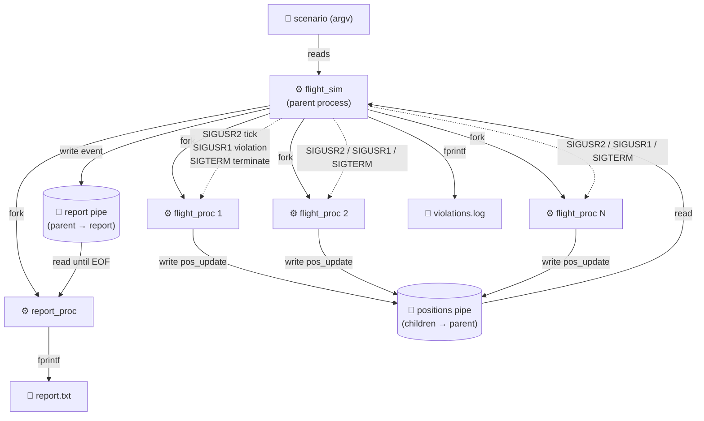

# Flight Simulation SCOMP Component

C implementation of the air-traffic simulation component using processes,
pipes and signals. Covers user stories US100, US101, US102, US103 and US109
in the sprint-2 scope.

---

## Build & Run

```bash
make                  # builds ./flight_sim
make run-clean        # 3 flights, no expected violations
make run-violation    # 3 flights, pair violates the cylinder threshold
make run-threshold    # 3 flights, first violation triggers early termination
make clean            # removes binaries and generated artifacts
```

The binary takes a single optional CLI argument selecting one of the built-in
scenarios (`clean`, `violation`, `threshold`); defaults to `clean`.

Compile flags: `-Wall -g -D_POSIX_C_SOURCE=200809L`, linked against `-lm`.

---

## Component Diagram



**Process count at steady state:** parent + 1 report process + N flight
processes (verifiable with `pstree -p`).

**Files produced per run:** `report.txt` (final aggregated report) and
`violations.log` (incremental violation log written during the simulation).

---

## File layout

| File              | Responsibility                                             |
| ----------------- | ---------------------------------------------------------- |
| `flight_sim.c`    | `main`, fork orchestration, simulation loop, status mapping |
| `flight_proc.c`   | Flight child process: signal handlers, tick wait, position write |
| `violation.c`     | Cylinder check, signal dispatch, anti-spam, event emission |
| `report_proc.c`   | Report child process, I/O helpers, file output             |
| `config.c`        | Scenario loading, parameter validation                     |
| `types.h`         | Shared structs, enums, constants and function prototypes   |

---

## US100 — Simulate Flights in an Area

### Approach

The parent reads parameters from the selected scenario, runs `validate_config`
to reject malformed input **before any fork**, then creates two pipes
(positions and report) and forks the report process and N flight processes.
Each flight child knows its identity via the `flight_t` struct passed at fork
time. The parent maintains a `pid_t pids[MAX_FLIGHTS]` array so that signals
can later be addressed to specific children. All children are reaped via
`waitpid` at the end of the run.

Parameter validation covers: flight count bounds, total-step bounds (capped
by `HISTORY_SIZE`), non-negative violation threshold, geographic area
consistency, positive safety thresholds, unique flight IDs, non-zero
velocity vectors, and initial positions inside the configured area.

### Implemented

- Parameter validation rejects invalid input with clear `stderr` messages and
  a non-zero exit code before any fork.
- One process per flight via `fork`, with PID tracking in the parent.
- Both pipes are created before any fork so all relevant children inherit the
  descriptors.
- Signal handlers (`SIGUSR1`, `SIGUSR2`, `SIGTERM`) installed in every flight
  child with `sigfillset(&act.sa_mask)`.
- Position tracking implemented via a `latest[]` snapshot plus
  `history[][]` matrix retained by the parent.
### Not implemented (intentional sprint-2 scope)

- Actual JSON parsing — `load_config_from_json` is named for the eventual
  LPROG integration boundary but currently dispatches built-in scenarios by
  name. Documented in the *Outliers* note that accompanies this deliverable.
### Observations

**Use of `_exit()` instead of `exit()` in forked children.** Every flight
child and the report child terminate via `_exit()`. The lecture examples
generally use `exit()`. The deviation is deliberate: after `fork()`, the
child inherits the parent's stdio buffers, and calling `exit()` would flush
those buffers a second time and run any inherited `atexit` handlers,
producing duplicate output and unintended side effects.

The Linux man page for `_exit(2)` states it
does not call any functions registered with atexit(3) or on_exit(3),
and that open stdio streams are not flushed — which is exactly the property
needed in a forked child. The same recommendation is given in the
`fork(2)` man page (OpenBSD wording): the child process should call
`_exit(2)` rather than `exit(3)` to avoid stdio buffers being flushed twice.

References: `man 2 _exit`, `man 2 fork`.


---

## US101 — Capture and Process Flight Movements

### Approach

Flight children write fixed-size `position_update_t` records to a single
shared positions pipe; the parent reads them. Each record carries
`flight_index` (internal array slot) and `flight_id` (external identifier)
plus the current step, position and velocity vector. The parent maintains
both a `latest[]` array for the active step and a `history[][]` matrix
indexed by `flight_index` and `step` so that violation detection can later
consult past positions.

Because `sizeof(position_update_t)` is comfortably below `PIPE_BUF`, every
`write` from a flight child is atomic and interleaves cleanly with writes
from siblings.

### Implemented

- Per-step position updates pushed by every flight child via the shared
  pipe.
- Demultiplexing by `flight_index` in the parent.
- Full read/write helpers (`read_full`, `write_full`) that retry on `EINTR`
  and short reads to guarantee complete record transfer.
- Full history retention in `history[MAX_FLIGHTS][HISTORY_SIZE]`.
### Not implemented (intentional sprint-2 scope)

- Predictive violation detection using `history[][]`. The data structure is
  populated and available; the current US102 check inspects only the latest
  step. Marked as future work.
### Observations

**`EINTR` retry loop inside `read_full` and `write_full`.** The flight
signal handlers in `flight_proc.c` are installed *without* `SA_RESTART`.
Per the Linux `signal(7)` man page, when a blocking system call is
interrupted by a signal handler, the call is either automatically restarted
(only if `SA_RESTART` was set) or the call fails with the error
`EINTR`. Because the handlers in this project intentionally do not set
`SA_RESTART` (the lecture style uses bare handlers), every `read` / `write`
in the pipe path can legitimately return `-1` with `errno == EINTR` after a
`SIGUSR2` tick or a `SIGUSR1` violation. The retry loop in the helpers
exists for that reason — without it, a perfectly valid signal-driven
interruption would surface to callers as an I/O failure.

The same helpers also handle short reads/writes (partial transfers below
the requested size). Although TP5 notes that writes ≤ `PIPE_BUF` are
atomic on Linux, `read()` is not guaranteed to return the full requested
size in a single call when interrupted; the retry loop guarantees a
complete record is transferred or a definitive error is reported.

Reference: `man 7 signal`, section *Interruption of system calls and
library functions by signal handlers*.


---

## US102 — Detect Aircraft Safety Violations

### Approach

After each step's full set of position updates is collected, the parent runs
`check_violations` over every unordered pair. A violation is defined by the
cylinder model: horizontal distance below `params.h_min` **and** vertical
distance below `params.v_min`. On a rising edge (first detection for a pair),
the parent logs to `violations.log`, sends `SIGUSR1` to both involved flights,
forwards a structured `EV_VIOLATION` event to the report process, and
increments the violation counter. If the counter exceeds
`params.max_violations`, the parent sends `SIGTERM` to all flights to trigger
early termination.

A `notified[i][j]` matrix tracks per-pair edge state so that flights
remaining inside the cylinder across multiple steps do not generate duplicate
SIGUSR1 deliveries or duplicate violation counts. The pair re-arms once the
flights separate again.

Each flight installs signal handlers with `sa_mask = sigfillset()` so that
during handling of `SIGUSR1` (or `SIGTERM`) every other signal is blocked
(US102 AC4). The `SIGUSR1` handler uses `write(STDOUT_FILENO, ...)` instead
of `printf` to stay async-signal-safe. The `SIGTERM` handler only flips a
`time_to_go` flag; the actual cleanup happens in the main flight loop after
the suspend returns, where `close(write_fd)` runs before `_exit`.

### Implemented

- Cylinder-model detection using the validated `h_min`/`v_min` thresholds.
- Rising-edge anti-spam matrix.
- Targeted `SIGUSR1` to the involved pair plus `SIGTERM` broadcast on
  threshold breach.
- Async-signal-safe handlers with full mask during execution.
- Clean child-side cleanup (pipe close before `_exit`) on `SIGTERM`.
- Distinct child exit codes for clean completion vs `SIGTERM`-triggered
  termination vs write errors, so the parent can map outcomes precisely.
### Not implemented (intentional sprint-2 scope)

- Velocity-projected predictive detection.
- Same-route segment-line distance check.

---

## US103 — Synchronize Flight Execution with Time Step

### Approach

The parent drives the simulation step by step. For each step it sends
`SIGUSR2` to every flight child (the "tick"), then performs N blocking reads
from the positions pipe. The N-read loop **is** the barrier — the parent
cannot proceed to step N+1 until every flight has written its update for
step N.

Each flight child waits for the tick using `sigsuspend(&empty_mask)` rather
than `pause()`. `sigsuspend` atomically swaps the signal mask and suspends,
which closes the check-then-act race window where a signal could otherwise
arrive between the flag test and the call to `pause`. The TP3 lecture notes
explicitly recommend `sigsuspend` for this scenario.

To prevent the first `SIGUSR2` from being lost in the window between fork
and `install_handlers`, the parent blocks `SIGUSR2` *before* forking the
flight children, then restores its own mask after the fork loop completes.
Children inherit the blocked mask; any tick sent before they install their
handler stays pending and is delivered the moment they enter their first
`sigsuspend(&empty_mask)`.

### Implemented

- Lockstep tick-and-collect loop in the parent.
- N-read pipe barrier guaranteeing all step-N updates arrive before step-N+1.
- `sigsuspend` for race-free signal waiting in children.
- Pre-fork signal masking to eliminate the fork/handler-install race.
### Not implemented (intentional sprint-2 scope)

- Semaphore-based or condition-variable-based synchronization (US108+ scope).
### Observations

**Pre-blocking `SIGUSR2` in the parent before forking flight children.**
The lecture material (TP4) covers `sigprocmask` and signal masks but does
not explicitly walk through the pattern used here: block the tick signal
in the parent **before** `fork()` so that every flight child inherits it
blocked. The `sigprocmask(2)` man page is explicit on the inheritance
mechanism: a child created via `fork(2)` inherits a copy of its parent's
signal mask.

This closes a narrow but real race window. Between the moment a flight
child returns from `fork()` and the moment it calls `install_handlers()`,
the default disposition for `SIGUSR2` is termination. If the parent were
to dispatch the first tick during that window, the child would die instead
of handling the signal. By pre-blocking `SIGUSR2`, any tick sent in that
window is held pending in the child until the first `sigsuspend(&empty_mask)`
in the flight loop, where it is delivered safely to the now-installed
handler. The parent restores its own mask immediately after the fork loop
completes.

Reference: `man 2 sigprocmask`, section *NOTES*.

## US109 — Generate and Store Final Simulation Report

### Approach

Aggregation runs in a dedicated forked **process** (not a thread — threads
are US105+ scope). The report process is created before the flight children
and connected to the parent through a unidirectional pipe. The parent
streams structured events to the report process throughout the run:

- `EV_METADATA` at start (parameters, scenario name, run timestamp).
- `EV_VIOLATION` on every rising-edge detection.
- `EV_FLIGHT_STATUS` after each `waitpid` resolves a flight exit.
- `EV_SIM_END` carrying the final end reason and counters.
  Events travel as a fixed-size tagged union (`report_event_t`), well below
  `PIPE_BUF`, so writes are atomic. At the end of the simulation the parent
  closes its write end of the report pipe. The report process then reads to
  EOF, sorts the accumulated events, computes the validation verdict, and
  writes the final `report.txt`. The parent `waitpid`s the report process
  last, guaranteeing the file is fully flushed before the program exits.

The report file uses a deterministic, parseable format: key=value metadata
followed by `[flight_statuses]` and `[violations]` CSV-style sections.

### Implemented

- Dedicated report process forked before flight children.
- Tagged-union event protocol over a dedicated pipe.
- EOF-driven shutdown with sentinel `EV_SIM_END` event for explicit semantics.
- All required content: total flight count, per-flight outcomes (with
  `completed` / `aborted` / `terminated_due_to_violation` / `crashed`
  distinction), violation events with timestamps, positions and velocity
  vectors, end reason, and final PASS/FAIL verdict.
- Dynamic in-memory buffers (doubling growth) so report size scales with
  run length.
### Not implemented (intentional sprint-2 scope)

- Threaded report generator (US106 — out of scope).
- Shared-memory-backed event delivery (US105 — out of scope).
- Machine-readable JSON/XML alternative format.
### Observations

**`localtime_r()` instead of `localtime()` for the run timestamp.** The
lecture material treats `localtime()` as the canonical conversion function.
The `localtime_r(3)` man page documents the difference: it is the
thread-safe reentrant variant, returning values in a user-supplied buffer
rather than the static data area that may be overwritten by subsequent
calls. The non-reentrant `localtime()` keeps results in a process-wide
static buffer, which would not be a problem for this single-threaded code
today, but using the reentrant form costs nothing, is the recommended
practice in any program that uses signal handlers, and survives the
sprint-3 refactor to threads without changes.

Reference: `man 3 localtime_r`, section *NOTES — Thread safety*.

**Dynamic event buffers with doubling growth strategy.** The report
process accumulates `EV_VIOLATION` and `EV_FLIGHT_STATUS` records in
dynamically grown arrays (`new_capacity = old_capacity == 0 ? 32 :
old_capacity * 2`). The `realloc(3)` man page describes the underlying
mechanism — `realloc()` resizes the memory block while preserving existing
contents up to the smaller of the old and new sizes — which is exactly the
behaviour needed for an append-only event log of unknown final length.

The doubling strategy itself is the standard amortised-`O(1)` growth
pattern used by `std::vector` in C++, `ArrayList` in Java, slices in Go,
and `list` in Python; the lecture material works with fixed-size arrays
only, so a brief note is included here to flag the deviation.

Reference: `man 3 realloc`.

**Sending `EV_SIM_END` before closing the report pipe.** This is the only
design choice in US109 that is not directly grounded in a man page. TP5/TP6
cover the standard EOF-driven shutdown pattern: the producer closes the
write end, the consumer's `read()` returns `0`, the consumer finalises and
exits. That same mechanism is used here — closing `report_fd[1]` in the
parent is what triggers the report file to be written. The added
`EV_SIM_END` event is a structured record sent **immediately before** that
close, carrying the final end reason (`normal`, `threshold_exceeded`,
`position_read_error`), the number of completed steps, and the final
violation count. Without it, the report process can detect that the
simulation ended (via EOF) but cannot distinguish a normal completion from
an early termination caused by threshold breach. The choice does not
break the lecture-aligned EOF protocol — it layers richer semantics on top
of it, using the same atomic-write pipe discipline established for the
other event types.
