# Flight Simulation SCOMP Component — Sprint 3

C implementation of the air-traffic simulation component using processes,
pipes, signals, threads and shared memory. Sprint 3 builds on the sprint-2
user stories and covers US105, US106, US107, US108, US109 and US110.

---

## Build & Run

```bash
make                  # builds ./flight_sim
make run-clean        # 3 flights, no expected violations
make run-violation    # 3 flights, pair violates the safety distance
make run-threshold    # 3 flights, first violation triggers sim termination
make clean            
```

The binary takes a single optional CLI argument: the path to a scenario JSON
file (`clean.json`, `violation.json`, `threshold.json`); defaults to
`clean.json`.

Compile flags: `-Wall -Wextra -g -std=c99 -D_DEFAULT_SOURCE`, linked against `-lm -pthread` (and `-lrt` on Linux). Strict C99 is kept; the POSIX functions (`shm_open`, `ftruncate`, named semaphores) are enabled explicitly with `_POSIX_C_SOURCE 200809L` (in `types.h`) and `-D_DEFAULT_SOURCE`, not GNU extensions.

---

## Component Diagram

```mermaid
flowchart TB
    JSON["📄 scenario JSON<br/>(clean / violation / threshold)"] -->|load + validate| Main

    subgraph Parent ["⚙️ flight_sim — parent process"]
        direction TB
        Main["main()<br/>fork orchestration + sim loop"]

        subgraph PThreads ["parent threads (pthread)"]
            direction LR
            TM["🧵 monitor_thread<br/>(live positions)"]
            TE["🧵 environment_thread<br/>(wind generation)"]
            TD["🧵 violation_detection_thread"]
            TR["🧵 report_generation_thread"]
            TC["🧵 control_thread<br/>(final confirmation)"]
        end

        Queue[("📥 report_queue_t<br/>mutex + condvar")]
        GC[("g_mutex / g_cond")]

        Main --- PThreads
        TD -->|enqueue<br/>violation event| Queue
        Main -->|enqueue metadata,<br/>statuses, sim_end| Queue
        Queue -->|dequeue| TR
        Main -.->|cond_broadcast<br/>on shutdown| GC
        GC -.->|cond_wait| TC
    end

    subgraph IPC ["🔗 POSIX IPC (created before fork)"]
        direction TB
        SHM[("📦 /aisafe_shm<br/>SharedData<br/>• flights&#91;&#93; pos / prev / vel / active<br/>• env (wind speed/dir)<br/>• simulation_running")]
        SemMutex["🚦 /aisafe_sem_mutex (1)<br/>shm write mutex"]
        SemTick["🚦 /aisafe_sem_tick_0..N−1 (0)<br/>per-step gate (one per flight)"]
        SemDone["🚦 /aisafe_sem_done (0)<br/>per-step ack"]
        SemBarrier["🚦 /aisafe_sem_barrier (0)<br/>end-of-run barrier"]
        SemNproc["🚦 /aisafe_sem_nproc (1)<br/>barrier counter"]
    end

    F["⚙️ flight_proc × N<br/>(forked children)"]
    PosPipe[("🔀 positions pipe")]

    Main -->|fork × N| F
    Main -.->|SIGTERM on threshold| F

    Main -->|sem_post on each<br/>sem_tick&#91;i&#93; per step| SemTick
    SemTick -->|sem_wait on<br/>own sem_tick&#91;i&#93;| F
    F -->|sem_post<br/>after write| SemDone
    SemDone -->|wait N tokens| Main

    F -->|position_update_t| PosPipe
    PosPipe -->|read N records| Main

    F <-->|write under mutex| SemMutex
    SemMutex -.- SHM

    F -->|position / prev / vel| SHM
    TE -->|wind speed + direction| SHM
    TM -.->|read flights| SHM
    TD -.->|read flights + env| SHM

    F -.->|end-of-run<br/>cascade barrier| SemBarrier
    SemNproc -.- SemBarrier

    TR -->|append on detect| ViolLog["📄 violations.log"]
    TR -->|flush at end| Report["📄 report.txt"]
```



**Process count at steady state:** parent (with 5 threads) + N flight processes
(verifiable with `pstree -p`). Unlike sprint-2, the report process is no longer
forked — its responsibility moved to `report_generation_thread`.

**Files produced per run:** `report.txt` (final aggregated report, written by the
report thread after the queue is closed) and `violations.log` (incremental
violation log written by the report thread as events are dequeued).

---

## File layout

| File              | Responsibility                                                                 |
| ----------------- |--------------------------------------------------------------------------------|
| `flight_sim.c`    | `main`, fork orchestration, simulation loop, status mapping                    |
| `flight_proc.c`   | Flight child process: signal handlers, tick wait, movement/write               |
| `violation.c`     | Mid-step closest-approach check, signal dispatch, event emission               |
| `report_proc.c`   | Report child process, I/O helpers, file output                                 |
| `config.c`        | Defaults, JSON orchestration, coordinate projection, validation                |
| `json.c` / `json.h`     | JSON scenario parser (sim params, profiles, segments)                          |
| `movement.c` / `movement.h` | Kinematics: lat/lon projection, profile lookup, per-step advance               |
| `types.h`         | Shared structs, enums, constants, POSIX resource names and function prototypes |
| `clean.json` / `violation.json` / `threshold.json` | Scenario input files                                                           |
| `detection_thread.c` / `detection_thread.h` | US106/107 violation detection thread                                           |
| `report_thread.c` / `report_thread.h` | US106/107 report thread and event queue                                        |
---

## Sprint 2 feedback updates

- Scenarios now come from JSON files instead of being hardcoded in `config.c`.
- Flights follow a real route: `movement.c` moves them along segments using
  speed/rate tables, instead of a fixed `x += vx` step.
- Routes use latitude/longitude, converted to x/y metres on load; `movement.c`
  also has a haversine function for great-circle distance.
- History keeps only the last few defined steps, instead of hardcoded 600.
- The violation check now uses the closest point between two steps, so fast
  crossings are not missed.
- Cleaned up dead code in `flight_sim.c`.
- Flights now have an arrived state: on reaching the last waypoint a flight stops
  and is marked inactive, so it is no longer collision-checked. 
- Flights can enter the area at different steps via an `EntryStep` field, instead
  of all starting at step 0.
- Added altitude checks: a flight above the area ceiling or below the area floor
  is reported as a new kind of violation, separate from two flights getting too
  close.
- Added a console heads-up that predicts a conflict a few steps before it
  happens, from each flight's current speed and heading.
- Raised the flight limit to 512. The JSON read buffer was raised so larger scenario files load fully.

---

## US105 — Initialize hybrid simulation environment with shared memory

### Approach

The existing sprint-2 simulation (processes + pipes + signals) was extended with
POSIX shared memory and named semaphores for real-time IPC, and with two
dedicated parent threads (monitor and control) to fulfil the hybrid
multi-threaded/multi-process model required by the acceptance criteria.
All new IPC resources use a `/aisafe_*` namespace and are created before any
`fork()` call so that child processes can open them by name.

### Implemented

- **Shared memory** (`/aisafe_shm`): `SharedData` struct (declared in `types.h`)
  holds one `shm_flight_t` slot per flight (position, step, active flag).
  Created with `shm_open` + `ftruncate` + `mmap` in `main()` before `fork_flights()`;
  destroyed with `munmap` → `close` → `shm_unlink` after all children finish.

- **Named semaphores** (AC4):
  - `/aisafe_sem_mutex` (init=1): mutual exclusion around each `shm->flights[i]`
    write inside `flight_process()`.
  - `/aisafe_sem_barrier` (init=0) + `/aisafe_sem_nproc` (init=1): end-of-run
    barrier in `flight_process()` — all flight processes wait here until the last
    one arrives, then cascade-release.

- **Parent threads** (AC1): two threads created with `pthread_create` in `main()`
  before the fork loop:
  - `monitor_thread`: reads `shm->flights[]` every second and prints live
    positions to stdout; exits when `shm->simulation_running` becomes 0. It
    emits one line per flight with a single `write()` each, so a flight's line
    is not split by other threads' output, and tags each flight `ATIVO` or
    `INATIVO`.
  - `control_thread`: blocks on `pthread_cond_wait` (inside a `while` loop as
    required by TP12) until the main thread broadcasts after all `waitpid` calls
    return; prints final confirmation and exits.

- **Mutex + condition variable** (AC5): `pthread_mutex_t g_mutex` /
  `pthread_cond_t g_cond` (static initialisers) used by `control_thread` and
  signalled by `main` via `pthread_cond_broadcast`.

- **Signals** (AC5): SIGUSR1, SIGUSR2 and SIGTERM handlers already present from
  sprint 2 in `flight_proc.c`; unchanged.

- **Compile flags**: `-pthread` added to `Makefile`; `-lrt` added conditionally
  for Linux (`glibc < 2.17`).

### Not implemented (intentional sprint-3 scope)

- Shared memory is used for live monitoring only; the authoritative position
  stream for violation detection still goes through the existing pipe to
  `main_loop`, as redesigning that path is out of scope for US105.

### Observations

- `write(STDOUT_FILENO, …)` is used instead of `printf` inside both threads and
  inside the fork loop in `main()`, following TP11 p.17 (thread-safe I/O).
- All POSIX resources (`shm_unlink`, `sem_unlink`) are removed unconditionally at
  startup to handle leftover state from a previous crashed run.

---

## US106 — Implement function-specific threads in the parent process

### Approach

For this user story, the goal was to add function-specific threads to the parent
process without changing the shared memory and semaphore logic already
implemented in US105.

The existing shared memory, named semaphores, flight process barrier,
`monitor_thread` and `control_thread` were kept. The main change was to add two
new parent threads:

* one thread for detecting safety violations;
* one thread for generating the report.

The violation detection thread is notified when a simulation step is complete.
It then reads the flight data from shared memory and checks if any pair of
flights is in conflict.

The report thread waits for events produced by the detection thread. The
communication between these two threads is done with a shared event queue,
protected by a mutex and a condition variable.

### Implemented

* Added a `violation_detection_thread` in the parent process.
* Added a `report_generation_thread` in the parent process.
* Added `detection_thread.c` / `detection_thread.h` to keep the detection thread
  logic separate from `flight_sim.c`.
* Added `report_thread.c` / `report_thread.h` to keep the report thread and event
  queue logic separate from `flight_sim.c`.
* Extended `shm_flight_t` with previous position and velocity fields:

    * `prev_x`, `prev_y`, `prev_alt`;
    * `vx`, `vy`, `vz`.
* Updated `flight_proc.c` so each flight process writes these new values to
  shared memory.
* Kept the existing `SEM_MUTEX` protection when writing and reading shared
  memory.
* Changed the main loop so it no longer calls the violation check directly.
  Instead, it signals the detection thread when a step is ready.
* Added a mutex and condition variable so the detection thread can notify the
  report thread when a violation event is available.
* Added shutdown signalling so both new threads finish correctly before the
  parent process cleans up the IPC resources.
* Kept `report_proc.c` in the project, but the report for this flow is now
  generated by the report thread, avoiding two processes/threads writing the
  same files at the same time.

### Not implemented

* The US105 semaphore/barrier implementation was not redesigned.
* The flight movement logic was not changed.
* The JSON loading/validation was not changed.
* `report_proc.c` was not deleted, because it was safer to leave the old code in
  the project instead of removing it as part of this user story.

### Observations

The main concern in this implementation was to avoid breaking US105. For that
reason, the shared memory and semaphore logic were reused instead of replaced.

Semaphores are still used for synchronization between processes. Mutexes and
condition variables are used only between threads inside the parent process.

Another important point was to avoid deadlocks. The condition variables are used
with state flags and `while` loops around `pthread_cond_wait`.

It was also necessary to make sure that only the report thread writes the report
files in the US106 flow, so that the old report process and the new report
thread do not write the same file at the same time.


---

## US107 — Notify report thread via condition variables upon safety violation detection

### Approach

The goal was to make the `violation_detection_thread` notify the
`report_generation_thread` in real time whenever a safety violation is detected,
using a condition variable — without polling or busy-waiting. The communication
channel is the existing `report_queue_t` (a mutex-protected linked list with a
condition variable), introduced in US106.

### Implemented

- **Detection → report handoff** (`report_thread.c`, `enqueue_report_event`):
  when the detection thread finds a conflicting pair of flights, it calls
  `enqueue_report_event()`, which:
  1. acquires `queue->mutex`
  2. appends the violation event to the linked list (state mutated **before**
     signalling — the "publish then signal" rule that prevents lost wakeups)
  3. calls `pthread_cond_signal(&queue->cond)` while still holding the mutex
  4. releases `queue->mutex`
- **Report thread consumer** (`report_thread.c`, `dequeue_report_event`):
  the report thread blocks in `pthread_cond_wait(&queue->cond, &queue->mutex)`
  inside a `while (head == NULL && !done)` loop. The `while` guard protects
  against spurious wakeups: even if the thread wakes for any other reason, it
  re-tests the predicate before consuming an event. On a real wakeup it
  dequeues the event, logs it to `violations.log` immediately, and accumulates
  it for the final report.
- **Signal blocking in flight processes** (`flight_proc.c`, `install_handlers`):
  the SIGUSR1 handler (`handle_violation`) is registered with `sigfillset` on
  `sa_mask`, so all other signals are blocked for the duration of the handler —
  preventing nested signal delivery as required by the acceptance criteria.
- **Clean shutdown**: `report_queue_finish()` sets `done = 1` and calls
  `pthread_cond_broadcast()` so the report thread always exits its wait loop
  cleanly, even if no violations were detected.

### Not implemented (intentional sprint-3 scope)

- The detection thread does not directly call `pthread_cond_signal` itself; the
  signal is issued inside `enqueue_report_event()`. This is intentional: keeping
  the condvar signal co-located with the state mutation (inside the queue
  function) is the safest pattern and avoids a class of lost-wakeup bugs.

### Observations

- The "publish then signal" rule (`pthread_cond_signal` called while holding the
  mutex, after mutating the shared state) is the key correctness property of
  this implementation. If the signal were sent before the enqueue, a consumer
  that woke early and found an empty queue would go back to sleep and miss the
  event.
- The `while` loop around `pthread_cond_wait` is mandatory. A spurious wakeup
  (which POSIX explicitly allows) must not cause the report thread to attempt
  consuming from an empty queue.

---

## US108 — Enforce step-by-step simulation synchronization

### Approach

The Sprint-2 tick mechanism (parent sends `SIGUSR2` to each flight child, child
waits via `sigsuspend`) was replaced with a semaphore-based per-step handshake.
Each flight has its own tick semaphore (`/aisafe_sem_tick_<i>`) and all flights
share one `/aisafe_sem_done`, all initialised to 0; together they advance the
simulation in strict lockstep.

### Implemented

- **`sem_tick[i]` (one per flight, init 0)** — per-step gate from parent to
  each flight:
  - Parent posts each flight's own tick at the start of every step.
  - Flight `i` calls `sem_wait(sem_tick[i])` at the top of its step loop, so one
    post wakes exactly that flight and no flight can take another's token.
- **`sem_done` (init 0)** — per-step acknowledgement from flights to parent:
  - Each flight child calls `sem_post(sem_done)` after writing its updated
    position to shared memory.
  - Parent collects N tokens via `sem_wait(sem_done)` after draining the pipe,
    implementing a counting barrier: the parent cannot advance to step k+1 until
    every flight has finished step k and written its shm state.
- **Reusability**: both counters return to 0 at the end of every step, so the
  handshake works identically for each step of the simulation (unlike a one-shot
  barrier).
- **EINTR-safe waits**: all `sem_wait` calls in `flight_proc.c` use a retry
  loop (`while (sem_wait(...) == -1 && errno == EINTR)`) so that signal delivery
  cannot interrupt a wait and corrupt the barrier counter.
- **Termination safety (check-then-block race fix)**: when the simulation ends
  early (threshold exceeded or read error), the parent:
  1. Sets `shm->simulation_running = 0` under `sem_mutex` (visible to all
     flight children via shared memory).
  2. Posts each flight's own tick once.
     Any flight blocked on its tick wakes, checks `!shm->simulation_running`,
     and breaks out of its step loop to reach the end-of-simulation barrier
     cleanly — no deadlock regardless of when `SIGTERM` is delivered relative to
     the semaphore wait. This closes the classic check-then-block race that
     POSIX `sem_wait` is otherwise vulnerable to.

### Not implemented (intentional sprint-3 scope)

- The end-of-simulation barrier (`sem_barrier` / `sem_nproc`) was not
  redesigned; it continues to operate as implemented in US105.

### Observations

- Each `sem_tick[i]` is an event-signal gate: init 0 means "no permission yet", and one `sem_post` grants one
  unit to that single flight — so a flight can never grab a token meant for
  another (the "one semaphore per process" idea). `sem_done` is the
  counting barrier: the parent collects N posts before advancing a step.
- The deadlock that motivated the termination-safety fix was observed and
  diagnosed during testing: with a 10 % hang rate on the threshold scenario,
  `/proc/<pid>/wchan` showed flight children stuck in `futex_do_wait` (inside
  `sem_wait`) while the parent was stuck in `do_wait` (inside `waitpid`). The
  root cause was `shm->nproc_at_barrier` reaching only 2 of 3 because one flight
  never left its tick wait after `SIGTERM` was delivered before `sem_wait` was
  entered.

---

## US109 — Generate and store final simulation report

### Approach

The final report is built by the report thread (`report_generation_thread` in
`report_thread.c`). During the run it receives events on the shared event queue
from US106/US107. When the simulation ends, the parent joins the detection
thread, waits on every flight to collect its exit status, then closes the queue.
Only after that does the report thread read all queued events, add up the
totals, and write the file. Writing after the producers are done means the
report never reads half-finished data.

### Implemented

- One report file (`report.txt`), written once at the end by the report thread.
- Header with report version, run timestamp, scenario name, total steps, total
  flights, separation limits, seconds per step, completed steps, end reason,
  violation count and the pass/fail result.
- Flight statuses section: one row per flight with its id, outcome (completed,
  terminated, aborted or crashed) and exit code.
- Violations section: one row per violation with the step, the flights involved,
  horizontal and vertical distance, and a position and velocity vector for each
  flight.
- A `violations.log` written line by line during the run, so there is still a
  record if the run is stopped early.

### Design notes

- **Timestamps.** Each violation row carries the simulation step. The clock time
  of a violation is `run_timestamp + step * seconds_per_step`, and both of those
  are in the header, so a reader can compute it. We did not add a separate time
  column, to keep the report small.
- **Pass/fail.** The run passes only when it ended normally, the violation count
  is within the allowed maximum, and every flight completed its route. Any other
  case fails.
- **Effect of the new altitude checks.** The violations section now ends with a
  `kind` column saying whether a row is a separation conflict between two flights
  or an altitude breach by one flight. An altitude row lists the same flight
  twice (`flight_2 = flight_1`), with horizontal distance 0 and vertical distance
  equal to how far past the limit it is. The earlier columns are unchanged, so
  the Java reader still works without changes.

### Not implemented (intentional sprint-3 scope)

- The report is a single plain text file; no other output format was added. Plain
  text was chosen because it is easy to read and easy for the Java app to parse.

### Observations

- The report is written only after the detection thread is joined and every
  flight has been waited on, so the totals and statuses are final before anything
  is written.
- The report thread is the only writer of the report files, so no locking around
  the file is needed.

---

## US110 — Integrate environmental influences into simulation

### Approach

An additional environment thread was introduced in the parent process to simulate
environmental influences such as wind.

The thread periodically generates wind speed and direction values and writes them
to the shared memory segment. This allows all processes and threads in the
simulation to access consistent environmental data.

The implementation reuses the existing shared memory and synchronization
mechanisms introduced in US105, ensuring minimal architectural disruption.
``

### Implemented

- Created a dedicated environment thread using pthread_create.
- Added an env_t structure (wind speed and direction) to the shared memory.
- Environment data is generated dynamically (random values) during runtime.
- Writes to shared memory are protected using the existing semaphore mutex.
- Integrated the environment thread into the parent process lifecycle,
  including proper thread creation and termination (pthread_join).

### Not implemented (intentional sprint-3 scope)

- Integration with an external weather service was not implemented.
- Environmental data is generated locally instead of being fetched remotely.
- Direct influence of wind on flight movement is not fully integrated into
  movement calculations.

### Observations

The implementation introduces minimal overhead while enhancing simulation realism.

The use of shared memory guarantees that all processes and threads can access
consistent environmental data.

The existing semaphore-based synchronization ensures that no race conditions
occur during shared memory updates.

The solution follows the same design pattern used for other threads in the system,
maintaining architectural consistency.
